# From SVG to G-code in the app

This chapter makes the coaster of
[Your first cut from an SVG](first-cut.md) again, this time in the
DreamCarve app: no command line, and no project file to edit by hand. The
coaster is a 90 mm circle cut out of plywood sold as 12 mm, held to the
board by four small **tabs** (bridges of uncut material) until you are
done.

You will open the drawing, type one measurement, make one tool, add one
operation and press **Export G-code**. After the coaster, three short
sections add what the later quick starts teach: a second tool, a V-Carve
and an inlay pair.

Every value in this chapter is read from it by DreamCarve's test suite,
which builds the four parts with those values and compares the programs
with the ones the command-line quick starts write. Every picture is taken
from the app by the same test suite, doing what the step says. If a step
does not work for you, that is a bug.

## What you need

- The DreamCarve app, `dreamcarve-app`. See
  [Installing](installing.md#the-app).
- The drawing,
  [`coaster.svg`](https://raw.githubusercontent.com/grayzu/dreamcarve/main/fixtures/coaster.svg),
  saved in a folder of its own. It is also in the repository at
  `fixtures/coaster.svg`.
- Calipers, to measure the plywood.
- For the cut: a piece of plywood sold as 12 mm, at least 110 × 110 mm, on
  a spoilboard; a 6.35 mm (1/4") two-flute upcut end mill; and a router
  controlled by grblHAL. GRBL works too; see
  [Post-processors](../user-guide/post-processors.md).

## 1. Start the app

Start `dreamcarve-app`. With no project open it shows the **start
screen**:

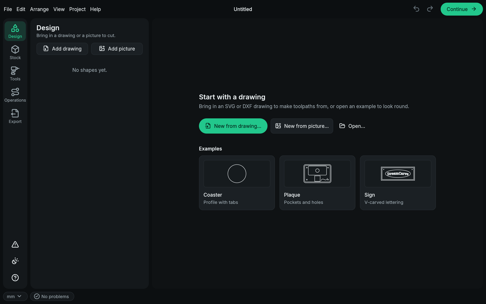

The window has the same parts whatever you are doing:

- The **header** across the top: the menus, the project's name, Undo and
  Redo, and one green button, **Continue**.
- The **rail** at the left: the five **steps** of a job, in order.
  **Design** holds the drawing, **Stock** the material, **Tools** the
  bits, **Operations** the cuts, and **Export** writes the G-code. Under
  them are **Warnings**, **Appearance** (dark or light) and **Help**.
- The **step panel** beside the rail: what the current step holds.
- The **Viewport**: the stock seen from above. Until there is a drawing,
  the start screen takes its place.
- The status bar along the bottom.

No step is locked. You can open any of them at any time; **Continue**
opens the next one that still needs something.

## 2. Make a project from the drawing

Click **New from drawing…** and choose `coaster.svg`. A sheet shows what
the file holds: one closed shape.

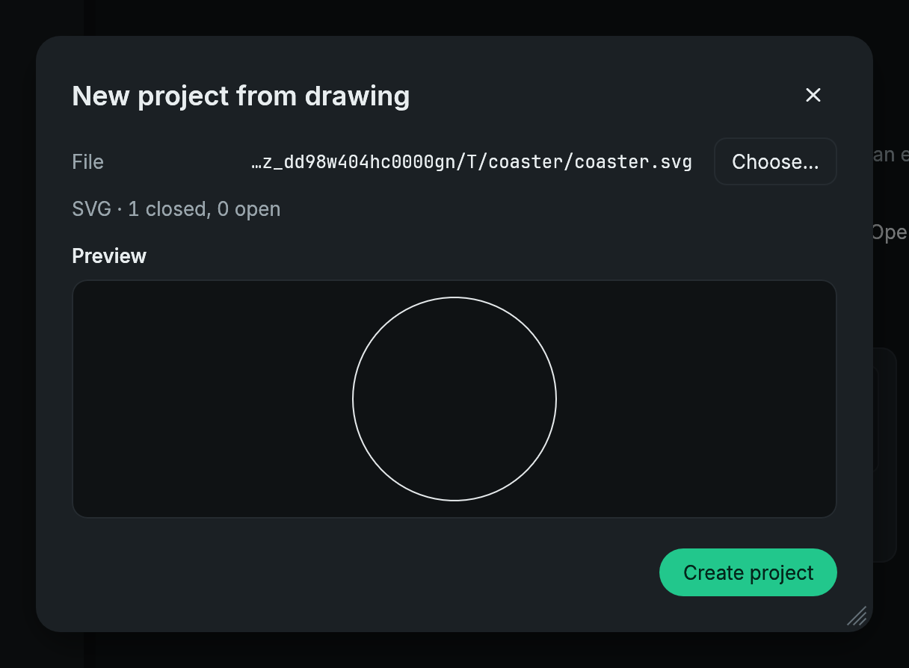

Click **Create project**. DreamCarve makes a new project round the
drawing:

| Setting | What the app sets |
| --- | --- |
| Stock | The drawing's bounds plus 10 mm on each side: 110 × 110 mm here, **no thickness** |
| Work zero | X and Y at the stock's bottom-left corner, Z at the stock top |
| Tools | None |
| Operations | None |
| Post-processor | grblHAL, millimetres |

The **stock** is the block of material you cut from. The
**post-processor** is the definition of the G-code dialect your
controller reads.

The app opens the first step that needs something, which is **Stock**:

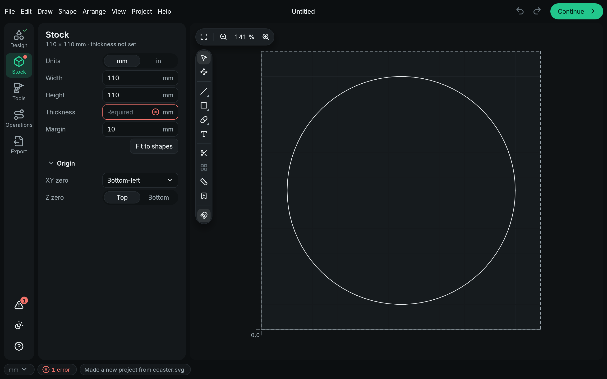

The rail tells you where the job stands. A step with a check is
complete. A red dot means the step has an error that stops export; an
amber dot means a warning. A step with no mark is still empty.

## 3. Set the stock

Plywood sold as 12 mm is often thinner. Measure yours with calipers in a
few places. This chapter uses 11.8 mm; use your own measurement.

Type it into **Thickness** and press Enter:

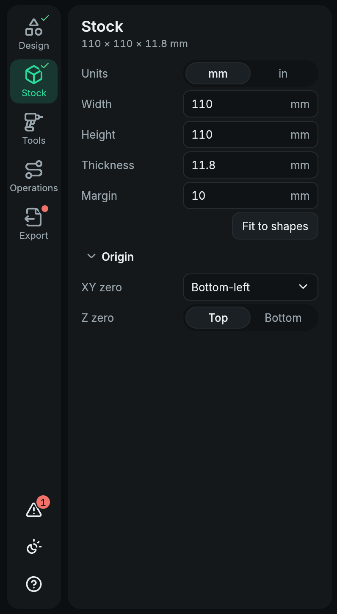

A field applies its value when you leave it, with Enter, Tab or a click
elsewhere. There is no OK button anywhere in the app, and **Undo** in the
header takes back one change at a time.

DreamCarve never guesses your material's thickness, a cut depth, a feed
rate or a spindle speed. A wrong thickness puts every pass, and sometimes
every rapid move, at the wrong height; a wrong feed can break a bit or
start a fire. Until you type them, those fields say **Required** and
**Export G-code** stays off.

The rail still shows a red dot on **Export**: there is nothing to export
yet. It goes when the project has an operation.

## 4. Add the tool from your library

Click **Continue**. The **Tools** step is empty:

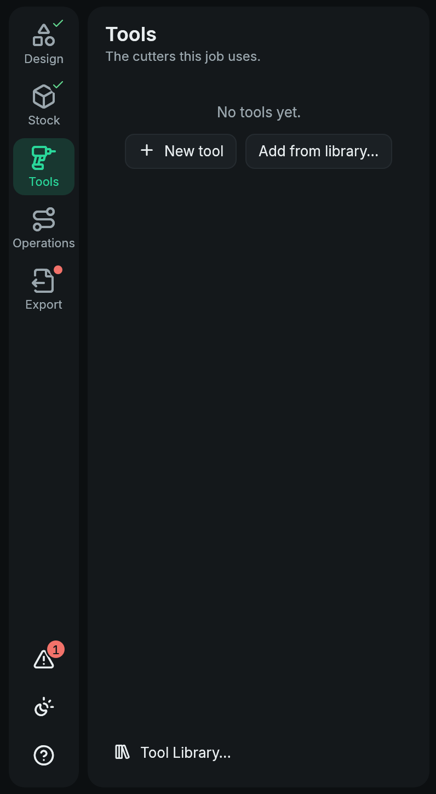

Your bits live in the **Tool Library**, which every project shares. A
project gets its own copy of each tool it uses, so the project file is
complete by itself. The library starts empty, so make the bit there
first.

1. Click **Tool Library…**, at the foot of the panel.
2. Click **New tool**. It makes an end mill, 6.35 mm across with 2
   flutes, named `tool1`, and no feed, plunge rate or spindle speed.
3. In the pane at the right, set:

   | Field | Value |
   | --- | --- |
   | **Name** | `1/4 end mill` |
   | **Feed** | 1500 |
   | **Plunge** | 500 |
   | **RPM** | 18000 |
   | **Step-down** | 4 |
   | **Stepover** | 40 |
   | **Tool number** | 1 |

4. Tick the tool's row, at its left.

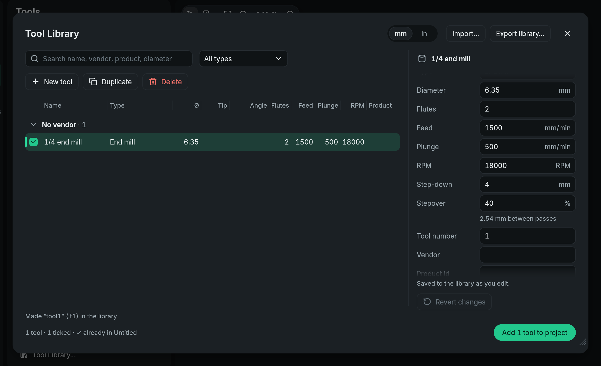

5. Click **Add 1 tool to project**. The library closes, and the tool is
   in the **Tools** list.

What the fields mean:

- **Feed** is the **feed rate**: how fast the bit moves along the outline
  while cutting, in millimetres per minute.
- **Plunge** is the **plunge rate**: how fast it moves straight down into
  the material, in millimetres per minute. The profile ramps into each
  pass rather than plunging, but never descends faster than this.
- **RPM** is the spindle speed, in revolutions per minute.
- **Step-down** is the **depth per pass**: the most the bit cuts deeper
  on each trip around the outline, in millimetres. The 12 mm cut takes
  three passes of 4 mm. Keep it at most the bit's diameter, 6.35 mm here;
  DreamCarve warns about a deeper one, which can break the bit.
- **Stepover** is how far the bit moves sideways between passes when it
  clears an area, as a share of its diameter. The coaster does not use
  it; the plaque's pockets will.
- **Tool number** is the bit's number on your machine. The program calls
  this one T1.

These are starting values for this bit in plywood. Your machine may need
others. If you are not sure, ask the maker of your bit or your machine.

The library saves each field as you leave it. Back on the **Tools** step,
click the tool to see the project's copy in the **Inspector**, the panel
that opens at the right for whatever is selected:

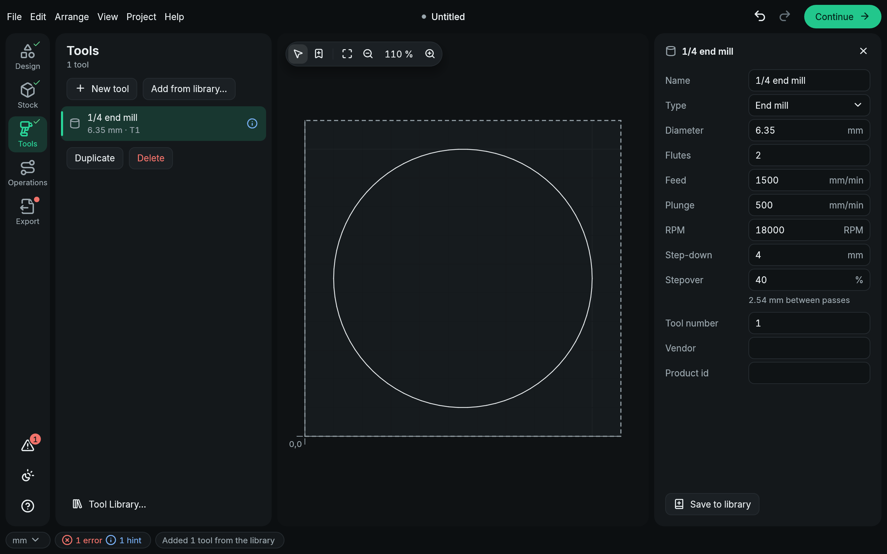

The small blue mark on the tool's row is a hint that no operation uses
the tool yet. Hints never stop anything.

## 5. Add the Profile

Click **Continue**. The **Operations** step lists what the machine will
cut, in the order it cuts it. It is empty.

A **Profile** cuts along a shape's outline. To add one:

1. Click the circle's outline on the Viewport. It turns green, with
   handles round it: it is selected.
2. Click **Add** and choose **Profile**.

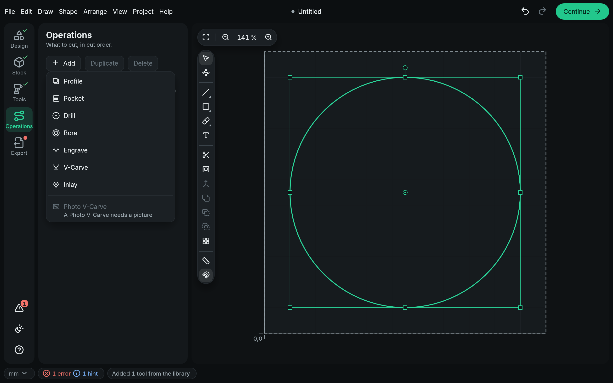

The new operation, `Profile 1`, opens in the Inspector. It has the tool
already, since the project has only one, and the same defaults the
command line gives a Profile:

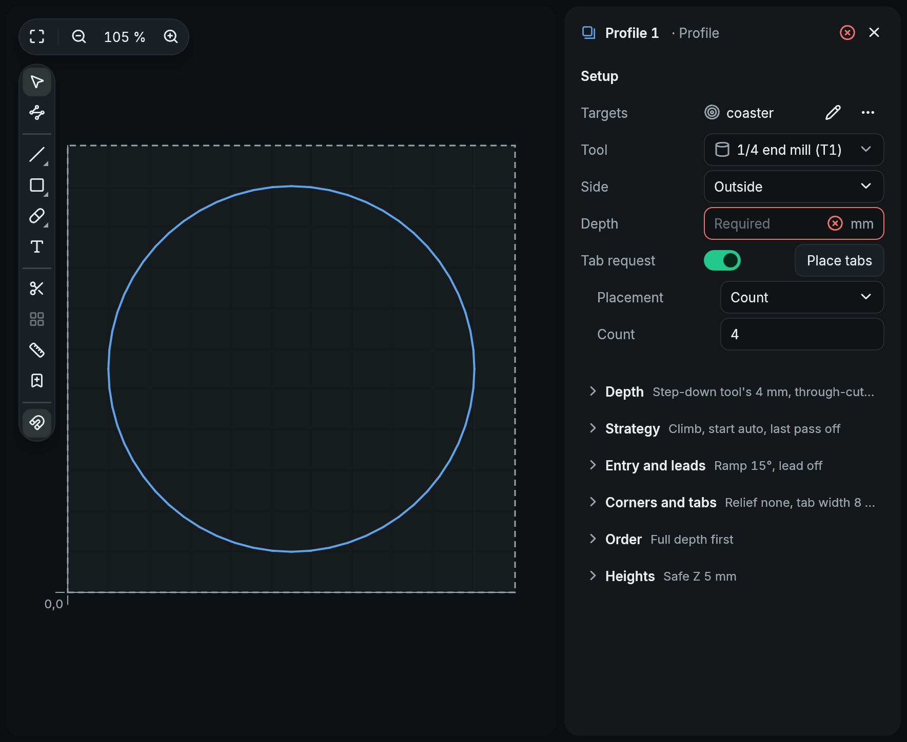

**Setup**, at the top, holds what every Profile needs before it can cut.
Under it are groups that start closed, each with its values on its
header: this Profile climbs, ramps into each pass at 15°, and lifts to a
safe Z of 5 mm. "Outside" puts the cutter outside the line, so the part
comes out at the size you drew. **Depth** is required: only you know how
deep to cut.

3. Click the **Depth** group's header to open it, and set **Through-cut
   allowance** to 0.2.
4. In **Setup**, set **Depth** to 12.
5. Click **Place tabs**.

- **Depth** is how deep the Profile cuts, measured down from the top of
  the plywood: the thickness plus 0.2 mm. Plywood cut exactly to its
  bottom often keeps a thin skin of fibres; going 0.2 mm into the
  spoilboard (the board under the plywood) cuts the part free.
- **Through-cut allowance** allows that 0.2 mm. DreamCarve refuses any
  cut that goes further below the bottom of the stock than this. Set it
  first: a depth of 12 in 11.8 mm plywood is an error without it.
- **Step-down** is empty and shows `tool's: 4 mm`. Leave it: an
  operation's value overrides the tool's, and an empty one uses the
  tool's.

If your measurement differs, set **Depth** to it plus 0.2.

**Tab request** asks for tabs: here 4, spaced evenly round the outline,
8 mm wide and 3 mm tall (the sizes are in **Corners and tabs**). **Place
tabs** turns the request into four tabs on the part itself. The switch
goes off, since the request is now placed, and the tabs show as white
marks across the toolpath:

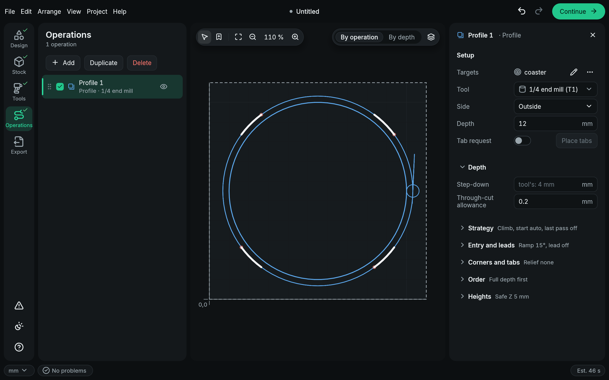

A placed tab is part of the drawing, listed under **Tabs** on the Design
step. You can drag one along its outline, or select it and press Delete.
The [Tabs](../user-guide/tabs.md) chapter says more.

There is no Generate button. The toolpath appears a moment after each
change, and the status bar shows how long the program will take: `Est.
46 s`.

## 6. Look at the toolpath

The Viewport draws what the machine will do. Close the Inspector with the
× at its top right, to give the Viewport the room.

At the Viewport's top right, **Layers** opens what it draws of the
toolpaths:

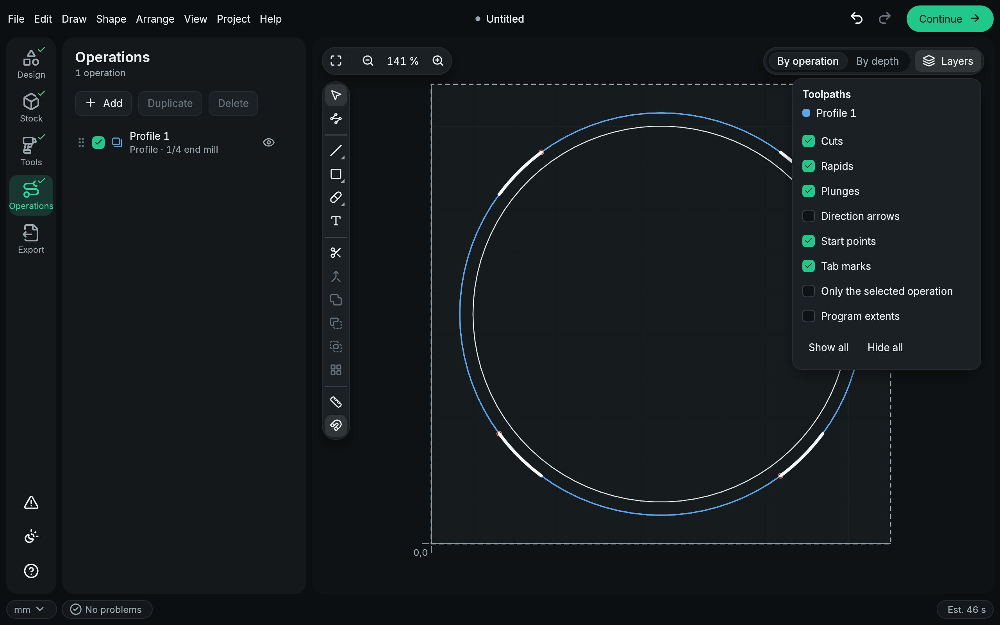

- The solid blue line is the cut: the centre of the bit, half a bit
  outside the circle.
- The small circle on the right, as wide as the bit, is where the cut
  starts. The line running from it is the **ramp**: the bit enters the
  wood on a slope instead of drilling straight down.
- The white marks are the tabs, where the last pass rises and leaves
  3 mm of wood.

Tick **Program extents**, close the popover with Escape, and click **By
depth**:

**By depth** colours each cut from pale at the top of the stock to dark
at the deepest pass, and the legend names the heights: the bit travels at
+5 (safe Z), the stock top is 0, and the Profile reaches −12.

The **program extents** are where the program takes the bit, in the
coordinates your controller shows once work zero is set. The inner box is
the bit's centre; the dashed box outside it is the bit's edge: X 3.65 to
107.16 mm and Y 3.65 to 106.35 mm. You place clamps from these numbers
before you cut.

These are view settings. They are not saved in the project and do not
change the program. Click **By operation** to go back.

## 7. Save and export

Save the project first: **File ▸ Save** (Ctrl S, or ⌘S on macOS), as
`coaster` in the folder that holds the drawing. The header now shows the
project's name.

Click **Continue**. Every other step is complete, so it opens **Export**.
The green button is now at the foot of the step's panel, and reads
**Export G-code**:

From the top, the step shows:

- Whether anything stands in the way, the **estimated time**, and the
  **Z range**: from −12, the deepest cut, up to 5, safe Z.
- Three groups of output settings, closed, with their values on their
  headers. **Post-processor** is where you pick another controller.
- **Program Details**: click it to list each program the export will
  write, with its tool, its operations and what to do before you run it.
- **Destination** and **File name**: the programs go beside the project
  file unless you choose another folder.
- At the foot, **Export G-code**, and beside it what it will write, or
  why it cannot yet.

The **estimated time** is how long the cutting and the spindle's spin-up
wait take at the feed rates you set. It leaves out the rapids, because
DreamCarve does not know how fast your machine moves; set your machine's
rapid rate in the
[configuration](../user-guide/configuration.md#estimated-run-time) to
include them. The real job takes a little longer: the machine also speeds
up and slows down.

Click **Export G-code**. A sheet shows what was written:

`coaster.nc` is the G-code program. **Run instructions** says what to do
before you start it: fit the bit and set work zero with it. The program
does not stop for its first bit. The notes under it are for senders that
store a tool length offset or scale an axis; if you set Z zero by
touching the bit to the stock, as this chapter does, you can ignore them.
**Save setup sheet…** writes the same facts as a page you can print and
take to the machine. **Done** closes the sheet; **Show result** on the
step opens it again.

Export writes every program or none, and never changes the project.

### The same program as the command line

`coaster.nc` is the program the command-line quick start writes, move for
move. [Read the start of the program](first-cut.md#7-read-the-start-of-the-program)
there explains each line. Two comment lines differ, because they carry
names: the app's program says `( Operation 1: Profile 1 )` and
`( Tool 1: 1/4 end mill )`, where the command line's keeps the names
`init` gave its placeholders, `Profile` and `Set me`.

## Before you cut

Read [Safety](../user-guide/safety.md) once before your first cut. For
this job:

1. **Fix the stock.** The program uses the 110 × 110 mm square that
   starts at your XY zero. Use the program extents (step 6) to place
   clamps: the bit's edge reaches X 3.65 to 107.16 mm and Y 3.65 to
   106.35 mm from your XY zero, so keep clamps and screws outside that
   area, with room to spare for the collet nut. Your board can be bigger.
   If you change the project, export again and use the new extents.
2. **Use a spoilboard.** The last pass goes 0.2 mm below the plywood,
   into the board under it.
3. **Fit the bit and set work zero with it.** Fit the 6.35 mm bit first:
   a different bit, or the same one seated deeper, has a different
   length. Then set X and Y at the front-left corner of the square (the
   corner nearest you on the left), and Z at the top of the plywood. The
   program does not stop for this; it starts cutting from the zero you
   set.
4. **Do an air cut.** Before you start, set Z zero 20 mm above the
   plywood instead of on it, and run the whole program. The deepest move,
   Z −12, then stays 8 mm above the wood. Watch that the path is where
   you expect and nothing hits a clamp. Then set Z zero back on the
   plywood.

Then cut:

1. Check that the 6.35 mm bit is in and that work zero is set with it on
   the top of the plywood.
2. Load `coaster.nc` in your sender and start it. The program lifts to
   safe Z, the spindle starts, waits 3 seconds, and the cut begins. It
   does not stop until the end. Stay at the machine with the stop button
   in reach.
3. When it ends, cut the four tabs with a knife or a flush-cut saw, and
   sand the stubs.

## The coaster in one table

Everything you set for the coaster:

<!-- app-test: part coaster -->
| Step | What to set |
| --- | --- |
| Drawing | `coaster.svg` |
| Stock | **Thickness** 11.8 |
| Tools | `1/4 end mill` |

<!-- app-test: operations coaster -->
| Name | **Add** | Shapes | **Tool** | Then set |
| --- | --- | --- | --- | --- |
| `Profile 1` | Profile | `coaster` | `1/4 end mill` | **Through-cut allowance** 0.2; **Depth** 12; **Place tabs** |

The three parts that follow are given the same way: a table for the
start of the project, and a table with a row for each operation.

## Three more parts

The later quick starts each make a part that needs more than one tool.
These sections build the same three parts in the app. They give the
values and say what is new in the app; for what each setting does to the
cut, and for cutting the part, follow the link to its quick start.

### Your tool library

The three parts use four bits between them. Make each in the **Tool
Library** when you first need it, as you made the first one in step 4:
**New tool**, then its fields. An empty cell is a field to leave alone.

<!-- app-test: tools -->
| **Name** | **Type** | **Angle** | **Diameter** | **Feed** | **Plunge** | **RPM** | **Step-down** | **Stepover** | **Tool number** |
| --- | --- | --- | --- | --- | --- | --- | --- | --- | --- |
| `1/4 end mill` | End mill | | 6.35 | 1500 | 500 | 18000 | 4 | 40 | 1 |
| `1/8 end mill` | End mill | | 3.175 | 1000 | 300 | 18000 | 2 | 40 | 2 |
| `1/4 90 degree V-bit` | V-bit | 90 | 6.35 | 1200 | 400 | 18000 | 2.5 | 40 | 3 |
| `1/4 60 degree V-bit` | V-bit | 60 | 6.35 | 1000 | 300 | 18000 | 2 | 40 | 1 |

For a V-bit, choose **V-bit** in **Type**. An **Angle** field appears,
marked required: the tool does not become a V-bit until you type its
included angle, because the angle decides how deep a carve goes and
DreamCarve will not assume one.

The **Tool number** is the bit's number on your machine, and the program
files are named after it (`plaque-1-T2.nc` is run with T2). The two
V-bits are never in one project here, so the 60° bit can be T1 in the
inlay. Number your own bits as your machine has them.

### How to add each operation

Each row of an operations table is one operation, added the same way:

1. **Select its shapes**, in the order the table lists them. On the
   **Design** step, click the first shape's row in the list, then
   Shift-click the others; or click and Shift-click the shapes on the
   Viewport.
2. On the **Operations** step, click **Add** and choose the kind. The
   menu lists the kinds the selection can take first, and the others
   under a line with the reason.
3. **Name it**: click the name in the Inspector's header, type, and press
   Enter. The names are yours to choose. The ones here are the ones the
   quick starts use, and they appear as comments in the program.
4. Pick its **Tool**.
5. Set the fields in the last column, in order. A field that is not in
   **Setup** is in one of the groups under it:

   | Group | Fields used in this chapter |
   | --- | --- |
   | **Depth** | Through-cut allowance, Step-down, Band margin, Outline rounding |
   | **Strategy** | Floor stepover, a countersink's Start depth, an Inlay's Clearing passes |
   | **Entry and leads** | Entry, Lead |
   | **Corners and tabs** | Corner relief |
   | **Cut-out** | Cut-out, Holding tabs, Tab width, Cut-out allowance |
   | **Heights** | Safe Z |

In the last column, `on` is a switch to turn on. **Clearing passes**
followed by a tool means: click **Add pass**, then pick that tool in the
new pass's **Tool** row.

Operations cut in the order of the list, top to bottom, so add them in
the order the table gives. To change the order later, drag a row by the
grip at its left.

### The plaque: a second tool

[A pocketed plaque from DXF](plaque.md) cuts a plaque with two pockets,
four screw holes and an engraved border, with a 6.35 mm and a 3.175 mm
end mill. The drawing is
[`plaque.dxf`](https://raw.githubusercontent.com/grayzu/dreamcarve/main/tests/fixtures/plaque.dxf).

Start it with **File ▸ New Project from Drawing…**, which is the start
screen's button in the menu.

<!-- app-test: part plaque -->
| Step | What to set |
| --- | --- |
| Drawing | `plaque.dxf` |
| Stock | **Thickness** 11.8 |
| Tools | `1/4 end mill`, `1/8 end mill` |

This project opens on **Design**, with an amber dot: the drawing has an
open path, `squiggle`, and no operation cuts it yet. The **Warnings**
button in the rail lists it. The dot goes when the Engrave below takes
the squiggle.

On the **Tools** step, open the **Tool Library…**. It still holds the
coaster's bit. Make the `1/8 end mill` from the table above, tick both
rows, and click **Add 2 tools to project**:

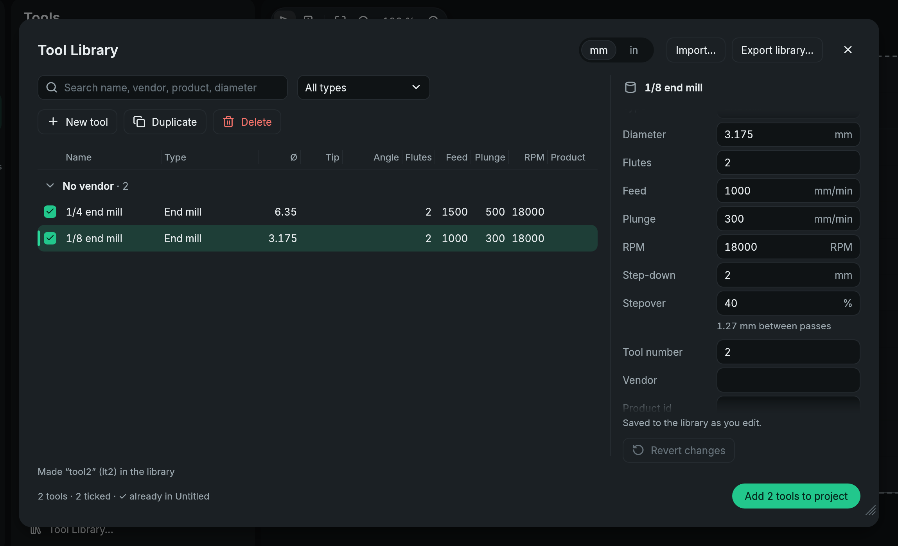

Then add the five operations:

<!-- app-test: operations plaque -->
| Name | **Add** | Shapes | **Tool** | Then set |
| --- | --- | --- | --- | --- |
| `Screw holes` | Bore | `holes-1`, `holes-2`, `holes-3`, `holes-4` | `1/8 end mill` | **Through-cut allowance** 0.2; **Depth** 12; **Safe Z** 15 |
| `Border and squiggle` | Engrave | `border`, `squiggle` | `1/8 end mill` | **Depth** 1; **Step-down** 1; **Safe Z** 15 |
| `Panel` | Pocket | `pocket`, `island` | `1/4 end mill` | **Depth** 4; **Strategy** Raster; **Entry** Helix; **Safe Z** 15 |
| `Square recess` | Pocket | `square` | `1/4 end mill` | **Depth** 6; **Corner relief** Dogbone; **Safe Z** 15 |
| `Cut out` | Profile | `outline` | `1/4 end mill` | **Through-cut allowance** 0.2; **Depth** 12; **Lead** on; **Safe Z** 15 |

The first one, after its fields are set:

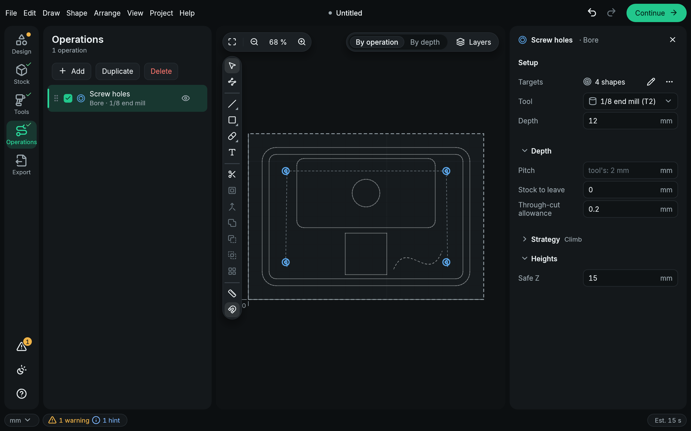

A new operation takes the project's first tool that fits its kind, so the
two that use the 3.175 mm bit need their **Tool** changed. The `Cut out`
keeps its tab request, as the command line's does; press **Place tabs**
if you want to move the tabs yourself.

With all five, each operation has its own colour, on the Viewport and in
the **Layers** key:

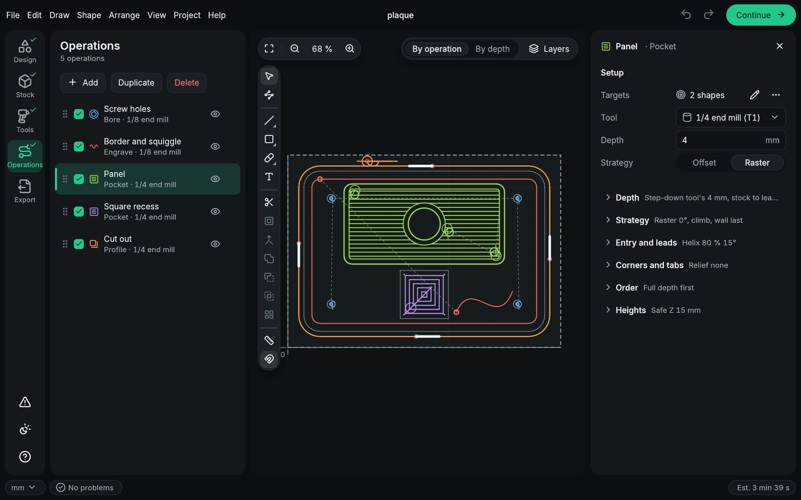

The **Export** step now has something new: two programs, one for each
tool.

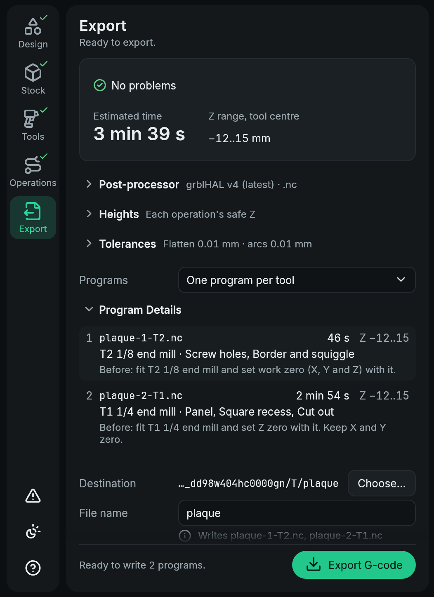

The 3.175 mm bit runs first, because the operations that use it come
first in the list. **Program Details** says what to do between the two:
fit the second bit and set Z zero with it, leaving X and Y alone.
**Programs** can be set to **One program for all tools** instead, on a
controller that can stop for a tool change.

These are the programs of the plaque quick start, to the byte. Go to
[Read the programs](plaque.md#8-read-the-programs) and
[Before you cut](plaque.md#9-before-you-cut) there before you run them.

### The sign: a V-Carve

[A V-carved sign from SVG outlines](sign.md) carves lettering and a
recessed background with a 90° V-bit, drills two hanging holes and
countersinks them. The drawing is
[`sign.svg`](https://raw.githubusercontent.com/grayzu/dreamcarve/main/tests/fixtures/sign.svg).

<!-- app-test: part sign -->
| Step | What to set |
| --- | --- |
| Drawing | `sign.svg` |
| Stock | **Thickness** 11.8 |
| Tools | `1/8 end mill`, `1/4 end mill`, `1/4 90 degree V-bit` |

Add the three tools one at a time, in that order: tick one row, click
**Add 1 tool to project**, and open the library again for the next. Any
order cuts the same sign. This one gives the tools the places they have
in the sign quick start's project, which one comment line of a program
shows, so the programs match that chapter's to the byte.

<!-- app-test: operations sign -->
| Name | **Add** | Shapes | **Tool** | Then set |
| --- | --- | --- | --- | --- |
| `Hanging holes` | Drill | `hole-left`, `hole-right` | `1/8 end mill` | **Through-cut allowance** 0.2; **Depth** 12; **Safe Z** 15 |
| `Background` | V-Carve | `background`, `oval` | `1/4 90 degree V-bit` | **Flat depth** 2.5; **Clearing passes** `1/4 end mill`; **Floor stepover** 10; **Safe Z** 15 |
| `Lettering` | V-Carve | `letter-D`, `letter-r`, `letter-e`, `letter-a`, `letter-m`, `letter-C`, `letter-a-2`, `letter-r-2`, `letter-v`, `letter-e-2` | `1/4 90 degree V-bit` | **Safe Z** 15 |
| `Countersinks` | Drill | `hole-left`, `hole-right` | `1/4 90 degree V-bit` | **Cycle** Countersink; **Mouth diameter** 6; **Start depth** 2.5; **Safe Z** 15 |
| `Cut out` | Profile | `outline` | `1/4 end mill` | **Through-cut allowance** 0.2; **Depth** 12; **Lead** on; **Safe Z** 15 |

A **V-Carve** cuts with the side of a V-bit, deeper where the shape is
wider. The `Lettering` needs nothing but its safe Z: the letters decide
their own depth. The `Background` is too wide for the bit, so it has a
**Flat depth**, the floor the carve stops at, and a **clearing pass**
that flattens that floor with the end mill before the V-bit cuts the
walls:

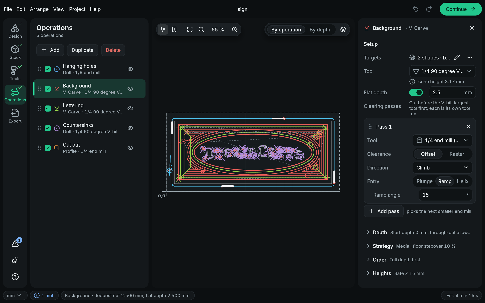

Under the **Tool** row the app shows the V-bit's **cone height**, the
deepest it can carve at its full width. The status bar's message says
what the selected carve comes to: `Background · deepest cut 2.500 mm,
flat depth 2.500 mm`.

For the `Countersinks`, **Depth** is not typed: the app works it out
from the mouth diameter, the start depth and the V-bit's angle, and
shows it.

The sign exports four programs. [Read the programs](sign.md#8-read-the-programs)
and [Before you cut](sign.md#9-before-you-cut) in its quick start apply
as they stand.

### The inlay pair

[An inlay pair](inlay.md) cuts the letters "DC" as a pocket in one board
and as a mirrored plug in another, which is glued in and planed flush.
The drawing is
[`dc-inlay.svg`](https://raw.githubusercontent.com/grayzu/dreamcarve/main/tests/fixtures/dc-inlay.svg).
Save the project as `dc`, the name its quick start gives the file.

<!-- app-test: part inlay -->
| Step | What to set |
| --- | --- |
| Drawing | `dc-inlay.svg` |
| Stock | **Thickness** 12 |
| Tools | `1/4 60 degree V-bit`, `1/8 end mill` |

Add the V-bit first and the end mill second, one at a time, for the same
reason as the sign's tools.

<!-- app-test: operations inlay -->
| Name | **Add** | Shapes | **Tool** | Then set |
| --- | --- | --- | --- | --- |
| `DC` | Inlay | `letter-D`, `letter-C` | `1/4 60 degree V-bit` | **Inlay depth** 4; **Glue gap** 1; **Plug depth** 2; **Board thickness** 12; **Band margin** 8; **Outline rounding** 10; **Clearing passes** `1/8 end mill`; **Floor stepover** 10; **Cut-out** on; **Holding tabs** on; **Tab width** 6; **Cut-out allowance** 0.2; **Safe Z** 10 |

The stock is the **female board**, the one that gets the pocket.
**Board thickness** is the **male board**'s, the one the plug is cut
from, so it is the first row of the editor's **Male board** group, which
is open while the thickness is not set; measure each board and type its
own. Do not select `frame`: it is
there only to size the stock.

One Inlay cuts both boards from one set of numbers, with one bit, so the
two halves cannot disagree. The Viewport draws the male board beside the
stock, mirrored, as it will lie on the machine:

The two warnings and the hint are among the ones the inlay quick start's
[Check the project](inlay.md#7-check-the-project) lists and explains.

On the **Export** step, **Boards** has a tick for each board. Both are
on, and the step writes five programs, two for the female board and three
for the male:

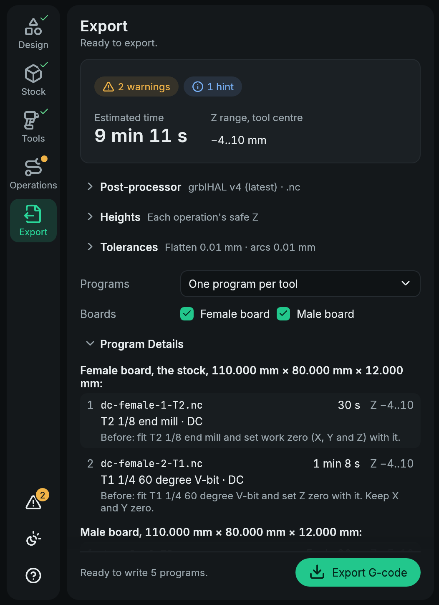

To cut the plug again after a test fit, untick **Female board** and
export: only the male's programs are written. The tick is for that
export only and is not saved.

Cutting, fitting and gluing an inlay takes care. Follow
[the inlay quick start](inlay.md#10-before-you-cut) from "Before you cut"
on.

## Next steps

- [The project file](../user-guide/project-file.md): what the app saves.
  It is the same `.dcv` file the command line reads, so a project made in
  the app can be checked and exported from a script.
- [Tabs](../user-guide/tabs.md): tab counts, sizes and shapes.
- [Tool library](../user-guide/tool-library.md): importing a library you
  already have, from Fusion or from another computer.
- [Warnings](../user-guide/warnings.md): every warning the app can show,
  by its code.
- [Keyboard shortcuts](../user-guide/keyboard.md).
- [Carving a photo](photo.md) and
  [Carving and inlaying with a tapered ball nose](tapered-ball-nose.md):
  two more kinds of work the app does, from **New from picture…** and
  from a tapered ball nose in the Tool Library.
