# Your first design

This chapter makes a part with no drawing to start from. You draw it in
the DreamCarve app, with the sizes typed, and take it to G-code: a
**hook plate**, 160 × 80 mm, of the kind that screws to a bench or a
wall to hang tools from.

It has one of each thing the drawing tools make: a rounded rectangle,
two slots, four screw holes, a hexagonal pocket for a nut, and a word.
On the way you use a construction line, make copies in a row and in a
grid, and centre a shape on the board.

Every value in this chapter is read from it by DreamCarve's test suite.
The tests draw the part with those values, once through the window's own
controls and once without a window, check that both give the same
shapes, and compare the programs the app writes with the ones
`dreamcarve export` writes for the saved file, on every post-processor.
Every picture is taken from the app by the same tests, doing what the
step says. If a step does not work for you, that is a bug.

If you have not used the app before, read
[From SVG to G-code in the app](app.md) first. It explains the window,
the five steps and the Tool Library, which this chapter uses without
explaining again.

## What you need

- The DreamCarve app, `dreamcarve-app`. See
  [Installing](installing.md#the-app).
- Calipers, to measure the board.
- For the cut: a board 180 × 100 mm and about 12 mm thick, on a
  spoilboard; the four bits of [step 11](#11-add-the-tools); and a
  router controlled by grblHAL. GRBL works too; see
  [Post-processors](../user-guide/post-processors.md).

## 1. Start from nothing

Start `dreamcarve-app`:

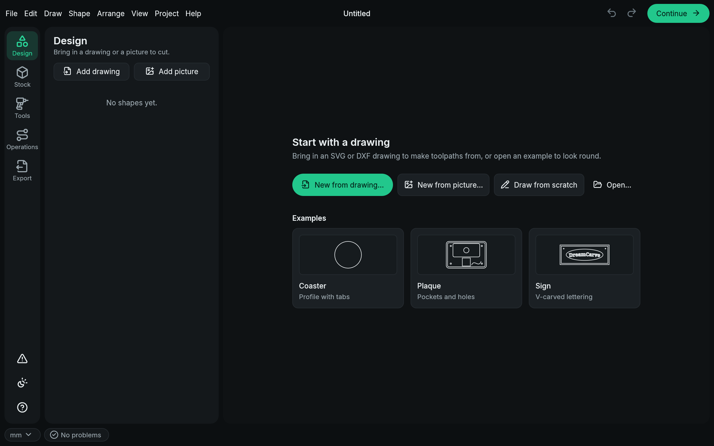

Click **Draw from scratch**. DreamCarve makes a blank project and opens
the **Design** step with a drawing tool already in hand:

Two things are new if you have only imported drawings before:

- The **pill** at the top left of the Viewport holds the tools:
  **Select**, **Edit nodes**, one **Draw** button with a small arrow
  beside it, and the **Tab tool**. The Draw button shows the drawing
  tool you last used. Its arrow opens the list of them all.
- The **tool bar** appears under the pill while a tool is in hand. It
  says what the next click does, and holds the fields and choices of the
  shape you are drawing.

A tool stays in hand after each shape, so you can draw several. **V**, or
**Escape** with nothing begun, puts it down and gives you Select back.

## 2. Set the stock

The blank project's stock is 100 × 100 mm with no thickness. Set it to
your board before you draw, so the drawing has the right edges round it.
Open the **Stock** step in the rail and type the three sizes:

<!-- app-test: part hook-plate -->
| Step | What to set |
| --- | --- |
| Stock | **Width** 180; **Height** 100; **Thickness** 12 |
| Tools | `1/4 end mill`, `1/8 end mill`, `5 mm drill`, `1/4 60 degree V-bit` |

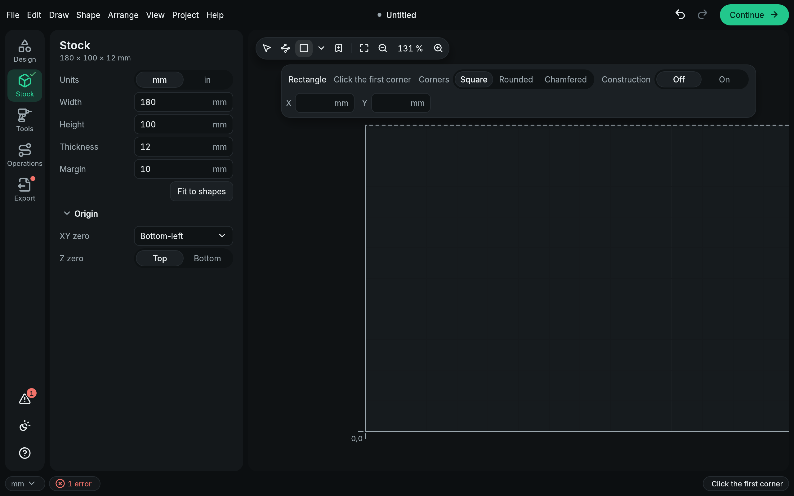

Measure the thickness with calipers and type your own number. The
**Tools** row of the table is for [step 11](#11-add-the-tools).

Go back to **Design**. The tool is still in hand. Press **F** to fit the
stock in the Viewport.

## 3. Draw the plate

The plate is a rectangle 160 × 80 mm with rounded corners of 8 mm. It
sits 10 mm in from the stock's bottom-left corner, which centres it on
the board.

Every shape in this chapter is drawn the same way, with the keyboard:
choose the tool, set its choices, type where it starts, type its sizes.
This table has a row for each shape. Read it with the steps under it.

<!-- app-test: draw hook-plate -->
| Shape | Tool | Set first | Start | Then type |
| --- | --- | --- | --- | --- |
| `Rectangle 1` | Rectangle | **Corners** Rounded; **Corner size** 8 | **X** 10; **Y** 10 | **W** 160; **H** 80 |
| `Line 1` | Line | **Construction** On | **X** 90; **Y** 10 | **Length** 80; **Angle** 90 |
| `Slot 1` | Slot | **Construction** Off | **X** 40; **Y** 35 | **Length** 30; **Angle** 0; **Width** 6.5 |
| `Circle 1` | Circle | | **X** 18; **Y** 18 | **Diameter** 5 |
| `Hexagon 1` | Polygon | **Sides** 6; **Measure** To the flats | **X** 90; **Y** 35 | **Radius** 6.5 |
| `Text 1` | Text | **Font** Inter Bold; **Height** 10 | **X** 40; **Y** 58 | **Words** DREAMCARVE |

For the first row:

1. The **Rectangle** tool is in hand already. Any other time, click the
   arrow beside the Draw button and choose **Rectangle**, or press
   **M**.
2. In the tool bar, click **Rounded** beside **Corners**. A **Corner
   size** field appears. Click in it, type `8` and press Enter.

   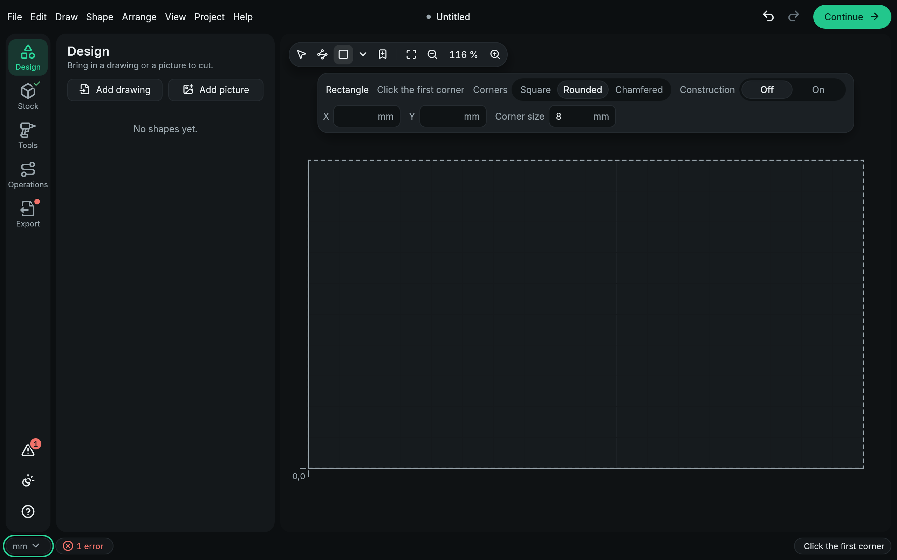

3. Press **Tab**. The keyboard goes to the bar's first field, **X**.
   Type `10`, press **Tab**, type `10` for **Y**, and press **Enter**.
   That is the first corner, measured from the origin at the stock's
   bottom-left corner.
4. Press **Tab** again: the fields are now **W** and **H**. Type `160`,
   **Tab**, `80`. The plate is previewed, with its size written under
   it:

   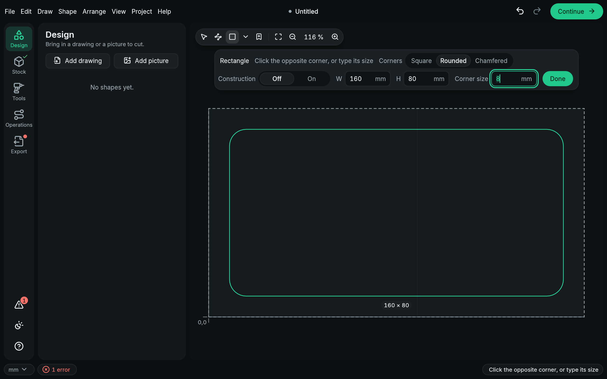

5. Press **Enter**. The plate is drawn, and `Rectangle 1` is in the
   **Shapes** list at the left:

   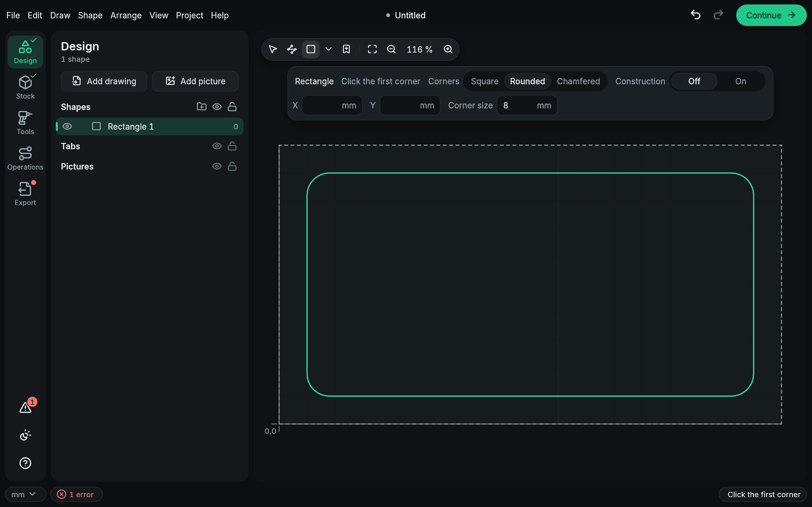

You can also draw with the pointer: click one corner and then the
opposite one, or press at one corner and drag to the other. The pointer
**snaps** to the grid and to what is already drawn, and a small marker
shows what it snapped to. Typing is exact whatever the zoom, which is
why this chapter types. [Drawing shapes](../user-guide/drawing-shapes.md)
and [Snapping and the grid](../user-guide/snapping.md) have the rest.

A shape you draw **keeps its sizes**. Select the plate later and its
**Properties** show **Width**, **Height** and **Corner size**, and you
can retype any of them.

## 4. A construction line

A **construction line** is a line you draw to draw by. It is shown thin
and dashed, the pointer snaps to it, and it is never cut: no operation
offers it, and `check` does not ask why nothing cuts it. This one marks
the plate's centre, top to bottom.

Second row of the table: choose **Line** (**P**), click **On** beside
**Construction**, then Tab, `90`, Tab, `10`, Enter for the start. The
fields become **Length** and **Angle**: Tab, `80`, Tab, `90`.

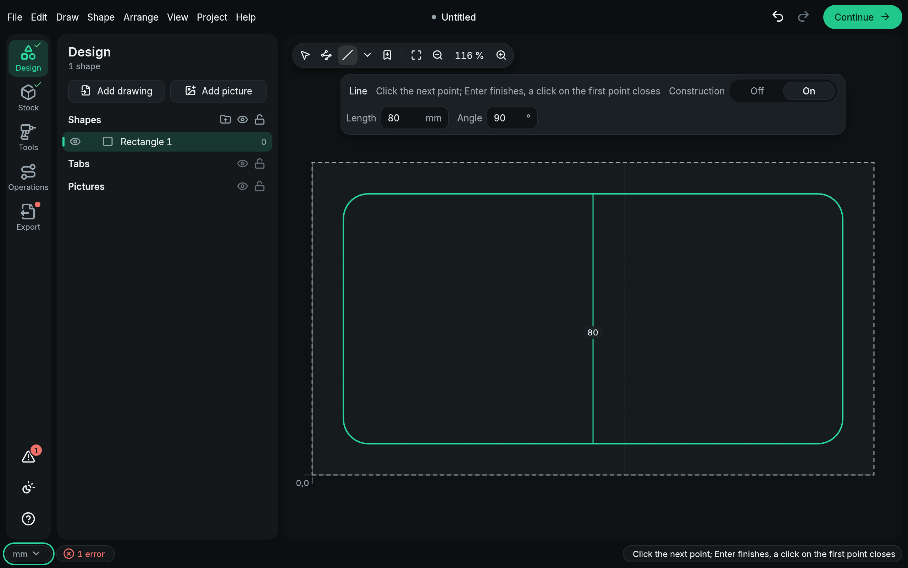

Press **Enter** for that point. A line can go on to more points, so it
is not finished yet: click **Done** in the tool bar, or press Enter
again.

**Construction** stays **On** for the shapes that follow until you turn
it off, which the next row does first.

## 5. A slot

A **slot** is a rounded-end slot, given by the two centres of its ends
and its width. Third row: choose **Slot** (**O**), click **Off** beside
**Construction**, and type the start, `40` and `35`, as before. Then
its three sizes: **Length** `30`, **Angle** `0` (along X) and **Width**
`6.5`, with Tab between them.

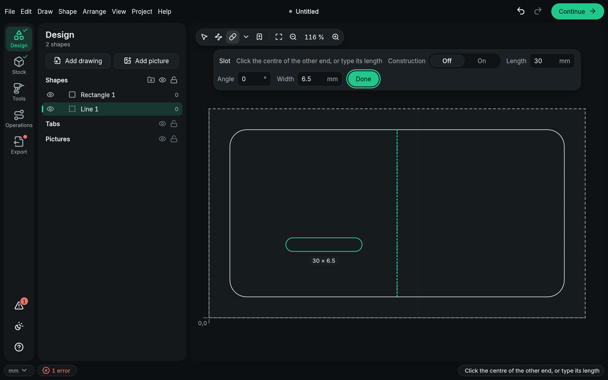

Press **Enter**. The length is between the centres of the two round
ends, so the slot is 36.5 mm long over all.

## 6. A screw hole

Fourth row: **Circle** (**C**), centre `18`, `18`, **Diameter** `5`.
The centre is the centre of the plate's corner arc: 10 mm for the
plate's corner plus the 8 mm corner size.

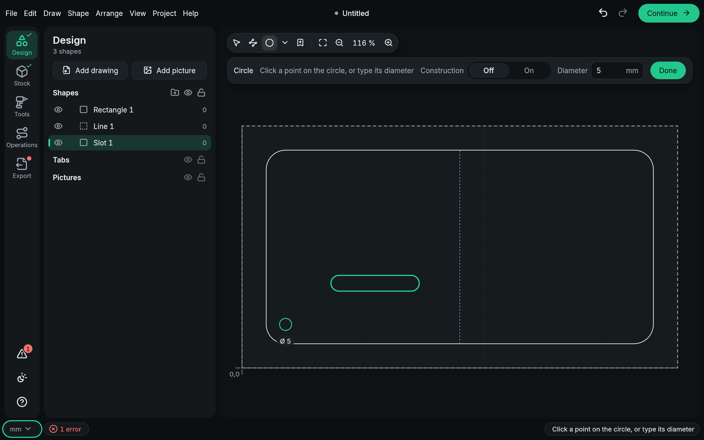

## 7. The nut pocket

Fifth row: **Polygon** (**G**). Set **Sides** to `6`, and click **To
the flats** beside **Measure**: the radius is then measured to the
middle of a side, so a radius of 6.5 makes a hexagon 13 mm across the
flats, which is an M8 nut. Its centre is on the construction line: `90`,
`35`.

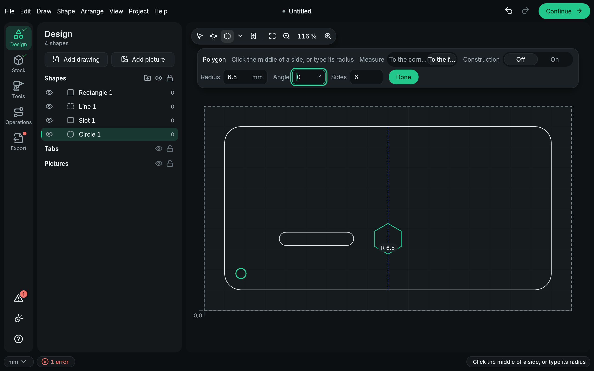

## 8. The lettering

Last row: **Text** (**Shift+T**). Choose **Inter Bold** in **Font**, and
type `10` in **Height**: the height of a capital letter. The Text tool
starts with a click, not typed numbers: click on the plate above the
slot, near X 40, Y 58. Exactly where does not matter, because
[step 10](#10-centre-the-lettering) puts it in place. A **Words** field
appears with the keyboard in it. Type `DREAMCARVE`:

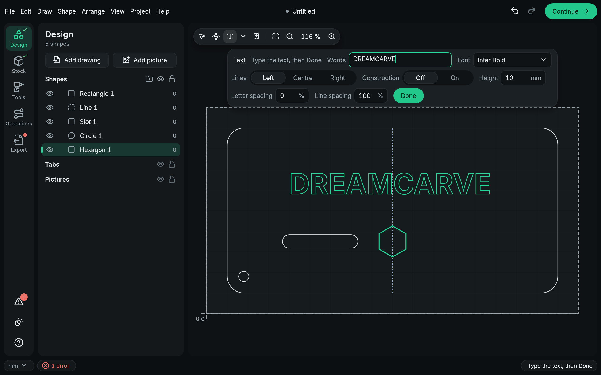

Click **Done**. The fonts in the list come with DreamCarve, and
**Add font…** at the end of the list takes a font file of your own.
[Text and fonts](../user-guide/text.md) says what each field does.

Press **V** to put the tool down.

## 9. Copy the slot and the hole

The plate needs a second slot and three more holes. An **array** makes
copies in rows and columns. This table has what is left to do to the
shapes; each row starts by clicking the shape's name in the **Shapes**
list.

<!-- app-test: arrange hook-plate -->
| Shapes | Command | Then set |
| --- | --- | --- |
| `Slot 1` | **Arrange ▸ Array…** | **Columns** 2; **Rows** 1; **Spacing** Pitch; **Spacing X** 70 |
| `Circle 1` | **Arrange ▸ Array…** | **Columns** 2; **Rows** 2; **Spacing** Pitch; **Spacing X** 144; **Spacing Y** 64 |
| `Text 1` | **Arrange ▸ Align ▸ Centre** | **Y** 58 |

For the slot: click `Slot 1` in the list, then choose **Arrange ▸
Array…** from the menu bar. The tool bar takes the array's values. Type
**Columns** `2` and **Rows** `1`, click **Pitch** beside **Spacing**,
and type **Spacing X** `70`. A **pitch** is measured from one copy to
the same point of the next, so the second slot starts 70 mm to the right
of the first, as far from the centre line on its side as the first is on
its own:

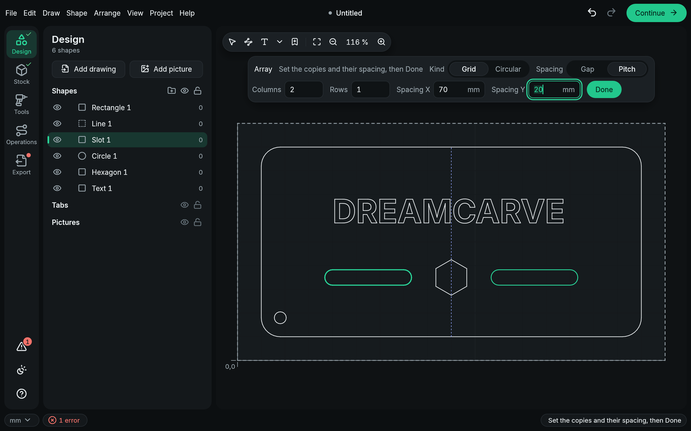

Click **Done**. Do the same for `Circle 1` with the second row's
values: two columns 144 mm apart and two rows 64 mm apart, one hole at
the centre of each corner.

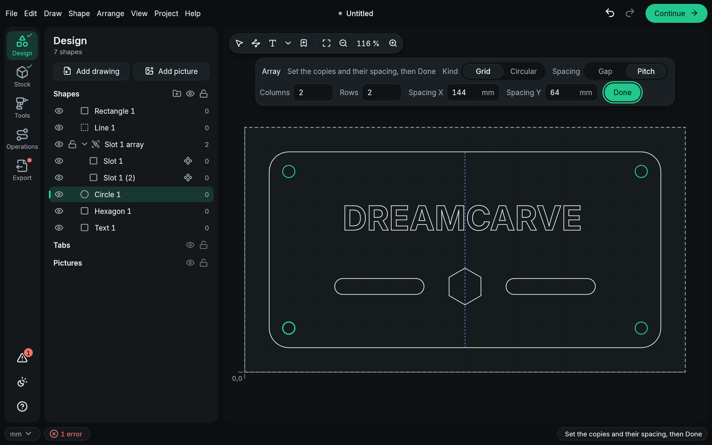

The copies of an array are **linked copies**: they are the same shape
placed again, so a size changed on one changes them all
([Change it](#change-it), below). An array is filed in a **group** of
its own in the Shapes list, `Slot 1 array`, and a click on any of its
shapes on the Viewport selects them all.

## 10. Centre the lettering

Third row: click `Text 1` in the list and choose **Arrange ▸ Align ▸
Centre**. One shape on its own aligns to the stock, so the word is now
centred across the board, and across the plate, which is centred too.
Then type `58` into **Y** in the **Properties** panel at the right, and
press Enter: the bottom of the letters is 58 mm up.

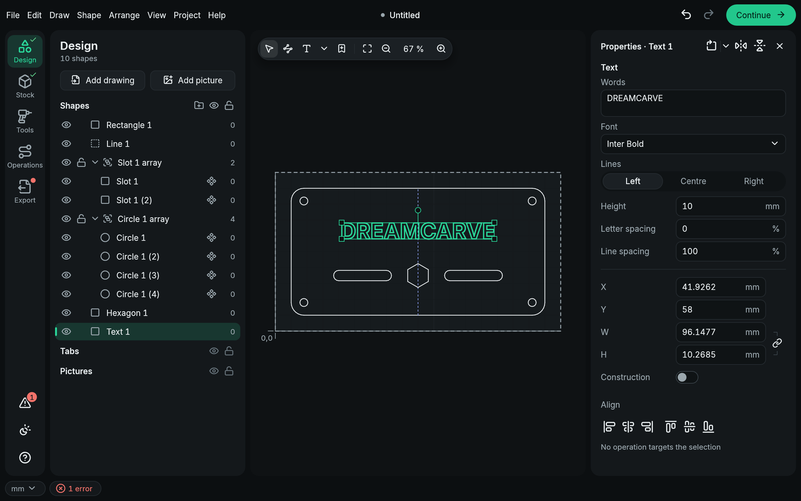

Click an empty part of the Viewport to select nothing. The drawing is
done:

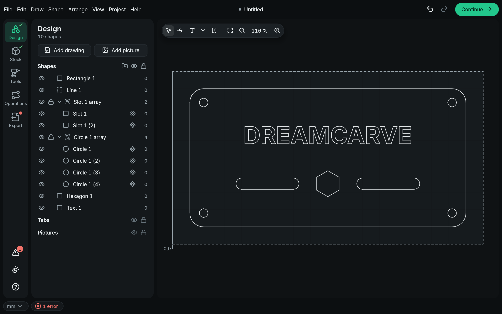

Save it now, with **File ▸ Save** (Ctrl+S, ⌘S on a Mac), as
`hook-plate.dcv` in a folder of its own. The programs are named after
the file.

## 11. Add the tools

The part uses four bits. Make them in the **Tool Library** and add them
to the project, as [From SVG to G-code in the
app](app.md#4-add-the-tool-from-your-library) shows, one at a time in
this order:

<!-- app-test: tools -->
| **Name** | **Type** | **Angle** | **Diameter** | **Feed** | **Plunge** | **RPM** | **Step-down** | **Stepover** | **Tool number** |
| --- | --- | --- | --- | --- | --- | --- | --- | --- | --- |
| `1/4 end mill` | End mill | | 6.35 | 1500 | 500 | 18000 | 4 | 40 | 1 |
| `1/8 end mill` | End mill | | 3.175 | 1000 | 300 | 18000 | 2 | 40 | 2 |
| `5 mm drill` | Drill | | 5 | 300 | 150 | 12000 | 4 | | 3 |
| `1/4 60 degree V-bit` | V-bit | 60 | 6.35 | 1000 | 300 | 18000 | 2 | 40 | 4 |

If you made the two end mills and the V-bit for the first chapter, they
are in your library already. That chapter gave the V-bit tool number 1;
give it 4 here, in the library, so that no two bits of this project
share a number.

These are starting values for plywood. Your machine may need others. A
twist drill wants a slower spindle than a router bit; if your spindle
cannot run that slowly, leave the drill out and cut the holes with a
[Bore](../user-guide/bore.md) and the 1/8 end mill instead.

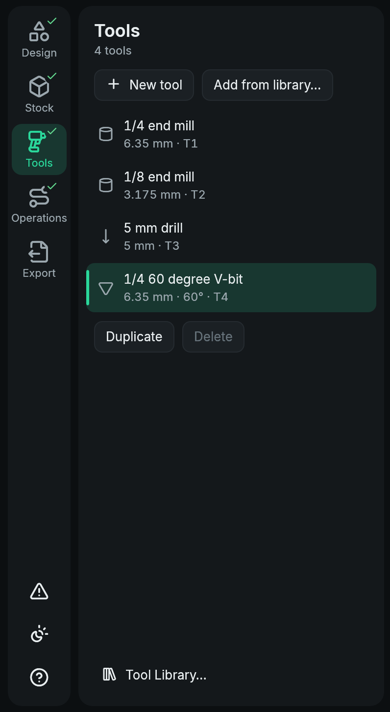

## 12. Add the operations

Open **Operations**. Each row of this table is one operation, in the
order the machine cuts them: select the shapes named, click **Add** and
choose the kind, give it its name and its tool, and set the fields in
the last column.

<!-- app-test: operations hook-plate -->
| Name | **Add** | Shapes | **Tool** | Then set |
| --- | --- | --- | --- | --- |
| `Holes` | Drill | `Circle 1`, `Circle 1 (2)`, `Circle 1 (3)`, `Circle 1 (4)` | `5 mm drill` | **Through-cut allowance** 0.2; **Depth** 12 |
| `Slots` | Pocket | `Slot 1`, `Slot 1 (2)` | `1/8 end mill` | **Depth** 6 |
| `Nut trap` | Pocket | `Hexagon 1` | `1/8 end mill` | **Depth** 5 |
| `Lettering` | V-Carve | `Text 1` | `1/4 60 degree V-bit` | |
| `Cut out` | Profile | `Rectangle 1` | `1/4 end mill` | **Through-cut allowance** 0.2; **Depth** 12; **Place tabs** |

To select the four holes, click one of them on the Viewport: the group
comes with it. The slots are the same.

The cuts inside the plate come first and **Cut out** last, so the plate
is still held by the board while the small features are cut. `Cut out`
goes through the board and a little into the spoilboard, and **Place
tabs** leaves four tabs that hold the plate until you cut them by hand.
The construction line is in no operation's list: it is not offered.

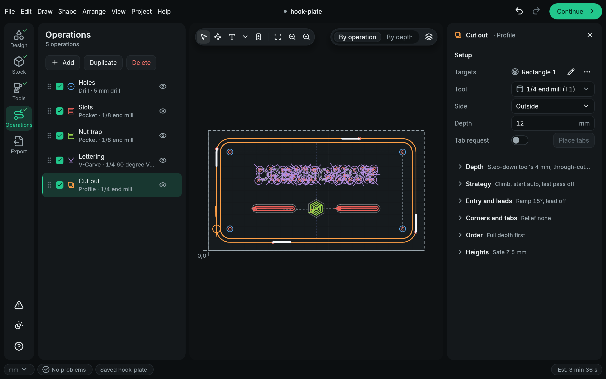

The lettering needs no depth. A **V-Carve** cuts with the side of the
V-bit, deeper where a letter's stroke is wider:

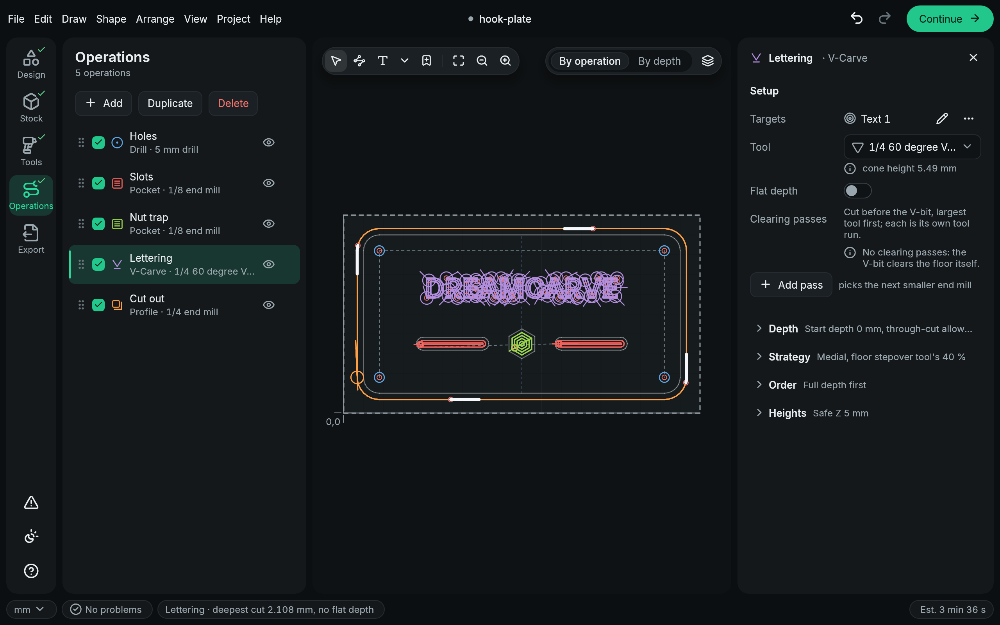

## 13. Export

Open **Export**:

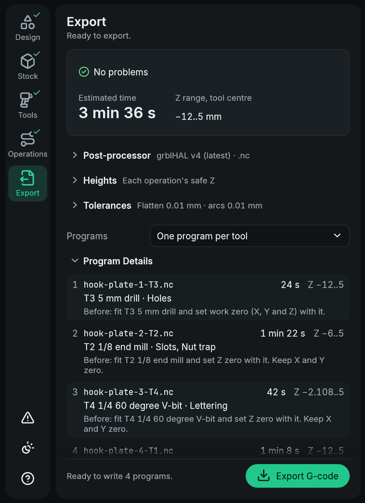

The project has four tools, so **Export G-code** writes four programs,
numbered in the order to run them. Each row says what to do before its
program: fit the bit, and set Z zero with it on the top of the board.
X and Y zero are set once, before the first, and kept.
[From SVG to G-code in the app](app.md) and
[Checking and exporting](../user-guide/exporting.md) explain the Export
step and what to do at the machine. Read
[Safety](../user-guide/safety.md) before the first cut.

## Change it

A drawn shape keeps its sizes, so a design can change after it is
drawn. Suppose the slots should be 8 mm wide:

1. On **Design**, click `Slot 1` in the Shapes list.
2. In **Properties**, the **Slot** section at the top has **Length** and
   **Width**. Type `8` into **Width** and press Enter.

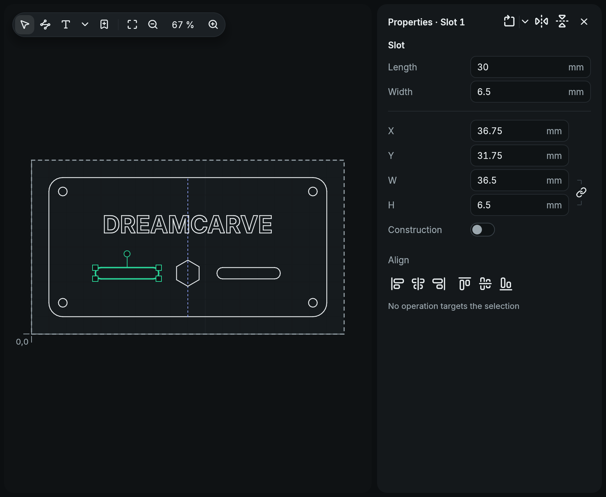

Both slots widen, each about its own centre line, because the second is
a linked copy of the first. The `Slots` pocket is marked as out of date
and cut again from the new outline; **Export** waits until it has been.

To change one of them alone, select it and choose **Shape ▸ Make
Unique** first. It is then a shape of its own, and a size typed on it
changes nothing else.

## Where to go next

- [Drawing shapes](../user-guide/drawing-shapes.md): every drawing tool
  and what its sizes are.
- [Editing nodes](../user-guide/editing-nodes.md) and
  [Changing shapes](../user-guide/changing-shapes.md): reshape a path,
  round a corner, offset, weld and trim.
- [Tracing a picture](../user-guide/tracing.md): draw over a photo or a
  scan.
- [Measuring](../user-guide/measuring.md): check a distance before you
  cut.
