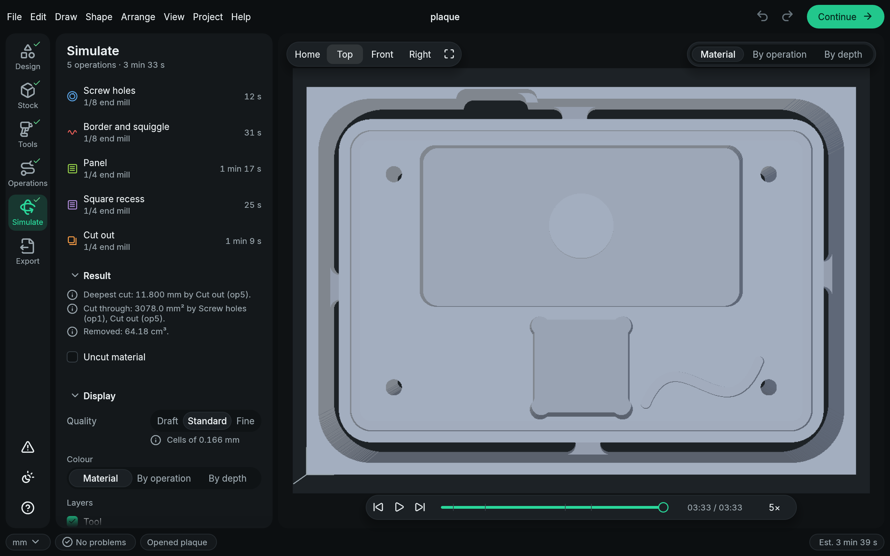
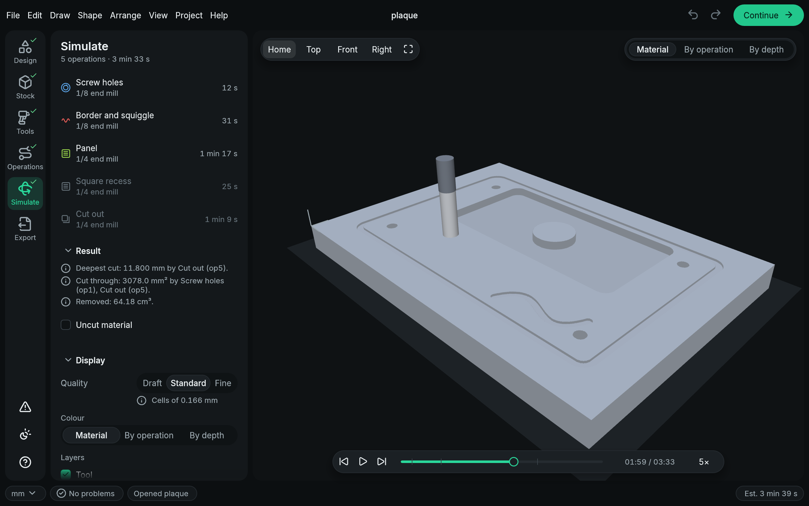
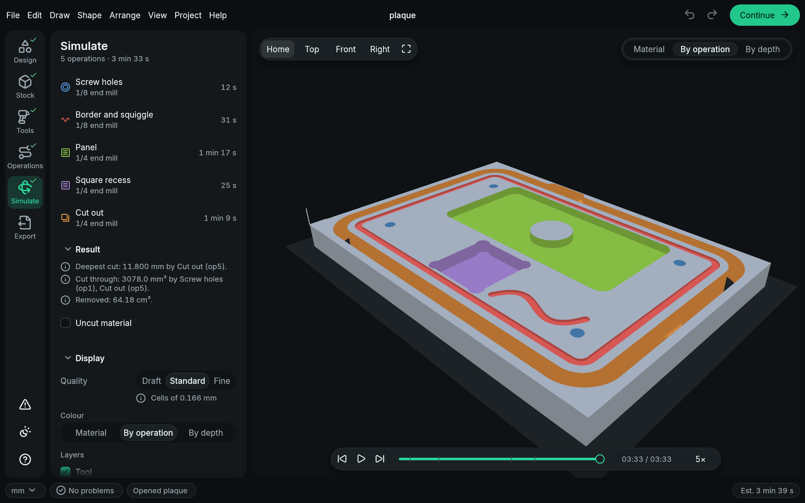
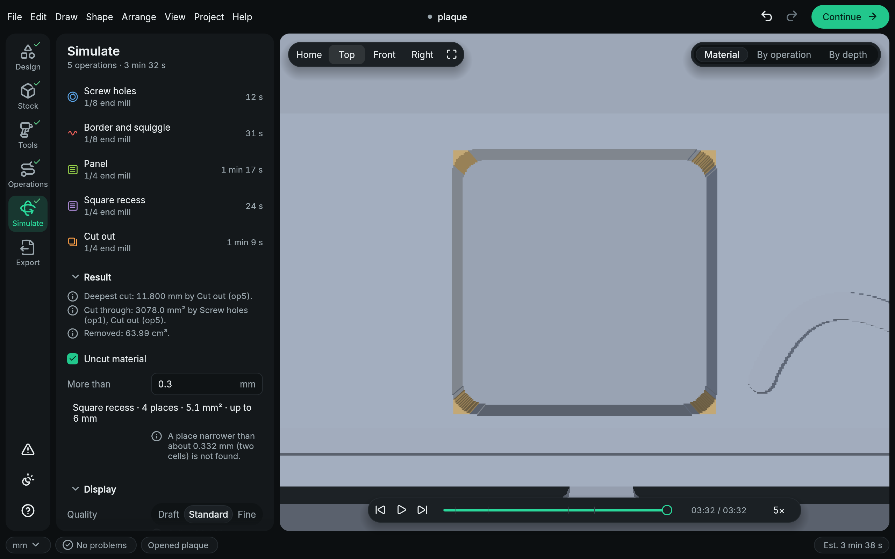

# Check the cut in 3D

Before you clamp anything down, you can watch the job on the screen. The
**Simulate** step cuts every toolpath into a block the size of your
stock, with the shape of each bit, and shows what is left. This chapter
looks at the plaque of
[A pocketed plaque from DXF](plaque.md) that way. It takes five minutes,
cuts nothing, and changes nothing in the project.

## What you need

- The DreamCarve app, `dreamcarve-app`. See
  [Installing](installing.md#the-app).
- Nothing else. The plaque is one of the examples on the app's start
  screen.

## 1. Open the plaque and go to Simulate

Start the app. On the start screen, under **Examples**, click
**Plaque**. It opens as an untitled copy, with its five operations and
their toolpaths.

Click **Simulate** in the rail, between Operations and Export, or press
Ctrl 5 (⌘5 on macOS). For a moment the status bar says *Simulating…*;
then the Viewport shows the finished plaque as a solid block:

- the large panel pocketed 4 mm deep, with the round island left
  standing in it;
- the square recess, 6 mm deep, with a notch in each corner;
- the engraved border and squiggle;
- the four screw holes, bored through;
- the cut-out all the way round, with the tabs still holding the plaque
  to the waste.

Under the stock is the **bed**. Where a cut goes right through, as in
the screw holes and the cut-out, you see the bed through it.

The panel at the left says *5 operations · 3 min 33 s* and lists them in
the order they are cut.

## 2. Look round it

Drag on the stock to turn it. Turn the wheel to come closer; the point
under the pointer stays where it is. Drag with the right button, or hold
Shift and drag, to slide it.

The buttons at the top left take you to four fixed views. Try **Top**
(or press 7): the plaque from straight above, as the other steps draw
it. **Home** (the Home key) brings back the view you started with, and
**Fit** (F) shows the whole stock again.

Move the pointer over the floor of the large pocket. The read-out at the
bottom left gives the place and the depth, and names the operation that
cut there, for example `X 112.4  Y 71.0  Z -4.0 · Panel`. Over the
square recess it ends `Z -6.0 · Square recess`. The plaque's origin is
the stock's top, so a depth reads as a negative Z. This is the quickest way to check a depth
you typed.

## 3. Watch it being cut

Press **Play** at the bottom of the Viewport, or press Space. The stock
starts again uncut, the tool appears, and the job plays: first the screw
holes, then the border, and so on. The time into the job counts up
beside the scrubber.

- **Speed**, at the right of the transport, sets how fast: try 25×.
- Drag the **scrubber** to any moment of the job, backwards too.
- Press Space again to pause.

Now click the row **Panel** in the list. The Viewport shows the stock as
it is when the Panel pocket is done: the holes, the border and the
pocket are cut, and the square recess and the cut-out are not yet. Their
rows are dimmed. **[** and **]** step from one operation's end to the
next.

This is how you check the order of the cuts. The screw holes are bored
while the plaque is still part of the board, and the cut-out comes last.

## 4. See which operation cut what

At the top right, choose **By operation**. Every cut surface takes the
colour of the operation that cut it last, the same colours as the list.
The walls of the cut-out are the cut-out's colour; the floor of the
recess is the recess's.

**By depth** colours every cut surface by how deep it is, pale near the
top of the stock and dark at the deepest cut, with a legend at the right.
**Material** brings back the plain stock.

## 5. Ask what is left

A round bit cannot cut a square inside corner. The plaque's square
recess has **corner relief** for that: a small notch in each corner, so
a square block fits. To see what the relief is for, take it away and
ask the simulation.

1. Click **Operations** in the rail and click **Square recess**. In the
   Inspector, set **Corner relief** to **None**.
2. Click **Simulate** again. The simulation is made again from the
   square recess on; the three operations before it are kept.
3. In the panel, under **Result**, tick **Uncut material**.

The four corners of the recess turn amber on the stock, and the panel
lists them:

*Square recess · 4 places · 5.1 mm² · up to 6.0 mm*

Click that line. The view goes to the top and closes in on the recess.
Each corner has a small fillet of material the 1/4 in bit could not
reach, the full 6 mm deep. A square block will not go in.

Press Ctrl Z (⌘Z) to undo the change. The relief comes back, the
simulation follows, and the list says *No uncut material.*

Uncut material is not a warning, and it is off until you tick it. Most
projects have some, and often it is what you want: a rounded inside
corner is fine for a tray. It is there for when you need to know.

## What a simulation does not tell you

The simulation is geometry. It knows the toolpaths and the shape of
each bit. It does not know where your clamps are, how the wood will
tear, whether the bit is sharp, or whether your machine can do what the
program asks. A drill and an engraving bit are cut as plain flat
cylinders, because the project holds no point angle for them, and the
panel says so when you use one.

So a clean simulation is a good sign, not a licence. Air cut first, as
every quick start says, and read [Safety](../user-guide/safety.md).

## Next steps

- [Simulation](../user-guide/simulation.md) has every control, the
  quality settings and what uncut material can and cannot find.
- `dreamcarve simulate plaque.dcv` prints the same result from the
  command line, and can write the finished stock as a picture
  ([Overview](../user-guide/overview.md#dreamcarve-simulate-dcv)).
