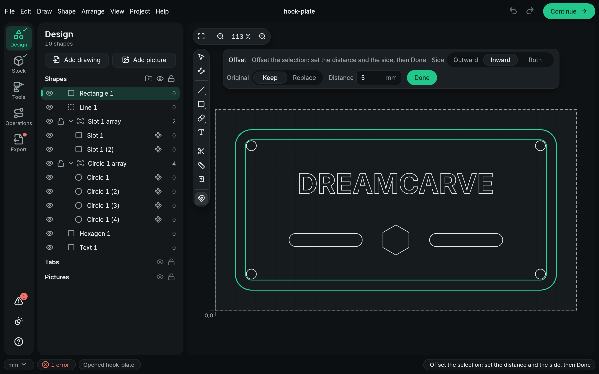

# Changing shapes

The **Shape** menu makes new outlines from the ones you have: a border
round a shape, two shapes made one, a hole taken out of another shape.
The **Trim** tool cuts outlines where they cross.

The commands that need a value, **Offset…**, **Fillet Corners…** and
**Join…**, take it in the [tool bar](drawing-shapes.md#the-tool-bar):
select the shapes, choose the command, set the value, and click **Done**
or press Enter. **Escape** leaves with nothing changed.

## Offset

**Shape ▸ Offset…** (**Shift+O**) makes an outline a set distance from a
shape: a border, a recess a little larger than a part, a line to engrave
beside an edge.

| Setting | What it is |
| --- | --- |
| **Distance** | How far from the shape |
| **Side** | **Outward**, **Inward** or **Both**. An open path has **Left** and **Right**, as seen along the direction it was drawn. |
| **Original** | **Keep** it, or **Replace** it with the offset |

The result is previewed as you change the values. Arcs stay arcs, and
an outside corner is rounded, as a toolpath is. A shape with a hole
grows outward while its hole shrinks.

Each selected shape is offset on its own. The new shapes are named
`<name> offset`. An inward offset by more than half a shape's width
leaves nothing, and the status bar says so.

## Weld, Subtract and Intersect

Select two or more **closed** shapes and choose from the **Shape**
menu:

| Command | Result |
| --- | --- |
| **Weld** | One shape covering everything the selected shapes cover |
| **Subtract** | The first shape you selected, with the others taken out of it |
| **Intersect** | Only what all the selected shapes share |

The result takes the place of the shapes it was made from. It is a new
path, named for the first shape, and an operation that cut the first
shape cuts the result.

Notes:

- The order you select in matters to **Subtract**: the first shape is
  the one that is kept.
- Curved edges come out as short straight pieces, within the project's
  flatten tolerance. The program still has arcs where they fit.
- Welded shapes that do not touch become one shape with several
  outlines.
- When there would be nothing left, nothing changes and the status bar
  says why.

Lettering whose letters overlap is a common use of **Weld**: script
letters imported as separate outlines carve as one once they are welded.

## Trim

Click **Trim** in the tool strip. Move the pointer over an
outline: the part under the pointer, between the two nearest crossings,
is highlighted. Click to remove it.

- A closed outline opens. An open one gets shorter, or becomes two
  shapes when you take a piece from its middle.
- An outline that nothing crosses has no part to trim, and the status
  bar says *Nothing crosses this outline*.
- A shape that keeps its sizes becomes a path when it is trimmed.

**Escape** puts the tool down.

## Join

**Shape ▸ Join…** (**Ctrl+J**, **⌘J**) makes one path of open paths
whose ends meet. Ends within the **Tolerance**, 0.1 mm at first, are
joined, with a straight piece across any gap. A chain whose two ends
meet becomes a closed outline.

This is what the DXF importer does to a file's loose lines when you
import it. Use it when a drawing arrives as pieces that should be one
outline: a Pocket and an Outside Profile need a closed one.

Paths that reach nothing are left alone, and the status bar counts
them.

## Fillet Corners

**Shape ▸ Fillet Corners…** rounds every corner of one shape that can
take the radius you type. [Editing nodes](editing-nodes.md#fillet-and-chamfer)
has fillets and chamfers for single corners.

## Convert to Path

**Shape ▸ Convert to Path** turns a shape that keeps its sizes into a
plain path with the same outline. See
[Drawing shapes](drawing-shapes.md#shapes-that-keep-their-sizes).
