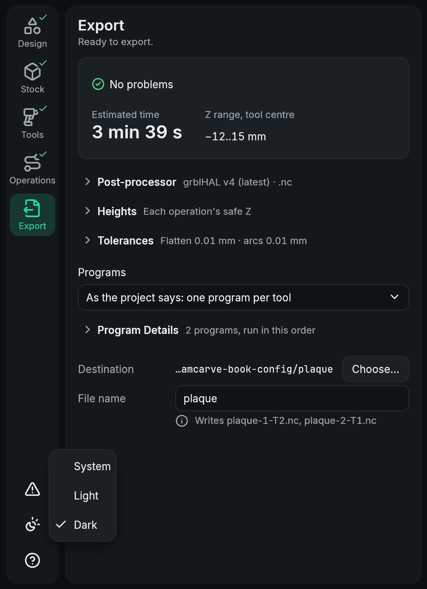

# Configuration

DreamCarve keeps a small amount of per-user configuration outside your
projects: defaults for new projects, your machine's rapid rate for the
run-time estimate, your [tool library](tool-library.md), and what the
app remembers between sessions ([The app's
preferences](#the-apps-preferences)). A project
file never depends on it: everything a project exports with is in the
`.dcv`, so a project exports the same on any machine.

## Where it lives

Run `dreamcarve config path` to see the locations on your machine and
whether each exists:

```text
Config directory: /Users/you/Library/Application Support/dreamcarve (exists)
Config file:      /Users/you/Library/Application Support/dreamcarve/config.toml (exists)
Tool library:     /Users/you/Library/Application Support/dreamcarve/tools.json (not found)
```

The directory is the operating system's usual place for an application's
settings:

| | Config directory |
| --- | --- |
| macOS | `~/Library/Application Support/dreamcarve` |
| Linux and others | `$XDG_CONFIG_HOME/dreamcarve`, or `~/.config/dreamcarve` when `XDG_CONFIG_HOME` is not set |
| Windows | `%APPDATA%\dreamcarve` (for example `C:\Users\you\AppData\Roaming\dreamcarve`) |

These come from the environment (`HOME`, `XDG_CONFIG_HOME`, `APPDATA`); if
the one your platform needs is not set, commands that need the directory
stop with an error naming it. DreamCarve never creates `config.toml`; make
it when you want to set something. The first `dreamcarve tools` command
that changes the tool library creates `tools.json`, and the directory if
it is missing.

To use another directory, set the environment variable
`DREAMCARVE_CONFIG_DIR` to it. Everything, the config file and the tool
library, is then looked up there. This is useful for a portable setup, or
for trying a setting without touching your own:

```sh
DREAMCARVE_CONFIG_DIR=/tmp/dc-try dreamcarve config path
```

## The config file

`config.toml` is a [TOML](https://toml.io) file. Every setting is optional;
a missing file, or a missing setting, means the default. The whole file
today:

```toml
[export]
tool_change_mode = "separate_programs"   # or "m6"

[estimate]
rapid_mm_min = 5000   # your machine's rapid rate; unset by default
scale_factor = 1.0
```

| Setting | Meaning |
| --- | --- |
| `export.tool_change_mode` | The `tool_change_mode` that `init` and `export --post --reset-settings` write into a new project's `post_processor` block, and that `export --post` writes when it resets the project's mode ([Switching keeps your settings](post-processors.md#switching-keeps-your-settings)): `"separate_programs"` (the default, one program per tool run) or `"m6"` (one program with `T<n> M6` tool changes, grblHAL only). See [Projects with more than one tool](post-processors.md#projects-with-more-than-one-tool). |
| `estimate.rapid_mm_min` | Your machine's rapid rate, in mm/min, for the [estimated run time](#estimated-run-time) that `export` and `check` print. A number above 0. Unset (the default), the estimate gives the rapids' distance and leaves their time out, rather than guess a rate. |
| `estimate.scale_factor` | What every time in the estimate is multiplied by. A number above 0; 1 by default. |

`init` and `export --post` read `[export]`, when they create a new
`post_processor` block. A plain `export --post` keeps the project's own
mode unless the new post-processor cannot use it. A default the chosen post-processor cannot honour (`"m6"` with any
post-processor but grblHAL, the only one with `M6`) stops the command with an error naming the config file,
so a project that `check` would reject is never written.

`export` and `check` read `[estimate]` for the printed estimate only. It
never changes a program: the same project exports the same bytes with any
`[estimate]`, or none. A bad value in the file still stops them, with
nothing written (see [Mistakes in the file](#mistakes-in-the-file)).

## The app's preferences

The app reads `config.toml` for one thing: `[estimate]`, for the
estimated times it shows. It does not read `[export]`: a project made in
the app starts with one program per tool, and you choose otherwise on the
Export step. What the app itself remembers from one session to the next
is in a second file, `gui.toml`, in the same config directory:

| | `gui.toml` |
| --- | --- |
| macOS | `~/Library/Application Support/dreamcarve/gui.toml` |
| Linux and others | `$XDG_CONFIG_HOME/dreamcarve/gui.toml`, or `~/.config/dreamcarve/gui.toml` when `XDG_CONFIG_HOME` is not set |
| Windows | `%APPDATA%\dreamcarve\gui.toml` |

`DREAMCARVE_CONFIG_DIR` moves it with everything else. `dreamcarve
config path` does not list it.

The app writes the file itself, when a preference changes and when it
closes. You never need to edit it. This is what it holds:

| In the file | Remembers |
| --- | --- |
| `theme` | The [appearance](#appearance): `"dark"`, `"light"` or `"system"` |
| `[window]` | The window's size and place on the screen |
| `[panels]` | The widths of the step panel and the Inspector, and whether the step panel shows |
| `[sections]` | Which groups you left open: in the operation editor, for each kind of operation, and on the Export step |
| `[visibility]`, `colour` | The **Layers** ticks, and **By operation** or **By depth** |
| `recent` | The last ten projects you opened, for the start screen and **File ▸ Open Recent** |
| `[export_dirs]` | The folder each project was last exported to |
| `[tab]` | The size and shape of the last tab you set, which the Tab tool gives a new tab |
| `library_units` | The Tool Library sheet's **mm** or **in** |

A file after a short session looks like this:

```toml
theme = "system"
colour = "by_depth"
recent = ["/Users/you/cnc/plaque/plaque.dcv"]

[panels]
left_width = 312.0
left_open = true
right_width = 328.0
right_open = true

[sections]
"operation.pocket.depth" = true

[visibility]
cuts = true
rapids = true
plunges = true
arrows = false
start_points = true
tab_marks = true
grid = true
extents = false
only_selected = false

[export_dirs]

[tab]
width_mm = 8.0
height_mm = 3.0
shape = "rect"
```

None of this is part of a project, and none of it changes a program:
`gui.toml` is how you look at your work, not the work.

**It is safe to delete.** Close the app and delete `gui.toml`: the next
start uses the defaults (a dark window of 1280 × 800, every group
closed, no recent files) and writes a new file. Your projects, your tool
library and `config.toml` are not touched.

The app is also forgiving about this file, where it is strict about
`config.toml`. A `gui.toml` it cannot read, or one written by another
version of DreamCarve with a key this one does not know, never stops the
app from starting: what cannot be read is left at its default.

### Appearance

The app is dark until you choose otherwise. Click **Appearance** in the
rail, or choose **View ▸ Appearance**:



| Choice | The app is |
| --- | --- |
| **System** | Light or dark as your operating system is, and it follows when the system changes |
| **Light** | Light |
| **Dark** | Dark. This is what a new installation uses |

The choice applies at once and is written to `gui.toml` as `theme`.
[The app](the-app.md#appearance) has a picture of the light appearance.

## Estimated run time

After it writes the programs, `export` prints how long each one should
take, and for one program per tool run, the total. `check` prints the same
once the program builds:

```text
Estimated time: 46 s (cutting 43 s, dwells 3 s); 21 mm of rapids not included: set [estimate] rapid_mm_min in config.toml. Excludes acceleration.
```

It is worked out from the program as written, the way VCarve's
"Estimating Machining Times" works one out:

- **Cutting** is every feed move (`G1`, `G2`, `G3`, ramps and plunges
  included) at its programmed feed rate. An arc is measured along the
  arc, and a helix along its spiral.
- **Dwells** are the `G4` waits: the spindle spin-up and a Drill's dwell
  at the bottom of each hole.
- **Rapids** (`G0`) are timed at `rapid_mm_min` when you set it.
  DreamCarve cannot know how fast your machine rapids, so without it the
  line gives their distance instead. The first move of a program starts
  wherever the machine was left, so its length is not counted.
- **Not included**: acceleration and slowing down at corners, and the time
  the machine waits at each pause or tool change. The line counts those
  ("Excludes acceleration and 2 pauses."). Real jobs take longer than the
  estimate, most of all with many short moves.

With a rapid rate and a scale factor set, the line names both:

```text
Estimated time: 28 s (cutting 20 s, dwells 6 s, rapids 2 s at 3000 mm/min; scale factor 2). Excludes acceleration.
```

To calibrate the scale factor, time a real job and divide the time it
took by the estimate (made with the same `rapid_mm_min`). The result is
your `scale_factor`, as with VCarve's.

## Mistakes in the file

A file that does not parse, and a setting DreamCarve does not know, are
errors, never silently ignored: a typo in a setting name would otherwise
turn into the default without a word. The message names the file, line
and column, in the form your editor or terminal can open:

```text
error: /Users/you/Library/Application Support/dreamcarve/config.toml:2:1: unknown field `tool_change_mod`, expected `tool_change_mode`
```

A value out of range is an error at the value:

```text
error: /Users/you/Library/Application Support/dreamcarve/config.toml:2:16: must be a number above 0, not 0
```
