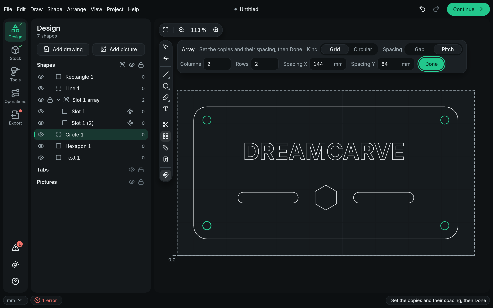
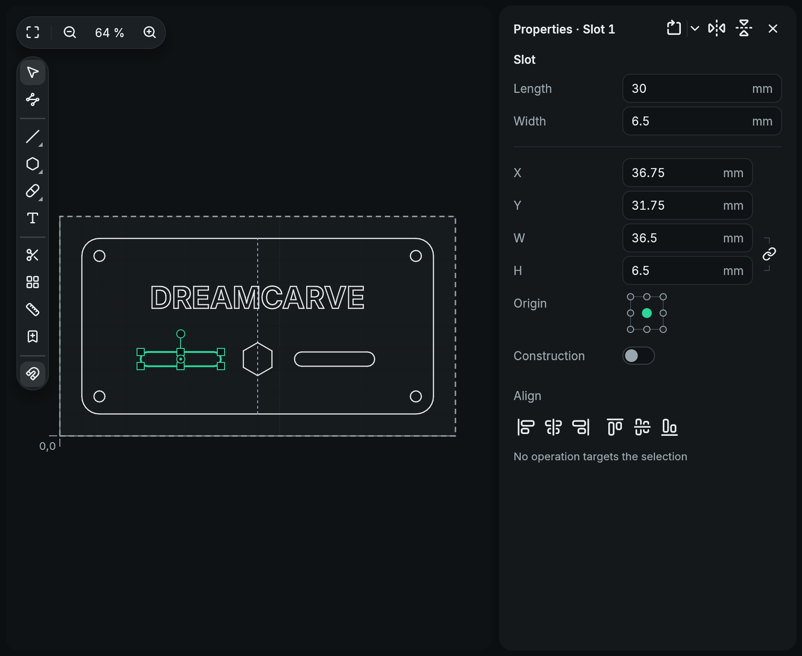

# Copies, arrays and alignment

This chapter covers making more of a shape, and lining shapes up.

## Linked copies

**Edit ▸ Duplicate** (**Ctrl+D**, **⌘D**) makes a **linked copy**: the
same shape placed again. Each copy has its own position, rotation and
size, but they share one outline. Change the outline of one, by a typed
size or by [editing its nodes](editing-nodes.md), and all of them
change.

That is what you want for four identical feet or a row of slots: one
edit changes them all.

**Alt**-drag a shape to drag a linked copy out of it, leaving the
original where it was.

In the Shapes list a linked copy has a small mark at the right of its
row.

### Make Unique

To change one copy alone, select it and choose **Shape ▸ Make Unique**.
It gets an outline of its own, and an edit to it changes nothing else.

A linked copy cannot be stretched to a different shape from its
siblings. The status bar says *Make Unique to stretch this copy*.

## Cut, copy and paste

**Edit ▸ Cut**, **Copy** and **Paste** (**Ctrl+X**, **C**, **V**; **⌘**
on a Mac) work on the selected shapes.

- **Paste** puts the copies under the pointer when it is over the
  Viewport. Otherwise it puts them 10 mm from the originals, and 10 mm
  further each time.
- Pasted shapes are shapes of their own, not linked copies.
- The clipboard is the app's. It survives opening another project in
  the same window, so you can carry shapes from one project to another.

A right-click on a shape opens the same menu as its row in the Shapes
list, with Cut, Copy, Paste, Duplicate and Delete in it.

## Arrays

**Array** makes copies in a pattern. Select what to copy, then click
**Array** in the tool strip at the Viewport's left (it is greyed until
something is selected), or choose **Arrange ▸ Array…**, or **Array…**
in the menu a right-click on a shape opens. Set the values in the tool
bar, and click **Done**.
The copies are previewed as you type.

A **Grid** is rows and columns:

| Setting | What it is |
| --- | --- |
| **Columns**, **Rows** | How many across and up, the selection among them |
| **Spacing** | **Gap**: from one copy's side to the next copy's near side. **Pitch**: from one copy to the same point of the next. |
| **Spacing X**, **Spacing Y** | The spacing across and up. A negative spacing goes left or down. |

A **Circular** array is copies round a centre:

| Setting | What it is |
| --- | --- |
| **Count** | How many, the selection among them |
| The centre | Click it on the Viewport, where it snaps, or type its **X** and **Y** |
| **Angle** | The angle the copies are spread over; 360 is all the way round, anticlockwise |
| **Copies** | **Turn** each copy to face the centre as the selection does, or **Keep upright** |

The selection is the first of the array and stays where it is. The
copies are linked copies of it, filed with it in a
[group](groups-and-construction.md#groups) named `<name> array`.

An array is not remembered as an array. Once made, it is copies: to
change the spacing, undo and make it again, or move the copies.

## Align

Select shapes, and the **Properties** panel has an **Align** row under
the placement fields. **Arrange ▸ Align** has the same commands.

| Command | Moves each shape so that |
| --- | --- |
| **Left**, **Centre**, **Right** | Its left side, middle or right side meets the selection's |
| **Top**, **Middle**, **Bottom** | Its top, middle or bottom meets the selection's |

- With **one** shape selected, it aligns to the **stock**. **Centre**
  and then **Middle** put a shape in the middle of the board.
- With several selected, turn **To stock** on to align them to the
  stock and not to each other.
- A locked shape does not move, but the others can be aligned to it.

## Distribute

With three shapes or more selected, **Distribute** spaces them evenly
between the two outermost, **Horizontally** or **Vertically**, by equal
gaps or by equal distances between centres.
