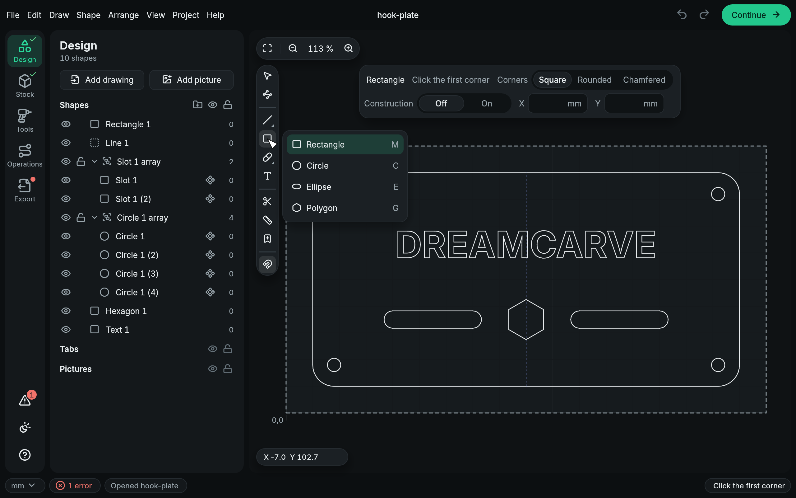
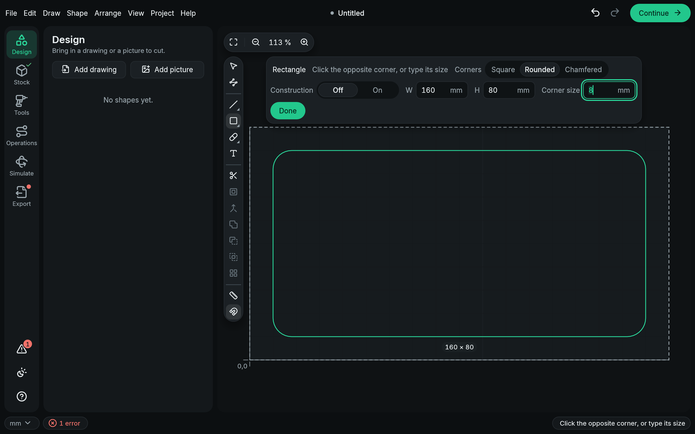

# Drawing shapes

You can draw a part in the app instead of importing a drawing. This
chapter covers the drawing tools, the tool bar they share, and what each
shape's sizes are. For a part drawn start to finish, see the quick start
[Your first design](../quick-start/first-design.md).

A drawn shape is a shape like any other: it is listed on the **Design**
step, placed and arranged as [Placing shapes](placing-shapes.md) says,
and cut by any operation. Nothing about how it was made reaches the
machine. An operation cuts the outline you see.

## The tools

The Viewport has one tool in hand at a time, shown pressed in the
**tool strip** down its left side. Rules divide the strip into four
parts:

| Part | Tools | What they do |
| --- | --- | --- |
| Select and edit | **Select** (V), **Edit nodes** (N) | Select, move, resize and turn shapes; reshape a path ([Editing nodes](editing-nodes.md)) |
| Draw | The **line tools**, the **shape tools**, the **slot and gear tools**, **Text** (Shift+T) | Draw new shapes |
| Change what is drawn | **Trim**, **Offset** (Shift+O), **Join**, **Weld**, **Subtract**, **Intersect**, **Array** | Cut an outline at a crossing, make an outline a set distance from another, make one path of several, combine closed shapes ([Changing shapes](changing-shapes.md)); copy the selection in a pattern ([Copies, arrays and alignment](copies-and-arrays.md#arrays)) |
| Measure and snap | **Measure** (K), **Snapping** (Shift+S) | Read a distance ([Measuring](measuring.md)); turn snapping on or off, and choose what a point snaps to ([Snapping and the grid](snapping.md)) |

**Offset**, **Join**, **Weld**, **Subtract**, **Intersect** and
**Array** act on the selection, so each is greyed until enough is
selected: one shape for Offset and Array, two for the others. Its
tooltip says what it needs.

The **Tab tool** is not in the strip. It is **Shape ▸ Tab Tool**, and
the T key ([Tabs](tabs.md#the-tab-tool)).

Three of the drawing buttons are **groups**, marked with a small
triangle at the corner. A group's button shows the tool of the group
you used last. Click it to take that tool; a list opens beside it with
the group's other tools, each with its key. Choose one there to take it
instead, or ignore the list and start drawing: it goes when you click
on the Viewport.

| Group | Tools |
| --- | --- |
| **Line tools** | Line, Arc, Spline |
| **Shape tools** | Rectangle, Circle, Ellipse, Polygon |
| **Slot and gear tools** | Slot, Gear |

The **Draw** menu in the menu bar lists every drawing tool too, and
above the strip a separate pill has the view's controls: **Fit** and
the zoom.

| Tool | Key | You give it |
| --- | --- | --- |
| **Line** | P | A point for each corner |
| **Arc** | A | The arc's end, then a point it passes through |
| **Spline** | S | Points the curve passes through |
| **Rectangle** | M | Two opposite corners |
| **Circle** | C | The centre, then a point on the circle |
| **Ellipse** | E | The centre, then a corner of its box |
| **Polygon** | G | The centre, then where a corner points |
| **Slot** | O | The centres of its two ends, then its width |
| **Gear** | | The centre and the outside radius, then its sizes |
| **Text** | Shift+T | Where the text starts, then its words ([Text and fonts](text.md)) |

A drawing tool **stays in hand** after each shape, with the choices you
last made, so you can draw several. **V**, or **Escape** with nothing
begun, puts it down. While a tool is in hand, clicks are the tool's:
nothing is selected or moved by a click.

Each new shape is named for its kind and the next free number,
`Rectangle 1`, `Slot 2`. A six-sided polygon is `Hexagon 1`.

## The tool bar

While a tool is in hand, a **tool bar** floats at the top of the
Viewport. It has the tool's name, a line saying what the next click
does, the tool's choices, and the fields of the step you are on.

Every step of every tool can be **typed** instead of clicked:

- Before the first point the fields are **X** and **Y**, measured from
  the origin.
- After it they are the sizes of the shape: **W** and **H** for a
  rectangle, **Diameter** for a circle, **Length** and **Angle** for the
  next piece of a line.
- **Tab** puts the keyboard in the bar's first field, and moves from
  field to field. **Enter** takes the step with the fields as they
  read.
- A value you type is **pinned**: the preview keeps it while the rest
  follows the pointer. Type a width, and the height still follows the
  mouse. **Escape** in a field unpins it.
- A field takes what any length field takes: `6.35`, `1/4 in`,
  `2 1/2 in`, or a sum such as `18 / 2 + 0.3`
  ([Formulas](keyboard.md#formulas)). An angle is in degrees,
  anticlockwise from the X axis.
- A value the tool cannot use, such as a width of zero, marks its field
  and draws nothing.

The shape being drawn shows its size beside it, and so does a selection
while you drag or resize it.

You can also use the pointer alone. Click each point, or press at the
first and drag to the second. **Shift** makes a rectangle square and an
ellipse a circle, and holds a line to steps of 15°. **Alt** draws a
rectangle from its centre. The pointer snaps as you move it; see
[Snapping and the grid](snapping.md).

## Shapes that keep their sizes

A rectangle, circle, ellipse, polygon, slot, gear and text **keep the
sizes they were drawn with**. Select one, and the **Properties** panel
has a section named for it above X, Y, W and H:

| Shape | Sizes |
| --- | --- |
| Rectangle | **Width**, **Height**, **Corners** (Square, Rounded, Chamfered), **Corner size** |
| Circle | **Diameter** |
| Ellipse | **Width**, **Height** |
| Polygon | **Sides** (3 to 50), **Radius**, measured **To the corners** or **To the flats** |
| Slot | **Length**, between the centres of its ends, and **Width** |
| Gear | See [Gears](#gears) |
| Text | See [Text and fonts](text.md) |

Typing a size changes the shape about its own centre, in one undo step.
Every [linked copy](copies-and-arrays.md) changes with it.

Some notes on the sizes:

- A **Corner size** is at most half the shorter side.
- A polygon measured **To the flats** has its radius to the middle of a
  side. A hexagon of radius 6.5 is then 13 mm across the flats, the
  size of the spanner that fits it.
- A rounded corner and a slot's ends are true arcs, and reach the
  program as arc moves.
- A size the shape cannot have is refused at its field, with the
  reason.

Dragging a corner handle with the proportion link open stretches a
rectangle, an ellipse and a slot into another of the same kind. A circle
stretched becomes an ellipse. A polygon, a gear and a text scale evenly
or not at all, and so does any of these once it is rotated.

These shapes are not edited node by node. To reshape one freely, choose
**Shape ▸ Convert to Path**. It becomes a plain path with the same
outline and no sizes to type. That cannot be reversed except with Undo.

## Lines, arcs and curves

**Line**, **Arc** and **Spline** draw one path between them. Each click
adds a point.

- With **Line**, the point is joined to the last by a straight piece.
- Press **A**, and the next piece is an arc: click its end, then a
  point it passes through. A typed **Radius** takes the place of the
  second click.
- Press **S**, and the pieces that follow are a smooth curve through
  the points you click. **P** goes back to straight pieces.

To finish:

- Click the first point again to **close** the outline. That needs
  three points or more, or two when one of the pieces between them is
  an arc: an arc and the line back across it.
- Press **Enter**, click **Done**, or double-click to finish it
  **open**.
- **Backspace** takes back the last point. **Escape** throws the whole
  path away.

An open path is drawn dashed. A Profile set to **On line** or an
Engrave cuts it; a Pocket or an Outside Profile needs a closed outline.

### Carrying a path on

Start or end a path on the **end of an open path** and the two are one
shape: the path you had, carried on. Bring its two ends together that
way and it **closes**. So an outline can be drawn a piece at a time,
with different tools, in any order: a line, later an arc from its end,
later a line back to its start. Nothing has to be joined afterwards.

- The end has to be hit exactly, which snapping to its **Endpoint**
  does, and so does typing its X and Y.
- The shape keeps the name, the place in the Shapes list and the
  operations of the path you started on, or, when you started in the
  open, of the one you ended on.
- It is one step for Undo, which takes the new piece away and leaves
  the path as it was.
- A closed shape, the middle of a path, a locked or hidden path and a
  linked copy are not carried on, and
  [construction geometry](groups-and-construction.md) is only by a path
  drawn as construction geometry.

To make one path of pieces already drawn apart, use
[Join](changing-shapes.md#join).

## Gears

The **Gear** tool takes a click for the centre and one for the outside
radius. The tool bar then holds the gear's sizes, previewed as you type,
and **Done** draws it:

| Size | What it is |
| --- | --- |
| **Teeth** | 6 to 200 |
| **Outside diameter** | Across the tips of the teeth |
| **Pressure angle** | 10° to 35°, for involute flanks |
| **Flanks** | Involute or Straight |
| **Whole depth** | From the tip of a tooth to its root |
| **Root** | Rounded, Flat or Sharp, with a **Root fillet** when rounded |
| **Crest** | Flat or Rounded, with a **Crest radius** when rounded |
| **Bore diameter** | A hole at the centre; 0 for none |

The **module** is shown under the fields: the outside diameter divided
by the number of teeth plus two. Two gears mesh when their modules and
pressure angles are the same.

## Construction geometry

The **Construction** choice at the end of every drawing tool's bar makes
the shapes that follow construction geometry: lines to draw by, which
are never cut. It stays as you set it. See
[Groups and construction geometry](groups-and-construction.md).
