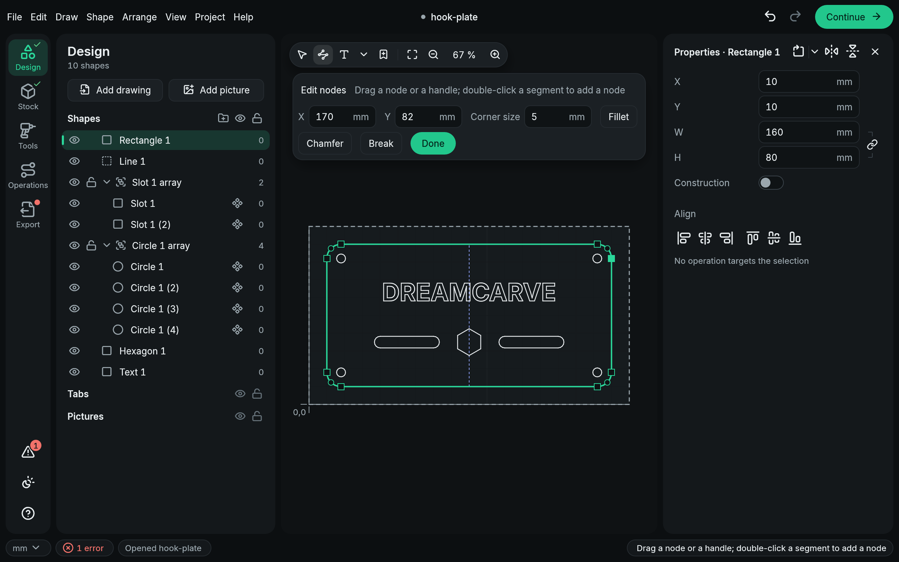

# Editing nodes

A **path** is made of **nodes** joined by straight pieces, arcs and
curves. The **Edit nodes** tool shows a path's nodes and lets you move
them, add and delete them, and change what joins them.

Select a path and press **N**, or double-click the path.

A rectangle, circle, slot or other shape that keeps its sizes is not a
path. Asked to edit one, the tool offers **Convert to Path** first. An
imported outline is a path already. Its curves were turned into short
straight pieces when it was imported, so a curve has many nodes.

**Escape**, **Enter**, **V** or a double-click on empty stock leaves the
tool, with the shape selected.

## Selecting and moving

- Click a node to select it. **Shift**-click adds one. Drag a box round
  several. **Ctrl+A** (**⌘A**) selects all.
- Drag a node, or the selected nodes together. The arrow keys nudge
  them.
- A dragged node [snaps](snapping.md).
- With one node selected, the tool bar shows its **X** and **Y**, and
  you can type them.
- Dragging a straight piece moves the node at each end of it.

## Arcs and curves

- An **arc** has a handle at its middle. Drag it to make the arc bulge
  more or less; its ends stay where they are. The tool bar shows the
  arc's **Radius**.
- A **curve**'s node has two handles. Dragging one keeps the other in
  line with it, so the curve stays smooth through the node. **Alt**-drag
  moves one handle alone and makes the node a corner.

## Adding and deleting

- **Add a node:** double-click a piece, or click it with **Ctrl**
  (**⌘**) held. The piece splits there and the outline does not change.
- **Delete nodes:** select them and press **Delete**. The gap is joined
  by a straight piece. A closed outline keeps at least three nodes.
- **Delete a piece:** click a piece to select it and press **Delete**.
  A closed outline opens there; an open one becomes two shapes.
- **Break** (the tool bar, or **B**): a closed outline opens at the
  selected node; an open one splits there in two.

## Joining ends

Drag the end node of an open path onto its own other end, and the path
closes. Drag it onto the end of another open path, and the two become
one shape.

## Changing a piece

Right-click a piece for **Make Straight**, **Make Arc** and **Make
Curve**.

## Fillet and chamfer

Select one or more corner nodes, type a **Corner size** in the tool bar,
and click:

- **Fillet** to round each corner with an arc that meets both sides
  smoothly.
- **Chamfer** to cut each corner back by that size along both sides.

Both need a corner between two straight pieces, and sides long enough to
take the size. A corner that cannot take it is left alone and named in
the status bar.

To round every corner of a shape at once, select the shape with the
Select tool and choose **Shape ▸ Fillet Corners…**. An inside corner
rounded to at least the radius of your bit is one the bit can follow
without a [dogbone](pocket.md).

## What an edit changes

Each edit is one undo step. A drag is one step when you let go.

- A [linked copy](copies-and-arrays.md) follows every edit, since the
  copies are one shape placed several times.
- An operation that cuts the shape is marked out of date and cut again
  from the new outline. **Export** waits until it has been.
- A [tab](tabs.md) stays on the outline. A tab on a piece you delete is
  deleted with it, and the status bar says so.
