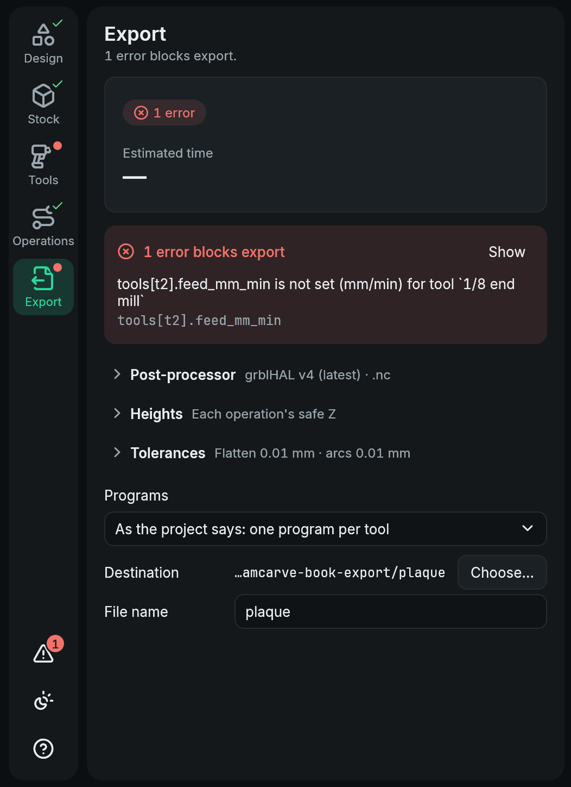

# Checking and exporting

Before a program is written, DreamCarve checks the whole project: every
value, every toolpath, and the program itself, move by move, against its
[safety rules](safety.md#what-dreamcarve-checks). In the app the check
runs by itself after every change. This chapter is about reading what it
finds, in the **Warnings drawer**, and about the **Export** step, which
writes the G-code.

From the command line the same two things are `dreamcarve check` and
`dreamcarve export`. They report the same findings in the same words and
write the same files.

## Errors, warnings and hints

A finding is one of three kinds.

| Kind | Means | Export |
| --- | --- | --- |
| **Error** | Something is missing or wrong: a thickness not set, a tool with no feed, a cut below the stock | Refused until it is fixed |
| **Warning** | Something you should look at: a step-down deeper than the bit is wide, an open path nothing cuts | Allowed |
| **Hint** | Something worth knowing that needs no action: a tool no operation uses | Allowed |

The status bar counts each kind, or says *No problems*. The **Warnings**
button in the rail carries the count of the worst kind found, in its
colour. A step whose content has an error or a warning has a dot in the
rail ([The app](the-app.md#the-five-steps)).

## The Warnings drawer

Click the counts in the status bar, the **Warnings** button in the rail,
or **View ▸ Warnings**. The drawer opens over the bottom of the Viewport:

![The Warnings drawer over the Viewport: "Warnings · 1 error" with Copy and a close button, and one row: error, "tools[t2].feed_mm_min is not set (mm/min) for tool 1/8 end mill", and the field's name at the right](figures/app/app-warnings-drawer.png)

Each row has:

- its **kind**;
- its **code**, such as `unused_tool`, when it has one. The
  [Warnings](warnings.md) chapter explains each code;
- the **message**, which names the operation, the shape or the tool;
- at the right, the **value** it is about, as the project file names it.

Rows are grouped by operation, with the project's own first, under a
heading for each group when there is more than one.

**Click a row** to go to what it is about. The app opens the step that
owns it: an operation's field in its editor, a tool in the Tools step, a
shape on the Design step, a stock or output setting in its step. In an
operation's editor the same message also shows under the field.

**Copy** puts the whole list on the clipboard, as `dreamcarve check`
prints it, which is the form to paste into a bug report.

### Notes

An operation that carves (a V-Carve, an Inlay, a Photo V-Carve) also has
a **note** in the drawer: what the carve comes to, such as its deepest
cut, its flat floor and the ridges left on it. A note is information, not
a problem, and is not counted. The status bar's message shows the
selected carve's note in one line, and a click on it opens the drawer
there.

## The Export step

**Export** is the last step in the rail. **File ▸ Export G-code…** and
Ctrl E (⌘E on macOS) open it too. On this step the header's green button
reads **Export G-code**.

### Is it ready

The card at the top shows the counts, the **estimated time** of the
whole job, and the **Z range** the bit will move through.

The estimated time is the cutting and the spindle's spin-up waits at the
feed rates you set. It leaves out the rapids unless you give your
machine's rapid rate in the
[configuration](configuration.md#estimated-run-time), and it does not
know how your machine speeds up and slows down, so the real job takes a
little longer.

While an error blocks export, the step lists it, and **Export G-code** is
off, with the reason in its tooltip:

Click the finding to go and fix it. **Show** opens the Warnings drawer.
Warnings are not listed here; the counts at the top include them. Read
them before you export.

### Output settings

Three groups hold the settings that shape the program. Each is closed
until you open it, with its values on its header.

- **Post-processor**: the **Controller** your machine runs, and how the
  program is written for it: the file extension, whether the program
  switches the spindle or pauses for you to switch a router, how long to
  wait for the spindle to reach speed, and whether each tool gets its own
  program. A setting a controller does not have is not offered, with the
  reason. Switching controller keeps the settings the new one can use and
  says which it reset. [Post-processors](post-processors.md) explains
  every setting and each controller.
- **Heights**: the clearance height, the tool-change height and the park
  point ([Stock, origin and heights](stock-and-origin.md#the-heights)).
- **Tolerances**: **Flatten**, how far a flattened curve may stray from
  the true one, and **Arc fitting**, how far a fitted arc may stray from
  the lines it replaces ([Arc fitting](project-file.md#arc-fitting)).

These are project settings: they are saved with the project and Undo
takes a change back.

### The programs

A job that uses one tool is one program. With more than one tool, the
project says how they are split, and the **Programs** menu shows it:

- **As the project says**: one program per tool, or one program with
  tool changes, whichever the Post-processor group's **Tool change** is
  set to.
- **One program per tool, this export only**.
- **One program with M6 tool changes, this export only**, on a
  controller that has `M6`.

The last two change this export and are not saved.

A project with an Inlay has a tick for each board, **Female board** and
**Male board**. Untick one to export the other alone, which is how you
cut the plug again after a test fit. The ticks are not saved either.

**Program Details** lists each program the export will write, in the
order to run them: its file name, its tool, its operations, its time and
Z range, and what to do before you start it: fit this bit and set work
zero with it, or fit the next bit and set Z zero only. Operations run in
the order of the Operations list, and a tool that is needed again later
gets a second program.

### Where they go

**Destination** is the folder, beside the project file unless you
**Choose…** another; the app remembers it for the project. **File name**
is the start of each program's name, and the line under it lists the
files that will be written.

A project that has never been saved has no folder, so **Export G-code**
asks for one first.

### Exporting

Click **Export G-code**. The app writes every program, or none: if one
cannot be written, nothing is. It never writes over the project file, and
exporting never changes the project.

The step then shows what was written:

- **The files**, in the order to run them, with each one's tool and
  time, and the **folder**, with a button to copy its path and **Show in
  folder**.
- **Run instructions**: for each program, what to do before you start
  it, its extents and its time; then notes about your controller, such as
  what the program does and does not do with tool length offsets.
- **Done** brings the plan back, to export again or somewhere else.

The result stays until you click **Done** or change the project. Once
the project changes, the files on disk are no longer what it would
write, and the rail's check on **Export** goes: export again.

### The setup sheet

**Save setup sheet…** writes one page to take to the machine, by default
`<name>-setup.html` beside the programs. Open it in a browser and print
it. It has the project's name and the date, the post-processor, the
stock and the origin, then each program in the order to run it, with its
tool, its operations, what to do before it, its time, its extents and its
Z range, and the export's warnings and notes.

**File ▸ Save Setup Sheet…** saves it again for the last export.

## Before you cut

A program that exported cleanly has passed DreamCarve's checks. It has
not been checked against your machine. Before every first run of a
program:

- check that the bit in the spindle is the one the program names, and
  that work zero is set with that bit where the project's origin says;
- place clamps outside the program's extents
  ([Toolpath preview](toolpath-preview.md#program-extents));
- do an air cut: set Z zero above the stock and run the whole program
  once.

[Safety](safety.md) says what DreamCarve checks, what it cannot, and what
to do before every cut.
