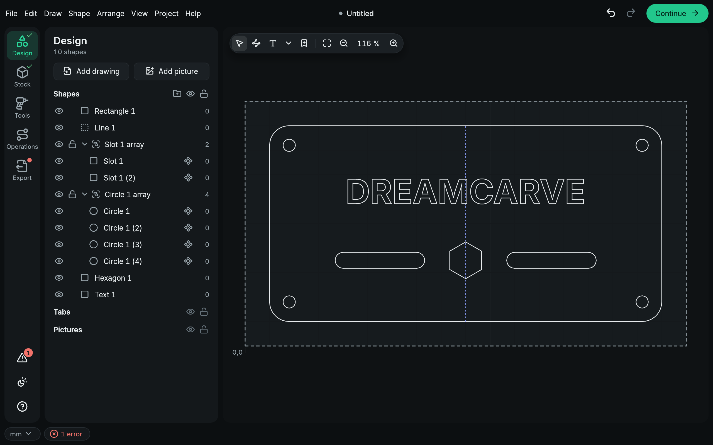

# Folders, groups and construction geometry

A drawing of more than a few shapes is easier to work with when it is
organised. The Shapes list on the **Design** step can file shapes in
folders, groups can keep shapes together on the Viewport, and
construction geometry marks the lines that are there to draw by.

## Folders

- **New Folder**, the button in the Shapes header or a row's menu,
  makes a folder holding the selected shapes, or an empty one.
- Drag rows into a folder, out of one, or from one to another. A line
  shows where they will go. A selected row takes the rest of the
  selection with it.
- Double-click a folder's name to rename it.
- A folder's arrow folds its rows away. Its eye and padlock hide and
  lock every shape in it. Its count is how many shapes it holds.
- A click on a folder selects its shapes.

Folders do not nest.

Dragging rows also reorders them. The order of the list is the order
the shapes are saved and drawn in.

**Delete** on a folder deletes the folder **and its shapes**, in one
undo step. To keep the shapes, choose **Ungroup** from its menu, or
drag them out first.

## Groups

A **group** is a folder whose shapes act as one on the Viewport.
Select two or more shapes and choose **Arrange ▸ Group** (**Ctrl+G**,
**⌘G**).

- A click on any shape of a group on the Viewport selects all of them,
  so they move, turn and scale together.
- A double-click reaches the one shape.
- In the Shapes list, a click on a row selects that row alone.

**Arrange ▸ Ungroup** (**Shift+Ctrl+G**, **⇧⌘G**) dissolves the group
and keeps the shapes.

An [array](copies-and-arrays.md#arrays)'s copies arrive in a group.

## Construction geometry

**Construction geometry** is a shape you draw to draw by: a centre
line, a circle that holes sit on, the edge of a part this one must fit.

A construction shape:

- is drawn thin and dashed, in its own colour;
- [snaps](snapping.md) and [measures](measuring.md) like any shape;
- is **never cut**. No operation offers it. The checks of the artwork
  ignore it, so an open construction line raises no warning. **Fit
  stock to shapes** ignores it.

To make shapes construction geometry:

- While drawing, click **On** beside **Construction** in the tool bar.
  It stays on for the shapes that follow, in every drawing tool, until
  you click **Off**.
- For a shape already drawn, turn on **Construction** in its
  **Properties**, or tick **Shape ▸ Construction**, or use the row's
  menu.

Marking a shape that an operation cuts takes it **out of that
operation**. The Warnings drawer says which operation is left with
nothing to cut. Turning Construction off again does not put the shape
back: add it to the operation yourself.

A project file that names a construction shape as something to cut is
an error, and nothing is exported until it is put right.
