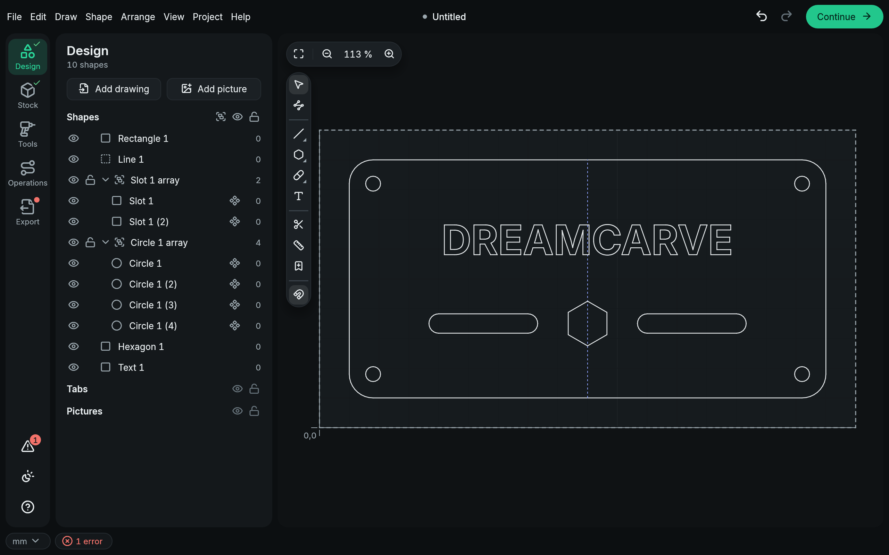

# Groups and construction geometry

A drawing of more than a few shapes is easier to work with when it is
organised. A **group** files shapes together in the Shapes list on the
**Design** step and keeps them together on the Viewport, and
construction geometry marks the lines that are there to draw by.

## Groups

A group is a named row of the Shapes list with its shapes under it.

To make one:

- Select the shapes and choose **Arrange ▸ Group** (**Ctrl+G**,
  **⌘G**), or **Group** in a shape's right-click menu. One shape can be
  a group of its own.
- Or click **New group**, the button in the Shapes header. It holds the
  selected shapes, or is empty when nothing is selected, ready for
  shapes to be dragged into it.

An [array](copies-and-arrays.md#arrays)'s copies arrive in a group.

On the Viewport, a group's shapes act as one:

- A click on any of them selects all of them, so they move, turn and
  scale together. So does a marquee that touches one.
- A double-click reaches the one shape.

In the Shapes list:

- A click on the group's row selects its shapes. A click on a shape's
  row selects that shape alone.
- The group's arrow folds its rows away. Its eye and padlock hide and
  lock every shape in it. Its count is how many shapes it holds.
- Double-click the group's name to rename it.
- Drag rows into a group, out of one, or from one to another. A line
  shows where they will go. A selected row takes the rest of the
  selection with it. Dragging also reorders rows: the order of the list
  is the order the shapes are saved and drawn in.

Groups do not nest.

### Select Together

A group's right-click menu has **Select Together**, ticked for a new
group. Untick it for a group that only files shapes in the list: screw
holes you want listed together but still click and move one at a time.
The rest of what a group does stays the same.

### Ungroup and delete

- **Arrange ▸ Ungroup** (**Shift+Ctrl+G**, **⇧⌘G**), or **Ungroup** in
  the group's menu, dissolves the group and keeps its shapes.
- **Delete** on a group deletes the group **and its shapes**, in one
  undo step.
- A group goes with its last shape: delete or drag out the last one and
  the group's row goes too. An empty group you have just made stays
  until you use it.

## Construction geometry

**Construction geometry** is a shape you draw to draw by: a centre
line, a circle that holes sit on, the edge of a part this one must fit.

A construction shape:

- is drawn thin and dashed, in its own colour;
- [snaps](snapping.md) and [measures](measuring.md) like any shape;
- is **never cut**. No operation offers it. The checks of the artwork
  ignore it, so an open construction line raises no warning. **Fit
  stock to shapes** ignores it.

To make shapes construction geometry:

- While drawing, click **On** beside **Construction** in the tool bar.
  It stays on for the shapes that follow, in every drawing tool, until
  you click **Off**.
- For a shape already drawn, turn on **Construction** in its
  **Properties**, or tick **Shape ▸ Construction**, or use the row's
  menu.

Marking a shape that an operation cuts takes it **out of that
operation**. The Warnings drawer says which operation is left with
nothing to cut. Turning Construction off again does not put the shape
back: add it to the operation yourself.

A project file that names a construction shape as something to cut is
an error, and nothing is exported until it is put right.
