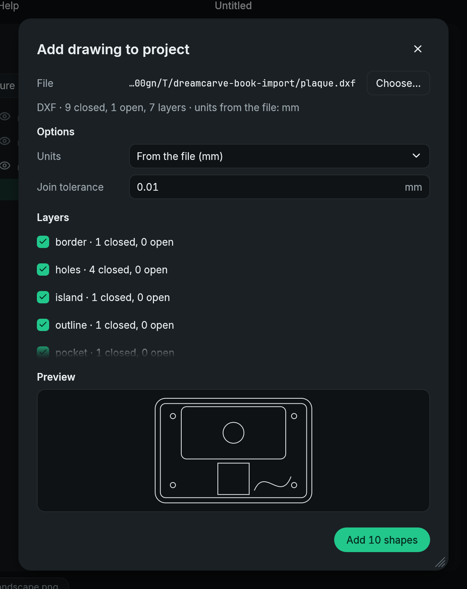
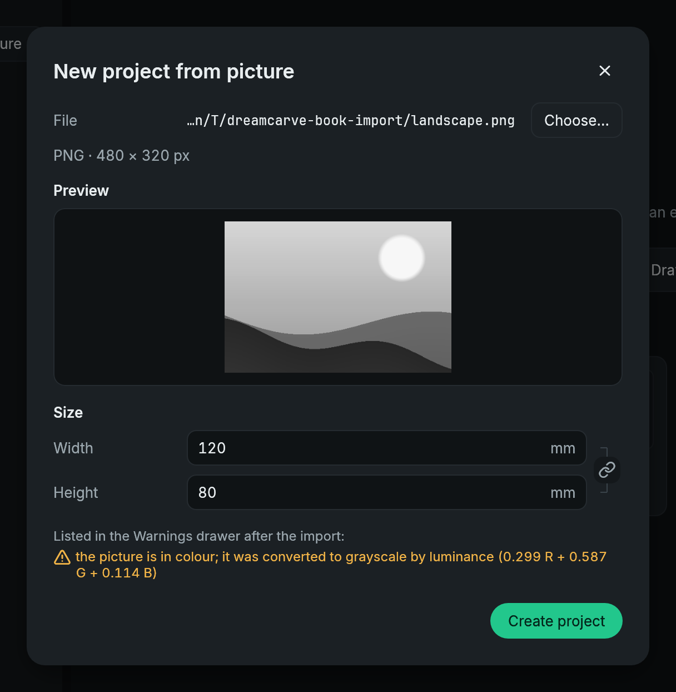

# Importing drawings and pictures

DreamCarve does not draw. A project starts from a file made elsewhere: a
**drawing** of outlines (SVG or DXF), which the operations cut along or
inside, or a **picture** (PNG or JPEG), which a
[Photo V-Carve](photo-v-carve.md) carves as grooves. This chapter is
about bringing either into the app. The rules for what is read from a
file are the same from the command line, and have their own chapters:
[Importing DXF](importing-dxf.md) for DXF and SVG drawings, and
[Images](images.md) for pictures.

## New project, or add to this one

There are two things to do with a file, and the app keeps them apart.

| | Starts a new project | Adds to the open project |
| --- | --- | --- |
| A drawing | **New from drawing…** on the start screen; **File ▸ New Project from Drawing…** | **Add drawing** on the Design step; **File ▸ Add Drawing to Project…** (Ctrl I, ⌘I on macOS); a drawing dropped on the window |
| A picture | **New from picture…** on the start screen; **File ▸ New Project from Picture…** | **Add picture** on the Design step; **File ▸ Add Picture to Project…**; a picture dropped on the window |

**A new project** replaces the one that is open (the app asks first if it
has unsaved changes) and sizes the stock round the file: the drawing's or
the picture's bounds plus 10 mm on every side, with work zero at the
stock's bottom-left corner and Z zero on its top. It has no thickness, no
tools and, for a drawing, no operations: the app does not add a
placeholder for you to fill in. A project from a picture has one Photo
V-Carve of the picture and a 60° V-bit for it, both with their required
values still to set.

**Adding** leaves the stock alone. A drawing's shapes are placed as
drawn, with the drawing's own origin at the stock's bottom-left corner. A
picture is placed at the stock's bottom-left corner. Either way the new
shapes or the new picture are selected, so you can move them straight
away, and the whole import is one step for Undo.

A `.dcv` project dropped on the window opens.

## The drawing sheet

Choosing a drawing opens a sheet that shows what the file holds before
anything changes: how many closed shapes and open paths, and a preview of
the drawing alone.

An SVG has no options. A DXF has three:

- **Units**: taken from the file when it says what they are. A DXF that
  does not say cannot be imported until you choose millimetres or inches;
  DreamCarve will not guess, since a wrong guess is a part 25 times too
  big or too small.
- **Join tolerance**: how close two line ends must be to count as joined
  into one outline. The default is 0.01 mm. Raise it for a drawing whose
  corners do not quite meet.
- **Layers**: untick a layer to leave its shapes out. Each line says how
  many closed shapes and open paths the layer holds, and how many
  entities on it DreamCarve does not read.

The button at the bottom says what it will do: **Add 10 shapes**, or
**Create project** for a new project. It is off while the file cannot be
imported.

[Importing DXF](importing-dxf.md) says exactly which entities are read,
how units and layers are handled, and how loose ends are stitched.

### What you get

Each closed shape and each open path becomes a row on the Design step,
named from the file: a DXF's layer names (`holes-1`, `holes-2` for
several on one layer), an SVG's ids. A circle is imported as a true
circle, which is what lets Drill and Bore take it.

Anything the importer has to tell you (entities it did not read,
duplicate shapes it dropped, an SVG object that will not cut as drawn) is
listed in the Warnings drawer after the import, under the file's name,
and marks the Design step with a dot. [Preparing
artwork](preparing-artwork.md) explains the SVG checks and how to fix a
drawing that fails them.

An **open path**, one that does not close into an outline, has its own
mark in the list and is drawn dashed. An Engrave, or a Profile on the
line, can cut it; a Pocket, a V-Carve and an Inlay cannot. Until an
operation cuts it the app warns that nothing does (`open_profile`).

## The picture sheet

A picture has pixels, not a size, so the sheet asks how big it is to be
on the stock:

Type the **Width** or the **Height**. The other follows the picture's
proportions: a picture is never stretched. The sheet's button is off
until one of them is typed.

A colour picture is converted to shades of grey as it is read, and the
sheet says so. The note is listed in the Warnings drawer afterwards.
[Images](images.md#choosing-a-picture) says which pictures carve well and
how a picture is read.

## A picture on the stock

A picture is drawn on the Viewport where it will be carved, under the
shapes, and has a row under **Pictures** on the Design step:

- **Select** it from its row, or with a click inside it on the Viewport
  where no shape, tab or toolpath is in the way. Pictures are selected on
  their own, not together with shapes.
- **Move** it by dragging it, with the arrow keys, or by typing **X** and
  **Y**, the bottom-left corner of its footprint.
- **Resize** it by dragging a corner handle, or by typing **W** or **H**.
  It keeps its proportions and resizes about its centre.
- **Rename**, **hide**, **lock** and **delete** it as you would a shape.
  A locked picture cannot be moved or resized.

A picture cannot be rotated or flipped.

The Properties show its size in pixels and the Photo V-Carves that carve
it. A Photo V-Carve reads the picture's footprint, so its grooves are
worked out again whenever the picture moves or changes size. Deleting a
picture leaves its Photo V-Carve without one, and the app says so.

To carve the picture, see [Photo V-Carve](photo-v-carve.md#in-the-app); a project
made with **New from picture…** already has the operation, waiting for
its **Max depth**.
