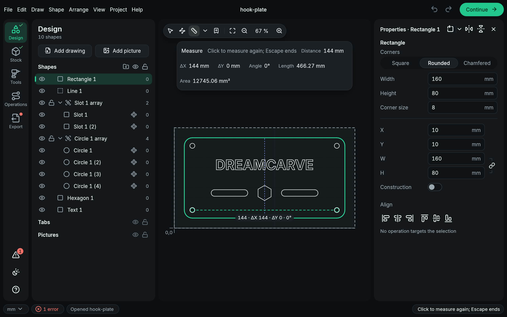

# Measuring

The **Measure** tool reads a distance between two points, and the length
and area of a shape. Use it to check a drawing before you cut: a hole
spacing, the gap between two parts, the width left beside a slot.

Choose **Measure** from the Draw button's list, or press **K**.

## A distance

Click two points. Each [snaps](snapping.md) as any point does, so a
click near a hole lands on its centre and a click near a corner lands on
the corner.

The tool bar reads, and the Viewport shows beside a dashed line:

| Reading | What it is |
| --- | --- |
| **Distance** | How far apart the two points are |
| **ΔX** | How far the second is from the first along X; negative to the left |
| **ΔY** | How far the second is from the first along Y; negative downwards |
| **Angle** | The direction from the first to the second, anticlockwise from the X axis: 0 to the right, 90 straight up |

After the first click the line follows the pointer, so you can read a
distance without clicking the second point.

The measurement stays until your next click, which starts another.
Hold **Shift** to keep the second point on a 15° step from the first.

## A shape

With **one shape selected** and the tool in hand, the tool bar also
reads:

| Reading | What it is |
| --- | --- |
| **Length** | The length of the shape's outline. A shape with holes counts every outline. |
| **Area** | The area the shape encloses, with its holes left out. An open path has none. |

Both are of the shape as it is placed: a shape scaled to twice its size
reads twice the length and four times the area.

To measure a shape, select it first with the Select tool, then press
**K**. While Measure is in hand a click is a measurement, not a
selection.

## What it does not do

A measurement is not part of the project. It is not saved, it is not an
undo step, and it leaves no dimension on the drawing. **Escape** puts
the tool down and the measurement goes with it.

## Sizes while you work

You do not always need the tool:

- A shape being drawn shows its size beside it.
- A selection shows the width and height of its box while you drag or
  resize it.
- A shape's **Properties** show its position and size, and the sizes it
  was drawn with.
