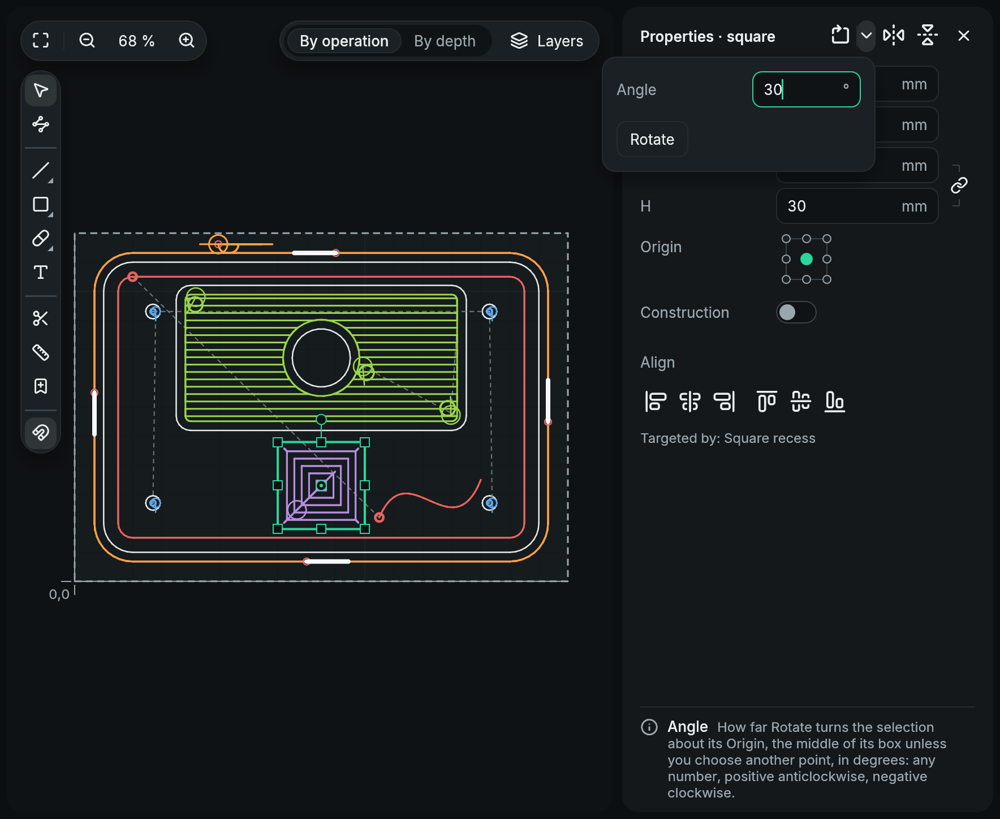
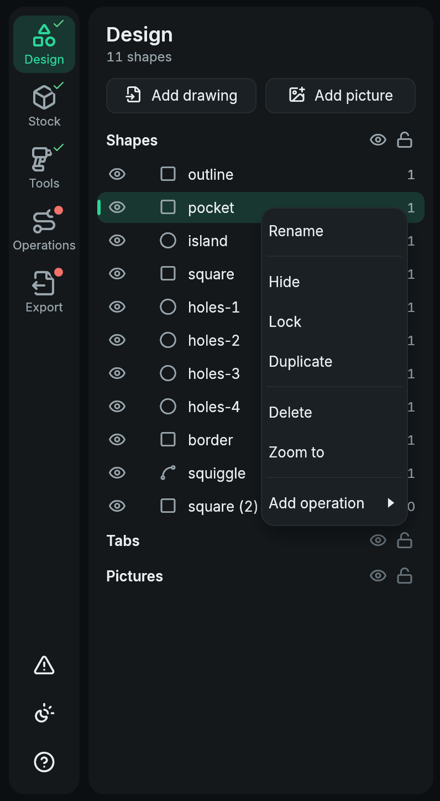

# Placing shapes

DreamCarve does not draw, but it does let you put what you imported where
you want it on the stock. This is the **Design** step's work: select
shapes, move, resize, rotate and flip them, copy them, hide and lock
them, and delete the ones you do not want cut.

The examples in this chapter use the plaque of the
[app quick start](../quick-start/app.md#the-plaque-a-second-tool): a
170 × 120 mm stock, and a 30 mm square whose bottom-left corner is at
X 70, Y 18.

## The Design step

The step panel lists what the project holds, in three sections.
**Shapes** has a row for each outline of the drawing, **Tabs** lists the
[placed tabs](tabs.md#in-the-app), and **Pictures** the
[pictures](importing.md#a-picture-on-the-stock).


From the left, a shape's row has:

- An **eye**. Click it to hide the shape, and again to show it.
- A **padlock**, drawn only while the shape is locked or the pointer is
  on the row. Click it to lock or unlock the shape.
- A **glyph** for what the shape is: a closed outline, a circle, or an
  open path (a line that does not close; an Engrave, or a Profile on the
  line, can cut it).
- The **name**.
- A **linked-copy mark**, on a row that shares its outline with another
  row.
- The number of operations that cut the shape. Hold the pointer on it to
  see their names.

The eye and the padlock in a section's header act on every row of the
section.

## Selecting

Click a row, or click the shape on the Viewport. Shift-click adds to the
selection; Ctrl-click (⌘-click on macOS) adds a shape or takes it out. A
drag on empty stock draws a box and selects every shape it touches.
Ctrl A (⌘A) selects every visible shape, and Escape clears the selection.
[The app](the-app.md#selecting) has the full rules.

A selected shape is drawn in the accent colour inside a box with a handle
at each corner and one more above it, and the **Inspector** opens at the
right with the selection's **Properties**:


| Field | What it is |
| --- | --- |
| **X**, **Y** | The bottom-left corner of the selection's box, measured from the stock's bottom-left corner |
| **W**, **H** | The box's width (along X) and height (along Y) |
| The link beside W and H | **Keep proportions**. Closed, typing one of W and H changes the other to match. Click it to open it |
| **Targeted by** | The operations that cut the selection |

With several shapes selected the fields describe the box round all of
them, and the shapes move and turn together as one.

The buttons in the Inspector's header are the **Arrange** group: rotate,
flip horizontal and flip vertical. The **Arrange** menu has the same
commands.

## Moving

- **Drag** the shape on the Viewport. The status bar shows how far it has
  travelled, and the shape moves when you let go.
- Press an **arrow key** to nudge it 1 mm. With Shift held a nudge is
  10 mm; with Alt (⌥ on macOS), 0.1 mm. The arrows nudge only while
  no other control has the keyboard: click the shape on the Viewport
  first.
- Type **X** or **Y**. Typing 80 into X moves the square 10 mm to the
  right.
- **Arrange ▸ Centre on Stock** puts the middle of the selection's box
  on the middle of the stock. The square goes to X 70, Y 45.

To make the stock fit the shapes instead, use **Fit to shapes** on the
[Stock step](stock-and-origin.md#fit-to-shapes).

## Resizing

A shape is resized about the centre of its box, so its middle stays where
it is.

- Type **W** or **H**. With the link closed, typing 20 into W makes the
  30 mm square 20 × 20 mm, at X 75, Y 23. With the link open, typing 40
  into H leaves W at 30.
- **Drag a corner handle.** The shape keeps its proportions while the
  link is closed. Hold Alt (⌥) while you drag to stretch it freely.

Resizing changes what is cut: a 20 mm square pocket is a different
pocket. A circle stretched with the link open is no longer a circle, so a
Drill or a Bore skips it, with a warning.

## Rotating

- Click **Rotate 90° clockwise**, the first Arrange button, or press R.
  Shift R turns the other way.
- Click the arrow beside that button, or choose **Arrange ▸ Rotate…**,
  to type an **Angle** in degrees. A positive angle turns anticlockwise.
  Press Enter or click **Rotate**.

  

- **Drag the round handle** above the box. Hold Shift to turn in steps of
  15°.

The selection turns about the centre of its box. After a turn that is
not a multiple of 90°, W and H are the size of the box round the turned
shape: the square turned by 30° reads 40.98 × 40.98 mm.

## Flipping

**Flip horizontal** mirrors the selection left to right, and **Flip
vertical** top to bottom, each about the centre of its box. The keys are
Ctrl Shift H and Ctrl Shift V (⇧⌘H and ⇧⌘V on macOS).

Flip lettering only when you mean to: mirrored text cuts mirrored. An
[Inlay](inlay.md) mirrors its own male board; you do not flip anything
for it.

## Renaming

Double-click a shape's name in the list, or select the shape and press
F2. Type the new name and press Enter; Escape keeps the old one. The
name is what the Design step, the Warnings drawer and an operation's
**Targets** row call the shape. It does not appear in the G-code.

## Hiding and locking

**Hide** a shape (its eye, or H with it selected) to get it out of the
way. A hidden shape is not drawn and cannot be selected on the Viewport,
and **Fit to shapes** ignores it. Shift H shows the selected shapes
again.

**Lock** a shape (its padlock, or L with it selected) so that it cannot
be moved by accident. A locked shape can still be selected, and its
Properties say why the fields are off:


A drag or a nudge of a locked shape does nothing, and the status bar says
`shape “square (2)” is locked`. **Unlock**, or L again, unlocks it.

With some of the selected shapes locked, a drag or a nudge moves none of
them. The Arrange commands turn, flip or centre the ones that are not
locked, and the status bar names the rest: `“square (2)” is locked, so it
stayed where it was`.

> Hiding and locking are for your convenience only. **Neither changes a
> cut.** An operation still cuts a shape it targets when the shape is
> hidden or locked. To stop a shape being cut, take it out of the
> operation's targets, turn the operation off, or delete the shape.

## Copies

**Edit ▸ Duplicate** (Ctrl D, ⌘D on macOS) makes a copy of each selected
shape, 10 mm to the right and 10 mm up, and selects it. The copy of
`square` is named `square (2)`.

The copy is a **linked copy**: it shares its outline with the original,
and both rows carry the linked-copy mark. Each has its own place, size,
rotation, name, eye and padlock, so you can move and turn one without the
other.

No operation cuts a new copy: its row counts 0. Add it to an operation's
targets, or select it and add an operation for it
([Adding an operation](operations.md#adding-an-operation)).

## Deleting

Select the shapes and press Delete or Backspace, or choose **Edit ▸
Delete**.

Deleting a shape also takes it out of every operation that cut it, and
deletes the tabs placed on it. An operation left with nothing to cut
stays in the list, and is an error that stops export until you give it
shapes, turn it off or delete it:

```text
error: operation `Square recess` (`op4`) is enabled but has no targets, so it would cut nothing; add targets or disable it
```

## The row's menu

Right-click a row for the same commands in one place:



**Zoom to** fits the Viewport to the shape. **Add operation** opens the
Operations step's **Add** menu for it. While an operation is selected on
the Operations step, the menu also offers to add the shape to that
operation's targets or to remove it from them.

Right-clicking a row that is part of the selection acts on the whole
selection.

## Undo

Every change in this chapter is one step for **Undo** (Ctrl Z, ⌘Z on
macOS), and the **Edit** menu names the step it would take back:

| You did | The Edit menu says |
| --- | --- |
| Dragged, nudged or typed X or Y | *Undo Move “square”* |
| Typed W or H, or dragged a corner | *Undo Scale “square”* |
| Clicked Rotate 90° clockwise | *Undo Rotate “square” 90° clockwise* |
| Typed an angle of 30 | *Undo Rotate “square” 30° anticlockwise* |
| Flipped it | *Undo Flip “square” horizontally* |
| Centred it | *Undo Centre “square” on stock* |
| Duplicated it | *Undo Duplicate “square”* |
| Hid or locked it | *Undo Hide “square”*, *Undo Lock “square”* |
| Deleted it | *Undo Delete “square”* |

Undoing a delete puts the shape back into the operations that cut it.

## What a change does to the cut

The toolpaths follow the shapes. A moment after you move, resize, turn
or flip a shape, every operation that cuts it is worked out again, and
the status bar's estimated time follows.

A cut may not leave the stock. With the square moved to X 150, its pocket
runs past the stock's right edge, which is an error that stops export:

```text
error: operation `op4` cuts off the stock: 10.930 mm past the +X (right) edge
```

The **Stock** step is marked too, and says that a shape reaches past the
stock. Move the shape back, or make the stock fit with
[Fit to shapes](stock-and-origin.md#fit-to-shapes) if your material
really is that big.

In the project file, each row of the list is an entry of
[`instances`](project-file.md#definitions-and-instances), and what this chapter changes
is its `transform`, `name`, `visible` and `locked`.
