# Shapes, holes, and islands

A drawing is a set of closed shapes. Before DreamCarve can cut them, it
decides which shapes are **parts** (material you keep) and which are
**holes** cut out of a part. That is how a ring cuts as a ring: the outer
circle is cut on its outside, and the inner circle on its inside.

Each group of one part and its holes is a **region**. This page states the
rules, with a picture of each one.

## Reading the figures

Every figure on this page is generated from the real code: `nest` runs on
the shapes shown, and the picture draws what it returned. A test fails if a
figure no longer matches the code, so the pictures can't drift from it.

- **Shading** is the material of a region. Each region has its own colour,
  matching the `R1`, `R2`, … rows of the legend under the figure.
- **Solid blue** outlines are parts. **Dashed red** outlines are holes.
- The **arrowhead** shows which way the outline runs once nesting is done,
  seen from above with Y pointing away from you. Parts always run
  counter-clockwise (CCW) and holes clockwise (CW). The cutting direction
  (climb or conventional) is worked out from this.
- **`#n`** is the shape's position in the drawing, starting at `#0`. Two
  labels side by side, like `#0, #1`, are two shapes in the same place.
- **Grey dotted** outlines are shapes that aren't cut: a dropped duplicate,
  or every shape when nesting stopped with an error. Warnings and errors
  are listed under the figure, marked **!**.

## The rules

### 1. A shape inside nothing is a part

Shapes that don't enclose each other are separate parts, and each becomes
its own region with no holes.

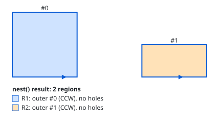

### 2. Count the shapes around it: even is a part, odd is a hole

A shape's depth is the number of other shapes that enclose it. Depth 0 is
a part, depth 1 is a hole, depth 2 is a part again (an island inside a
hole), and so on.

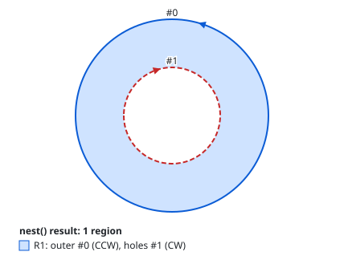

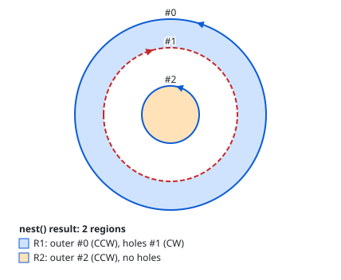

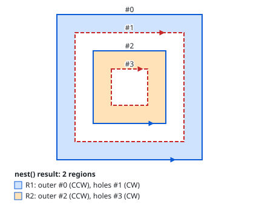

### 3. A hole belongs to the smallest part around it

In the four-squares figure, `#3` sits inside both `#0` and `#2`. It's a hole
of `#2`, the smaller one. When there are several parts, each hole goes to
the part it actually sits in, wherever the shapes appear in the drawing:

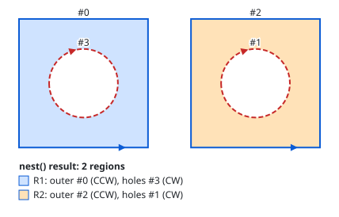

### 4. Curves count by their real shape

Whether a shape is inside another is decided against the true curve, not
the straight line between its end points. A small circle inside the bulge of
a larger circle is a hole. A small circle that falls inside the larger
circle's bounding box but outside the curve is a separate part.

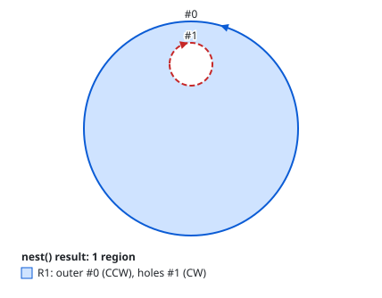

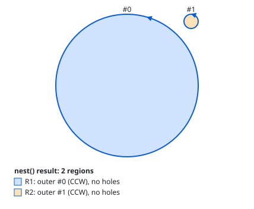

### 5. The direction you drew a shape in doesn't matter

Parts come out counter-clockwise and holes clockwise, whichever way they
were drawn. Here the outer square was drawn clockwise:

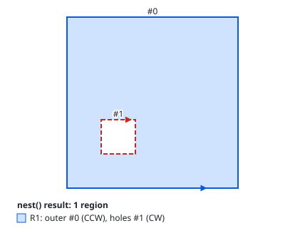

### 6. Order follows the drawing

Regions are listed in the order their parts appear in the drawing, and holes
in the order they appear. In the second figure the hole `#0` comes first in
the drawing, yet the regions are ordered by their parts, `#1` then `#2`.

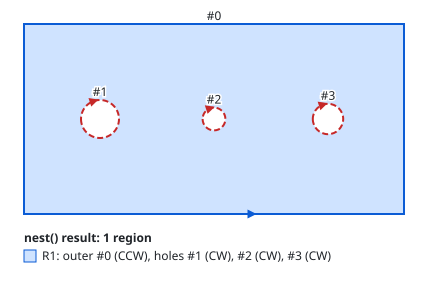

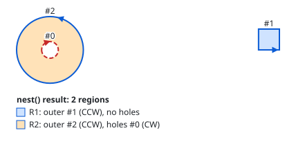

### 7. Reordering the drawing doesn't change which shapes are holes

Shuffling the shapes changes only the order of the results, never which
shapes are parts and which are holes. The test runs these shapes in four
different orders and gets the same regions each time.

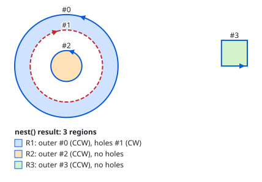

### 8. A hole may touch its part's edge

A hole that shares part of an edge with the part around it is still a hole.

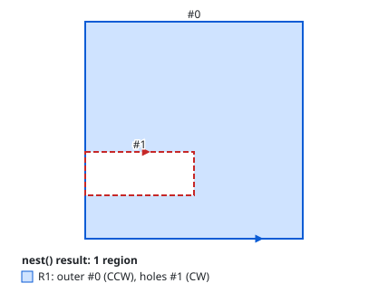

### 9. A shape drawn twice is cut once

Two copies of the same shape in the same place, whichever way each was
drawn, are one shape. DreamCarve keeps the first, drops the later copy, and
warns you, so the outline is not cut twice. A duplicate hole is dropped the
same way.

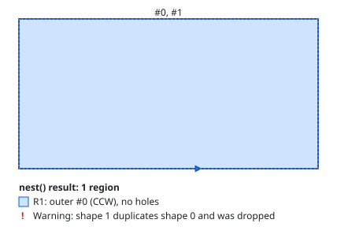

### 10. Shapes must not cross

Every pair of shapes must be either apart (touching is fine) or one wholly
inside the other. When two shapes cross, it isn't clear which area is
material, so DreamCarve stops with an error that names both shapes and
cuts nothing. Fix the drawing by moving the shapes apart or merging them
into one outline (in Inkscape, select both and use **Path → Union**).

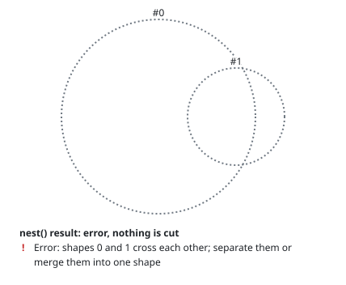

DreamCarve decides this from the area two shapes share, measured on the
true curves, so a crossing is caught even when it's tiny. Shapes that only
touch along an edge or at a point, inside or outside, don't count as
crossing.

## For contributors

The rules live in `dc_geometry::nest` (`crates/dc-geometry/src/region.rs`).
The figures are generated by `tools/doc-figures`. After changing nesting,
run `cargo run -p doc-figures` and review the changed SVGs. The
`committed_figures_match_engine_output` test fails until you do.

| Rule | Figure | Unit test in `region::tests` |
| --- | --- | --- |
| 1. Separate parts | `disjoint` | `disjoint_shapes_are_separate_regions`, `lone_contour_is_one_region_without_holes`, `no_contours_give_no_regions` |
| 2. Even part, odd hole | `ring`, `island`, `four-levels` | `circle_in_circle_becomes_hole`, `island_in_hole_becomes_its_own_region`, `four_levels_alternate_outer_and_hole` |
| 3. Smallest enclosing part | `four-levels`, `two-parts-two-holes` | `four_levels_alternate_outer_and_hole`, `several_parts_each_get_their_own_hole` |
| 4. Curves by their real shape | `inside-arc-bulge`, `outside-arc-bulge` | `circle_inside_arc_bulge_is_hole`, `circle_outside_arc_bulge_is_separate`, `winding_counts_arc_bulge_not_chord`, `winding_of_rect_is_one_inside_zero_outside` |
| 5. Direction normalised | `clockwise-input` | `clockwise_input_is_normalised` |
| 6. Drawing order | `several-holes`, `region-order` | `several_holes_in_one_outer_keep_input_order`, `regions_follow_input_order_of_outers` |
| 7. Order-independent | `order-independent` | `containment_does_not_depend_on_input_order` |
| 8. Touching edge | `touching-edge` | `hole_touching_outer_edge_is_still_a_hole`, `shapes_touching_from_outside_do_not_cross` |
| 9. Duplicates cut once | `identical` | `identical_shapes_keep_the_first_and_warn`, `duplicate_drawn_the_other_way_is_still_a_duplicate`, `duplicate_hole_is_dropped_and_part_keeps_one_hole` |
| 10. No crossing | `crossing` | `crossing_circles_are_an_error`, `crossing_rects_are_an_error_whatever_the_order` |
