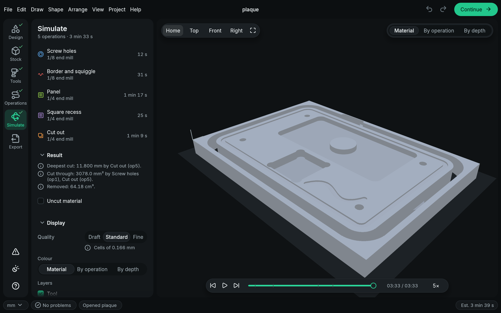
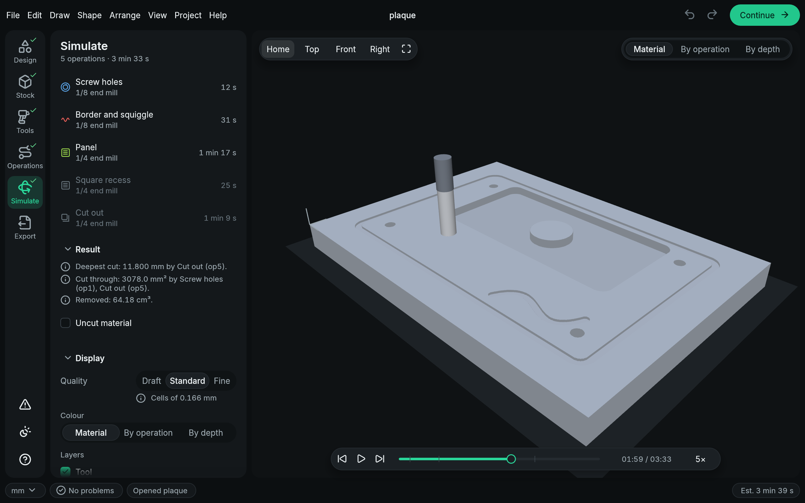
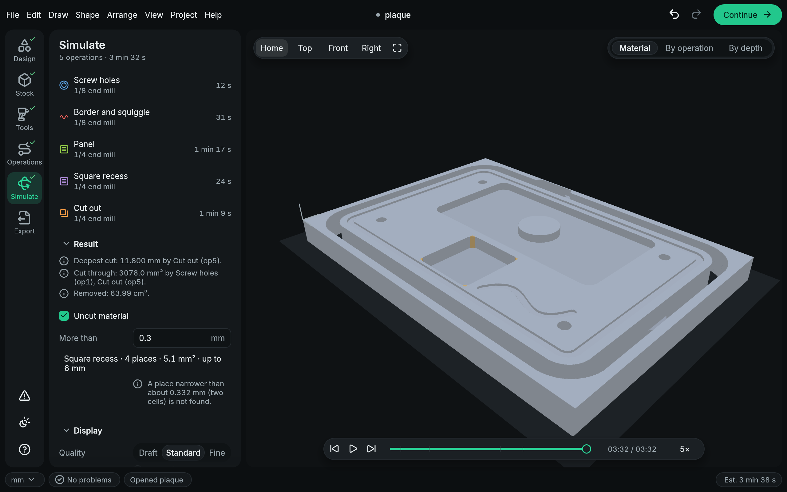
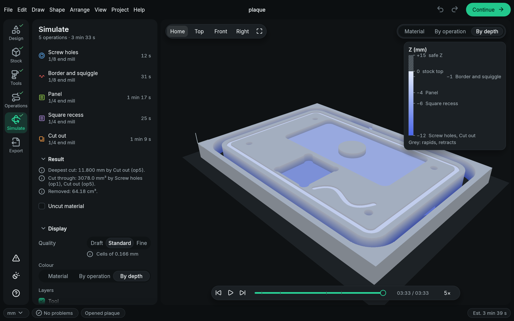

# Simulation

The **Simulate** step shows the stock as the machine will leave it. It
cuts every operation's toolpath into a block of your stock's size, with
the shape of each tool, and draws the result in 3D. You can turn it over
in your hands, watch it being cut from the first move to the last, and
ask where material is left that the shapes meant to remove.

The step sits between Operations and Export on the rail. **Continue** on
Operations opens it, and its key is Ctrl 5 (⌘5 on macOS). Nothing waits
for it: you can export without ever opening it, and what it shows
changes no program. It reads the same toolpaths that **Export G-code**
writes, in the same order.

A simulation is geometry. It does not know your clamps, your machine,
the wood, or how sharp the bit is. A clean result is no reason to skip
the checks of the [Safety](safety.md) chapter.

## What you see

The stock is a block of its width, height and thickness, standing on the
**bed**: a flat surface at the stock's bottom that reaches a little past
it. Where a cut goes through the stock, the bed shows. Tabs stand where
the Profile left them.

The stock is one colour, lit from two sides so that walls, floors and
slopes read at a glance, and a little darker the deeper it is cut.
Nothing is drawn as wood grain.

The simulation is made when you open the step, and made again a moment
after any change to the project. While it is being made, the last result
stays on screen, dimmed, and the status bar says *Simulating… 42 %* with
**Stop**. After a change, only the operations from the first changed one
are cut again, so a change to the last operation of a long job is quick.

| The step's summary says | Meaning |
| --- | --- |
| *5 operations · 3 min 33 s* | What is shown: the enabled operations, and how long their moves take |
| *Waiting for the toolpaths…* | The toolpaths are being worked out; the simulation follows them |
| *Simulating… 42 %* | The simulation is being made |
| *Simulation stopped* | You pressed Stop. **Simulate again** makes it |
| *1 error blocks the simulation. The stock is shown uncut.* | The project has an error that stops every toolpath. The Warnings drawer says which |
| *Nothing to simulate: no operation is enabled.* | Tick an operation on the Operations step |

An operation with an error of its own has no toolpath. The rest are
simulated, and the panel says *1 operation is left out: it has an
error*, with **Show** to open the Warnings drawer.

The time is that of the moves at their feeds, with rapids at the rate
set in [`config.toml`](configuration.md), or taking no time when it is
not set. It leaves out the spindle's spin-up and the tool changes, which
the Export step's estimate counts.

## Looking around

| To | Do |
| --- | --- |
| Turn the stock | Drag |
| Slide it | Drag with the right or the middle button, or hold Shift and drag |
| Zoom | Turn the wheel, or pinch: the point under the pointer stays put |
| See all of it | **Fit**, or press F |

The pill at the Viewport's top left has four views and **Fit**.

| View | Key | Looks from |
| --- | --- | --- |
| **Home** | Home | The front right, above |
| **Top** | 7 | Straight above, with +Y up the screen, as the other steps draw the stock |
| **Front** | 1 | The operator's side |
| **Right** | 3 | The right |

The view is in perspective, and it cannot go under the bed.

When the pointer is over the stock, the read-out at the bottom left
gives the X, Y and Z of the surface under it, measured from the origin
in the project's units, and the name of the operation that cut there:
`X 64.2  Y 51.8  Z -4.0 · Pocket`.

## Playing the cut

The transport at the bottom of the Viewport plays the job.

| Control | Key | Does |
| --- | --- | --- |
| **Play** or **Pause** | Space | Cuts the stock as the tool reaches each move. At the end of the job, Play starts again from uncut stock |
| **Previous operation**, **Next operation** | [ and ] | Shows the stock as the operation before, or the next one, leaves it |
| The scrubber | | Drag it, or click on it, for the stock at any moment of the job, backwards as well as forwards. The ticks are where each operation ends |
| *03:10 / 14:20* | | The time into the job, and its length |
| **Speed** | - and = | 1×, 5×, 25×, 100× or 500× the programmed feed. A job opens at the speed that plays it in about half a minute |

The comma and full stop keys step one cutting move back and forward, and
ten with Shift.

Opening the step shows the finished stock, not the start.

## Operation by operation

The panel lists the enabled operations in cut order, each with its
colour, its tool and the time its moves take. Click a row for the stock
as that operation leaves it, with every operation before it cut. The
rows the playback has not reached are dimmed, and the row being cut
shows how far through it is.

An operation with more than one tool run, such as a V-Carve with a
clearing pass or a male Inlay with its cut-out, lists its runs under its
row (*Clearing · 1/4 in End Mill*). A run can be clicked as an operation
can.

With an Inlay in the project, **Stock** and **Male board** at the top of
the panel choose which board is shown. Each is cut by its own toolpaths.
The male board is shown as it is cut, face up.

## Cutter shapes

Each tool cuts with its own shape.

| Tool | Cuts as |
| --- | --- |
| End mill | A cylinder with a flat end |
| Ball nose | A hemisphere under a cylinder |
| V-bit | A cone of its angle, up to the tool's diameter, with a cylinder above |
| Tapered ball nose | Its ball, its cone and its cutting diameter |
| Drill | A cylinder with a flat end |
| Engraving bit | A cylinder with a flat end |

The project holds no point angle for a drill and no shape for an
engraving bit, so both are cut as plain cylinders, and **Result** says
so. The bottom of a drilled hole is not flat on the machine.

## Result

**Result** gives the facts of the finished stock: the deepest cut and
the operation that made it, whether and how much of the stock is cut
through, and the volume removed. The command line's `dreamcarve
simulate` prints the same lines
([Overview](overview.md#dreamcarve-simulate-dcv)).

### Uncut material

Tick **Uncut material** to see where the finished stock still stands
above what the shapes ask for. Those places are tinted in the warning
colour on the stock and listed by operation:

*Square recess · 4 places · 8.7 mm² · up to 6.0 mm*

Click a line to see its places from the top.

What it finds, among others: the corners a round bit leaves in a Pocket
or an inside Profile, a Pocket too narrow for its tool, and ridges
between passes. It is not a warning, and it is off until you turn it on:
most projects have some, and a square corner that a round bit cannot
reach is often what you want. Tabs are not uncut material.

**More than** is how far the stock must stand above the shapes' depths
to count: 0.3 mm unless you change it, from 0.05 to 5 mm.

A place narrower than about two cells is not found. The sliver a 1/8 in
bit leaves in the corner of a hexagon is a quarter of a millimetre wide,
and no quality shows it on a large stock.

DreamCarve does not report **gouges**, cuts into material that was meant
to stay. With no model of the finished part there is little to find:
the checks that run before export already refuse an operation that cuts
outside its own material.

## Display

| Setting | Does |
| --- | --- |
| **Quality** | How finely the stock is divided: **Draft**, **Standard** or **Fine**, 512, 1024 or 2048 cells along its longer side. The cell size is shown under it |
| **Colour** | **Material**: one colour. **By operation**: each cut place takes the colour of the operation that cut it last. **By depth**: each cut place takes its depth's colour, from the stock top to the deepest cut. The uncut top keeps the material's colour in all three |
| **Layers** | What is drawn besides the stock: the tool, the toolpath of the operation being shown, its rapids, the bed and the origin |

The stock is divided into square **cells**, each holding one height. A
wall's position is true to within one cell, and a depth is true at a
cell's centre. A finer quality shows smaller things and takes longer to
make.

These settings, and the speed you last chose, are remembered between
sessions in the app's preferences. The project file holds nothing of the
simulation.
