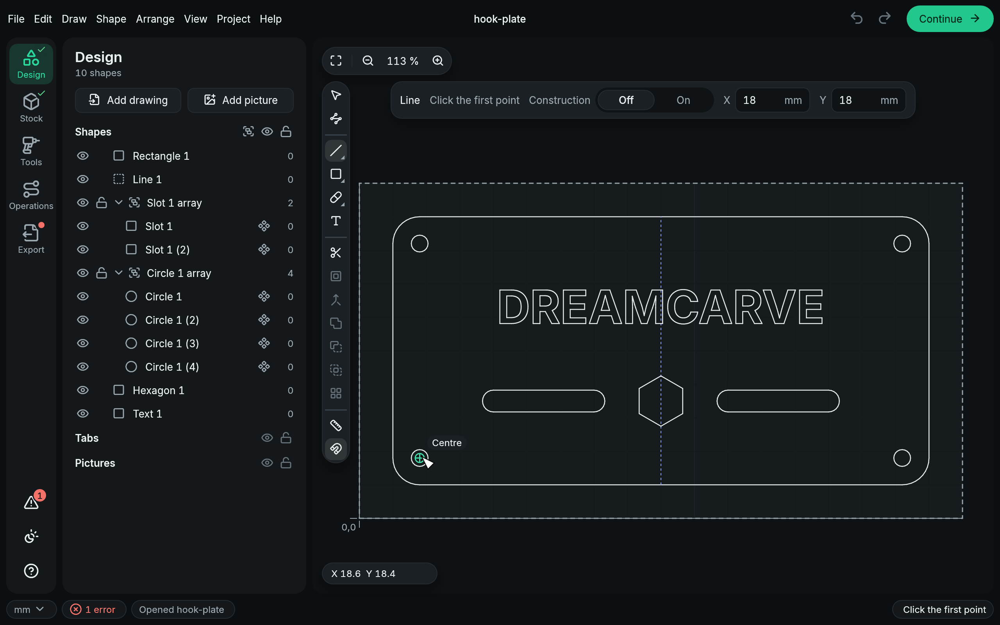

# Snapping and the grid

When you draw, move or reshape something, the pointer **snaps**: a point
near something worth hitting lands exactly on it. A marker shows what it
snapped to, with the kind's name beside it.

## What a point snaps to

A point snaps when a candidate is within 14 pixels of the pointer.

| Kind | What it offers | At first |
| --- | --- | --- |
| **Endpoint** | Every corner of every visible shape, the stock's corners, the origin | On |
| **Midpoint** | The middle of every line and arc | On |
| **Centre** | The centre of every arc and circle, and of every shape that keeps its sizes | On |
| **Intersection** | Where two outlines cross, or one crosses itself | On |
| **On outline** | The nearest point of an outline | On |
| **Perpendicular** | The foot of the perpendicular from the last point to an outline | Off |
| **Grid** | The nearest point of the grid | On |
| **Horizontal or vertical** | A point level with the last point, or straight above or below it | On |

When several are in reach, an endpoint, midpoint, centre or intersection
wins, then a perpendicular, then horizontal or vertical, then a point on
an outline, then the grid.
With nothing in reach the point is where the pointer is: a click is
never thrown away.

Shapes snap as they are drawn, so a slot's end centres, a rounded
corner's arc and the corners of a letter are all offered. A hidden shape
is not. A locked shape and
[construction geometry](groups-and-construction.md) are. A picture does
not snap.

## Turning it on and off

- The **Snapping** button, the last in the tool strip at the Viewport's
  left, is pressed while snapping is on. Click it for a list with
  **Snapping**, which turns all of it on or off, and a tick for each
  kind.
- **View ▸ Snapping** and **View ▸ Snap To** in the menu bar are the
  same switch and the same ticks. **Shift+S** turns all of it on or
  off.
- Hold **Ctrl** (**⌘** on a Mac) while you move the pointer to switch
  snapping off for as long as you hold it.

These are settings of the app, not of the project.

## Level and upright

**Horizontal or vertical** keeps a line level or upright without a key
held. Once a tool has a point, a pointer within 8 pixels of the
horizontal or the vertical through it is put on it, and a dashed guide
runs from that point.

- Where that line crosses an outline near the pointer, the point is on
  both: a level line that ends exactly on another shape.
- An endpoint, midpoint, centre or intersection in reach still wins.
- With the grid snapping, the point is also on a grid line along the
  way. It reaches no further than half a grid step, so the next grid
  line up can still be had; a slightly sloping line is drawn by moving
  further off, or with **Ctrl** (**⌘**) held.
- In [Edit nodes](editing-nodes.md), a node you drag is held level
  with, or upright from, the nodes either side of it. That is how a
  line drawn askew is put right: drag one end until the guide shows.

## Holding a direction

Hold **Shift** while you draw, and the point is held to steps of 15°
about the last point: straight along, straight up, 45° and so on. A
snap candidate on that line still wins.

Hold **Shift** while you **move** shapes with the Select tool, and they
go level or upright only, whichever way you have dragged further.

## The grid

The grid's spacing follows the zoom. It is the smallest of 1, 2, 5, 10,
20, 50 mm and so on that is at least 8 pixels on screen. In an inch
project the steps are 0.01, 0.02, 0.05, 0.1 in and so on. Zoom in, and
a point snaps finer.

**View ▸ Grid ▸ Spacing** sets the spacing to a length you type instead,
until you set it back to **Automatic**. A hidden grid does not snap.

## When exact matters

Snapping is as exact as the thing snapped to. Where a size matters, type
it: every point and every size of every tool can be typed in the tool
bar, as [Drawing shapes](drawing-shapes.md#the-tool-bar) says. A typed
value does not depend on the zoom.
