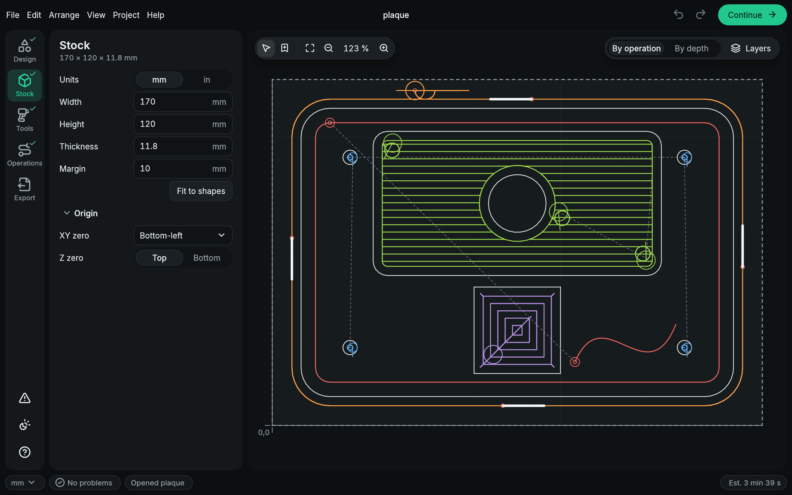
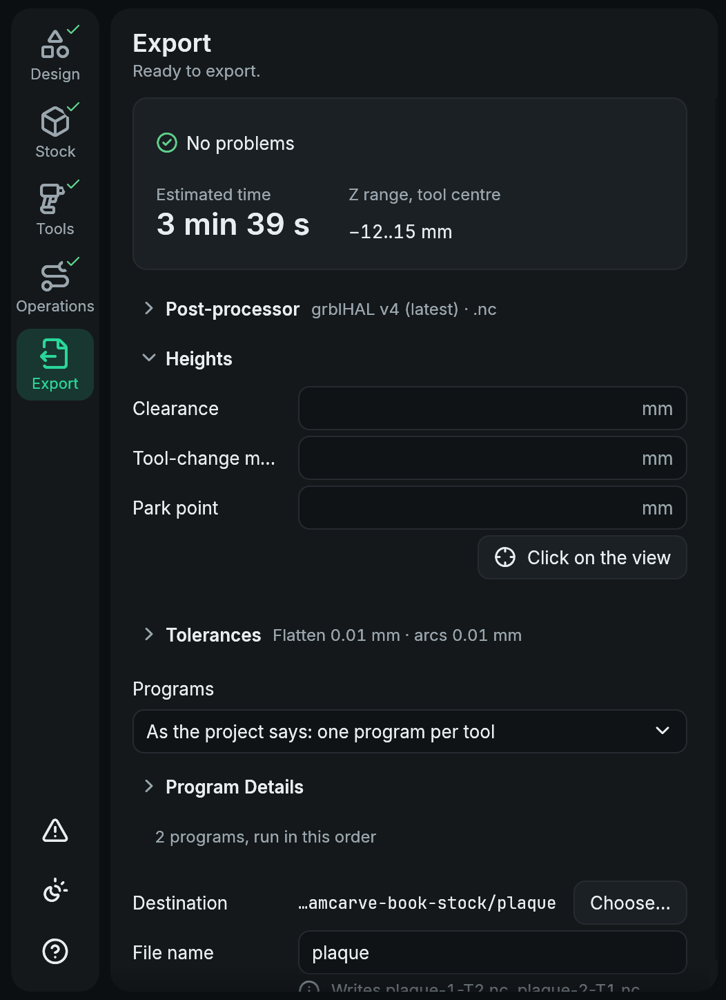

# Stock, origin and heights

Three things tell DreamCarve where the material is and how high the bit
may travel over it: the **stock**, the **origin** and the **heights**. In
the app the first two are the **Stock** step; the heights are on the
**Export** step and in each operation. In the project file they are
[`stock`](project-file.md#stock), [`origin`](project-file.md#origin) and
[`heights`](project-file.md#heights).

**Project ▸ Project Settings…** opens this step too.

## Units

**Units** switches every length and feed the app shows between
millimetres and inches. The status bar's units button does the same.
Only the display changes: the project file stores millimetres either
way, and switching back and forth changes nothing in it.

Any length field takes a value in the other unit if you say so: `0.5 in`
in a millimetre project becomes 12.7.

## The stock

The **stock** is the block of material you cut from. On the Viewport it
is the dashed rectangle.

- **Width** is its size along X, left to right as you face the machine.
- **Height** is its size along Y, front to back.
- **Thickness** is how thick it is. **Measure it.** Plywood sold as 12 mm
  is often 11.8. A project made from a drawing has no thickness; the
  field says **Required**, and nothing can be exported until you type it.

The thickness is what DreamCarve's depth check rests on: no cut may go
deeper than the bottom of the stock plus the operation's through-cut
allowance. A thickness that is wrong makes that check wrong, and a cut
meant to go through either stops short or goes into the spoilboard.

The stock is where the program expects material, not a limit on your
board. The board can be bigger; it must not be smaller, and it must sit
with its corner where the origin says.

### Fit to shapes

**Fit to shapes** resizes the stock round the visible shapes, leaving the
**Margin** on every side. The shapes keep their places relative to each
other. **Project ▸ Fit Stock to Shapes…** is the same command. A project
made from a drawing starts fitted, with a 10 mm margin.

When a shape reaches past the stock, the Stock step says so under its
title and the rail marks it. Either fit the stock, or move the shape:
select it on the Design step and drag it, or use **Arrange ▸ Centre on
Stock**.

Leave a margin. A Profile that cuts round the outside of a part runs its
bit, and its ramp or lead, in the margin, and DreamCarve refuses a cut
that leaves the stock.

## The origin

The **origin** is the point on the stock the machine treats as X0 Y0 Z0:
**work zero**. You set work zero on the machine before you run a program;
the origin tells DreamCarve where on the stock you will set it, so that
the program's coordinates come out right.

**XY zero** is one of the stock's four corners, its centre, or
**Custom**, which shows **X** and **Y** fields measured from the stock's
bottom-left corner.

**Z zero** is the **Top** of the stock or its **Bottom**:

- **Top**: you touch the bit off on the top of the material. Cutting
  moves have negative Z, measured down from that surface. This is the
  default.
- **Bottom**: you touch the bit off on the spoilboard beside the
  material. The top of the stock is then at Z equal to the thickness, and
  cutting moves are measured up from the spoilboard.

On the Viewport the origin is the small mark labelled `0,0`. Changing
the origin moves that mark and nothing else: the shapes, the stock and
the toolpaths stay where they are, because the origin changes the
numbers in the program, not the part. The pointer's read-out at the
Viewport's bottom left counts from the new point.

The origin in the project must be the work zero you set at the machine.
If the project says bottom-left and you zero at the centre, every move is
half a stock away from where the Viewport shows it. Run an air cut after
you change it: [Safety](safety.md#before-every-cut).

## The heights

How high the bit travels when it is not cutting is set in two places.

Each operation has its own **Safe Z**, in its **Heights** group: the
height above the top of the stock at which the bit moves between that
operation's cuts. A new operation gets 5 mm. Raise it above your clamps
and anything else the bit crosses. The clearance, when it is set, must be
at least every operation's safe Z.

The project's heights are on the **Export** step, in the **Heights**
group, which is closed until you open it:

All three are empty in a new project, and may stay so.

- **Clearance** is the height above the top of the stock for the moves
  between parts, between operations, at a tool change and at the end of
  the program. Left empty, those moves use each operation's own safe Z,
  which the group's header says: *Each operation's safe Z*.
- **Tool-change machine Z** is a height in the machine's own
  coordinates, below 0, which the program lifts to before each tool
  change and at its end. It needs a machine that has been homed, and it
  is offered only on grblHAL, GRBL and LinuxCNC, whose post-processors
  have the command for it.
- **Park point** is where the program leaves the bit, in X and Y. Type it
  as `X, Y`, or click **Click on the view** and then click the Viewport.
  Left empty, the program ends above its last cut.

[Post-processors](post-processors.md#heights-clearance-tool-change-and-park)
says what the program does with each, and how to choose the machine Z.

To see the heights a program uses, colour the toolpaths **By depth**: the
legend on the Viewport marks the clearance height and each safe Z above
the stock top, and the deepest cut below it.
