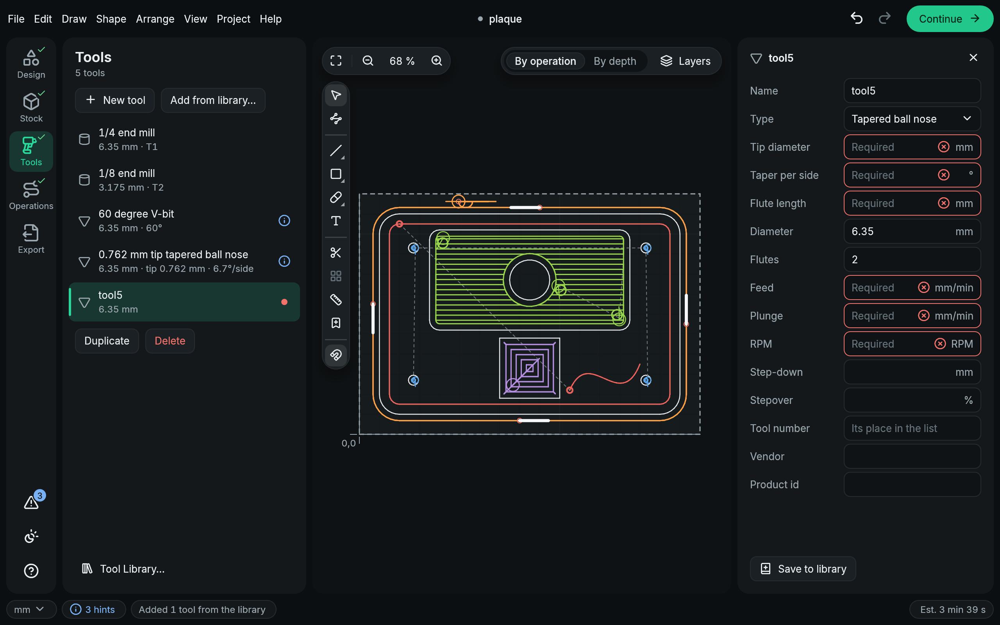

<!--
Copyright 2026 The DreamCarve Contributors
SPDX-License-Identifier: Apache-2.0
-->
# Tapered ball nose

A **tapered ball nose** is a narrow cone capped at its tip by a small
ball. It carves where a V-bit carves: a [V-Carve](v-carve.md) and an
[Inlay](inlay.md) take one in place of a V-bit, with the same settings.
Its sides are steep, a few degrees from the axis where a V-bit's are 15°
to 45°, so it cuts deep and narrow; its tip is a ball, stronger than a
V-bit's point and better at clearing chips. Corbin's Workshop recommends
one for inlays.

What changes from a V-bit is the shape at the tip. Near the tip the ball
cuts, so a groove has a round bottom, a flat floor meets its walls in a
fillet, and below the surface the bit cannot follow a corner sharper
than its ball. This chapter says how DreamCarve models the bit, how to
enter one, and what each of those means for a carve and an inlay.
[Carving and inlaying with a tapered ball
nose](../quick-start/tapered-ball-nose.md) does it all on a test piece.

## The bit

Four numbers describe the bit:

| Field | What it is |
| --- | --- |
| `tip_diameter_mm` | The ball's **diameter**: twice the tip radius. Vendors usually give the radius: a bit sold as "0.015 in radius" has `tip_diameter_mm` 0.762. |
| `taper_angle_deg` | The taper **per side**: the angle from the bit's axis to its flank, half the included angle. Above 0 and at most 45. |
| `flute_length_mm` | The fluted length, measured from the tip. Above it the shank would rub. It must reach past the ball. |
| `diameter_mm` | The **cutting diameter**, the widest the bit cuts, the catalogue's "cut diameter": 6.35 mm for a 1/4 in bit. It must be wider than the tip. |

From the tip up, the bit is the ball, then the cone, tangent to it, and,
where the cone reaches the cutting diameter, a plain cylinder of that
diameter up to the top of its flutes.

**Per side, not included.** A V-bit's `included_angle_deg` is the full
angle between its edges, as V-bits are sold; a tapered ball nose's
`taper_angle_deg` is per side, as tapered bits are sold, and as Fusion
and Vectric give it. Each is stored the way it is sold, so you type the
number on the packet. Do not double a tapered ball nose's taper, or
halve it: a 6.7° bit entered as 13.4° per side, or as 3.35°, carves
every depth wrong. Every message and `tools list` say "per side".

**The tangent height** is where the ball meets the cone, `tip radius ×
(1 − sin(taper))` above the tip: 0.337 mm for a 0.762 mm tip at 6.7°,
1.010 mm for a 2.286 mm tip. Above it the bit cuts exactly as a V-bit of
twice its taper whose point lies `tip radius × (1 / sin(taper) − 1)`
below the real tip (2.885 mm and 8.654 mm for those two tips); below it,
the ball cuts.

**The cutting height** is how deep the flank may be engaged: the lower of
the flute length and the height where the cone reaches the cutting
diameter. It is the tapered ball nose's form of a V-bit's cone height:

| Tip | Taper | Flutes | Cone reaches 6.35 mm at | Cutting height | Widest cut |
| --- | --- | --- | --- | --- | --- |
| 0.762 mm | 6.7° | 19.05 mm | 24.143 mm | 19.050 mm, the flutes | 5.154 mm, at the flute top |
| 2.286 mm | 6.7° | 19.05 mm | 18.374 mm | 18.374 mm, the cutting diameter | 6.350 mm |

A carve or an inlay engaged deeper than the cutting height is refused
with `v_bit_cone_exceeded`, which names the flutes or the cutting
diameter, whichever is the limit: past the flutes the shank rubs, and
past the cutting diameter the bit is a cylinder, whose straight walls
follow no carve. The tool itself is never warned about. The widest the
bit cuts (the last column) is what the [safety](safety.md) rule for the
stock's edge holds it to.

## Entering one

A tapered ball nose is a tool like any other, in a project's `tools`
([The project file: tools](project-file.md#tools), format 28) or in your
[tool library](tool-library.md) (version 3):

```json
{
  "id": "t3",
  "name": "0.762 mm tip tapered ball nose",
  "vendor": null,
  "product_id": null,
  "number": 2,
  "cutter": { "tapered_ball_nose": { "tip_diameter_mm": 0.762, "taper_angle_deg": 6.7, "flute_length_mm": 19.05 } },
  "diameter_mm": 6.35,
  "flutes": 2,
  "feed_mm_min": 1524.0,
  "plunge_mm_min": 635.0,
  "rpm": 19000,
  "step_down_mm": null,
  "step_over_fraction": 0.1
}
```

The feeds here are an example; use your bit maker's, for your wood.
`step_down_mm` is not used: a carve is cut in one pass. `tools list`
prints the bit's four numbers on a line of their own, which `check`
repeats for every tapered ball nose a project has:

```text
lt2 0.762 mm tip tapered ball nose: tapered ball nose, 6.350 mm cut, tip 0.762 mm (radius 0.381 mm), 6.7° per side, 19.050 mm flutes
```

The values are checked whether or not an operation uses the tool. Each
out of range is the error `tapered_ball_nose_range`, at its field:

- `tip_diameter_mm` not above 0;
- `taper_angle_deg` not above 0, or above 45 (a "tapered ball nose" of
  45° per side is a 90° V-bit with a rounded point: enter it as a V-bit);
- `flute_length_mm` not past the tangent height, where the ball meets the
  cone;
- `diameter_mm` not wider than the tip.

A library file holding a tool that breaks one of these is refused whole.

### Unset values

The three cutter values may be `null`, as a tool's feeds may: a vendor's
library may leave one out, and DreamCarve never guesses it. `tools add`
says which values a tool it copies still needs, and where they are:

```text
t2: set tools[t2].cutter.tapered_ball_nose.flute_length_mm (and feed_mm_min, rpm) before an operation uses it
```

Once an operation uses the tool, `check` lists each unset value as
`tool_value_unset`, at its field, all in one run, and `export` refuses
until every one is set:

```text
dc-tbn.dcv:67:30: error: tools[t3].cutter.tapered_ball_nose.taper_angle_deg is not set (degrees per side) for tool `0.762 mm tip tapered ball nose`
```

`tools list` shows an unset value as `-`. The cutting diameter is the
exception: `diameter_mm` is required for every tool, so a tapered ball
nose without one cannot be written at all.

### In the app

Make the tool on the **Tools** step, or in the **Tool Library** to keep
it for other projects: click **New tool**, then choose **Tapered ball
nose** in **Type**. The type is taken at once, and three fields appear
under it:



| Field | What to type | In the file |
| --- | --- | --- |
| **Tip diameter** | The ball's diameter: twice the tip radius vendors usually give. 0.762 for an R 0.381 mm tip | `tip_diameter_mm` |
| **Taper per side** | The taper in degrees **per side**, as tapered bits are sold. Do not double it | `taper_angle_deg` |
| **Flute length** | How far up the bit the flutes go | `flute_length_mm` |
| **Diameter** | The **cutting diameter**, where the taper becomes a cylinder: 6.35 for a 1/4 in bit. Not the tip | `diameter_mm` |

Each of the three says **Required** until you type it, as the feed,
plunge rate and RPM do. DreamCarve fills none of them in: a wrong taper
or tip cuts the wrong shape. If the maker gives no taper, measure it
([Measuring the taper](#measuring-the-taper)).

So that a tapered ball nose's two diameters and its angle are not
misread, the app says which is which wherever it lists the tool:

- The Tools step's row reads `6.35 mm · tip 0.762 mm · 6.7°/side`.
- In the Tool Library, **Ø** is the cutting diameter, **Tip** has a
  column of its own, and **Angle** reads `6.7°/side`, where a V-bit's
  reads `60°` ([The Tool Library sheet](tool-library.md#the-tool-library-sheet)).

A V-Carve's and an Inlay's **Tool** row offer the project's tapered ball
noses with its V-bits. A Photo V-Carve's offers V-bits only. Under the
row the app shows the bit's **cutting height**, the deepest its flank may
cut, where a V-bit shows its cone height:

![The tapered ball nose test part with its Inlay in the Inspector: Tool "0.762 mm tip tapered ball nose" with "one bit for both boards · cutting height 19.05 mm" under it, Inlay depth 6, Glue gap 0.85, Plug depth 2, Board thickness 19; and under Depth, Derived: "male start plane 5.15 mm · band floor 7.15 mm below the board top", "flank engagement 7.15 mm of the tapered ball nose's 19.05 mm cutting height" and "seat: moves 0.55 mm per 0.5° of taper, 0.76 mm per 0.05 mm of tip radius; test-fit before gluing"](figures/app/tapered-inlay.png)

For an Inlay, open the **Depth** group to see the **Derived** lines. The
second compares how much of the flank the cut engages with the cutting
height. The third is [the seat line](#the-seat-line): how far the plug's
seat moves if the bit's real taper or tip differs from what you typed. It
is the reason to cut a test coupon before the real boards.

### Measuring the taper

Catalogue numbers are rounded, and a bit's real cut differs from them
by runout and wear. Two plunge holes measure the taper as the bit cuts:

1. In a flat offcut, plunge the bit straight down at two depths well
   above the tangent height and well apart, say 2 mm and 12 mm.
2. Measure each hole's diameter at the surface with calipers.
3. The taper per side is `atan((D₂ − D₁) / (2 × (d₂ − d₁)))`, for
   diameters `D₁`, `D₂` at depths `d₁`, `d₂`.

For the 0.762 mm, 6.7° bit the model predicts 1.15 mm at 2 mm and
3.50 mm at 12 mm: `atan(2.35 / 20)` = 6.7°. A difference of 0.1 mm in one
diameter moves the taper by about 0.3°, so measure carefully; a third
hole checks the other two. The holes measure the cone, not the tip:
leave the tip diameter at the catalogue's. Whatever the measurement,
cut a [coupon](#the-coupon-fit) before an inlay: the coupon measures the
bit as it cuts, which no hole measured by eye does to the 0.05 mm that
matters.

### From Fusion 360

`tools import` reads a Fusion library's `tapered mill` with a ball tip
as a tapered ball nose. Libraries write one in two ways, and both
import, with `TA` the taper per side as written and `LCF` the flute
length:

- **Fusion's way**: `DC` is the tip, and its corner radius `RE` is half
  of it. `DC` is the tip diameter and the shaft diameter `SFDM` the
  cutting diameter.
- **Tool vendors' way**: `DC` (and `SFDM`) is the cutting diameter, a
  1/4 in bit's 0.25 in, and the ball is the corner radius `RE`. The tip
  diameter is twice `RE` and `DC` the cutting diameter.

A tool read the vendors' way says so on its import line, because two of
its numbers were taken on trust:

```text
`Acme 1/4" Tapered Ball Nose`: imported (lt4); tip 2.286 mm from the corner radius `RE` and taper 10° per side as the file gives them: check both against the bit (that tip and taper over the 19.05 mm flutes would be 8.636 mm wide and the cutting diameter is 6.35 mm)
```

The words in brackets appear when the file's own numbers disagree: a
2.286 mm ball widening 10° per side over 19.05 mm of flute would be
8.6 mm across where the bit is 6.35 mm, so one of them is off, and it is
usually the taper. [Measure the taper](#measuring-the-taper) and correct
it in the library before you carve. The bit is imported either way;
with the file's taper DreamCarve takes it to reach its cutting diameter
partway up the flutes and to be straight above that.

- A missing `TA`, `LCF` or tip is imported unset, and the import line
  names each field to set: `imported (lt3); set
  cutter.tapered_ball_nose.taper_angle_deg, …`.
- A tapered mill without `SFDM` is **skipped**, saying its shaft diameter
  is missing: the cutting diameter is required, and DreamCarve does not
  guess it. Add it in Fusion and import again.
- A tapered mill with a flat tip (`RE` 0 or missing) or a bull tip (`RE`
  below half of `DC`, under a shaft wider than `DC`) is skipped too,
  with the numbers that say so: it is a V-bit with a flat tip, which
  DreamCarve does not model yet.

[Tool library: tapered mills](tool-library.md#tapered-mills) has the
whole mapping.

## Carving with it

Everything [V-Carve](v-carve.md) says holds, with the bit's width at
each depth in place of a V-bit's straight `2 × depth × tan(α / 2)`.

### Depth

A point whose walls are `2c` apart is carved as deep as the bit goes
with its cut at the start plane exactly `2c` wide:

```text
depth = tip radius − √(tip radius² − c²)          while the ball does it (c below tip radius × cos(taper))
depth = c / tan(taper) − tip radius × (1 / sin(taper) − 1)   above it
```

With a 0.762 mm tip at 6.7° per side, a 1.5 mm stroke is carved
3.500 mm deep and a 0.6 mm stroke, all in the ball, 0.146 mm deep. The
groove's bottom is round, the ball's shape. The depth grows fast with the
width: a 5 mm stroke needs 18.40 mm, which that bit's 19.05 mm flutes
reach, and a 6 mm stroke needs 22.65 mm, which is refused with
`v_bit_cone_exceeded` naming the flutes. So most carves with a tapered
ball nose use a flat depth.

### Flat depth and the fillet

With `flat_depth_mm` `F`, the floor boundary is the shape inset by the
bit's half-width at `F`, as for a V-bit. The walls are the cone from the
outline down to the tangent height above the floor, and then the ball's
arc into the floor: every flat floor cut by a tapered ball nose meets its
wall in a **fillet** of the tip's radius, as a ball nose's floor does.
With a 2.286 mm tip and `F` 2, a 30 × 10 mm rectangle's floor is
27.497 × 7.497 mm, the cone running down to 0.990 mm deep and the ball's
arc below it.

`step_over_fraction` is a fraction of the bit's width at `F`, as for a
V-bit. Between two rings the ball leaves a scallop, not a V-bit's sharp
ridge: a few thousandths of a millimetre at the recommended 0.1, where a
V-bit's ridge is a tenth of `F`. `check` prints it. Clearing passes and
the offset strategy work as for a V-bit, on the bit's width at each
depth.

### Corners

At the surface the bit reaches every corner: the medial line into a
sharp corner runs up to its tip at depth 0, so the outline is cut as
drawn. Below the surface the ball cannot follow a corner sharper than
about its own radius: the two walls meet in a round valley, the shape of
the tip, instead of a crease. That is the soft look a tapered ball nose
gives a carve. With a 0.762 mm tip a 90° corner's valley stands 0.16 mm
back along its bisector, 2 mm down, from where a V-bit of the same taper
would put it; with a 2.286 mm tip, three times that.

A corner rounded in the drawing by at least `tip radius × cos(taper)`
(0.378 mm and 1.135 mm for those tips) is cut exactly as the cone cuts
it. When a V-Carve has sharper convex corners it warns, once,
`tapered_corners_softened`, with how many there are, where the one that
changes most is, by how much, and the radius that would let the bit
follow them. It exports anyway: round the corners in the drawing if you
want them cut as the taper would.

## Inlay with it

Both boards of an [Inlay](inlay.md) are cut with the one bit, so where
both walls are cut by the cone they mate exactly as with a V-bit. The
steep taper lets an inlay go deep: 6 mm, as a cutting board needs, fits a
1/4 in tapered ball nose comfortably, where a 60° 1/4 in V-bit's cone
stops at 5.5 mm. The ball adds four things.

### Glue gap and plug depth

The pocket's floor has the fillet: it is rounded by the ball up to the
tangent height. The plug's face must stay above it, so `glue_gap_mm`
must be at least the tangent height (0.337 mm with a 0.762 mm tip,
1.010 mm with a 2.286 mm tip). Below it, `inlay_glue_gap_below_ball`
warns how far the plug will stand proud on the fillet and how far its
walls will open at the surface: with the 2.286 mm tip and `glue_gap_mm`
0.25, 0.43 mm proud and 0.05 mm open.

`plug_depth_mm` likewise: below the tangent height, the plug's wall just
under the finished surface is cut by the ball, narrower than the pocket,
and `inlay_plug_depth_below_ball` warns by how much.

Both are warnings, since the cost may be small (with a 0.762 mm tip, a
0.25 mm glue gap lifts the plug 0.03 mm), and the program is still cut.
Start the glue gap at the tangent height plus 0.5 mm and let the coupon
set it.

### Rounding for the bit

A sharp point of the design leaves wood in the pocket that the ball
cannot reach to the plug's height, and the plug's sharper point hits it:
a single unrounded 90° point would hold the plug 0.94 mm proud with a
0.762 mm tip, 2.8 mm with a 2.286 mm tip. An inward corner, or a gap
narrower than the ball, lets the bit cut into the plug just under the
surface. So the Inlay **rounds the design for the bit**, the same on
both boards:

- its points, and parts narrower than twice it, to `R_min = (depth_mm −
  glue_gap_mm) × tan(taper) + tip radius × cos(taper)`;
- its inward corners, and gaps narrower than twice it, to `tip radius ×
  cos(taper)`.

It warns `inlay_rounded_for_bit`, once for the points and once for the
notches, with the radius, the largest change to the outline and where
it is. The visible outline is then not exactly your drawing, by up to
that change at a point. For a 6.7° taper:

| `depth_mm − glue_gap_mm` | 0.762 mm tip: points, narrowest part | 2.286 mm tip: points, narrowest part |
| --- | --- | --- |
| 1.5 mm | 0.555 mm, 1.109 mm | 1.311 mm, 2.623 mm |
| 2 mm | 0.613 mm, 1.227 mm | 1.370 mm, 2.740 mm |
| 3 mm | 0.731 mm, 1.462 mm | 1.488 mm, 2.975 mm |
| 5.15 mm (the quick start's 6 − 0.85) | 0.983 mm, 1.967 mm | 1.740 mm, 3.480 mm |

Inward corners are rounded to 0.378 mm with the 0.762 mm tip and
1.135 mm with the 2.286 mm tip, whatever the depth, and the narrowest
gap between parts is twice that: 0.757 mm and 2.270 mm. A finer tip, or
a shallower plug (`depth_mm − glue_gap_mm`), keeps the design sharper.
A V-bit inlay is never rounded.

### Too narrow for the bit

Rounding that would remove a part, split one, or join two (a stroke
narrower than twice `R_min`, a gap narrower than twice the corner
radius) is not rounding, so it is refused instead:
`inlay_too_narrow_for_bit` names the part or gap, where it is as drawn,
how wide it is and how wide the bit needs it. Widen it in the drawing,
lower `depth_mm − glue_gap_mm`, or use a bit with a finer tip.

### The seat line

A small error in the bit's numbers moves where the plug seats, by the
same amount everywhere in the design: the walls still mate, a little
higher or lower. A steep flank turns a sideways error into much more
height: 8.5 times as much at 6.7° per side. So `check` prints, for
every Inlay cut with a tapered ball nose, the job's own **seat line**:

```text
op2 `DC inlay` seat: moves 0.55 mm per 0.5° of taper, 0.76 mm per 0.05 mm of tip radius; test-fit before gluing
```

That is the quick start's pair, `depth_mm` 6 and `plug_depth_mm` 2: half
a degree of error in the taper moves the seat 0.55 mm, and 0.05 mm of
error in the tip radius 0.76 mm. Shallower inlays move less (0.40 mm per
0.5° at `depth_mm` 4). A cone 0.02 mm wider than modelled, from runout
or wear, moves it about 0.34 mm. No hole measured with calipers pins the
bit down that closely; a coupon does.

### The coupon fit

Before the real inlay, cut a **coupon pair**: a 20 mm square with 3 mm
corners, inlaid at the real inlay's `depth_mm`, `glue_gap_mm` and
`plug_depth_mm`, with the same bit. It costs two offcuts and a few
minutes, and it measures your bit as it cuts:

1. Start `glue_gap_mm` at the tangent height plus 0.5 mm: 0.85 mm for a
   0.762 mm tip at 6.7°.
2. Cut both boards, cut the plug free and press it in dry.
3. A gap at the surface, all round: raise `glue_gap_mm` by 0.25 mm. The
   plug will not go in, or stops short: lower it by 0.25 mm, but not
   below the tangent height. Re-cut the male alone (`export --board
   male`).
4. When it seats flush, use that `glue_gap_mm` for the inlay.

A bit close to its numbers seats within one or two tries. A coupon that
needs a glue gap far from its starting value points at the bit's
numbers: measure the taper again. The quick start's [Part
1](../quick-start/tapered-ball-nose.md#part-1-the-coupon) cuts one.

The other Inlay rules read the bit's profile where they read a V-bit's
cone: the male's engagement, `depth_mm − glue_gap_mm + plug_depth_mm`,
must be within the cutting height; the band's edge, the edge pass and the
cut-out read the bit's width at the plug's foot and at the male board's
top.

## What refuses it

These stop `check` and `export`, each naming the operation, tool or
field:

| Code or rule | When | What to do |
| --- | --- | --- |
| `tapered_ball_nose_range` | A tip not above 0, a taper not above 0 or above 45° per side, flutes not past the tangent height, or a cutting diameter not wider than the tip. | Correct the value; check per side against included. |
| `tool_value_unset` | A tip, taper or flute length is `null` and an operation uses the tool. | Set it, from the bit's maker or measured. |
| `v_bit_cone_exceeded` | The flank would be engaged past the cutting height: a carve's flat depth (plus an uncleared start depth), or with no flat depth its widest part; an Inlay's `depth_mm` on the female, `depth_mm − glue_gap_mm + plug_depth_mm` on the male. The message names the flutes or the cutting diameter. | A flat depth or a shallower one, a smaller inlay depth, or a bit with longer flutes or a wider cutting diameter. |
| `inlay_too_narrow_for_bit` | A part or gap of an Inlay's design is too narrow to round for the bit. | Widen it, lower `depth_mm − glue_gap_mm`, or use a finer tip. |
| `v_carve_needs_v_bit` | A Photo V-Carve with a tapered ball nose: its depth follows a V-bit's angle. | Use a V-bit. |
| `countersink_needs_v_bit` | A countersink with a tapered ball nose: its seat is a cone by purpose. | Use a V-bit. |
| `cutter_not_flat`, `clearing_needs_end_mill` | A tapered ball nose as the tool of an Outside, Inside, Left or Right Profile, a Pocket or an Inlay's cut-out (`cutter_not_flat`), or of a clearing pass (`clearing_needs_end_mill`). | Use a flat end mill there. |
| Safety rule 14 (S17) | A program, edited or wrong, takes the bit's profile through a wall or its flank past the cutting height. DreamCarve's own programs never fail it. | Export again; report it if it persists. |
| Safety rule 9 (S7) | A cut would take the bit's widest cut past the stock's edge. | Move the design in from the edge. |

The warnings it adds, `tapered_corners_softened`, `inlay_rounded_for_bit`,
`inlay_glue_gap_below_ball` and `inlay_plug_depth_below_ball`, are above
and in [Warnings](warnings.md).

## Limits

- A tapered mill with a flat or bull tip is not modelled; Fusion import
  skips it.
- A Photo V-Carve and a countersink need a V-bit.
- No stored calibration of the bit: the coupon fit is the calibration.
- No 3D finishing with a tapered ball nose: that is phase 7.
