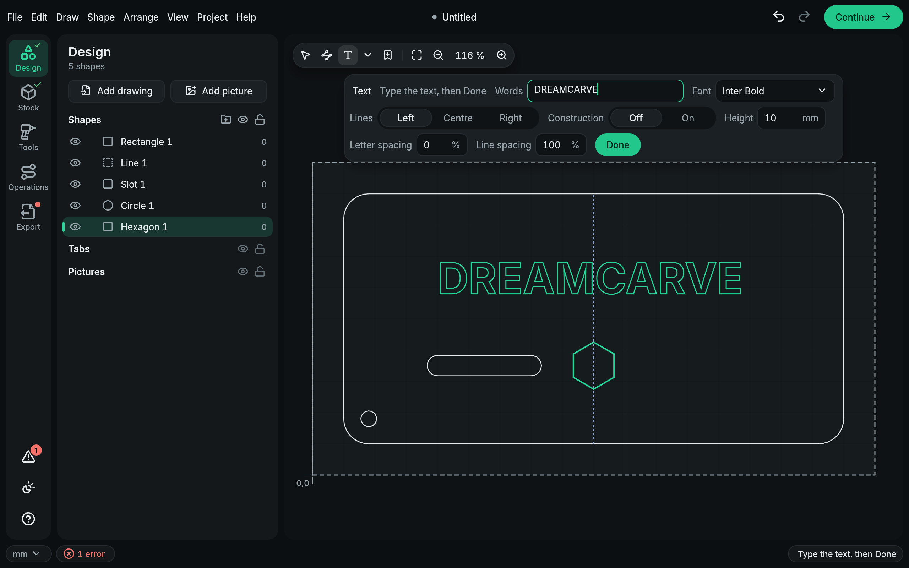
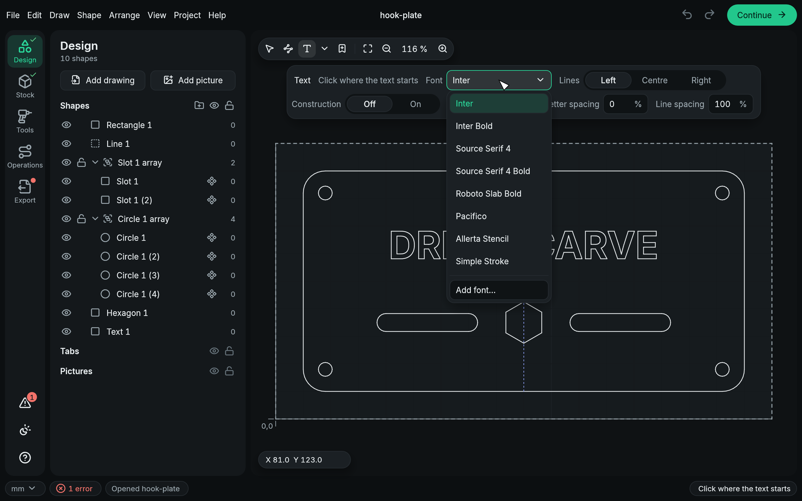

# Text and fonts

The **Text** tool (**Shift+T**) makes lettering to carve. A text is a
shape: a V-Carve, a Pocket or an Engrave cuts it as it cuts any outline.

## Making a text

1. Choose **Text** from the Draw button's list, or press **Shift+T**.
2. Set the **Font** and the **Height** in the tool bar.
3. Click where the text starts. The click sets the left end of the
   first line's baseline, the line the letters sit on. A second click
   moves it.
4. Type the words in the **Words** field, which has the keyboard after
   the click. They are previewed on the stock as you type.
5. Click **Done**, or press **Ctrl+Enter** (**⌘ Enter** on a Mac).

**Escape** takes the click back, and with no click puts the tool down.
The shape is named `Text 1`.

## The fields

| Field | What it is |
| --- | --- |
| **Words** | One line or several. **Enter** in the field starts a new line. |
| **Font** | A font that comes with the app, or one you added |
| **Height** | The height of a capital letter, in the project's units |
| **Letter spacing** | Extra space between letters, as a percentage of the height; 0 is the font's own spacing |
| **Line spacing** | The distance from one line to the next, as a percentage of the font's own; 100 is the font's own |
| **Lines** | **Left**, **Centre** or **Right**: how several lines sit under each other |

**Height** is the height of a capital *H*, so lettering set to 12 mm is
12 mm tall on the board in any font. A round letter such as *O* reaches
a little above and below, as type does.

The tool keeps these for the next text, and for the next time you start
the app.

## Fonts

The app comes with a small set of open-licensed fonts: a sans serif in
two weights, a serif in two weights, a slab, a script and a stencil.
[Licensing](../contributing/licensing.md#bundled-fonts) lists them.

One of them, **Simple Stroke**, is a **single-line font**. Its letters
are single strokes, not outlines, so they are open paths: use it with an
**Engrave**, which follows a line with the tip of the bit. It has
capitals, digits and a few marks; a small letter is drawn as its
capital.

To use a font of your own, choose **Add font…** at the end of the list
and pick a `.ttf` or `.otf` file. DreamCarve checks that it is a font,
copies it to its fonts folder in your configuration directory
([Configuration](configuration.md)) and chooses it. To remove a font,
delete its file from that folder. The app does not list the fonts
installed on your computer.

A character the font does not have is drawn as the font's own mark for a
missing character, and the tool bar says which.

## Changing a text

Select the text. Its **Properties** have a **Text** section with the
same fields. A change is one undo step, and the text is laid out again
where it is. The words are applied when you leave the field or press
Ctrl+Enter.

A text keeps its proportions: it scales evenly or not at all. To move
single letters or reshape them, choose **Shape ▸ Convert to Path**
first. The letters are then plain outlines, and no longer a text.

## A project on another computer

A project does not carry its fonts. It saves the text's **outline**, so
it opens, shows and cuts the same anywhere.

If you open it where the text's font is missing, the text's Properties
say *Font “Name” is not on this computer: the outline is kept*. The
fields are read-only, except **Font**: choose another font, or add the
missing one, and the text can be edited again.

## What carves well

- A **V-Carve** suits lettering: it cuts deeper where a stroke is
  wider. See [V-Carve operation](v-carve.md).
- Letters that overlap, as a script's do where they join, are one
  outline, so they carve as one.
- The holes of letters such as *O* and *A* are holes: a Pocket leaves
  them standing.
- Thin strokes need a small bit or a V-bit. A Pocket's bit cannot go
  where a stroke is narrower than the bit, and leaves that part uncut.
