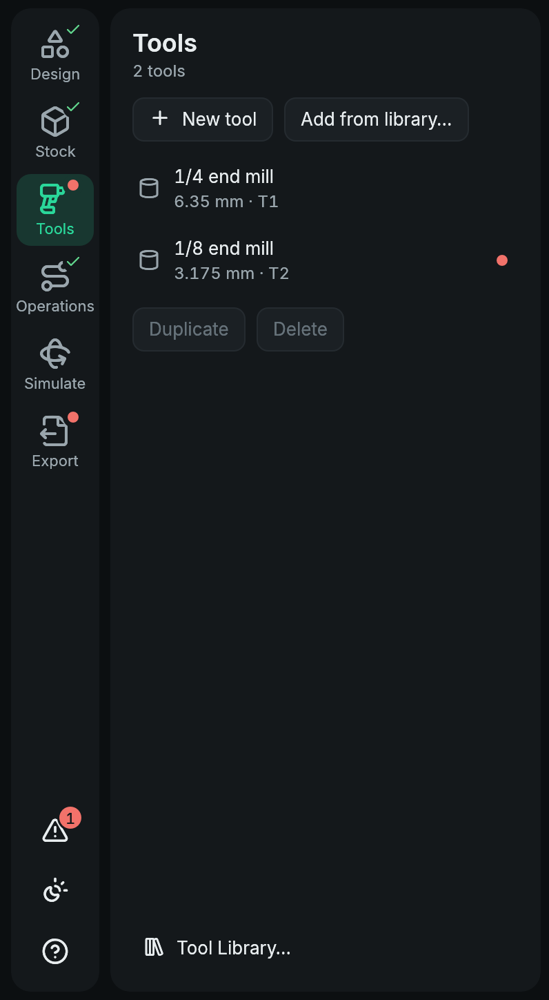
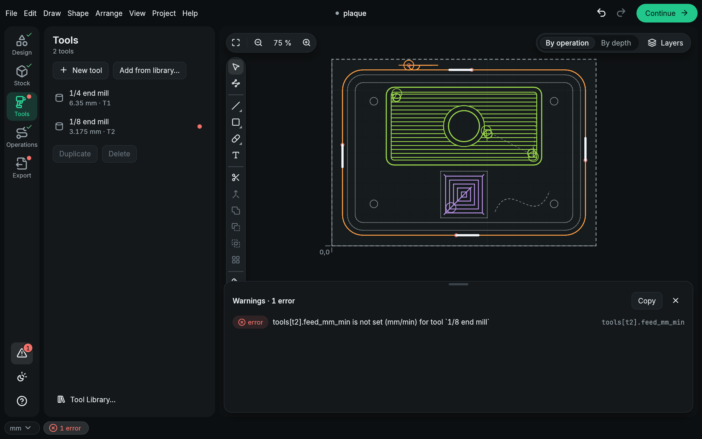
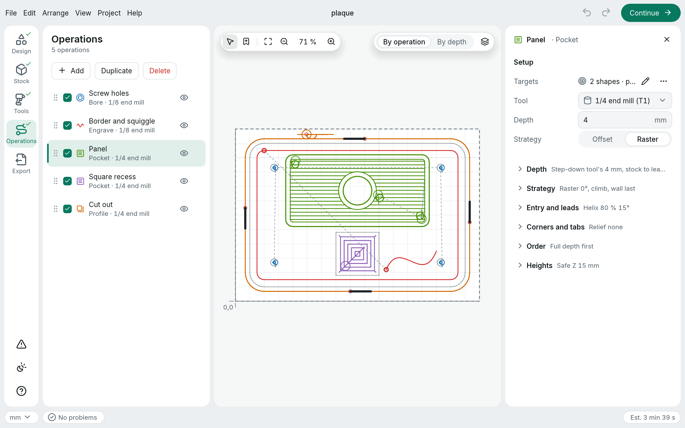

# The app

The DreamCarve app, `dreamcarve-app`, is a window on the same engine the
command line drives. It reads and writes the same project file, runs the
same checks, and writes the same G-code. This chapter is a tour of the
window: what each part holds, how to move through a job, and how to
select and edit things. For a first job from start to finish, do
[From SVG to G-code in the app](../quick-start/app.md) first.

## The window

| Part | Where | What it holds |
| --- | --- | --- |
| **Header** | Across the top | The menus, the project's name (with a dot before it while there are unsaved changes), **Undo** and **Redo**, and the one green button, **Continue**. The Export step's green button, **Export G-code**, is at the foot of its panel |
| **Rail** | Left edge | The five **steps** of a job, then **Warnings**, **Appearance** and **Help** |
| **Step panel** | Beside the rail | What the current step holds: the drawing's shapes, the stock, the tools, the operations, or the export |
| **Viewport** | The middle | The stock from above, with the shapes, the pictures, the tabs and the toolpaths. Its controls float over it |
| **Inspector** | Right edge | The editor of what is selected in the current step. It is there only while something is selected |
| **Status bar** | Along the bottom | The units, the problem counts, the last message, and the program's estimated time |

Drag the gap between two panels to make one wider. **View ▸ Step Panel**
hides the step panel and shows it again. The window works down to
1280 × 768; in a narrower one the Inspector lies over the Viewport's
right side.

With an empty project, the Viewport's place is taken by the **start
screen**: **New from drawing…**, **New from picture…**, **Open…**, three
examples to look round (each opens as an untitled copy) and your recent
files.

## The six steps

A job is six steps, always in this order. Each is a button in the rail,
and the step panel shows the one that is open.

| Step | What you do there | Its Inspector |
| --- | --- | --- |
| **Design** | Bring in drawings and pictures; move, resize, rename, hide and lock shapes | The selection's **Properties** |
| **Stock** | Set the units, the stock's size and thickness, and where work zero is | None |
| **Tools** | Make the project's tools, or add them from the Tool Library | The selected tool |
| **Operations** | Add the cuts, in cut order, and set each one | The selected operation |
| **Simulate** | See the stock as the machine will leave it, in 3D, and play the cut ([Simulation](simulation.md)) | None |
| **Export** | Check readiness, choose the output settings, write the programs | None |

No step is locked: open any of them at any time, from the rail, from
**View ▸ Go to …**, or with Ctrl 1 to Ctrl 6 (⌘1 to ⌘6 on macOS).
Simulate is there to look: nothing waits for it, and you can export
without opening it.

The rail marks each step with where it stands:

| Mark | Means |
| --- | --- |
| No mark | The step is empty: nothing has been done there yet |
| A check | The step is complete |
| An amber dot | Something in the step has a warning |
| A red dot | Something in the step has an error, which stops export |

| Step | Complete when | Marked with a dot when |
| --- | --- | --- |
| Design | The project has a shape or a picture | A shape has a problem, such as an open path no operation cuts, or the artwork has one, such as two shapes that overlap ([Preparing artwork](preparing-artwork.md#in-the-app)) |
| Stock | The thickness is set and every shape is on the stock | A stock or origin value has a problem, or a shape reaches past the stock |
| Tools | The project has a tool | A tool an operation uses lacks a feed, plunge rate or spindle speed |
| Operations | An enabled operation exists | An operation has an error or a warning |
| Simulate | The project as it stands has been simulated | Never: nothing the simulation finds is a warning |
| Export | The last export wrote the project as it stands | An error blocks export, or an output setting has a problem |

The marks are worked out from the project each time it changes; nothing
about them is saved. Hints never mark a step.

Here a tool has lost its feed rate. **Tools** and **Export** carry a red
dot, and the tool's row has one too:

**Continue** opens the next step that is not complete. The Export step
has no **Continue**: its own green button, **Export G-code**, is at the
foot of its panel and writes the programs; it is off, with the reason
beside it, while an error blocks export. Opening a
project opens its first step that is not complete, so a finished project
opens on Export.

## Tools

The **tool strip** down the left of the Viewport holds the tools. One is
in hand at a time, and it decides what a click on the Viewport does.
Rules divide the strip into four parts:

- **Select** (V), the tool for everything in this chapter: it selects,
  moves, resizes and turns; and **Edit nodes** (N), which reshapes a
  path ([Editing nodes](editing-nodes.md)).
- The tools that draw: three groups (line tools, shape tools, slot and
  gear tools), each a button with a list beside it, and **Text**
  ([Drawing shapes](drawing-shapes.md#the-tools)). The **Draw** menu
  lists them too.
- **Trim**, **Join**, **Weld**, **Subtract**, **Intersect** and
  **Array**, which change what is already drawn
  ([Changing shapes](changing-shapes.md)).
- **Measure** (K), and **Snapping**, which turns snapping on and off
  and lists what a point snaps to
  ([Snapping and the grid](snapping.md)).

The **Tab tool** (T) is in the **Shape** menu ([Tabs](tabs.md)).

The pill above the strip is the view's: **Fit** and the zoom.

While any tool but Select is in hand, a **tool bar** at the top of the
Viewport says what the next click does and holds the tool's fields, and the
Inspector stays closed. Some menu commands take their values in the
same bar: **Shape ▸ Offset…**, **Fillet Corners…** and **Join…**, and
**Arrange ▸ Array…**. **V**, or **Escape**, gives you Select back.

## Selecting

There is one selection, shared by the Viewport, the step panel and the
Inspector.

- **Click** a shape on the Viewport, or its row on the Design step, to
  select it. Where shapes overlap, a second click takes the next one
  under the pointer.
- **Shift-click** adds to the selection. Ctrl-click (⌘-click on macOS)
  adds a shape or takes it out.
- **Drag** on empty stock to draw a box: every shape it touches is
  selected.
- **Escape** clears the selection.

A selected shape is drawn in the accent colour with handles: drag it to
move it, drag a corner to resize it, drag the handle above it to rotate
it. The Inspector's **Properties** show its **X**, **Y**, **W** and
**H**, and its header has the **Arrange** buttons (rotate, flip). A
hidden shape cannot be selected. A locked one can, but it cannot be
moved, resized, rotated or flipped; operations still cut it.
[Placing shapes](placing-shapes.md) is the chapter on all of this.

The selection stays when you change step, which is how an operation gets
its shapes: select them, then **Add** on the Operations step.

Clicking a row on the Tools or Operations step selects that tool or
operation and opens it in the Inspector. Clicking a cut on the Viewport
selects its operation. The × at the Inspector's top right closes it.

Pictures and placed tabs are selected the same way, each among its own
kind: a picture from its row or with a click inside it where no shape
is, a tab with a click on its mark.

## Editing

The app has no OK or Cancel buttons. A field applies its value when you
leave it, however you leave it: Enter, Tab, a click anywhere else in the
window, a menu, another step, or switching to another program. Only
Escape leaves it and keeps the old value.

Every field has help. Hold the pointer on a field or on its label to
read what it does, its unit, the values it takes and what leaving it
empty means. While you type in a field, the same help is on a line at
the foot of the panel the field is in.

Every change to the project is one step for **Undo**, and the **Edit**
menu names the step it would take back: *Undo Move “square”*, *Undo Set
depth of “Panel”*. Selecting, zooming and what the Viewport shows are not
changes to the project, so they are not undone.

A value DreamCarve will not guess (the stock's thickness, a cut depth, a
tool's feed, plunge rate and spindle speed) shows **Required** in a red
outline until you type it. The app never fills one in.

A field with a problem is outlined in the problem's colour (red for an
error, amber for a warning, blue for a hint) and has a small mark
inside it at the right. The message is not written under the field.
Rest the pointer on the mark to read it, or put the keyboard in the
field and read it on the line at the foot of the panel; click the mark
to open the [Warnings drawer](warnings.md#in-the-app) at that
message.

Lengths and feeds are shown in the project's units, millimetres or
inches, set on the Stock step or from the status bar. A field also takes
a value with its own unit, such as `1/4 in` in a millimetre project,
and a sum, such as `1.5 + .375 / 2`, which it works out
([Formulas](keyboard.md#formulas)).
[Keyboard shortcuts](keyboard.md#typing-values) has the details, and
every shortcut.

## Warnings

The app checks the project every time it changes, as `dreamcarve check`
does. The counts are in the status bar and on the **Warnings** button in
the rail, which carries the count of the worst kind found. Either opens
the **Warnings drawer** over the bottom of the Viewport:

Each row has its kind (error, warning or hint), its code where it has
one, the message, and the value it is about. Click a row to go there: the
app opens the step that owns it and shows the field. An error stops
export; a warning and a hint do not. **Copy** puts the list on the
clipboard as `check` prints it. Drag the handle at the drawer's top edge
to make it taller.

[Checking and exporting](exporting.md) says more about the drawer and
about the Export step, [Toolpath preview](toolpath-preview.md) about
what the Viewport draws, and the [Warnings](warnings.md) chapter lists
every message by its code.

## The status bar

From the left: the **units** (click to switch between mm and inches),
the **counts** of errors, warnings and hints (or *No problems*), and the
last **message**, such as *Saved plaque*. While an operation that carves
is selected, the message is that carve's summary, and a click on it
opens the full note in the Warnings drawer.

At the right: the name of the shape under the pointer, and the program's
**estimated time**. While toolpaths are being worked out it says
*Generating 2 of 5…* with a **Stop** button instead.

## Projects

The **File** menu makes, opens and saves projects.

| Command | Does |
| --- | --- |
| **New** | An empty project: a 100 × 100 mm stock with no thickness, no tools, no operations, on the machine new projects start with ([Post-processors](post-processors.md#the-machine-new-projects-start-with)) |
| **New Project from Drawing…** | A new project round an SVG or DXF drawing, the stock sized to it, in the drawing's units: a DXF made in inches is a project in inches |
| **New Project from Picture…** | A new project round a PNG or JPEG picture, with a Photo V-Carve of it |
| **Open…**, **Open Recent** | Opens a `.dcv` project. An older file is upgraded as it is read, and the Warnings drawer lists what changed |
| **Save**, **Save As…** | Writes the project. The first Save asks where. A name typed without `.dcv` gets it, and the project takes the file's name, which its programs and setup sheet then show |
| **Add Drawing to Project…**, **Add Picture to Project…** | Adds to the open project and leaves its stock alone |
| **Export G-code…** | Opens the Export step |

A project, a drawing or a picture dropped on the window does what the
matching command does.

There is no autosave. With unsaved changes the header shows a dot before
the project's name, and closing the window, opening another project or
starting a new one asks first: **Save**, **Don't Save** or **Cancel**.

The project file is the one the command line reads and writes
([The project file](project-file.md)). Nothing about the window is in it:
panel sizes, recent files, the appearance and what the Viewport shows are
the app's own preferences, kept in `gui.toml` beside `config.toml`
([Configuration](configuration.md#the-apps-preferences)).

## Appearance

The app is dark until you choose otherwise. **Appearance** in the rail,
or **View ▸ Appearance**, offers **System** (follow the operating
system), **Light** and **Dark**. The choice is remembered.

The toolpath colours differ a little between the two so that each reads
on its background. The pictures in this book are of the dark appearance.

## Words the app uses

- **Step**: one of the six parts of a job: Design, Stock, Tools,
  Operations, Simulate, Export.
- **Rail**: the column of step buttons at the window's left edge.
- **Step panel**: the panel beside the rail that shows the open step.
- **Inspector**: the panel at the right that edits what is selected.
- **Start screen**: what a new project, with nothing done to it yet, shows in the Viewport's place.
- **Design Tree**: the list of the project's shapes, tabs and pictures on
  the Design step.
- **Viewport**: the view of the stock from above.
