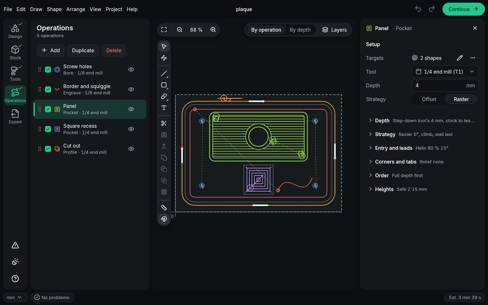
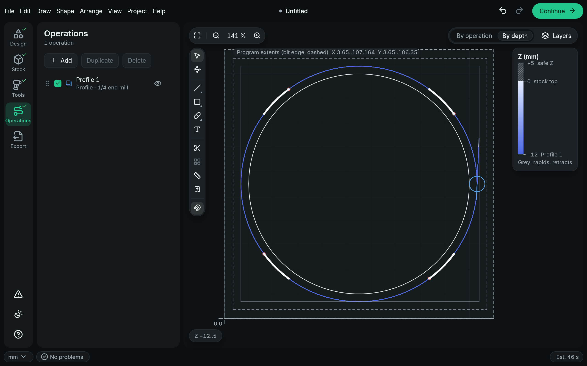
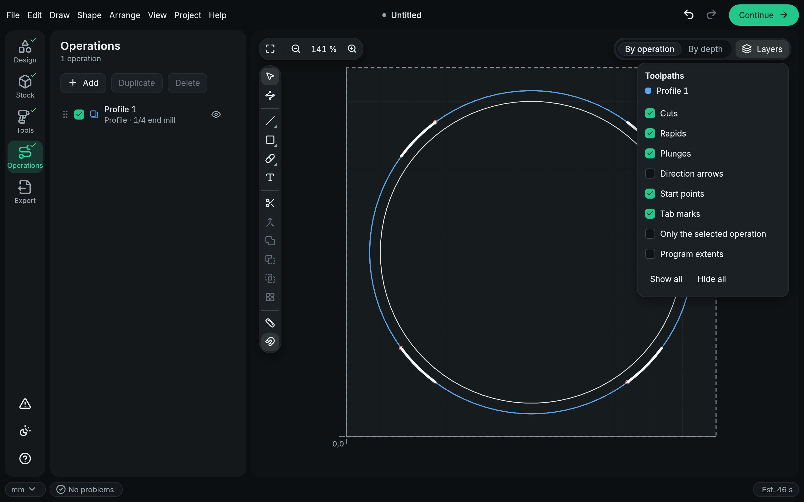

# Toolpath preview

The **Viewport** is the picture of what the machine will do. It shows the
stock from above, X to the right and Y away from you, with the shapes,
the pictures, the tabs, and the **toolpath** of every operation: the path
the centre of the bit follows.

There is nothing to press to see a toolpath. The app works each one out
again a moment after any change that affects it. While it does, the old
toolpath stays on the Viewport, faded, the operation's row shows a
spinner, and the status bar says *Generating 2 of 5…* with a **Stop**
button. An operation that cannot be worked out, for want of a depth or a
feed, draws nothing and is marked red in the list; the Warnings drawer
says why.

What the Viewport draws is what **Export G-code** writes. The command
line's `export --preview` draws the same picture as an SVG file.

## Reading the picture

| Drawn as | Is |
| --- | --- |
| A solid line in the operation's colour | A cut: the centre of the bit, moving at the feed rate |
| A thin dashed grey line | A **rapid**: a fast move above the stock, not cutting |
| A circle as wide as the bit, with a tick | A **start point**: where a cut begins, and which way it sets off |
| A heavy white mark across a cut | A **tab**: the last passes rise here and leave material |
| A circle as wide as the bit, alone | A drilled hole |

A Profile's line is half a bit outside (or inside) the shape it cuts,
because the line is the bit's centre and the bit's edge is on the shape.

A Photo V-Carve draws one start point for each groove. When the project
has an Inlay, the **male board** is drawn to the right of the stock, with
the mirrored design and its toolpaths, as it will lie on the machine.
Clicking a shape on the male board selects the Inlay.

Clicking any cut selects its operation and opens it in the Inspector.
While an operation is selected, the shapes it cuts are outlined in its
colour and the others fade.

## Moving round

The controls at the Viewport's top left are, in order: **Select**, the
**Tab tool** (click an outline to add a tab there), **Fit**, **Zoom out**,
the zoom as a percentage, and **Zoom in**.

| To | Do |
| --- | --- |
| Pan | Drag with the middle button, hold Space and drag, or scroll with two fingers on a trackpad |
| Zoom | Turn the wheel, or pinch: the point under the pointer stays put |
| See everything | **Fit**, or press F |
| See the selection | **View ▸ Zoom to Selection**, or Shift F |
| See the work at about its real size | Click the percentage: 100 % |

The percentage is of 96 pixels to the inch, about real size on most
displays. The app does not know your display's true size, so treat it as
a guide.

At the bottom left, the read-out gives the pointer's position in the
program's coordinates, measured from the origin: `X 64.2  Y 51.8`.

## Colours: by operation, or by depth

The control at the Viewport's top right, which appears once the project
has a toolpath, chooses how the cuts are coloured.

**By operation**, the default, gives each tool run its own colour, as
the command line's preview does. An operation that is one cut with one
tool has one colour, and while every operation is like that it is the
colour of its row's glyph. An operation with clearing passes, or an
Inlay's second board, takes a colour for each run, and an operation that
is turned off takes none, so the operations after it differ from their
rows ([Operations in the app](operations.md#the-list)). The **Layers**
key shows the colours as drawn. There are eight colours; the ninth run
takes the first again.

**By depth** colours every cut by how deep it is, from pale at the top of
the stock to dark at the deepest cut in the project:

The **legend** is one scale of Z, in the program's coordinates:

- at the top, in grey, the heights the bit travels at without cutting:
  the clearance height, when the project sets one, and each operation's
  safe Z;
- `0 stock top`, or the stock's thickness when Z zero is its bottom;
- below it, the ramp of cutting depths, with a tick and a name at each
  operation's deepest cut.

Rapids stay grey and dashed in this mode. Use it to check that an
operation is as deep as you meant before you cut, and that no safe Z is
lower than your clamps.

## Layers: what is drawn

**Layers**, beside the colour control, opens a list of what the Viewport
draws of the toolpaths. **View ▸ Toolpaths…** opens it too, and Escape or
a click elsewhere closes it.

At the top is the **key**: each operation's colour and name, or, by
depth, a line saying how the colours read.

| Tick | Draws |
| --- | --- |
| **Cuts** | The cutting moves |
| **Rapids** | The fast moves between cuts |
| **Plunges** | The moves straight down into the material |
| **Direction arrows** | Arrows along each cut, showing which way the bit goes. Off to begin with |
| **Start points** | The circle and tick where each cut starts |
| **Tab marks** | The marks where a cut rises over a tab |
| **Only the selected operation** | Hides every toolpath but the selected operation's |
| **Program extents** | The boxes described below |

**Show all** and **Hide all** set every operation's toolpath at once.
Each operation's row also has an eye, which hides or shows that one
toolpath. Hiding a toolpath does not disable the operation: it is still
exported.

All of this is how you look at the job, not part of the job. None of it
is saved in the project or changes the program, and Undo does not touch
it. The app remembers it between sessions.

## Program extents

Tick **Program extents** to draw where the program takes the bit:

- the inner box is the reach of the bit's centre;
- the dashed box round it is the reach of the bit's edge, widened by the
  largest bit's radius.

A caption gives the numbers, `Program extents (bit edge, dashed)
X 3.65..107.164  Y 3.65..106.35`, and the read-out at the bottom left
adds the Z range, `Z −12..5`. They are in the coordinates your controller
shows once work zero is set, and they are the numbers `check` and
`export` print.

**Keep clamps, screws and anything else outside the dashed box**, with
room to spare for the collet nut, and make sure the bit can travel at the
top of the Z range without hitting anything. If you change the project,
look again: the box follows it.

## Before you trust it

The preview shows the path, not the machine. It cannot see your clamps,
your real stock, the bit that is actually in the spindle, or where you
set work zero. Run an air cut before the first real one:
[Safety](safety.md#before-every-cut).
