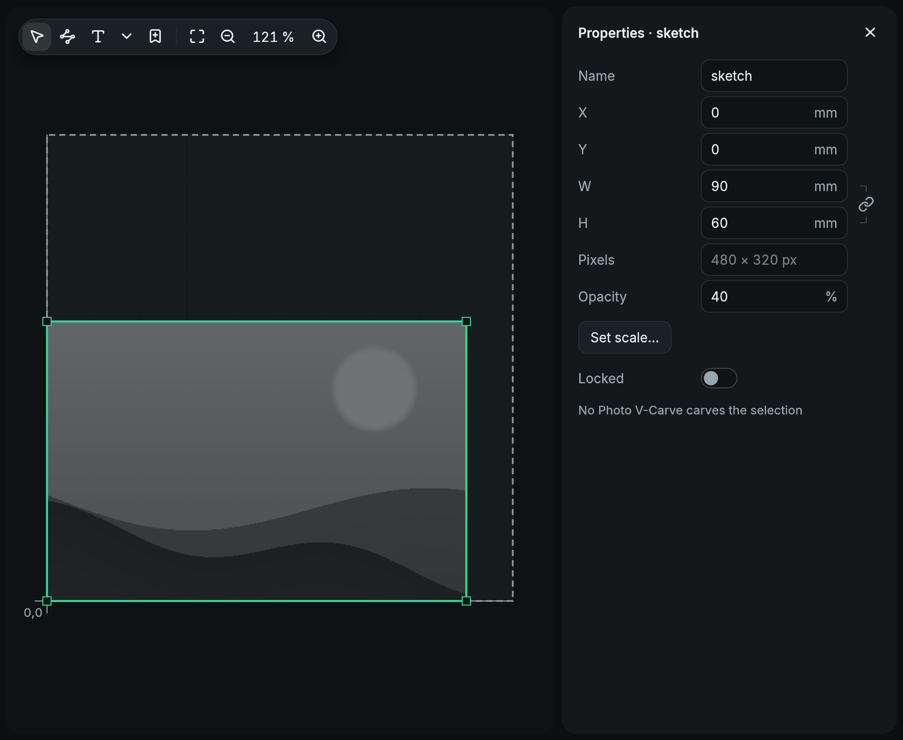
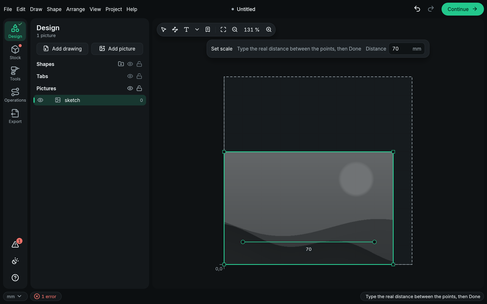

# Tracing a picture

To copy a part from a paper drawing, a photo or a scan, put the picture
on the stock and draw over it. A picture used this way is a
**backdrop**.

This chapter is about drawing over a picture by hand. To have DreamCarve
find the outlines for you, see [From line art](../quick-start/line-art.md).
To carve the picture itself, see [Carving a photo](../quick-start/photo.md).

## 1. Add the picture

On the **Design** step, click **Add picture** and choose the file.
[Images](images.md) has the formats and the import sheet.

Straighten a crooked scan before you add it. A picture cannot be turned
in the app.

## 2. Fade it

Select the picture. In its **Properties**, type a percentage into
**Opacity**, from 10 to 100. At 40 the picture is faint enough for the
lines you draw to stand out.

Opacity is how the picture looks, nothing more. It is saved with the
project, and nothing that is carved reads it.

## 3. Set its scale

A photo has no size. To make the picture the size of the real part, you
need one distance you know: a dimensioned edge, a ruler in the photo,
the spacing of two holes.

1. In the picture's Properties, click **Set scale…**.
2. Click one end of the known distance on the picture.
3. Click the other end. A line joins the two points.
4. In the tool bar, type the real distance into **Distance** and click
   **Done**.

The picture is resized about the first point, so the first point stays
where you clicked it and the second lands the typed distance away. It
keeps its proportions.

The two points are taken where the pointer is, with no snapping: what
you click is a mark in the picture. A third click moves the second
point. **Escape** takes back the last point.

Zoom in before you click. The scale is as good as the two clicks, and a
long known distance gives a better scale than a short one.

## 4. Lock it

Turn on **Locked** in the picture's Properties.

A locked picture cannot be picked on the Viewport. A click or a drag
across it selects nothing, so drawing and selecting over it never grab
it by mistake. Its row in the Pictures list still selects it, and
**Unlock** in its Properties frees it.

## 5. Draw over it

Use the [drawing tools](drawing-shapes.md). Some things that help:

- **Line** with **A** for the arcs follows most mechanical outlines.
  Click the corners, and press **A** before an arc.
- Draw centre lines as
  [construction geometry](folders-and-construction.md#construction-geometry)
  first, then snap holes and slots to them.
- Where the drawing gives a size, type it. A typed diameter is better
  than one traced from a thick pencil line.
- A picture does not snap, so your points snap only to what you have
  drawn.
- Check a few distances with the [Measure tool](measuring.md) before
  you add operations.

When the drawing is done, hide the picture with the eye on its row, or
delete it. A picture is cut only if you add a
[Photo V-Carve](photo-v-carve.md) for it.
