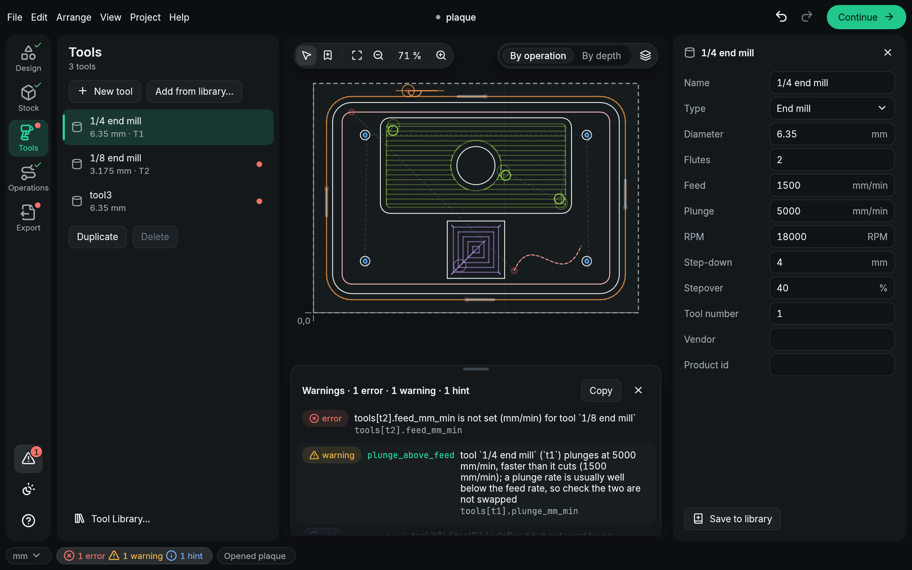

# Warnings

`check` and `export` print every warning as

```text
warning: <code>: <message>
```

and, when the warning is about one value in the project file, after that
value's position, as in `coaster.dcv:33:14: warning: spindle_speed_high: …`.
The code is a stable `snake_case` word you can search for here; the
message names the operation, shape or tool concerned and says what to do.
A warning never stops export: the program is still written and still
passes the [safety rules](safety.md). An error does stop it; errors are
described in the chapter of the thing they are about.

The tables list every code, grouped by where it comes from.

## In the app

The app runs the same check after every change, and shows what it finds
in four places.

**The status bar** counts the findings, or says *No problems*. **The
rail** marks each step: a check when it is complete, an amber dot when
something in it has a warning, a red dot when something in it has an
error. An error also puts a red dot on **Export**, because it stops
export. A hint marks no step. **A row** in the Operations list carries
its operation's warnings and errors, and a row in the Tools list a red
dot while the tool lacks a value. And the **Warnings drawer** lists
every finding in full.

### The three kinds

| Kind | Colour | Means | Export |
| --- | --- | --- | --- |
| **Error** | Red | Something is missing or wrong: a thickness not set, a tool with no feed, a cut below the stock | Refused until it is fixed |
| **Warning** | Amber | Something you should look at. The program is still safe, but it may not be what you meant | Allowed |
| **Hint** | Blue | Advice about how the job is set up, not about its cuts. There are two: `unused_tool` and `tool_change_avoidable` | Allowed |

The command line has no hints. It prints those two as warnings, which is
what they are in the tables below.

### The Warnings drawer

Click the counts in the status bar, the **Warnings** button in the rail,
or **View ▸ Warnings**. The button's badge is the number of findings of
the worst kind, in its colour.


Each row has:

- its **kind**;
- its **code**, in green, when it has one. Click the code to open this
  chapter at that code's entry, in your browser;
- the **message**, which names the operation, shape or tool and says
  what to do;
- the **value** it is about, as the project file names it:
  `tools[t1].plunge_mm_min`.

An error for a value that is not set has no code: its message is the
value's name.

Rows are grouped by operation, with the project's own first. Each group
has a heading, `Panel · Pocket`, when there is more than one group.

**Click a row** to go to what it is about:

| The row is about | The app opens |
| --- | --- |
| A value of an operation | The Operations step, with the operation in the Inspector and the keyboard in that field. The same message is under the field |
| A tool | The Tools step, with the tool in the Inspector |
| A shape | The Design step, with the shape selected |
| The stock or the origin | The Stock step |
| An output setting | The Export step, with the setting's group open |



The drawer stays open while you fix things, and follows the project: put
the plunge rate right and its row goes.

**Copy** puts the list on the clipboard as `dreamcarve check` prints it,
ending with `check`'s own count. That is the form to paste into a bug
report. Drag the handle at the drawer's top edge to make it taller, and
close it with the × at its right.

### Notes

An operation that carves (a V-Carve, an Inlay, a Photo V-Carve) also has
a **note** in the drawer: what the carve comes to. So does a picture
that was converted to grey when it was imported. A note is information,
not a problem. It is not counted and marks nothing.

## Operation order

Operations always run in the order the project lists them, never
regrouped by tool or reordered ([Machining order and operation
order](machining-order.md#operations-run-in-list-order)). These warnings
say when that order is likely a mistake.

| Code | Message says | What to do |
| --- | --- | --- |
| `cut_inside_freed_part` | <a id="cut_inside_freed_part"></a>"`<shape>` lies inside `<outline>`, which operation `<id>` cuts free of the stock first, so this cut would run in a loose part" | An earlier Profile cuts through the stock around (or inside) an outline, with no tabs, and this operation then cuts a shape inside it: the cut runs in a part or slug that is no longer held. An open path an Engrave or an `on_line` Profile cuts counts when all of it lies inside the outline. Move this operation before the one named. Giving that Profile tabs keeps the piece from coming loose, but the cut then runs in a part held only by them, which warns `cut_inside_tab_held_part`. |
| `cut_inside_tab_held_part` | <a id="cut_inside_tab_held_part"></a>"`<shape>` lies inside `<outline>`, which operation `<id>` cuts through the stock first, leaving it held only by its tabs, so this cut would run in a part that can flex, chatter or break a tab" | An earlier Profile cuts through the stock round an outline with [tabs](tabs.md), and this operation then cuts a shape inside it deeper than half the stock thickness (its `depth_mm`; a cut through the stock always counts), such as a hole or a deep pocket: the piece is held only by a few small bridges, so it is less rigid than uncut stock. A lighter cut, such as a shallow engraving after the cut-out, is normal practice and does not warn. An open path an Engrave or an `on_line` Profile cuts counts as for `cut_inside_freed_part`. The message names the innermost such outline. Move this operation before the one named. For a hole, cut it in the same operation as its part, which cuts holes first ([Tabs: parts with holes](tabs.md#parts-with-holes)). A shape inside an outline that Profile cuts free with no tab warns `cut_inside_freed_part` instead. |
| `tool_change_avoidable` | <a id="tool_change_avoidable"></a>"tool `<id>` (`<name>`) is used by operations `<a>`, `<b>`, which do not run one after another, so it is fitted more than once" | Operations using one tool are separated by an operation using another, so the tool is fitted twice. Put them next to each other if the order allows; DreamCarve never moves them for you. |
| `start_depth_mismatch` | <a id="start_depth_mismatch"></a>"it starts … mm below the stock top, but operation `<id>`, the Pocket before it whose area contains its targets, is … mm deep, so the start plane is not that Pocket's floor"; for a countersink "… contains the whole of its V-bit at each hole …", for a Photo V-Carve "… contains its picture's footprint …" | A V-Carve, a countersink or a Photo V-Carve is measured from its start plane, `start_depth_mm` below the stock top. An enabled Pocket earlier in the list clears the area its shapes (a countersink's bit at each hole, a Photo V-Carve's picture) lie in, but to another depth, so the carve's outline will not meet that Pocket's floor where it is drawn. Set `start_depth_mm` to the Pocket's depth (0 to carve from the stock top outside any Pocket). An earlier V-Carve's flat floor counts as a Pocket does: the message then names the V-Carve, "the V-Carve before it whose flat floor contains its targets", and the floor's depth, its start depth plus its flat depth. Until they match, the bit's flank is counted from the stock top when checking it against the bit's cone. With no such Pocket and a start depth above 0, `check` and `export` stop with the error `start_depth_uncleared` instead, unless the operation sets `start_plane_cleared_externally: true` because another program cleared the start plane. |

## Toolpath generation

Printed after the operation's id: `warning: <code>: operation `op1`: …`.

| Code | Message says | What to do |
| --- | --- | --- |
| `open_path_skipped` | <a id="open_path_skipped"></a>"… is an open path, which has no inside or outside, so it is not cut; an On line, Left or Right Profile or an Engrave cuts along it", or "… is an open path with no length, so there is nothing to cut; it is skipped" | A Pocket's or an Inside or Outside Profile's target is not a closed outline. Close it in the drawing, cut it with an `on_line`, `left` or `right` [Profile](profile.md#open-paths) or an [Engrave](engrave.md), or leave it untargeted. The second message is an open path of an On line, Left or Right Profile whose points are all in one place: delete it from the drawing. |
| `side_needs_open_path` | <a id="side_needs_open_path"></a>"… is a closed outline, and Left and Right are sides of an open path, so it is not cut; cut it Inside, Outside or On line" | A `left` or `right` Profile's target is a closed outline, which has no left or right you can see in the drawing. Cut it in an Inside, Outside or On line Profile, or leave it untargeted ([Profile: left and right](profile.md#left-and-right)). |
| `pocket_no_room` | <a id="pocket_no_room"></a>"tool … is wider than the pocket of … somewhere it must pass, so that shape is not cut" | The bit does not fit in the pocket at all. Use a smaller bit or widen the shape ([Pocket](pocket.md#warnings)). |
| `pocket_island_too_close` | <a id="pocket_island_too_close"></a>"in the pocket of …, island profile … is … mm from …, closer than the … mm tool … is wide, so the material between them is left uncut"; with stock to leave, "closer than tool … needs with a … mm stock to leave (… mm)" | An island is nearer the pocket wall or another island than the bit needs to pass: its diameter plus twice the stock to leave. Use a smaller bit or stock to leave, or move the island ([Pocket](pocket.md#warnings)). |
| `entry_fallback` | <a id="entry_fallback"></a>"there is no room for a `helix` entry in …, so its passes start with a zigzag ramp instead", or "… with a straight plunge at the plunge rate instead; set the operation's entry to `plunge` to stop this warning" | The Pocket's or Profile's helix or ramp does not fit that shape (a narrow slot, a hole barely wider than the bit, waste pinched between two parts, a tab over the start of an open path cut On line, or of a Profile outline whose every stretch between tabs is too short), or at its angle would take too many moves to reach depth ("… would take too many moves …"), or is a helix, or an On line ramp, so small that its moves are shorter than the program's last decimal place ("a `helix` entry this small has moves too short for the program's decimal places in …"). The next entry that fits is used: helix, then ramp, then plunge. Use a smaller bit, a steeper angle, or set `entry` to the one that is used ([Pocket: entry](pocket.md#entry), [Profile: entry](profile.md#entry)). |
| `helix_diameter_reduced` | <a id="helix_diameter_reduced"></a>"the helix entry in … is … mm across, smaller than the … mm asked for, because a larger one does not fit there" | The helix is cut at the size that fits. Nothing to do, or lower `diameter_fraction` to that size to stop the warning ([Pocket: entry](pocket.md#entry), [Profile: entry](profile.md#entry)). |
| `lead_shrunk` | <a id="lead_shrunk"></a>"the lead arc on … is … mm in radius over …°, smaller than the … mm over …° asked for, because a larger one does not fit there" | The Profile's lead fits that outline only smaller (a small hole, waste pinched between parts or by the stock edge, tabs). It is cut at the size given. Nothing to do, or set `lead` to that size to stop the warning ([Profile: leads](profile.md#leads)). |
| `lead_dropped` | <a id="lead_dropped"></a>"there is no room for a lead-in arc on …, even at a quarter of the radius, so its passes start on the outline without one", "there is no room for a lead-out arc where the cut on … ends, so it stops on the outline", "operation … cuts on the line, which has no waste side for a lead, so it cuts without one", or "operation … cuts beside open paths, which take no lead, so it cuts without one" | No lead fits that outline (a hole barely wider than the bit; when only the tabs are in the way, just the passes below the tab top go without one), no lead-out fits where its cut ends, or the Profile is On line, Left or Right. Use a smaller `radius_mm`, a smaller bit, or remove the lead ([Profile: leads](profile.md#leads)). |
| `relief_skipped` | <a id="relief_skipped"></a>"corner relief `…` is skipped because the tool has no step_down_mm, …", "… is skipped: an On line Profile has no waste side to cut a notch into, …", or "… is skipped: a Left or Right Profile cuts open paths, …" | No corner of the operation is relieved. Set the tool's `step_down_mm`, which the notches step down at; on an On line, Left or Right Profile, cut Inside or Outside, or set `corner_relief` to `"none"` ([Pocket: corner relief](pocket.md#corner-relief), [Profile: corner relief](profile.md#corner-relief)). |
| `relief_corner_too_tight` | <a id="relief_corner_too_tight"></a>"the corner of … at (…, …) mm is not relieved: an edge beside it is shorter than the bit is wide, …", "… the tool path does not turn it within reach, …", or "… its notch would come nearer another wall than the bit's radius and cut through the material there, …" | That corner keeps the bit's radius: a notch needs a bit's diameter of wall on each side of the corner, and the bit's radius of clearance from every other wall (a T-bone in a hole reaches the bit's radius into the part past its wall). Use a smaller bit, try `dogbone`, which reaches less far past the walls, or ignore it if that corner need not be square ([Pocket: corner relief](pocket.md#corner-relief), [Profile: corner relief](profile.md#corner-relief)). |
| `relief_corner_not_cut` | <a id="relief_corner_not_cut"></a>"the corner of … at (…, …) mm is not relieved because the main passes did not cut to full depth where its notch starts (a tab over it, or no wall pass), …" | A notch only plunges where the operation already cut to full depth. Move the tab off the corner, or set the Pocket's `wall_pass` to `"last"` or `"first"` ([Profile: corner relief](profile.md#corner-relief), [Pocket: corner relief](pocket.md#corner-relief)). |
| `last_pass_unused` | <a id="last_pass_unused"></a>"it has a last_pass, but its cut is only one pass deep, …" | The cut fits in one step-down, so its one pass is the last and nothing leaves stock: it cuts as without a last pass. Set `last_pass` to `null`, or make `step_down_mm` smaller than `depth_mm` ([Profile: last pass](profile.md#last-pass)). |
| `last_pass_edge_faster` | <a id="last_pass_edge_faster"></a>"its last pass round … turns on an inside arc of … mm, tighter than the … mm stock to leave, where it runs at … mm/min, the least the safety pass allows, so its cutting edge there moves at … times the feed; …" | The last pass lowers its feed round inside arcs so that its cutting edge moves at the feed, but not below what the smallest hole the last pass can cut needs. An inside corner rounded to little more than the bit's radius (a pocket's rounded corner with a bit nearly as large) needs more, and there the edge moves faster than the feed. Use a smaller bit, larger inside radii or a smaller stock to leave ([Profile: last pass](profile.md#last-pass)). |
| `last_pass_flattened_curve` | <a id="last_pass_flattened_curve"></a>"its last pass round … follows a curve drawn as straight segments, which it does not slow down for, and near (…, …) mm its tool path bends on a radius of about … mm, so its cutting edge there moves at about … times the feed; …" | The last pass slows down only round true arcs. A curve drawn as many short lines (a DXF ellipse or spline, an SVG curve that is not a circle) runs at the feed, and where it bends tightly the bit's cutting edge moves faster than the feed: this warns when it is more than 1.5 times. Feeds are not changed. Lower the feed, use a smaller stock to leave (the edge still moves as fast, but takes a thinner skin), or redraw the curve with arcs so the last pass slows down there ([Profile: last pass](profile.md#last-pass)). |
| `rest_of_clears_nothing` | <a id="rest_of_clears_nothing"></a>"operation `…`, which this one rests on, already reaches everything tool `…` can, so this operation cuts nothing" | A rest machining Pocket uses a bit no smaller than the earlier Pocket's, at no smaller a stock to leave, so nothing is left that it reaches. Use a smaller bit, or remove the operation ([Pocket: rest machining](pocket.md#rest-machining)). |
| `tool_too_large` | <a id="tool_too_large"></a>"tool … does not fit …, so that shape is not cut" | The bit does not fit inside the shape (an Inside cut, or a hole of an Outside cut), or beside an open path cut Left or Right, all of whose curves are tighter than the bit on the cut side. Use a smaller bit or enlarge the shape. |
| `duplicate_shape_dropped` | <a id="duplicate_shape_dropped"></a>"… is the same outline in the same place as …, so it is cut only once" | Two targets are the same outline in the same place, or the same open path: drawn either way for an On line Profile, the same way for a Left or Right one. Remove one. |
| `tabs_overlap` | <a id="tabs_overlap"></a>"tabs on … touch or overlap on its … mm tool path, so they were joined into longer tabs" | Too many or too wide tabs for the outline. Use fewer or narrower tabs ([Tabs](tabs.md#warnings)). |
| `tabs_outside_cut_range` | <a id="tabs_outside_cut_range"></a>"the tab top is … mm above the stock bottom, but the deepest pass stops at … mm" or "… higher than the … mm stock top" | The tabs are above every pass (they change nothing) or above the stock top (every pass lifts over them). Lower `height_mm` ([Tabs](tabs.md#warnings)). |
| `tabs_cover_most_of_contour` | <a id="tabs_cover_most_of_contour"></a>"tabs on … would cover more than half of its tool path …, so the part or hole would not cut free. Only … of them are cut there", or "All of them are cut, as placed, …" | The outline is too short for the tabs. `tabs place --count`, or a Profile's tab request, gives it the most that cover at most half of it, possibly none; tabs already placed are cut as placed. Use narrower or fewer tabs (the message gives the width) ([Tabs](tabs.md#outlines-too-short-for-the-tabs)). |
| `tab_on_hole` | <a id="tab_on_hole"></a>"tab `…` is on …, which this operation cuts as a hole, so the tab holds the hole's slug in place" | A placed tab is on a hole of the part this Profile cuts. The tab is cut, so the slug stays in the hole. If the slug is waste, remove the tab with `dreamcarve tabs clear <dcv> --tab <id>`. `tabs place` warns once for the tabs it puts on holes and saves them with `"holds_slug": true`; `check` and `export` warn only for a hole tab without it ([Tabs: parts with holes](tabs.md#parts-with-holes)). |
| `tab_not_crossed` | <a id="tab_not_crossed"></a>"tab `…` on … is crossed by no enabled Profile operation, so it holds nothing" | No enabled Profile cuts that outline, or every one that does runs too far from the tab (a tab in a corner the bit cannot reach) or stops above its top (a shallow score pass). Cut the outline with a Profile, move the tab, or remove it with `dreamcarve tabs clear <dcv> --tab <id>` ([Tabs](tabs.md#warnings)). |
| `tab_off_outline` | <a id="tab_off_outline"></a>"tab `…` on … is … mm from that outline, more than its width plus the widest bit that cuts round it" | The tab's point is far from its outline, so it is cut at the outline's nearest point, which may not be where you meant: a hand edit, or a tab left behind after the drawing changed. Move it back onto the outline, or check where it lands with `dreamcarve tabs list` (`AT_MM`, `OFF_MM`) ([Tabs](tabs.md#warnings)). |
| `tab_on_corner` | <a id="tab_on_corner"></a>"the tab … mm along the bit's path round … is on a corner, …, so it is cut on the corner", or "…, and so is every place it could go" | A Profile's tab request has `avoid_corners: true`, and this tab has nowhere off the corner within half the gap to its neighbours that is not on another tab or past an open path's end; or the outline is so small for the bit that its path is a corner all along it, so use a smaller bit. The distance is measured along the bit's path from where it starts (from the start point when `start` is set; from the first vertex as drawn on an open path). Use fewer or narrower tabs, or place this one by hand with `dreamcarve tabs place --at` ([Tabs: corners](tabs.md#tabs-off-corners)). |
| `engrave_path_degenerate` | <a id="engrave_path_degenerate"></a>"… has fewer than two distinct points, so there is nothing to engrave; it is skipped" | An Engrave target is a single point, or all its points are in one place. Delete it from the drawing ([Engrave](engrave.md#warnings)). |
| `drill_target_not_circle` | <a id="drill_target_not_circle"></a>"… is not a circle; Drill plunges only at the centre of circles, so it is not drilled" | A Drill target is not a closed circle. Draw a circle, or remove it from the targets ([Drill](drill.md#which-outlines-are-holes)). |
| `drill_hole_too_small` | <a id="drill_hole_too_small"></a>"the … mm hole … is narrower than the … mm tool, so it is not drilled: a Drill never moves sideways, so the hole would come out the tool's size; …" | The circle is smaller than the bit by more than the project's `flatten_tolerance_mm`, so that hole is left out; the others are drilled. To cut it the size you drew it, bore it with an end mill smaller than the circle ([Bore](bore.md)); or use a smaller drill, draw the circle the bit's size, or, if a hole the bit's size is what you want (a clearance hole drawn at the screw's size), set the Drill's `allow_tool_wider_than_hole` to `true` ([Drill: holes smaller than the bit](drill.md#holes-smaller-than-the-bit)). |
| `drill_tool_wider_than_hole` | <a id="drill_tool_wider_than_hole"></a>"the … mm tool is wider than the … mm hole …, so the hole comes out the tool's size" | The Drill's `allow_tool_wider_than_hole` is `true`, so the hole is drilled at the bit's size. As intended; set it to `false` to skip such holes instead ([Drill: holes smaller than the bit](drill.md#holes-smaller-than-the-bit)). |
| `drill_peck_deeper_than_hole` | <a id="drill_peck_deeper_than_hole"></a>"the … mm peck is at least the … mm depth of the holes, so each is drilled in one plunge" | Use a smaller `peck_depth_mm`, or the `"simple"` cycle ([Drill: peck](drill.md#peck)). |
| `drill_retract_below_stock_top` | <a id="drill_retract_below_stock_top"></a>"retract_mm is … mm, below the stock top; the tool retracts to the stock top instead" | Set `retract_mm` to 0 or more ([Drill: retract height](drill.md#retract-height)). |
| `countersink_mouth_not_wider_than_hole` | <a id="countersink_mouth_not_wider_than_hole"></a>"the … mm hole … is at least as wide as the … mm countersink, so there is no seat to cut and it is not countersunk" | A countersink opens a mouth of its `diameter_mm` round the top of each circle; a circle at least that wide leaves the cone's rim inside the hole, so that hole is skipped and the others are cut. Use a wider `diameter_mm` (at most the V-bit's diameter), or remove the circle from the targets. |
| `drill_no_holes` | <a id="drill_no_holes"></a>"none of its targets is a circle it can drill, so it drills nothing" | Every target was skipped, each with its own warning above (`drill_target_not_circle` or `drill_hole_too_small`), so the operation cuts nothing; the rest of the program is still written. Fix those, or remove the operation ([Drill](drill.md#holes-smaller-than-the-bit)). |
| `bore_target_not_circle` | <a id="bore_target_not_circle"></a>"… is not a circle; Bore cuts only circles, so it is not bored" | A Bore target is not a closed circle. Draw a circle, or remove it from the targets ([Bore](bore.md#holes-it-skips)). |
| `bore_no_room` | <a id="bore_no_room"></a>"the … mm hole … leaves the … mm tool no room: the tool does not fit, so it is not bored; use a smaller end mill", or "… no room to spiral, so it is not bored; a hole the bit's size is a Drill's: drill it with a Drill" | The bit, with the Bore's `stock_to_leave_mm`, leaves a helix radius under 0.05 mm, so that hole is left out; the others are bored. Use a smaller end mill, or a [Drill](drill.md) for a hole the bit's size ([Bore: holes it skips](bore.md#holes-it-skips)). |
| `bore_leaves_core` | <a id="bore_leaves_core"></a>"the … mm hole … is more than twice the … mm tool: a helix along its wall would leave a … mm core standing, which comes loose in a through hole, so it is not bored; …" | The hole is wider than twice the bit plus twice the stock to leave, so a helix would leave a core, which a through hole frees to spin against the bit. Clear it with a [Pocket](pocket.md), or use a bigger end mill ([Bore: holes it skips](bore.md#holes-it-skips)). |
| `bore_no_holes` | <a id="bore_no_holes"></a>"none of its targets is a circle it can bore, so it cuts nothing" | Every target was skipped, each with its own warning above, so the operation cuts nothing; the rest of the program is still written. Fix those, or remove the operation ([Bore](bore.md#holes-it-skips)). |
| `toolpaths_overlap` | <a id="toolpaths_overlap"></a>"the tool paths of … and … cut into each other: the shapes are … mm apart" | Two shapes in one Profile are closer than the bit needs between them, or an open path cut `on_line` comes within half a bit of another shape's line or crosses it, or an open path cut `on_line` outside any part comes within half a bit of itself far along it (a tight spiral or a hairpin; the warning names it twice). Move them apart or use a smaller bit ([Profile: shapes too close together](profile.md#shapes-too-close-together)). An Engrave never gives it. |
| `vcarve_target_open` | <a id="vcarve_target_open"></a>"… is an open path, which has no area to V-carve; it is skipped" | A V-Carve carves the area inside closed outlines. The closed targets are carved; close the path in the drawing, or cut it with an [Engrave](engrave.md). |
| `vcarve_no_medial_axis` | <a id="vcarve_no_medial_axis"></a>"… is too thin for a medial line to be found, so it is not carved" | The shape is so thin that no line between its walls survives even a finer sampling, so nothing of it is carved. Widen it, or Engrave it instead. |
| `vcarve_sampling_budget` | <a id="vcarve_sampling_budget"></a>"a carved shape is so long for its width that its medial lines are found every … mm, coarser than its width alone would give; small details may be smoothed" | A shape's outline is long for its size (a long, thin line of text drawn as one outline), so its medial lines are found at the step shown, which can round off fine details. Carve the parts separately if a detail is lost. Reported once per operation. |
| `tapered_corners_softened` | <a id="tapered_corners_softened"></a>"its tapered ball nose cannot follow … corners sharper than its tip below the surface, so their walls meet in a round valley instead of a crease, up to … mm from the corner as drawn at (…); round the corners by at least … mm …" | A V-Carve cut with a tapered ball nose reaches every corner at the surface, but below it the ball cannot follow a convex corner tighter than its tip: the two walls meet in a valley as round as the tip, the soft look a tapered ball nose gives a carve. The warning counts those corners and names the one that changes most. It exports anyway. To cut a corner as the taper would, round it by at least the radius shown, the bit's `tip radius × cos(taper)`. Reported once per operation. |
| `inlay_rounded_for_bit` | <a id="inlay_rounded_for_bit"></a>"its tapered ball nose cannot cut a point or a part narrower than its tip and taper allow, so both boards round the design's points to a radius of … mm; the outline moves up to … mm, at (…, …) …", or for notches "… cannot cut an inward corner or a gap tighter than its tip, so both boards round the design's notches to a radius of … mm …" | An Inlay cut with a tapered ball nose rounds its design for the bit on both boards, so the plug's points meet a pocket the ball reached and the male's grooves stay on the cone: its points and narrow parts to `R_min = (depth_mm − glue_gap_mm) × tan(taper) + tip radius × cos(taper)`, its notches and narrow gaps to `tip radius × cos(taper)`. Given once for points and once for notches, at the largest change, the point as drawn. The program is still cut, both boards the same rounded outline. To keep the drawing's corners, round them yourself, carve less deep (a smaller `depth_mm − glue_gap_mm`) or use a finer tip. |
| `clearing_no_room` | <a id="clearing_no_room"></a>"its clearing pass with tool … (… mm) can reach none of the floor the passes before it left, so it cuts nothing" | A V-Carve's clearing pass is too wide for the carve's floor, or comes after a pass with a narrower end mill, which already reached everything it can. The pass has no program of its own; remove it, or list the passes largest end mill first ([V-Carve: clearing passes](v-carve.md#clearing-passes)). |
| `inlay_male_board_unset` | <a id="inlay_male_board_unset"></a>"its male board has no thickness set, so only the female is cut; measure the male board and set male_board.thickness_mm to cut the male too" | An Inlay cuts its male on its male board only once the board's thickness is set. Until then only the female's programs are written, which is what you want while you cut the female. Measure the male board and set the Inlay's `male_board.thickness_mm` before you cut the male. At `male_board.thickness_mm` ([Inlay: the male board](inlay.md#the-male-board)). |
| `inlay_male_mirrored` | <a id="inlay_male_mirrored"></a>"it is a male inlay, so its design is cut mirrored about X = … mm, the middle of its targets, to seat face down in the female" | A note, once per Inlay that cuts its male: the plug is glued face down into the female, so the male cuts the design mirrored left to right about the vertical line through the middle of its targets' bounding box. Draw the design as it should read in the female; do not mirror it yourself. Turn the plug over left to right to fit it ([Inlay: the mirror](inlay.md#the-mirror-and-which-way-to-flip-the-plug)). |
| `inlay_band_edge_v_wall` | <a id="inlay_band_edge_v_wall"></a>"none of its clearing passes can cut the band's outer edge upright (no end mill fits the band's flat floor, or the V-bit's flank would reach past the edge), so the V-bit cuts it as a sloped wall; raise margin_mm to at least … mm for the first clearing pass that fits to cut it" | A male Inlay's clearing pass cuts the band's outer edge upright when its end mill fits the band's flat floor, `margin_mm − plug_depth_mm · tan(α/2)` wide, and the V-bit's flank at the plug's foot stays inside the band. None does, so the V-bit cuts the edge as a sloped wall, as without clearing passes, and the cut-out (if any) runs along the V wall's foot. The program is still cut; raise `margin_mm` as the message says, or use a narrower end mill ([Inlay: the band's edge](inlay.md#the-bands-outer-edge)). |
| `inlay_band_clipped` | <a id="inlay_band_clipped"></a>"its band runs past the stock's … edge(s), so it is clipped to the board there and is … mm wide at its narrowest; the board's edge is the plug's rim there, and a cut-out stops at it", or with a V wall "…, so its V wall is cut the V-bit's radius inside the board there, the band … mm wide at its narrowest" | An Inlay's male band, `margin_mm` round the design, runs past the male board (the message calls it the stock): the board is smaller than the design and its band. The band only gives the plug room, so it is clipped to the board, and the program is cut. With an end mill's upright edge the clearing pass clears to the board's edge and a cut-out stops at it; with a V wall the band stops the V-bit's radius short of it. Nothing to do, unless you want the whole band: use a bigger board ([Inlay: at the board's edge](inlay.md#the-bands-outer-edge)). |
| `inlay_parts_merged` | <a id="inlay_parts_merged"></a>"… and … come … mm apart at (…, …) mm, closer than the … mm an inlay keeps between two parts, so both sides cut them as one shape, with no wall between them; draw them at least … mm apart to keep them separate", or for one shape near itself, "… comes within … mm of itself at (…, …) mm, …, so both sides close the gap there, with no wall in it; draw it at least … mm open to keep it" | Two parts of an Inlay's design come closer than the merge distance, 0.05 mm. The V-bit cannot carve a gap that narrow, or the narrow wedge either side of it, so the female would leave a knife-edge wall between the two pockets, the male no groove between the two parts of the plug, and the plug would stand proud on the wall. Both boards cut the two parts as one shape instead, so they still fit; the point is as drawn, and the warning is given once for both boards. If the parts should touch, nothing needs doing. If they should stay apart, move them at least the distance the message gives apart in the drawing ([Inlay: parts that nearly touch](inlay.md#parts-that-nearly-touch)). The program is still cut. |
| `inlay_hole_filled` | <a id="inlay_hole_filled"></a>"… is a hole about … mm wide at (…, …) mm, narrower everywhere than the … mm an inlay keeps between two parts, so both sides cut it as part of the shape round it, with no wall there; draw it at least … mm wide to keep it" | A hole of an Inlay's design is narrower than the merge distance, 0.05 mm, all along: a hairline, often where two letters overlap. The female would leave a wall that thin standing to the stock top, and the male could cut no groove for it, so the plug would stand proud on the wall. Both boards cut the hole as part of the shape round it instead, so they still fit; the point is the middle of the hole as drawn, and the warning is given once for both boards. If the hole is not meant to be there, nothing needs doing. If it is, draw it at least the width the message gives ([Inlay: parts that nearly touch](inlay.md#parts-that-nearly-touch)). The program is still cut. |

## Export

| Code | Message says | What to do |
| --- | --- | --- |
| `arcs_flattened` | <a id="arcs_flattened"></a>"… arc(s) written as short straight moves because the controller would reject them once rounded" | Tiny arcs whose rounded centre no longer fits were written as lines. The motion is the same; nothing to do. |
| `arc_fit_fallback` | <a id="arc_fit_fallback"></a>"… run(s) of straight moves kept as written because, once rounded, the arc fitted to them would be rejected by the controller or stray from them" | Arc fitting left some runs as the original straight moves. The motion is the same, the program a little longer; nothing to do (see [The project file](project-file.md), `arc_fit_tolerance_mm`). |
| `disabled_operation_skipped` | <a id="disabled_operation_skipped"></a>"operation … is disabled and was left out" | As intended; set `enabled` to `true` to cut it. |
| `canned_cycle_expanded` | <a id="canned_cycle_expanded"></a>"operation …: written as plain moves, not canned cycles, because …" | `use_canned_cycles` is on, but this Drill was written as `G0`/`G1` moves, all of it. The reason says why: a peck with a dwell, or a cycle the post-processor lacks. A Drill crossed at two heights, the [clearance height](post-processors.md#heights-clearance-tool-change-and-park) between parts and safe Z within one, keeps its cycles, one series per part. The holes are the same either way ([Drill: canned cycles](drill.md#canned-cycles)). |
| `units_set_by_controller` | <a id="units_set_by_controller"></a>"post-processor `…` has no units words (G20/G21), so the program has none; it is in …, so run it only on a machine set up in …" | UCCNC reads every number in the units of its profile. Run the program with a profile in the units the message names, or change the project's `display_units` ([Post-processors: controllers compared](post-processors.md#controllers-compared)). |

## Project values

These come from checking the project file and start with the value's
position. They are listed with their meaning under [Profile: values that
look wrong](profile.md#values-that-look-wrong) and in [The project
file](project-file.md).

| Code | Message says | What to do |
| --- | --- | --- |
| `operation_disabled` | <a id="operation_disabled"></a>"operation … is disabled and will not be exported" | As intended, or set `enabled` to `true`. |
| `unused_tool` | <a id="unused_tool"></a>"tool … is defined but not used by any enabled operation" | Remove the tool, or target it from an operation. Its unset rates are not reported. |
| `open_profile` | <a id="open_profile"></a>"… is an open path and no operation cuts it; only an On line, Left or Right Profile or an Engrave cuts an open path" | A drawing has an open path. Close it, ignore the warning if it is a guide line, or cut it with an `on_line`, `left` or `right` [Profile](profile.md#open-paths) or an [Engrave](engrave.md). Not reported for a drawing an enabled Engrave or On line, Left or Right Profile targets. |
| `step_down_above_diameter` | <a id="step_down_above_diameter"></a>"… cuts … mm per pass, deeper than the … mm diameter of tool …" | Passes deeper than the bit is wide can break it. Lower `step_down_mm` on the operation or tool. |
| `plunge_above_feed` | <a id="plunge_above_feed"></a>"… plunges at … mm/min, faster than it cuts" | `plunge_mm_min` is above `feed_mm_min`; they may be swapped. |
| `spindle_speed_high` | <a id="spindle_speed_high"></a>"… is set to … RPM, faster than the 60000 RPM …" | Check `rpm` for a typo. |
| `large_diameter` | <a id="large_diameter"></a>"… is … mm in diameter, larger than the 50 mm …" | Check `diameter_mm` for a typo. |
| `drill_cutter_unusual` | <a id="drill_cutter_unusual"></a>"… drills with tool …, which makes a cone rather than a flat-bottomed hole" | Drill with a drill or an end mill, or accept the cone. Not reported for a countersink, which needs a V-bit. |
| `countersink_ignores_tool_width` | <a id="countersink_ignores_tool_width"></a>"… countersinks, so allow_tool_wider_than_hole has no effect" | A countersink's V-bit is wider than its hole by design, so the Drill's `allow_tool_wider_than_hole` does nothing; a hole at least as wide as the mouth is skipped instead. Set it to `false`. |
| `relief_needs_step_down` | <a id="relief_needs_step_down"></a>"… asks for corner relief, but tool … has no step_down_mm" | Set the tool's `step_down_mm`; until then the relief is skipped. |
| `engrave_deeper_than_cone` | <a id="engrave_deeper_than_cone"></a>"… engraves … mm deep with tool …, whose cone is only … mm tall" | Use a shallower depth or a wider V-bit; below the cone the shank cuts ([Engrave: V-bits](engrave.md#v-bits)). |
| `inlay_glue_gap_below_ball` | <a id="inlay_glue_gap_below_ball"></a>"… has glue_gap_mm … mm, below its tapered ball nose's tangent height … mm, so the plug's top edge rides on the pocket's rounded floor: it stands about … mm proud with its walls … mm open at the surface …" | An Inlay cut with a tapered ball nose leaves its pocket's floor rounded by the ball up to the tangent height, `tip radius × (1 − sin(taper))`. A glue gap below it puts the plug's top edge on that fillet. Set `glue_gap_mm` to at least the tangent height (the tangent height plus 0.5 mm for the first test fit), and test-fit a coupon. At `glue_gap_mm`. The program is still cut. |
| `inlay_plug_depth_below_ball` | <a id="inlay_plug_depth_below_ball"></a>"… has plug_depth_mm … mm, below its tapered ball nose's tangent height … mm, so the plug's wall just below the surface is cut by the ball, up to … mm narrower than the pocket …" | The plug's wall near the visible surface is cut by the ball, not the taper, so it stands that far off the pocket's wall. Set `plug_depth_mm` to at least the tangent height. At `plug_depth_mm`. The program is still cut. |
| `inlay_plug_base_thin` | <a id="inlay_plug_base_thin"></a>"… cuts its plug's surround … mm below the male board's top, leaving … mm of the … mm male board under it, less than 6 mm" | An Inlay's male surround is cut `depth_mm − glue_gap_mm + plug_depth_mm` deep; under 6 mm of the male board left below it may flex or crack when the plug is pressed into the glue. Use a thicker male board, or a smaller `depth_mm` or `plug_depth_mm` ([Inlay: the male](inlay.md#the-male)). It reads `male_board.thickness_mm`, never the stock's. The program is still cut. |
| `clearing_not_descending` | <a id="clearing_not_descending"></a>"clearing pass … of operation … uses tool … (… mm), wider than the pass before it" | A V-Carve's clearing passes run in list order, each clearing only what the passes before could not reach, so list the largest end mill first. The pass still runs, but a wider end mill reaches nothing a narrower one before it left, so it also warns `clearing_no_room`. |

## V-Carve errors

Not warnings, but listed here so every V-Carve code is in one place.
These stop `check` and `export`; [V-Carve: errors](v-carve.md#errors)
gives each message and what to do.

| Code | When |
| --- | --- |
| `v_carve_needs_v_bit` | <a id="v_carve_needs_v_bit"></a>A V-Carve's or an Inlay's tool is neither a V-bit nor a tapered ball nose, or a Photo V-Carve's is not a V-bit. A Photo V-Carve with a tapered ball nose says "a Photo V-Carve needs a V-bit; a tapered ball nose is not supported there": its depth follows a V-bit's angle. Use a V-bit. |
| `v_bit_angle_range` | <a id="v_bit_angle_range"></a>A V-bit's `included_angle_deg` is not above 0 and below 180. |
| `tapered_ball_nose_range` | <a id="tapered_ball_nose_range"></a>A tapered ball nose's `tip_diameter_mm` is not above 0, its `taper_angle_deg` not above 0 or above 45 (per side), its `flute_length_mm` not above the tangent height, where the ball meets the taper, or its `diameter_mm` not wider than the tip: "tool …: cutter.tapered_ball_nose.taper_angle_deg is …, expected a taper above 0 and at most 45 degrees per side (half the included angle)". At the field, whether or not an operation uses the tool. Correct the value; a taper that is twice what it should be is an included angle ([Tapered ball nose](tapered-ball-nose.md#the-bit)). |
| `tool_value_unset` | <a id="tool_value_unset"></a>A value a used tool needs is `null`: a feed, plunge rate or RPM, or a tapered ball nose's tip, taper or flute length, "tools[t3].cutter.tapered_ball_nose.taper_angle_deg is not set (degrees per side) for tool …". At the field; `check` lists every one in one run. Set it, from the bit's maker or measured; DreamCarve never guesses one. |
| `v_bit_cone_exceeded` | <a id="v_bit_cone_exceeded"></a>A carve, an Inlay, a countersink or a Photo V-Carve would engage the bit deeper than it can cut: the flat depth, the Inlay's depth from each board's top, the countersink's depth or the Photo V-Carve's `max_depth_mm`, plus a start depth no Pocket or V-Carve floor clears, or with no flat depth the widest part of a shape. For a V-bit the limit is its cone height. For a tapered ball nose it is its **cutting height**, the lower of its flutes and the height where its taper reaches its cutting diameter, and the message names which: "… engaged 22.650 mm, past the bit's 19.050 mm flutes …", or "… past 18.374 mm, where it reaches its 6.350 mm cutting diameter …". Use a flat depth or a shallower one, or a bit with longer flutes ([Tapered ball nose](tapered-ball-nose.md#the-bit)). |
| `clearing_needs_flat_depth` | <a id="clearing_needs_flat_depth"></a>A V-Carve has clearing passes but no flat depth. |
| `clearing_needs_end_mill` | <a id="clearing_needs_end_mill"></a>A clearing pass's tool is not a flat end mill. |
| `clearing_dangling_tool` | <a id="clearing_dangling_tool"></a>A clearing pass names a tool the project does not have. |
| `start_depth_negative` | <a id="start_depth_negative"></a>A `start_depth_mm` is below 0. |
| `start_depth_uncleared` | <a id="start_depth_uncleared"></a>A carve, countersink or Photo V-Carve starts below the stock top, no enabled Pocket before it, nor the flat floor of an enabled V-Carve before it, contains its targets (for a countersink, the whole of its V-bit at each hole; for a Photo V-Carve, its picture's footprint), and `start_plane_cleared_externally` is `false`. |
| `flatten_tolerance_range` | <a id="flatten_tolerance_range"></a>`flatten_tolerance_mm` is above 0.1 mm, which the safety checks' slack cannot allow. |

The safety pass adds two errors of its own for a V-Carve's program,
"emitted line … takes operation …'s V-bit … mm past the material it may
cut, at X … Y … Z … (project space)" and "emitted line … engages operation
…'s V-bit … mm deep, past its … mm cone, so its shank would cut". See
[Safety](safety.md), rule 14.

## Inlay errors

Not warnings, but listed here with the V-Carve errors an Inlay shares
(`v_carve_needs_v_bit`, `v_bit_angle_range`, `v_bit_cone_exceeded` and
the clearing errors). These stop `check` and `export`. An Inlay has no
start depth, so the start depth errors never name one, and it always
has a flat depth, so `clearing_needs_flat_depth` never does either.
Its `depth_mm`, `glue_gap_mm` and `plug_depth_mm` are always needed,
and its `margin_mm` once the male is cut (its male board's thickness
set): unset, each is `operation_value_unset`. Its `v_bit_cone_exceeded`
is at `depth_mm` for the female, whose flank engages that deep, and at
`plug_depth_mm` for the male, whose flank engages `depth_mm −
glue_gap_mm + plug_depth_mm` from the male board's top, since the plug
above its start plane is never cleared; with both boards cut, both can
be reported. With a tapered ball nose the limit is the bit's cutting
height, not a cone. The male's own rules (its margin, its cone, its cut-out
and its plug base) wait until the male board's thickness is set.

| Code | When |
| --- | --- |
| `inlay_glue_gap_not_below_depth` | <a id="inlay_glue_gap_not_below_depth"></a>An Inlay's `glue_gap_mm` is at least its `depth_mm`: "… has glue_gap_mm … mm, not below its depth_mm … mm; the male starts depth_mm − glue_gap_mm below the stock top, so its plug would have no wall to seat". |
| `inlay_margin_positive` | <a id="inlay_margin_positive"></a>An Inlay that cuts its male has a `margin_mm` of 0 or less: "… is a male inlay with margin_mm … mm; its surround is carved that far beyond the design, so it must be above 0". |
| `inlay_outline_rounding` | <a id="inlay_outline_rounding"></a>An Inlay's `outline_rounding_mm` is set but not above 0 (format 24): "… has outline_rounding_mm … mm; the male's band is rounded by that radius, so it must be above 0". Set it to `null` for no rounding. At `outline_rounding_mm`. |
| `inlay_male_board_size` | <a id="inlay_male_board_size"></a>An Inlay's `male_board.width_mm` or `height_mm` is set but not above 0 (format 25): "… has male_board.width_mm … mm; the male board's size must be above 0. Set it to null to use the stock's". At that field. Above 6 m it is `out_of_range`, as a stock side. |
| `inlay_male_board_thickness` | <a id="inlay_male_board_thickness"></a>An Inlay's `male_board.thickness_mm` is set but not above 0 (format 25): "… has male_board.thickness_mm … mm; measure the male board and set its thickness, above 0". At `male_board.thickness_mm`. |
| `inlay_male_boards_differ` | <a id="inlay_male_boards_differ"></a>A later enabled Inlay that cuts its male names a different male board from the first one's (format 25): "… cuts its male on a male_board other than operation …'s; every Inlay of a project cuts its male on the one male board, so give them the same male_board". At `male_board`. |
| `inlay_cut_out_no_room` | <a id="inlay_cut_out_no_room"></a>An Inlay's cut-out tool is wider than the band's flat floor, `margin_mm − plug_depth_mm × tan(α/2)` when a clearing pass cuts the band's outer edge, `margin_mm − 2 × plug_depth_mm × tan(α/2)` when the V-bit does: "… that floor is narrower than the tool, so the cut-out would cut into the plug's wall. Raise margin_mm to at least … mm". At `margin_mm`; with a `boundary`, the floor is measured from the boundary's narrowest band, and the error is at `boundary` (draw it wider). |
| `inlay_margin_ignored` | <a id="inlay_margin_ignored"></a>A male Inlay with a `boundary` has `margin_mm` or `outline_rounding_mm` set (format 26): the boundary replaces both. Warning. At the field set. See [Inlay: the boundary](inlay.md#the-boundary). |
| `inlay_boundary_unknown` | <a id="inlay_boundary_unknown"></a>An Inlay's `boundary` lists an id that is no instance of the project (format 26). At `boundary[j]`. See [Inlay: the boundary](inlay.md#the-boundary). |
| `inlay_boundary_open` | <a id="inlay_boundary_open"></a>A boundary instance has a profile that is not a closed outline (format 26); the message names the profile's index. At `boundary[j]`. See [Inlay: the boundary](inlay.md#the-boundary). |
| `inlay_boundary_is_target` | <a id="inlay_boundary_is_target"></a>A boundary instance is also one of the Inlay's targets (format 26). At `boundary[j]`. See [Inlay: the boundary](inlay.md#the-boundary). |
| `inlay_boundary_crosses_design` | <a id="inlay_boundary_crosses_design"></a>The drawn edge touches or crosses the design, or part of the design lies outside it (format 26); the message gives the worst point and how far past the edge it is. Several boundaries make one edge, their union. At `boundary`. See [Inlay: the boundary](inlay.md#the-boundary). |
| `inlay_boundary_empty` | <a id="inlay_boundary_empty"></a>A boundary instance shares no area with the design (format 26). Warning. At `boundary[j]`. See [Inlay: the boundary](inlay.md#the-boundary). |
| `inlay_boundary_hole_ignored` | <a id="inlay_boundary_hole_ignored"></a>A boundary shape has a hole (format 26): the band ignores holes, so the hole is band too. Warning; names the instance and the hole's profile. At `boundary[j]`. See [Inlay: the boundary](inlay.md#the-boundary). |
| `cutter_not_flat` | <a id="cutter_not_flat"></a>An Inlay's cut-out tool is not a flat end mill: "… cuts its plug's cut-out with tool …". At `cut_out.tool`. |
| `inlay_too_narrow_for_bit` | <a id="inlay_too_narrow_for_bit"></a>An Inlay cut with a tapered ball nose has a part narrower than `2 R_min` or a gap or hole narrower than twice the bit's `tip radius × cos(taper)`, which rounding the design for the bit would remove, split or join: "operation … has a part (or gap) … mm wide at (…, …), but its tapered ball nose needs … mm there to carve both boards so the plug seats". From the toolpath, at the place as drawn. Widen the part or gap, carve less deep, or use a finer tip. |

Export also stops when a male's band runs past an edge of the male
board (the message calls it the stock), which clips it, but the design
is too near that edge for what the band holds there: "operation …'s male design is … mm from the stock's … edge, which
clips its band, but the band needs … mm there (the V-bit along the
plug's foot with its whole radius on the board, and the end mills' floor
ring); move the design at least … mm away from that edge, or make the
stock at least … mm wide with the design centred". It has no code: it
comes from the toolpath, not the project's values. Move the design, or
use a bigger male board or smaller bits.

[Inlay: errors](inlay.md#errors) gives each message and what to do, and
[Inlay: choosing the bit](inlay.md#choosing-the-bit) what to change when
the male's engagement is past the cone.

## Countersink errors

Not warnings, but listed here with the V-Carve errors a countersink
shares (`v_bit_angle_range`, `v_bit_cone_exceeded`,
`start_depth_negative`, `start_depth_uncleared`). These stop `check` and
`export`; [Drill: countersink](drill.md#countersink) says what to do.
For a countersink, the start depth errors are at its
`cycle.countersink.start_depth_mm`, and `v_bit_cone_exceeded` is at its
`cycle.countersink.diameter_mm`.

| Code | When |
| --- | --- |
| `countersink_needs_v_bit` | <a id="countersink_needs_v_bit"></a>A countersink's tool is not a V-bit, a tapered ball nose included: "… countersinks with tool …; a countersink's depth follows the angle of a V-bit, so use a V-bit". A countersink's seat is a cone by purpose. |
| `countersink_diameter_positive` | <a id="countersink_diameter_positive"></a>A countersink's `diameter_mm` is 0 or less: "… has a countersink diameter_mm of … mm; the mouth must be wider than 0". |
| `countersink_mouth_exceeds_tool` | <a id="countersink_mouth_exceeds_tool"></a>A countersink's `diameter_mm` is wider than its V-bit: "… asks for a … mm countersink, wider than the … mm tool …; past its diameter a V-bit has no cutting edge, so use a mouth at most the bit's diameter or a wider bit". |

Export reports the same problems if they reach the toolpath generator,
in its own words; the cone one there reads "operation … countersinks with
its V-bit's flanks engaged … mm deep, but the bit's cone is only … mm
tall, so its shank would cut; clear the start depth with a Pocket first,
or use a smaller mouth or a wider V-bit".

The safety pass adds one error of its own for a countersink's program,
"emitted line … breaks operation …'s countersink: every cut must be a
straight plunge at a hole's centre, from no higher than the retract plane
to Z …, written as plain moves, and every rapid must stay at or above the
retract plane; this line ends at Z … (project space)", and holds its bit's
shank with the V-Carve shank error above. See [Safety](safety.md), rule
15.

## Photo V-Carve

A [Photo V-Carve](photo-v-carve.md) carves a picture, a bitmap, which
`init` or `dreamcarve image add` puts in the project ([Images](images.md)).

### Warnings

| Code | Message says | What to do |
| --- | --- | --- |
| `photo_lines_overlap` | <a id="photo_lines_overlap"></a>"… has line_spacing_fraction …, less than 1, so its grooves overlap where the picture is darkest and no ridge is left between them" | A Photo V-Carve's grooves are spaced `line_spacing_fraction` times their full-depth width apart. Below 1 the darkest grooves run into each other and the picture loses contrast there. Use 1 or more (1.1 is the default) unless you want that. Validation reports it once; export does not repeat it. At `line_spacing_fraction`. |

A Photo V-Carve also gives `start_depth_mismatch` (above, "Operation
order"), "… the Pocket before it whose area contains its picture's
footprint …": an earlier Pocket or V-Carve floor holds the whole picture,
but at another depth than `start_depth_mm`. Set `start_depth_mm` to the
floor's depth ([Photo V-Carve: start depth](photo-v-carve.md#start-depth)).

### Errors

Not warnings, but listed here so every Photo V-Carve code is in one
place. These stop `check` and `export`, and each is at the field it
names.

| Code | When |
| --- | --- |
| `photo_unknown_bitmap` | <a id="photo_unknown_bitmap"></a>`image` names no bitmap of the project: "operation … carves bitmap …, which does not exist". At `image`. |
| `photo_line_angle_range` | <a id="photo_line_angle_range"></a>`line_angle_deg` is not at least 0 and less than 180. |
| `photo_line_spacing_positive` | <a id="photo_line_spacing_positive"></a>`line_spacing_fraction` is not above 0. |
| `photo_sample_positive` | <a id="photo_sample_positive"></a>`sample_mm` is not above 0. |
| `photo_retract_positive` | <a id="photo_retract_positive"></a>`stepover_retract_mm` is not above 0. |

The Photo V-Carve shares these with the V-Carve ([V-Carve
errors](#v-carve-errors)):

- `v_carve_needs_v_bit` and `v_bit_angle_range`: its tool is not a
  V-bit, or its angle is not above 0 and below 180.
- `v_bit_cone_exceeded`, at `max_depth_mm`: the depth, plus a start
  depth no Pocket or V-Carve floor clears ("from the stock top (its start
  depth, which no Pocket or V-Carve floor of the project clears, plus its
  max_depth_mm)"), is deeper than the bit's cone is tall.
- `start_depth_negative` and `start_depth_uncleared`, at
  `start_depth_mm`: a start depth below 0, or above 0 with no enabled
  Pocket or V-Carve floor before it that contains its picture's
  footprint and `start_plane_cleared_externally` `false` ("… before it
  contains its picture's footprint; …").

An unset `max_depth_mm` is `operation_value_unset`. Export also stops,
with no code, when the grooves would need more than 2 000 000 moves:
"operation … would carve its picture in about … moves with sample_mm …,
more than the 2000000 a Photo V-Carve may make". Raise `sample_mm` or
`line_spacing_fraction`, or make the picture smaller. And it stops when a
groove, widened to its width at the stock top, runs off the stock
("operation … cuts off the stock: … mm past the … edge"): move the
picture in or make the stock bigger ([Photo V-Carve: the picture's edge
and the stock](photo-v-carve.md#the-pictures-edge-and-the-stock)).

The safety pass adds two errors of its own for a Photo V-Carve's
program, S19: "emitted line … takes operation …'s V-bit to (…, …) mm,
outside its picture or deeper than its max_depth_mm; …" and "emitted line
… moves operation …'s V-bit between two grooves as a rapid or away from
its link height; …". DreamCarve's own programs never fail them; a
failure is a bug to report. See [Safety](safety.md), rule 16.

### Bitmaps

Errors in a project's `bitmaps` ([The project
file](project-file.md#bitmaps)), each but `duplicate_bitmap_id` at the
field it names. They stop
`check` and `export`. A bitmap written by `init` or `image add` has none
of them; they come from a hand edit, or a file damaged in transit.

| Code | When | What to do |
| --- | --- | --- |
| `duplicate_bitmap_id` | <a id="duplicate_bitmap_id"></a>Two bitmaps have the same `id`: "bitmap id … is used twice". | Give each its own id, and point each Photo V-Carve's `image` at the one it carves. |
| `bitmap_footprint_positive` | <a id="bitmap_footprint_positive"></a>`width_mm` or `height_mm` is not above 0. | Set the picture's size on the stock. |
| `bitmap_footprint_aspect` | <a id="bitmap_footprint_aspect"></a>`width_mm` and `height_mm` are not the picture's proportions: "bitmap … is … × … mm, which is not the shape of its … × … px picture; set height_mm to … mm, or width_mm to … mm, so the picture is not stretched". At `height_mm`. | Set the size the message gives. |
| `bitmap_empty` | <a id="bitmap_empty"></a>`width_px` or `height_px` is 0. | Add the picture again with `image add`. |
| `bitmap_too_large` | <a id="bitmap_too_large"></a>`width_px` or `height_px` is above 8192. | Scale the picture down and add it again. |
| `bitmap_pixels_mismatch` | <a id="bitmap_pixels_mismatch"></a>`width_px` and `height_px` are not the size of the PNG in `png_base64`. At `width_px`. | Set them to the size the message gives, or add the picture again. |
| `bitmap_not_grayscale_8` | <a id="bitmap_not_grayscale_8"></a>The PNG in `png_base64` is not 8-bit grayscale: "the PNG of bitmap … is …-bit …, not 8-bit grayscale; import the picture again so that DreamCarve converts it". At `png_base64`. | Add the picture with `image add`, which converts it. |
| `bitmap_unreadable` | <a id="bitmap_unreadable"></a>`png_base64` is not base64, or not a PNG DreamCarve can read: "the picture of bitmap … cannot be read: …". At `png_base64`. | Add the picture again. |

A picture whose header reads well but whose pixels are damaged loads,
and stops export when the Photo V-Carve reads it: "bitmap … cannot be
read: …". Add the picture again.

### Pictures

`init` on a picture and `dreamcarve image add` print what they had to do
to the picture, as `warning: <code>: <message>`, before they write the
project. A warning never stops them ([Images: how a picture is
read](images.md#how-a-picture-is-read)).

| Code | Message says | What to do |
| --- | --- | --- |
| `image_colour_converted` | <a id="image_colour_converted"></a>"the picture is in colour; it was converted to grayscale by luminance (0.299 R + 0.587 G + 0.114 B)" | Nothing, if the grays look right. For control over which colours carve dark, make the picture grayscale in an image editor first. |
| `image_alpha_flattened` | <a id="image_alpha_flattened"></a>"the picture has transparent pixels; they were laid on white, so they carve as white" | Nothing, if a transparent background should be uncut. To carve it, fill it in an image editor first. |
| `image_16_bit` | <a id="image_16_bit"></a>"the picture has 16 bits per sample; each was rounded down to 8 bits (its high byte)" | Nothing: a carve cannot show the difference. |

These stop `init` and `image add`, which then write nothing. They have
no code; they print as `error: cannot import <file>: <message>`.

| Message says | What to do |
| --- | --- |
| "the file is named as a PNG picture but holds a JPEG; rename it to match" (or the other way round) | Rename the file with its real format's extension. |
| "the picture could not be read: …" | The file is damaged, cut short, or not a PNG or JPEG. Save it again from the image editor. |
| "the picture is … × … px, and a side is at most 8192 px; scale it down first" | Scale it down; 4 to 8 pixels per millimetre of footprint is plenty. |

Giving both `--width` and `--height`, or neither, is a usage error
(exit status 2):
"a picture needs exactly one of --width and --height, in mm; the other
side follows the picture's proportions".

## Import

`init` prints what it found in the drawing before it writes the project, as
`warning: <code>: <message>`. `check` repeats `shapes_overlap` and
`feature_below_size`, which it can read from the project's shapes. Import
warnings never stop `init`, and never change the project it writes. The
messages that [`image-prep`](preparing-artwork.md) would fix end with "`dreamcarve
image-prep` would fix this". [Preparing artwork](preparing-artwork.md#the-checks-init-prints)
explains the checks of the first table with an example.

### What the drawing holds

These are the checks of [Preparing artwork](preparing-artwork.md#the-checks-init-prints).
They are found by `init`, `check` repeats the first and last, and
`image-prep` prints the same codes about the drawing it prepares, in the
past tense ("were skipped").

| Code | Cause | What to do |
| --- | --- | --- |
| `shapes_overlap` | <a id="shapes_overlap"></a>Outlines of different paths cross; the first pair is named, with where they meet, and the number of pairs. | Unite the shapes (Path → Union) or move them apart; or `image-prep`. |
| `svg_hole_as_separate_path` | <a id="svg_hole_as_separate_path"></a>A filled path lies wholly inside another filled path, so the project has two shapes and the inner is a hole only in an operation that targets both. | Make each one path with a hole (Path → Combine); or `image-prep`. |
| `svg_stroke_only_path` | <a id="svg_stroke_only_path"></a>A path has a stroke and no fill, so `init` imports only its centre line, which no Inlay or V-Carve can cut. The message gives the stroke's width. A boundary drawn as a bare outline has this too, and needs no fix ([Preparing artwork](preparing-artwork.md#drawing-the-boundary-after)). | Path → Stroke to Path; or `image-prep`. |
| `svg_hidden_object` | <a id="svg_hidden_object"></a>An object is not drawn (`display:none`, `visibility:hidden`, zero opacity, or neither filled nor stroked) but is imported, and would be cut. | Delete it; or `image-prep`, which skips it. |
| `svg_object_not_convertible` | <a id="svg_object_not_convertible"></a>Live text, an image, a clip path or a mask. Text and images are skipped; clipped or masked shapes are imported whole. One warning per kind, with the count. | Convert text to paths (Path → Object to Path); trace pictures in Inkscape first; expand clips and masks. |
| `feature_below_size` | <a id="feature_below_size"></a>Pieces or holes whose widest point is under the default `--min-detail` of the design's height; the smallest is named. | Nothing is cut wrongly, but a speck that small is not worth carving; `image-prep` drops them. |

### `image-prep` warnings

Printed by `image-prep` before its report. A warning never stops it.

| Code | Cause | What to do |
| --- | --- | --- |
| `prep_regions_suggested` | <a id="prep_regions_suggested"></a>The ink is mostly thin line work: its median width is under 2 % of the design's height. Shapes mode would inlay the lines themselves. | Run again with `--regions` if the spaces between the lines are what you want to inlay ([Line art and --regions](preparing-artwork.md#line-art-and---regions)). |
| `prep_regions_open_ink` | <a id="prep_regions_open_ink"></a>In regions mode, some pieces of ink enclose no space, so nothing is cut there. | Close the line in the drawing program if a space was meant. |
| `prep_background_shape` | <a id="prep_background_shape"></a>One filled shape covers nearly all of the drawing and has the art inside or in front of it: probably a page background. | Delete it in the drawing program and prepare again ([A page background](preparing-artwork.md#a-page-background)). |
| `prep_stroke_failed` | <a id="prep_stroke_failed"></a>The stroker could not turn the stroke of the named path into an area; the stroke was left out. | Convert the stroke in the drawing program (Path → Stroke to Path), or simplify the path. |
| `prep_speck_dropped` | <a id="prep_speck_dropped"></a>Pieces under `--min-detail` were dropped; the count and the widest are given. | Lower `--min-detail` if the widest was something you wanted ([the thresholds](preparing-artwork.md#the-two-thresholds)). |
| `prep_hole_filled` | <a id="prep_hole_filled"></a>Holes under `--min-detail` were filled; the count and the widest are given. | As above. |
| `prep_smooth_skipped` | <a id="prep_smooth_skipped"></a>Smoothing would have made a piece's outline cross itself or another piece; those pieces were left as they were. | None needed; lower `--smooth` if the edges look rough. |
| `prep_smooth_exceeds_detail` | <a id="prep_smooth_exceeds_detail"></a>`--smooth` is above half of a non-zero `--min-detail`: smoothing that large could remove what the other step keeps. | Lower `--smooth`, or raise `--min-detail`. |
| `dxf_open_path_not_convertible` | <a id="dxf_open_path_not_convertible"></a>A DXF given to `image-prep` holds open paths (lines, arcs, open polylines or splines); a DXF line has no width, so there is no area to make of it, and they were left out. The count and the first are given. | Close the shape in the CAD program, or draw the line's outline ([A DXF drawing](preparing-artwork.md#a-dxf-drawing)). |

A DXF's own import warnings (`dxf_*`, see [below](#other-import-messages))
are printed too, before these, with their codes.

### `image-prep` errors

An error stops `image-prep` and writes nothing. `prep_not_svg`,
`prep_format_mismatch` and `prep_threshold_range` are usage errors (exit
status 2); the others exit 1.
They print as `error: <code>: <message>`.

| Code | Cause | What to do |
| --- | --- | --- |
| `prep_not_svg` | <a id="prep_not_svg"></a>A PNG or JPEG was given, not an SVG or DXF drawing. | Trace it in Inkscape (Path → Trace Bitmap), save as SVG and prepare that ([Tracing a picture](preparing-artwork.md#tracing-a-picture-in-inkscape)). |
| `prep_format_mismatch` | <a id="prep_format_mismatch"></a>The file's name and its contents disagree: a `.dxf` that is not a DXF, or a `.svg` that is one. | Rename the file to match what it holds. |
| `prep_threshold_range` | <a id="prep_threshold_range"></a>`--min-detail` or `--smooth` is outside 0 to 5 percent of the design's height. | Give a value from 0 to 5. |
| `prep_nothing_left` | <a id="prep_nothing_left"></a>No visible shape of any size remains: the drawing is empty or hidden, or everything fell below `--min-detail`. | Check the drawing's layers; lower `--min-detail`. |
| `prep_output_unreadable` | <a id="prep_output_unreadable"></a>The prepared shapes would not read back as the shapes they were made as. That is a defect in DreamCarve, and nothing is written. | Report it. |

### Other import messages

An SVG's warnings print as `warning: <code>: <message>`. A DXF's print as
they always did, a plain sentence after `warning:`, except that the message
of `dxf_entities_skipped` starts with its code; the table gives each
code's wording.

| Code | Cause | What to do |
| --- | --- | --- |
| `dxf_entities_skipped` | <a id="dxf_entities_skipped"></a>A DXF holds text, dimensions, meshes or other entities DreamCarve does not read, or entities tilted out of the drawing's plane; the message counts them by type. | Explode text to outlines in the CAD program if you want to cut it ([Importing DXF](importing-dxf.md#what-is-read)). |
| `dxf_hatch_unreadable` | <a id="dxf_hatch_unreadable"></a>A DXF hatch's boundary does not close, crosses itself or another of its boundaries, or holds an edge type DXF does not define; the hatch was skipped. The message names it by its handle and layer, and says which boundary is wrong. | Fix the boundary in the CAD program, or regenerate it as a polyline ([Hatches](importing-dxf.md#hatches)). |
| `dxf_hatch_boundary_duplicate` | <a id="dxf_hatch_boundary_duplicate"></a>Loops of DXF hatches repeat closed shapes drawn on their own, such as an associative hatch's boundary polyline; they were left out, so each pocket imports once, as the drawn shape. | Nothing. |
| `dxf_insert_too_deep` | <a id="dxf_insert_too_deep"></a>A DXF block inserts itself, or nests more than 12 levels deep; the deeper levels were skipped. One warning names each of the first 20 such blocks; one more counts the rest. | Fix the block in the CAD program. |
| `dxf_block_missing` | <a id="dxf_block_missing"></a>The DXF places a block it does not define; the insert was skipped. One warning names each of the first 20 such blocks; one more counts the rest. | Re-export the drawing. |
| `dxf_code_page_unsupported` | <a id="dxf_code_page_unsupported"></a>A DXF from before AutoCAD 2007 is saved in a code page DreamCarve has no table for, such as a Japanese, Chinese or Korean one. Layer names were read as Windows-1252 and may show wrong characters; the shapes are right. | Save the drawing as a 2007 or later DXF to fix the names ([Importing DXF](importing-dxf.md#limits)). |
| `svg_paint_server_ignored` | <a id="svg_paint_server_ignored"></a>A path uses a gradient or pattern; its outline was imported. | Nothing: paint never changes the shape. |
| `svg_zero_area_dropped` | <a id="svg_zero_area_dropped"></a>A closed subpath of a path encloses no area and was dropped. | A point or a line folded back on itself: delete it from the drawing. |
| `svg_empty_path` | <a id="svg_empty_path"></a>A path has no usable geometry and was skipped. | Delete it from the drawing. |
| `svg_physical_size_without_view_box` | <a id="svg_physical_size_without_view_box"></a>The page size is in physical units but there is no `viewBox`, so coordinates are read as CSS pixels (96 per inch). | Check the size `init` reports; add a `viewBox` to the SVG if it is wrong. |
