# Phase 4: GUI, CAM only — Functional Spec

**Status:** accepted (merged in #460, 2026-11-03); amended by the
screenshot review of #549 (2026-11-10, see "Review redesign" below)
**Mock-ups:** `mockups/` (wireframes referenced from the capabilities below;
`mockups/README.md` lists them and how they are rendered)

## Goal

A hobbyist can do everything the phase 1–3 command line does in a desktop
window, on Windows, macOS and Linux: open or create a project, bring in SVG
and DXF drawings and PNG or JPEG pictures, place them on the stock, set the
stock, origin and heights, pick tools from the library, add and edit
operations of every kind (Profile, Pocket, Drill, Bore, Engrave, V-Carve,
Inlay, Photo V-Carve), see every toolpath over the stock as it is generated,
read the same warnings `check` prints, and export the same programs `export`
writes. No drawing: the shapes come from files, and the app moves, rotates,
scales, mirrors and deletes them but never edits their geometry. That is
phase 5.

The app and the CLI are two shells on one engine. Whatever the window shows
is what the saved `.dcv` says, and the program the window writes is the
program `dreamcarve export` writes for that file. Every safety rule from
phases 1–3 (S1–S19) holds unchanged, and one new rule (S20) says the
window may not bypass them.

Where VCarve Pro and PureCutCNC differ in how a workflow is presented, this
spec follows PureCutCNC's layout (its CAM panel, design tree, export dialog
and canvas are the reference: `src/components/cam/`, `feature-tree/`,
`export/`, `canvas/`) and VCarve's vocabulary, as phases 2 and 3 did for the
operations. The GUI toolkit and the architecture are the design spec's.

## Users and scenarios

- **Sam** opens the app for the first time. The empty window offers two
  paths: *your drawing* (import one, or open a project) or *an example*
  (three pictured cards). Sam imports
  `coaster.svg`: the circle lands on a stock sized round it. They set the
  stock 12 mm thick, pick the 6.35 mm end mill from their library (its
  feeds come with it), select the circle, add an **Outside Profile**, type
  the depth, ask for four tabs, and watch the blue toolpath and its tab
  marks appear over the circle. The Warnings panel is empty. Export writes
  `coaster.nc`; the status bar says it will take 4 minutes. Sam saves the
  setup sheet beside it and prints it from the browser. Sam never sees a
  JSON file.
- **Sam, later,** opens `plaque.dcv`, the project they built from the CLI
  in phase 2. Every operation is in the list in cut order; the pocket's
  raster lines are visible on the canvas. They drag the Drill above the
  Pocket, switch the Pocket's clearance strategy to Offset, and see only
  that operation's toolpath change. They press Undo twice; both changes
  come back in order. Save writes the same file the CLI reads.
- **Alex** has a LinuxCNC router and a club Fusion library. In the Tool
  Library window they import `club.tools`, read that 23 tools came in and 2
  did not (and why), and drag a 90° V-bit and a 3.175 mm end mill into
  the project. They build the sign: a V-Carve of the rectangle with the
  oval standing as an island, a clearing pass by the end mill, a 2.5 mm
  flat depth, two countersinks, a tabbed outline. The Export dialog is set
  to LinuxCNC; its *Program Details* list three programs in the order to
  run them with what to do before each. Alex's club bits came in with
  inch feeds, so the Tool Library shows inches while the project stays in
  millimetres.
- **Alex** makes the inlay pair from one project. They add an Inlay of the
  two letters, type the depth, glue gap, plug depth and margin, and the
  thickness of the plug board. The Viewport shows the female carve on the
  stock and, beside it, the male board with the design mirrored, the band
  carved round it and the cut-out's tabs. The Warnings panel carries
  `inlay_male_mirrored` with the mirror line's X, as `check` does. Export
  lists the programs under *Female board* and *Male board*. After the fit
  test Alex changes the glue gap, unticks the female board in the export
  dialog, and re-cuts the male alone.
- **Jo** imports a DXF of six small parts drawn on three layers and takes
  only the `CUT` layer. The parts come in as drawn; Jo selects two, moves
  them off the clamps by dragging, rotates one 90° with the toolbar's
  Rotate button, and duplicates a third as a linked copy. One Outside Profile targets all
  six. The program extents overlay shows where the bit's edge reaches, so
  Jo knows the clamps are clear before leaving the desk.

## Capabilities

Numbering continues from phase 3's capability 49 and acceptance test 61.
Vocabulary is `CONTEXT.md`'s; three terms this phase adds (**Design Tree**,
**Viewport**, **Toolpath Visibility**) are defined in the Documentation
deliverables. "The user can" means in the app, with mouse and keyboard.
Everything the app can change is a field of the `.dcv`; the app has no
project state of its own. Window layout, recent files and the last export
folder are app preferences, kept outside the project.

### The workspace

50. **One window, four regions** (mock-up `01-workspace.svg`). A menu
    bar and toolbar across the top (File, Edit, Arrange, View, Project,
    Help; the toolbar holds Open, Save, Undo, Redo, Add drawing, Add
    picture, the Arrange group of 58a, Fit, the Tab tool, and Export). The
    **window title** is the project's name without its extension and the
    app's name, `plaque — DreamCarve`, with `*` after the name while there
    are unsaved changes (`plaque* — DreamCarve`) and `Untitled` before the
    first save; the name appears nowhere else in the chrome (no file name
    in the toolbar, none above the CAM panel). On the left the **Design
    Tree** over two collapsible sections, **Project Settings** on top (60)
    and **Properties** below it (58), present only while something is
    selected. In the centre the **Viewport**. On the right the **CAM
    panel**, titled *CAM* like the other panels, with two tabs in workflow
    order, **Tools** then **Operations**, each a list over an editor. A
    status bar along the bottom (50b), whose warning and error counts open
    the **Warnings** panel as a drawer above it. Side panels resize by
    dragging their dividers and collapse
    to a strip; the layout is remembered between sessions in the app's
    preferences file, `gui.toml` beside `config.toml` in the user config
    directory (open question 11). The window follows the OS light or dark
    appearance, so both palettes ship (open question 9). Minimum usable
    window: 1280 × 768 with both side panels open at their minimum; below
    that the side panels collapse to strips rather than the window
    refusing (open question 12).
50a. **Look and feel.** The app is a current desktop application, not a
    dialog-box program (maintainer, 2026-11-02). Panels edit the project in
    place: a change applies as it is made and is undone from the Edit menu,
    never through OK/Cancel forms. Validation is inline, under the field
    (60, 66). Modal windows are kept for the few things that are modal
    (open, save, import, export, the Tool Library) and use the same panel
    idiom inside. Flat controls with one icon set, a consistent spacing and
    type scale, and light and dark palettes designed together, so the
    toolpath colours read on both. No bevelled buttons, no tabbed
    property sheets, no nested dialogs. The wireframes in `mockups/` fix
    layout, labels and field names only; the visual design (palette, type,
    icons, spacing, control styling) is the design spec's, settled before
    the first GUI slice merges, with PureCutCNC's own interface as the
    reference for the level of finish. Acceptance test 92's screenshots are
    reviewed against it, and the quick start's screenshots come from the
    shipped build. The CAM panel opens on **Tools** for a project with no
    tools and on **Operations** otherwise; after that the tab the user
    picks stays until the next project is opened.
50b. **Status bar** (`01-workspace.svg`, `09-preview-legend.svg`; review
    2026-11-10). Cells left to right, each shown only when it has
    something to say:
    - **Units**, `mm` or `in`, a quiet button whose menu switches the
      project's display units (53).
    - **Cursor**, `X 64.2  Y 51.8` from the origin while the pointer is
      over the Viewport; empty (no dashes) when it is not.
    - **Toolpaths**, a button that opens the toolpath view popover (73).
      Hidden until the project has at least one toolpath.
    - **Generation**: empty when every toolpath is current; *Generating 2
      of 5…* with a spinner and *Stop* while any is pending; after Stop,
      *Stopped* and *Regenerate all*, the only place that command lives
      (71).
    - **Counts**: errors, warnings and hints, each a glyph and a number,
      opening the Warnings drawer (76). *No problems* when all three are
      zero.
    - **Estimate**, the program's total time (78), and the **Z range**
      while program extents are on (74).
    - **Message**, the last status message (*Saved plaque*, *"square" is
      locked*), or, while an operation is selected and nothing newer has
      been said, that operation's carve summary in one line (76a);
      clicking it opens the drawer at that operation.

    The stock size is not in the status bar: Project Settings shows it.
51. **Project lifecycle.** *New* makes an empty project with the phase 1
    defaults (100 × 100 mm stock, thickness unset, origin bottom-left and
    Z zero at the stock top, grblHAL at its latest version, no tools, no
    operations). *New Project from Drawing…* and *New Project from
    Picture…* start a **new** project and do what
    `init` does (capabilities 1, 20, 46): a stock sized round the drawing
    with its margin, the picture or the shapes placed as `init` places
    them, and, for a picture, one Photo V-Carve on it with `init`'s
    defaults. They differ from *Add Drawing to Project…* and *Add Picture
    to Project…* (55, 56), which add to the open project and leave its
    stock alone; the File menu groups the two pairs apart with a divider.
    *New Project from Drawing* adds the shapes and the stock only: no
    placeholder tool and no Profile (open question 1, decided 2026-11-02),
    since the empty Operations and Tools lists say what to do next (79) and
    a tool with unset feeds is a trap the library picker avoids. *Open* reads any `.dcv` the CLI
    reads, migrates it, and lists migration notes and validation
    warnings in the Warnings panel. *Save* and *Save As…* write through the
    same serializer as the CLI, so a project opened and saved unchanged is
    byte-identical. *Save As…* is the standard save-a-copy: it writes the
    project under a new name and the window then edits that file. *Recent*
    lists the last ten files. Closing the window, quitting, *Open* and
    *New* (any of the three kinds) with unsaved changes show the
    unsaved-changes sheet: *Save changes to "plaque"?*, with **Save**,
    **Don't Save** and **Cancel**; Save on an untitled project asks where
    first, and Cancel on that dialog cancels the whole action. There is no
    autosave in this phase (out of scope). The window title shows the
    project name and the unsaved marker (50). A `.dcv` dropped on the
    window, or passed on the command line, opens.
52. **Undo and redo** (Edit menu, Ctrl/⌘ Z and Shift+Ctrl/⌘ Z) walk the
    snapshot history. Every change to the project is a named command and
    one undo step: *Move "Oval"*, *Set depth of "Outside cut"*, *Reorder
    operations*, *Import plaque.dxf*, *Place 4 tabs*. The menu shows the
    name of the step it would undo. Typing in a field is one step when the
    field is left, not one per keystroke; dragging is one step when the
    mouse is released. Selection, zoom, pan, panel sizes and toolpath
    visibility are not project changes and are not undone. An instance's
    `visible` and `locked` flags are project data (they are saved) and are
    undone. Opening a file clears the history.
53. **Units.** The project's display units (`display_units`, mm or inch;
    capability 9) govern every length and feed field and the status bar.
    Fields show the unit after the value and accept the unit strings the
    file accepts (capability 32): `0.5 in` and `1 1/4 in` in a mm project
    convert on entry; a bare number is in the project's units. The stored
    value stays millimetres and the file is unchanged by the display.
    The switch is the first row of Project Settings (**Units**, a `mm` /
    `in` segmented control above Stock) and the status bar's units menu
    (50b); both set the same field, convert the display only, and are
    undoable. The Tool Library has its own display units (64), which are
    an app preference, not a project field.
54. **Keyboard.** Standard shortcuts on every platform (⌘ for Ctrl on
    macOS): New, Open, Save, Save As, Import (Ctrl I), Export (Ctrl E),
    Undo, Redo, Select all (Ctrl A), Delete, Duplicate (Ctrl D), Fit view
    (F), Zoom to selection (Shift F), Hide and show selection (H, Shift H),
    Lock and unlock (L), Rename (F2: the selected shape, or the selected
    operation or tool when its list has focus), Rotate 90° clockwise and
    anticlockwise (R, Shift R), Flip horizontal and vertical (Ctrl Shift
    H, Ctrl Shift V), nudge the selection with the arrow keys by 1 mm
    (Shift: 10 mm, Alt: 0.1 mm), Escape clears the selection or closes a
    menu. Every shortcut appears in its menu item and in the Keyboard
    chapter.

### Bringing geometry in

55. **Add a drawing to the project** (`02-import-dialog.svg`; File ▸
    *Add Drawing to Project…*, Ctrl I, the toolbar's *Add drawing*, or
    drop an `.svg` or `.dxf` on the window) adds the file's shapes to
    the open project as new feature instances, placed as drawn, with the
    drawing's origin at the stock's bottom-left corner, then selects them so
    the user can move them (open question 2, decided 2026-11-02). The
    sheet shows the file,
    the shapes it holds (closed and open counts), a preview of the drawing
    alone, fitted to the preview box (no stock outline, no origin, no
    placement note: the placement rule is in the chapter, and the selected
    shapes on the Viewport show it), and the importer's
    options: for DXF the units (read from the file, required when it has
    none, as `init --units` is), the join tolerance (default 0.01 mm) and
    a layer list to tick; nothing for SVG. Shapes are named as `init`
    names them (DXF layer names, SVG ids). Import warnings (entities not
    read, open paths skipped by nothing yet, duplicate shapes dropped)
    appear in the Warnings panel after the import, once, under the import's
    name. One import is one undo step.
56. **Add a picture to the project** (File ▸ *Add Picture to Project…*,
    the toolbar's *Add picture*, or drop a `.png`, `.jpg`
    or `.jpeg`) adds a bitmap (capability 46) at the origin, asking for its
    width *or* height in project units with the other following the
    pixels, and reporting a colour-to-grayscale conversion as `image add`
    does. The picture shows on the Viewport as it does on screen, under the
    shapes, at its footprint. A bitmap is a row in the Design Tree with a
    name, visibility and lock, moves like a shape, and does not rotate,
    scale or mirror in this phase (phase 3 decision). It is deleted like a
    shape; a Photo V-Carve that loses its picture says so.
57. **Design Tree** (`01-workspace.svg`, left). One row per feature
    instance, in file order, with: an eye (visible), a padlock (locked),
    a **shape glyph** that says what the shape is (a closed outline, a
    circle, or an **open path**, drawn as an open curve with no word
    beside it; its tooltip says *Open path: Engrave, or a Profile on the
    line, can cut it*), the name, a *linked* badge when the definition is
    shared with another row, and a count of the operations targeting it
    (hover lists them). The word "open" does not appear on the row. A
    shape is renamed by double-clicking its name, by F2, or by *Rename*
    in its context menu; all three edit the name in place (one undo
    step). Below the shapes, a
    **Tabs** section lists placed tabs by the outline they sit on, and a
    **Pictures** section lists bitmaps; an empty Tabs or Pictures section
    shows its header only, without a *None* row. Clicking a row selects it
    on the Viewport and vice versa; Shift and Ctrl extend the selection; the
    section header's eye and padlock act on every row in it. The padlock's
    tooltip says what a lock does: *Locked: cannot be moved, resized,
    rotated or flipped. Operations still cut it.* While an operation is
    selected its targets are marked in the tree (67). The context
    menu offers Rename, Hide/Show, Lock/Unlock, Duplicate, Delete, Zoom to,
    *Add operation ▸* with the kinds the selection can take, and, while an
    operation is selected, *Add to "Panel"* or *Remove from "Panel"*. Rows
    cannot be reordered or grouped in this phase (folders are phase 5).
58. **Placement** (`01-workspace.svg`, Properties). With one or more
    instances selected the Properties section shows, in project units, the
    selection's **X** and **Y** (bottom-left of its bounding box), and
    **W** and **H** with a **proportion link** to their right: one
    chain glyph spanning both rows, linked (the default) or broken.
    Typing X or Y moves the selection; typing W or H scales it about its
    bounding-box centre, the other following while the link is closed; a
    selection of several moves as one. Rotation and mirroring are not
    properties of a shape: they are actions on the selection (58a). On
    the Viewport the selection drags to move, its corner handles
    scale, its rotation handle rotates, and the arrow keys nudge (54).
    Every transform is a change to the instances' `transform`; the
    definitions are never touched, so a linked copy's sibling does not
    move. A locked instance shows its handles greyed and refuses every
    transform, and the status bar says why; the Properties section of a
    locked selection shows its fields read-only with the line *Locked:
    cannot be moved or resized. Operations still cut it.* and an
    *Unlock* button. Lock never removes a shape from an operation and
    never stops it being selected. *Fit stock to shapes* (61) is in the
    Project menu. No snapping, no alignment and no distribution: phase 5.
58a. **Arrange** (`01-workspace.svg`, toolbar; review 2026-11-10). The
    toolbar's Arrange group acts on the selection: **Rotate** (a split
    button: the button turns the selection 90° clockwise; its chevron
    opens a popover with an **Angle** field, positive anticlockwise as
    the Y-up file is, and a *Rotate* button, Enter applying it), **Flip
    horizontal** and **Flip vertical** (a scale of −1 about the
    bounding-box centre). The **Arrange** menu holds the same commands
    with their shortcuts (54), *Rotate 90° anticlockwise*, *Rotate…* (the
    angle popover), and *Centre on stock* (61). Each is one undo step named for the selection
    (*Rotate "square" 90°*). The group is disabled, with the reason in
    its tooltip, when nothing is selected or every selected instance is
    locked; with some locked, the unlocked ones turn and the status bar
    names the rest. A picture cannot rotate or flip (56), so a selection
    of pictures only disables the group with that reason.
59. **Duplicate and delete.** *Duplicate* makes a linked copy (CONTEXT:
    Linked Copy) offset by 10 mm, named `<name> (2)`, sharing the
    definition, so phase 5's shape editing will edit both. *Delete* removes
    the instance from every operation's targets as well as from the tree;
    when an operation is left with no targets the Warnings panel says so
    (`operation_has_no_targets`, as validation reports it today), and the operation stays, disabled-looking
    but enabled, until the user fixes or deletes it. A definition no
    instance uses is dropped from the file on save. Placed tabs on a
    deleted instance go with it.

### Stock, origin and output setup

60. **Project Settings** (`03-stock-origin.svg`; the upper collapsible
    section of the left column's lower half (50), always present, and
    Project ▸ Project Settings… opens and scrolls to it). It is open by
    default on a new project and whenever a project-level field has an
    error (thickness unset); otherwise it keeps the open state the user
    last gave it. **Units** first (53). **Stock**:
    width, height, thickness (marked required until set (66b); export
    refuses without it, as today). **Origin**: XY at one of the four
    corners or the centre, or
    custom X/Y, and Z zero at the stock top or bottom. Changing XY zero
    moves the origin marker (the `0,0` crosshair and the axis lines
    through it) to the new point in the same frame; the shapes, the stock
    and the toolpaths stay where they are on screen, because the origin
    moves the program's coordinates, not the part. The status bar's
    coordinates count from the new point, and the Z-zero choice relabels
    the depth legend (73). **Heights** (capability 33): clearance, tool-change machine Z (only
    offered when the post-processor documents `G53`, greyed with the reason
    otherwise), and park point, which can be typed or clicked on the
    Viewport. **Tolerances**, folded away: flatten tolerance and arc-fit
    tolerance (off switch for `null`). Each field validates as the file
    does and shows the validation message under itself.
61. **Fit stock to shapes** sizes the stock to the visible shapes plus a
    margin the user types (default `init`'s), keeping the origin preset;
    shapes do not move relative to each other. **Centre on stock** moves
    the selection so its bounding box is centred on the stock.
62. **Post-processor** (in Project Settings; `03-stock-origin.svg`).
    A list of the six bundled definitions with their latest version and a
    note when the project is on an older version. Picking another keeps
    the user's settings the new one can use, as `export --post` does
    (capability 27), and says which were reset. The settings below it are
    the project's post-processor settings (capability 2): file extension,
    spindle control (automatic or manual), spin-up dwell, tool-change mode
    (one program per tool, or one program with `M6`: offered only on a
    post-processor with `M6`), decimal places for mm and inch, and canned
    cycles (offered only where the definition has them). Nothing about the
    dialect itself is editable: the project names a bundled definition
    (ADR-0004).

### Tools

63. **Project tools** (`16-tools-tab.svg`, right panel, Tools tab, the
    first tab). The
    tools the project embeds, one row each with type icon, name, diameter
    (and angle for a V-bit), number, and a red dot when the tool lacks a
    feed, plunge rate or RPM. Selecting a row edits it below, in place
    (selecting *is* editing; there is no Edit button): name, type
    (end mill, ball nose, V-bit with included angle, engraver, drill),
    diameter, flutes, feed, plunge rate, RPM, step-down, stepover, tool
    number, vendor and product id. Feed, plunge and RPM fields are empty,
    never prefilled: the app invents no feed (principle 5). An unset feed,
    plunge rate or RPM shows the required-field look (66b), not a
    paragraph under the field. The list's actions, in this order:
    - **New tool** makes a tool from scratch, for a bit that is in no
      library: an end mill named `tool<n>`, where `<n>` is the number the
      tool takes (its position in the list, or the next free number when
      that name is taken), with `init`'s placeholder geometry (6.35 mm, 2
      flutes, the file needs a diameter) and no feed, plunge rate, RPM,
      step-down or stepover. It is selected with its name field focused
      and the name selected, so typing renames it; Tab moves to Type, then
      Diameter. One undo step, *New tool "tool4"*.
    - **Add from library…** opens the picker (64).
    - **Duplicate** copies the selected tool below itself as `<name> (2)`.
    - **Delete** removes it; it is refused while an operation uses the
      tool (the button disables and its tooltip names the operations).

    *Save to library* (in the editor's footer) copies a project tool into
    the library. A tool used by no operation shows an `unused_tool` hint,
    as `check` prints. *Duplicate* and *Delete* name the same actions in
    every list in the app (Operations, Tools, the Tool Library), and *New
    tool* is the same command on the Tools tab and in the library;
    *Remove* never labels a deletion (it is kept only for taking a shape
    out of an operation's targets, which deletes nothing).
64. **Tool Library** (`04-tool-library.svg`; Project ▸ Tool Library…, and
    the picker from 63 and from an operation's tool field). A sheet over
    the library in the user's config directory (capability 21), in two
    panes. The left pane: a search box (name, vendor, product, diameter),
    a type filter, and the library's tools **grouped by vendor** (one
    collapsible group header per vendor, `IDC Woodcraft · 6`, sorted by
    name, with *No vendor* last; a search hides groups with no match),
    each row with name, type, diameter, angle, flutes, feed, plunge, RPM
    and product; vendor is the group, not a column. Rows already in the
    project are marked. The right pane edits the selected tool in place
    (64a). The header holds the library's **display units**, a `mm` /
    `in` segmented control separate from the project's (53): an app
    preference kept in `gui.toml`, defaulting to the open project's
    units, changing only what the sheet shows; the library file stays in
    millimetres. Actions: **New tool**, **Duplicate** and **Delete** over
    the list (Delete asks once, in place, since the library is outside
    project history, and never touches a project's copy); **Import…** and
    **Export library…** at the right of the header; **Add to project**,
    the primary button, copies the ticked rows into
    the project under new ids, as `tools add` does; projects keep their
    copies and a library change never alters an open project (ADR-0002).
    *Export library…* writes the whole library as one DreamCarve JSON
    file, to keep a backup or to carry the library to another computer;
    its tooltip says so. *Import…* reads a Fusion `.tools` or `.json` or
    a DreamCarve library JSON and shows the review of 64b before anything
    is written. An empty library shows its sentence and the two ways to
    fill it, *New tool* and *Import…*.
64a. **Editing a library tool** (review 2026-11-10; was phase 5).
    Selecting a library row shows its fields in the right pane, the same
    fields, order, units and required-field look as a project tool's
    editor (63), in the library's display units. A field commits on leave
    and writes the library file at once, through the same staged write
    the CLI uses; a write that fails leaves the field marked with the
    reason. Library edits are not project changes: they are not in the
    Edit menu's history, and they never change a project's copy of the
    tool. While the sheet is open, *Revert changes* in the pane's footer
    puts the selected tool back as it was when the sheet opened. *New
    tool* here makes the same `tool<n>` placeholder as 63, numbered within
    the library. *Duplicate* copies a tool as `<name> (2)` with a new
    library id and no `source`, so a later import with *Replace* never
    overwrites the copy. Editing a tool keeps its `source`, so the import
    review (64b) shows it as changed when its file is imported again.
64b. **Importing into the library** (review 2026-11-10). After the file
    is chosen the sheet's panes are replaced in place (never a second
    sheet) by the **import review**: the file's name, then the counts
    `tools import` reports, **New**, **Already in your library** (the same
    tool), **Changed** (a library tool came from the same source and the
    file's entry now differs) and **Skipped** (with the reason each is
    skipped), then the incoming tools in the same grouped table with a
    status column. When any are *Changed*, a segmented control chooses
    **Keep mine** (the default: the file's version is added beside yours
    under a suffixed name, as `tools import` does) or **Replace with
    imported** (`tools import --replace`: yours is overwritten in place,
    keeping its id); the counts and statuses update as it changes. The
    control is absent when nothing is *Changed*, since then it changes
    nothing. This is where *Replace existing* lives; the library table
    has no such switch. The footer has *Back* and the primary *Import 21 tools*
    (its count follows the choice). Import writes the library and returns
    to the table with a banner, *Imported 21 tools from club.tools. 2
    skipped.*, whose *Details* reopens the review read-only. The review is
    the report `tools import` prints, computed without writing.

### Operations

65. **Operations list** (`01-workspace.svg`, right panel, Operations tab).
    The project's operations in cut order, one row each: a drag grip, an
    enable checkbox, the kind's icon, the name, the tool's name, an eye for
    the operation's toolpath visibility (73), and a status cell: a spinner
    while generating, a warning count, a red mark for an error, nothing
    when clean. Drag to reorder (one undo step); the list order is the cut
    order (capability 10) and nothing regroups it. *Add* opens a menu of
    the eight kinds, the kinds the current selection can take listed
    first and the rest below a divider with the reason (an open path cannot
    take a Pocket; a Photo V-Carve needs a picture). The new operation
    targets the selection, takes the project's first tool whose type fits
    (a V-bit for V-Carve, Inlay and Photo V-Carve; a drill or end mill for
    Drill) or none, is named `<Kind> <n>`, and gets the CLI's defaults for
    the kind (the chapter's JSON block: `init`'s Profile, the plaque's
    Pocket, and so on). *Duplicate* copies an operation below itself with
    its targets; *Delete* removes it (placed tabs stay: they are the
    part's, ADR-0005).
66. **Operation editor** (`05-operation-profile.svg`,
    `06-operation-vcarve.svg`, `07-operation-fields.svg`; reworked by the
    review, 2026-11-10). The editor's **header** is the operation's kind
    glyph, its **name**, editable in place (click the name, double-click
    the row, or F2; Enter commits, Escape reverts, one undo step), and the
    kind in secondary text (`Panel · Pocket`). There is no Identity group:
    the name lives in the header and *enabled* only in the list's
    checkbox (65). Below the header the editor scrolls, and holds, in
    this order:
    - **Setup** (66a), always open and never collapsible: the settings
      every operation of the kind needs before it can cut, so the user
      sets them without scrolling.
    - The other groups in the order **Depth**, **Strategy**, **Entry and
      leads**, **Corners and tabs**, **Order** and **Heights**, each a
      collapsible section holding the fields of 68 that Setup does not.
      A group with no field left for the kind is not shown. Groups are
      **closed by default**, and a closed group's header shows a one-line
      summary of its values in secondary text (`Strategy · Raster 0°,
      climb, wall last`; `Heights · Safe Z 5 mm`), so the whole operation
      reads on one screen and nothing is out of sight without a sign of
      it; the open state of each group is remembered per kind. A group
      holding a located error or warning opens by itself and its header
      carries the glyph and count when closed.

    The editor shows every setting of the kind's record (68): nothing is
    hidden and nothing is added; the review moved fields, it did not drop
    them. Every field shows its
    unit, validates on leave, shows the file's validation message under
    itself (or, for an unset required value, the required-field look,
    66b), and shows a short help line (the chapter's one-sentence
    definition) on hover of its label. A field whose file value is `null`
    and whose default comes from the tool (step-down, stepover, pitch)
    shows that default as grey placeholder text, `tool's: 3 mm`, and clears
    back to it with its ⟲ button. Warnings and errors that `check` locates
    at a field (capability 25) are shown under that field as well as in the
    Warnings panel. The editor never offers a setting the generator ignores
    for that kind, and never hides one it reads. The carve summary `check`
    prints for an operation (*check says…*) is not in the editor: it is a
    note in the Warnings drawer and the status bar (76a).
66a. **Setup, per kind.** The first rows of every editor, in this order.
    Targets and Tool come first for every kind; the rest are the fields
    that decide where the bit goes and how deep, the ones a new operation
    of the kind cannot be right without:

    | Kind | Setup rows after Targets and Tool |
    | --- | --- |
    | Profile | Side, Depth, Tabs (none, a count, or distances; its sizes stay in Corners and tabs) |
    | Pocket | Depth, Clearance strategy (Offset or Raster) |
    | Drill | Cycle, Depth (a countersink's derived depth and its mouth diameter in its place) |
    | Bore | Depth |
    | Engrave | Depth |
    | V-Carve | Flat depth (off, or the depth), Clearing passes (the list of 70) |
    | Inlay | Inlay depth, Glue gap, Plug depth, Male board thickness |
    | Photo V-Carve | (Targets is the Picture) Max depth |

    A Setup field keeps its file name, label, unit, help and validation;
    it is the same row as in 68, moved. The design spec's field table
    marks which rows are Setup rows, and acceptance 73 still checks every
    field of 68 is present exactly once.
66b. **Required values.** A value the file needs before export (a
    tool's feed, plunge rate and RPM; the stock thickness; an Inlay's male
    board thickness) shows, while unset: the field's error outline, the
    `circle-x` glyph inside the field before the unit, and *Required* as
    its placeholder text. The file's message (*tools[t1].feed_mm_min is
    not set…*) is the field's tooltip and a row in the Warnings drawer; it
    is not written under the field. Every other validation error (a
    value out of range, a depth past the thickness) keeps its message
    under the field, as 66 says.
67. **Targets** (`15-targets.svg`; reworked by the review, 2026-11-10).
    Targets are shown on the drawing, not as a list in the editor.
    - **Highlight.** While an operation is selected, its targets are
      marked where the shapes are: on the Viewport each target's outline
      draws 2 px in the operation's colour and every other shape fades to
      40 %; in the Design Tree each target row has a bar in the
      operation's colour on its left edge. Hovering an operation's row in
      the list shows the same marks as a preview.
    - **Setup's Targets row** is one line: a target glyph, the count and
      the first names (`2 shapes · pocket, island`, truncated, all names
      in its tooltip), a warning glyph when a target carries one, and an
      **Edit** button.
    - **Editing targets.** *Edit* (or double-click on the Targets row)
      enters **target editing**: a bar across the top of the Viewport
      says *Editing targets of "Panel": click shapes to add or remove
      them*, with *Done* (Enter) and *Cancel* (Escape). While it is on,
      clicking a shape on the Viewport or a row in the Design Tree adds it
      to or removes it from the targets (marquee adds every shape it
      touches; Alt-marquee removes), tree rows show a checkbox in place of
      their eye, and nothing else can be selected or moved. *Done* commits
      the new target list as one undo step (*Set targets of "Panel"*);
      *Cancel* leaves the operation as it was. The highlight follows each
      click, so the user sees the result as they go.
    - **Shortcuts.** With shapes selected, the Targets row's menu (its
      `⋯` button) offers *Use selection* (replace) and *Add selection*;
      the Design Tree's context menu offers *Add to "Panel"* and *Remove
      from "Panel"* (57).

    A target the kind cannot cut
    (an open path for a Pocket, a non-circle for a Drill) is accepted and
    carries the warning `check` gives it (`side_needs_open_path`,
    `drill_target_not_circle`), as a hand-edited file does. A Photo
    V-Carve's single target is a picture: its Setup row is a **Picture**
    dropdown of the project's pictures, not target editing.
68. **Fields per kind.** The editor exposes every setting of the kind's
    record in the project file and nothing else. The table is the
    checklist for acceptance test 73; names are the file's, labels are the
    chapters'.

    | Kind | Fields, by group |
    | --- | --- |
    | Profile | Depth: `depth_mm`, `step_down_mm` (tool's), `through_cut_allowance_mm`. Strategy: `side` (Inside, Outside, On line, Left, Right), `direction`, `start` (Auto, First vertex, Near a point: typed or clicked), `last_pass` (off, or `stock_to_leave_mm`, `thickness_mm`, `reverse`). Entry and leads: `entry` (Plunge; Ramp with `angle_deg`; Helix with `diameter_fraction` and `angle_deg`), `lead` (off, or `radius_mm`, `sweep_deg`, `lead_out`, `overcut_mm`). Corners and tabs: `corner_relief` (None, Dogbone, T-bone), `tabs` request (69). Order: `machining_order`. Heights: `safe_z_mm`. |
    | Pocket | Depth: `depth_mm`, `step_down_mm` (tool's), `stock_to_leave_mm`, `through_cut_allowance_mm`. Strategy: `strategy` (Offset; Raster with `angle_deg`), `wall_pass` (Last, First, None), `step_over_fraction` (tool's, shown as a percentage), `direction`, `rest_of` (an earlier Pocket, or none). Entry: `entry`. Corners: `corner_relief`. Order: `machining_order`. Heights: `safe_z_mm`. |
    | Drill | Depth: `depth_mm`, `retract_mm`, `through_cut_allowance_mm`. Strategy: `cycle` (Simple; Peck with `peck_depth_mm` (tool's) and `retract` Full or Chip break with `gap_mm`; Countersink with `diameter_mm`, `start_depth_mm`, `start_plane_cleared_externally`), `dwell_s`, `allow_tool_wider_than_hole`. Heights: `safe_z_mm`. |
    | Bore | Depth: `depth_mm`, `pitch_mm` (tool's step-down), `stock_to_leave_mm`, `through_cut_allowance_mm`. Strategy: `direction`. Heights: `safe_z_mm`. |
    | Engrave | Depth: `depth_mm`, `step_down_mm` (tool's), `through_cut_allowance_mm`. Strategy: `alternate_direction`. Order: `machining_order`. Heights: `safe_z_mm`. |
    | V-Carve | Depth: `flat_depth_mm` (off for `null`), `start_depth_mm`, `start_plane_cleared_externally`, `through_cut_allowance_mm`. Strategy: `strategy` (Medial; Offset with `step_over_mm` and `direction`), `step_over_fraction`, `clearing` (70). Order: `machining_order`. Heights: `safe_z_mm`. |
    | Inlay (format 25, #498) | Depth, one set for both boards (68a): `depth_mm`, `glue_gap_mm`, `plug_depth_mm`, `margin_mm`, `outline_rounding_mm` (off for `null`), `through_cut_allowance_mm`. Male board: `male_board.width_mm` and `height_mm` (the stock's for `null`), `male_board.thickness_mm`. Clearing: `clearing` (70), `step_over_fraction`. Cut-out: off, or `tool`, `tabs` request, `through_cut_allowance_mm`. Order: `machining_order`. Heights: `safe_z_mm`. |
    | Photo V-Carve | Targets: `image`. Depth: `max_depth_mm`, `start_depth_mm`, `invert`. Strategy: `line_angle_deg`, `line_spacing_fraction` (as a percentage), `strategy` (Raster, Hatch), `sample_mm`. Heights: `safe_z_mm`, `stepover_retract_mm`. |

    Photo V-Carve lands with phase 3.5 (format v27); its editor is a slice
    of this phase that waits for it, and nothing else in the phase does
    (open question 10, decided 2026-11-02).
68a. **Inlay: both boards from one project** (`06-operation-vcarve.svg`;
    maintainer decision 2026-11-02, engine and format change #498, which
    lands before this editor's slice). An inlay is one design cut into two
    boards from one set of numbers (capability 45), and since #498 one
    project holds both: the female carve on the stock, and the male on the
    Inlay's own **male board**, whose width and height default to the
    stock's and whose thickness is its own. There is no side to choose.
    The editor shows the Inlay's values once: inlay depth, glue gap, plug
    depth, margin, outline rounding, through-cut allowance; then the
    **Male board** group: width and height (placeholder *same as stock*),
    thickness (required for the male to export; it sits in Setup (66a)
    and shows the required-field look (66b) until it is set, with
    `inlay_male_board_unset` in the drawer), and the derived base under the band,
    red below 6 mm (`inlay_plug_base_thin`). Under Depth a read-only line
    shows what the bench needs to see: the male's start plane, its band
    floor, and the flank's engagement against the V-bit's cone height, red
    when it exceeds it (phase 3's 90° bit caps it at 3.175 mm). One tool,
    one clearing list and one cut-out serve both boards, so the same bit
    angle on both sides is enforced by construction. The Viewport draws the
    male board beside the stock (72). Export writes both boards' programs
    (77); re-cutting the male alone after a fit adjustment is an export
    choice, not a project setting.
69. **Tabs** (`08-tabs-on-canvas.svg`). A Profile's **Tab request** is
    edited in its Corners and tabs group: none, a count, or distances along
    each outline; width, height, shape (rect or smooth), on holes, avoid
    corners. *Place tabs* runs `tabs place` for that operation: the request
    becomes **placed tabs** on the part's outlines (ADR-0005), drawn on the
    Viewport as marks the tab's width across the toolpath and listed under
    Tabs in the Design Tree. A placed tab drags along its outline (it stays
    on the outline; its point is in definition space, so it follows its
    instance), has width, height and shape in the Properties panel, and
    deletes with Delete. The **Tab tool** on the toolbar adds a tab where
    the user clicks an outline, with the last-used size. Every enabled
    Profile that cuts that outline rises over it; `tab_not_crossed`,
    `tab_on_hole` and the other tab codes appear as `check` gives them, and
    the Viewport draws a tab no cut crosses hollow. A disabled Profile's
    request is kept until the user places it, as the CLI keeps it. The
    saved file holds placed tabs only, as `tabs place` leaves it.
70. **Clearing passes** (`06-operation-vcarve.svg`). A V-Carve's or an
    Inlay's `clearing` is an ordered list of passes, each with its tool
    (an end mill from the project tools), clearance strategy (Offset or
    Raster with angle), direction and entry. *Add pass* appends one with
    the next smaller end mill; passes reorder by drag; the list enforces
    the file's rule that passes descend in diameter and shows
    `clearing_not_descending` otherwise. The passes' floor rings draw in
    the Viewport in the operation's colour, lighter than the V-bit's lines.
71. **Generation** happens by itself. Every change that affects an
    operation's toolpath regenerates it (and only it, where the engine's
    inputs allow; the design spec owns what counts) on a worker, a short
    moment after the change settles, never blocking the window. While an
    operation regenerates its row shows a spinner and its old toolpath
    stays on the Viewport, faded; when it finishes the new toolpath
    replaces it. A generation error (a tool with no feed, a missing
    thickness) marks the row red and lists in the Warnings panel; the
    operation draws nothing. The status bar shows *Generating 2 of 5…*
    while any operation is pending. There is no Generate button, because
    there is nothing to press: an edit is its own request. *Stop* cancels
    generation on a huge project; after a Stop the status bar shows
    *Stopped* and **Regenerate all**, which forces every operation to
    generate again and is the only place that command appears (not the
    View menu, not the Warnings drawer). The next project edit also ends
    the stopped state, since it regenerates what it touches.

### Preview

72. **Viewport** (`01-workspace.svg`, centre; `09-preview-legend.svg`).
    The stock from above at the project's scale, Y up, in project units:
    the stock outline, a 10 mm grid that thins and coarsens with zoom, the
    origin crosshair, the park point, the shapes (closed solid, open
    dashed, selected highlighted, hidden absent, locked with a padlock at
    their corner), the pictures, the placed tabs, and the toolpaths. When
    the project has an Inlay, the **male board** is drawn to the right of
    the stock with a gap, as `--preview` draws it (#498): its own outline,
    origin mark, the targets mirrored, and the male runs' toolpaths; its
    shapes are not selectable, since they are the female's instances seen
    from the other board, and clicking one selects the Inlay.
    Toolpaths draw as `--preview` draws them (capability 31): cutting
    moves solid in the operation's colour, rapids thin grey dashed, start
    points as a bit-sized circle with a tick in the direction of the first
    cut, tab marks heavy, drill holes as bit-sized circles. Direction
    arrows along cuts are a toggle. Pan with the middle button, Space-drag
    or a two-finger scroll on a trackpad (open question 8), zoom with the
    wheel or pinch about the cursor, *Fit* (F) to
    the stock and shapes, *Zoom to selection* (Shift F), and a 1:1 button
    where the display's size is known. Clicking a toolpath selects its
    operation. The Viewport flips Y exactly once; every coordinate the
    user sees is project coordinates.
73. **Toolpath view** (`09-preview-legend.svg`; reworked by the review,
    2026-11-10). A filter on what the Viewport draws, opened from the
    status bar's **Toolpaths** button (50b) as a popover above it, and
    closed by a click elsewhere or Escape; it is not a panel and takes no
    room on the Viewport. The button is hidden until the project has a
    toolpath, so a project fresh from a drawing shows only the drawing.
    The popover holds the colour mode, **By operation** (default; each
    operation its own colour, repeating after eight, the same palette as
    `--preview`) or **By depth** (every cutting move coloured from pale at
    the stock top to dark at the deepest cut in the project), with, under
    the control, the **key** for the mode chosen: by operation, each
    operation's swatch and name; by depth, a line saying how the ramp
    reads. Then toggles for *Cuts*, *Rapids*, *Plunges*, *Direction
    arrows*, *Start points*, *Tab marks*, *Only the selected operation*
    and *Program extents* (74), and *Show all* / *Hide all*. Each
    operation's eye (65) hides or shows its toolpath. These are view
    settings: not in the file, not undoable, remembered between sessions.
    By operation is the default because it matches `--preview` and the
    quick-start pictures (open question 6, decided 2026-11-02).
73a. **Depth legend.** While By depth is on, a legend sits on the
    Viewport's bottom-left corner, whether or not the popover is open. It
    is one vertical scale of Z in project units, from the clearance
    height at the top to the deepest cut at the bottom, labelled in work
    coordinates (so with Z zero at the stock bottom the stock top reads
    `+11.8`): above the stock top, the band where the bit moves without
    cutting, in the rapid grey, with ticks at the **clearance** height and
    each distinct **safe Z** (`+10 clearance`, `+5 safe Z`); the stock top
    (`0 stock top`); then the cutting ramp with a tick at each
    operation's depth, named (`−6 Square recess`). Rapids and retracts
    keep their grey dashes on the Viewport in this mode; the legend's
    grey band is their key.
74. **Program extents.** A toggle draws the program's XY extents box in
    machine coordinates as `check` prints them (capability 4): the tool
    centre's box and, dashed outside it, the box widened by the largest
    tool's radius, where the cutter's edge reaches. The status bar shows
    the Z range. This is the box the user checks against their clamps.
75. **Selection on the Viewport.** Click selects an instance (the topmost
    where several overlap; a second click cycles), Shift-click adds,
    Ctrl-click toggles, a drag on empty stock draws a marquee, Escape
    clears. Hidden instances cannot be selected; locked ones can be
    selected but not transformed. Hovering an instance shows its name in
    the status bar. The selection is one selection, shared by the Design
    Tree, the Viewport and the Properties panel.

### Checking and exporting

76. **Warnings panel** (`10-warnings-panel.svg`). Always current: it is
    `check` on the project as it stands, run with every generation. Three
    tiers as `check` prints them: **errors** (export refuses), **warnings**
    and **hints**. Each row: the tier, the code (monospace, the chapter's
    anchor), the message with the operation and shape named, and, where the
    code concerns a field, that field. Clicking a row selects the operation
    and scrolls to the field, or selects the shape; the row's code links to
    its entry in the Warnings chapter. Rows group by operation, project-level
    rows (thickness unset, tool-change height on a post without `G53`,
    `tool_change_avoidable`) first, under a heading naming the group
    (*Project*, *Panel · Pocket*). When every row belongs to one group the
    heading is not shown, since it would label the only thing there; the
    row still names its operation in its message. The status bar shows the
    counts; the drawer opens from them or from View ▸ Warnings. Its header
    holds the counts, *Copy* (the drawer's text on the clipboard in
    `check`'s format) and close; it has no Regenerate button (71).
76a. **Carve notes** (`10-warnings-panel.svg`; review 2026-11-10). The
    summary `check` prints for an operation that carves (deepest cut, flat
    floor, floor ridges, start plane, the male board's band and cut-out)
    is information, not a problem, so it is neither in the editor nor
    counted with the warnings. It is shown as a **note** in the drawer,
    last in its operation's group, with a quiet `info` glyph in secondary
    text (not the hint blue), laid out as labelled facts, one per line,
    under a sub-heading per board when there are two:

    | Female board | |
    | --- | --- |
    | Deepest cut | 4.000 mm below the stock top |
    | Flat floor | at 4.000 mm (depth_mm) |
    | Floor ridges | 0.400 mm along the rings, up to 0.800 mm at corners no clearing pass reaches |

    The status bar's message cell shows the selected operation's first
    fact (*Lettering · deepest cut 1.658 mm, no flat depth*) and opens the
    drawer at its note. *Copy* writes the notes as `check` prints them,
    so the text the CLI prints is unchanged.
77. **Export** (`11-export-dialog.svg`; File ▸ Export G-code…, Ctrl E;
    trimmed by the review, 2026-11-10).
    The sheet shows: the destination folder and file stem (default the
    project's name beside the project file, remembered per project in the
    app's preferences), with the names it will write under the stem
    (*Writes plaque-1-T2.nc, plaque-2-T1.nc*); the post-processor with
    its version (changing it
    here is Project Settings' switch (62) and a project change); the
    program split, *as the project says* (the setting's value shown) or
    overridden for this export to one program per tool or one program with
    tool changes (`--programs-per-tool`, `--one-program`; the override is
    not saved, and *one program* is refused on a post without `M6` with
    the CLI's message); with an Inlay, a tick per board, **Female board**
    and **Male board**: unticking one exports the other alone for this
    export (`--board`), not saved, which is how the male is re-cut after a
    fit adjustment. Then **Program Details**, a disclosure **closed by
    default**, which lists the programs it will write, one row per tool
    run (capability 3): file name, tool, operations, estimated time
    (capability 30) and extents (capability 4), with the step before each
    (zero the tool, change to T2) as `export` prints them, grouped by
    board with an Inlay. The sheet does not list warnings (the status bar
    counts them), does not repeat the estimated total (the status bar
    shows it), does not offer the toolpath preview SVG (the Viewport is
    the preview; `export --preview` still writes it from the CLI), and
    carries no note about how files are written. When an error blocks
    export, one line above the footer says so (*1 error blocks export*)
    with *Show* opening the drawer at it, and *Export* is disabled with
    the same reason in its tooltip. *Export* writes every file
    or none, as the CLI does (#71), then shows the result (77a). Export
    never changes the project
    file: switching the post-processor in the dialog is an undoable project
    change the user saves or not.
77a. **Export result** (`13-export-result.svg`; review 2026-11-10). The
    sheet's content is replaced in place by the result, in three parts:
    - **Status**: a success glyph and *2 programs written* (or, on a
      failure, an error glyph and the CLI's reason, nothing written).
    - **Files**: one row per program in run order, number, file name in
      the monospace face, tool, estimated time; then the **folder** they
      were written to, with *Show in folder* and *Copy path*.
    - **Run instructions**, a disclosure closed by default: per program,
      what to do before it runs (*Fit T2 1/8 end mill and set work zero X,
      Y and Z with it*), then the controller notes `export` prints (the
      `G43.1` and `G51` lines), each a separate callout, then the extents
      and Z range.

    The footer has **Save setup sheet…** on the left and the primary
    **Done** on the right. The CLI's report text is no longer shown as
    one block; every fact in it is in one of the three parts.
77b. **Setup sheet** (`13-export-result.svg`; maintainer decision
    2026-11-10). *Save setup sheet…* writes one self-contained HTML file,
    default `<stem>-setup.html` beside the programs, that the user opens
    and prints from a browser; the app does no printing of its own. It
    holds: the project name, the export date, the post-processor and its
    version, the stock (width, height, thickness), the origin (XY zero and
    Z zero), the display units; then each program in run order with its
    file name, its tool (name, number, type, diameter, angle, vendor and
    product), its operations, the step before it, its estimated time, its
    extents (tool centre and bit edge) and Z range; then the export's
    warnings and the run instructions' controller notes. It has no script,
    no external resource and no image, prints on A4 and Letter in black
    on white, and uses the project's display units. Its text is the CLI's
    text where the CLI has one (step-before lines, notes, warnings), and
    the rest comes from the string table (80). Writing it is not an
    export: it never writes a program and never changes the project.
78. **Estimate and extents** appear outside the dialog too: each
    operation's row shows its estimated time on hover, and the status bar
    shows the program's total. The numbers are the CLI's (`[estimate]` in
    `config.toml` is read for the rapid rate, as today).

### First run and help

79. **Empty state** (`12-empty-state.svg`; reworked by the review,
    2026-11-10). A project with no shapes shows a card over the Viewport
    with the heading *Start a project* and one line, *Bring in a drawing
    to make toolpaths from, or explore an example.* Below it, two paths
    side by side, each its own panel so they cannot be read as one list:
    - **Your drawing**: the primary *Import a drawing…* (SVG or DXF; on an
      empty project it is *New Project from Drawing*, so the stock is
      sized round the drawing), then the secondary *Import a picture…*
      and *Open a project…*, each with its shortcut.
    - **Examples**: the three quick-start projects (coaster, plaque,
      sign), each a card with a **thumbnail** of its shapes drawn from the
      example itself (not a stored image), its name and one line of what
      it teaches (*Profile with tabs*, *Pockets and holes*, *V-carved
      lettering*). Opening one opens an
      untitled copy, so Save asks where; the card says nothing about it.

    The card closes when a shape arrives or on its ✕. Neither path has
    copy about phases or drawing tools. An empty Tools list says *No tools
    yet* with *New tool* and *Add from library…* as buttons; an empty
    Operations list says *Select shapes on the drawing, then Add an
    operation*. Help ▸ opens the
    book's quick start for the app, the Keyboard chapter, and About
    (version string as the CLI prints it).
79a. **Menus** (`14-menus-and-sheets.svg`; review 2026-11-10). **File**:
    New; New Project from Drawing…; New Project from Picture…; Open…;
    Open Recent ▸ | Save; Save As… | Add Drawing to Project…; Add Picture
    to Project… | Export G-code…; Save Setup Sheet… (after an export in
    this session) | Quit. **Edit**: Undo *name*, Redo *name* | Duplicate,
    Delete, Rename | Select All. **Arrange** (58a).
    **View**: the two side panels, Toolpaths…, Warnings, Fit, Zoom to
    Selection, and **Appearance ▸** with three checked choices, *System*
    (the default, following the OS), *Light* and *Dark*, kept in
    `gui.toml`. **Project**: Project Settings…, Tool Library…, Fit Stock
    to Shapes. **Help** (79). A choice of three is a submenu with a check,
    not a checkbox, since a checkbox cannot say "follow the system".
80. **Strings.** Every user-visible string in the app comes from one
    string table keyed by id, so phase 8 can translate it; English is the
    only language shipped. Warning text is the CLI's text, from the same
    source.

## Out of scope

- Drawing or editing shape geometry: lines, rectangles, circles, text,
  node editing, fillets, booleans, offsets, joining open paths, snapping,
  alignment, distribution, arrays, folders, construction geometry (phase 5).
- Rotating, scaling or mirroring a picture (phase 3 decision; revisit in 5).
- 3D preview and material-removal simulation (phase 6).
- Machine-definition editing (ADR-0004: definitions are bundled); a
  post-processor converter (phase 8). Editing library tools in place is
  **in** this phase since the review (64a, maintainer 2026-11-10).
- Operation templates, merging, array copies, tiling, nesting, the
  operation booklet, CAM Plan, clamps as obstacles (phase 8 or post-1.0).
- Printing from the app: the setup sheet (77b) is an HTML file the
  browser prints. Printing the design or exporting the design as SVG
  (phase 8).
- Writing the toolpath preview SVG from the app (`export --preview`
  writes it; the Viewport is the app's preview).
- The assistant panel (its own proposal; open question 3).
- Autosave and crash recovery files (maintainer 2026-11-10: they need a
  crash-recovery design and get their own issue), more than one project
  open at once, multiple windows, tabs, touch and tablet layouts, a web
  build.
- Localisation beyond keyed strings; appearances beyond System, Light
  and Dark.
- New operation or engine settings: the review moved fields, it added
  none (maintainer 2026-11-10).
- Any change to toolpath generation, warnings or G-code: the engine is as
  phase 3 left it. A GUI slice that needs an engine change opens an issue
  against the engine first, as the Inlay editor did (#498, phase 3.3).

## Acceptance tests

Numbered from 62, each traceable to a capability. The app is driven by its
test harness (the design spec names it) with the same fixtures the CLI
tests use; "the file" is the `.dcv` the app saves. "Equals the CLI" means
byte-identical output with the program's header date pinned (`--date`).

62. **Open, save, unchanged** (51). Each fixture under `tests/golden/`
    and the three quick-start projects opened and saved to a new path is
    byte-identical to the original after the CLI has migrated it to the
    current version. The history is empty after open.
63. **New Project from Drawing** (51). *New Project from Drawing* on `fixtures/coaster.svg`
    yields the project `dreamcarve init` writes for it with the placeholder
    tool and the Profile removed: same stock, same instances, same
    post-processor, no tools, no operations (open question 1).
64. **Import DXF** (55). Importing `fixtures/plaque.dxf` into an empty
    project adds the shapes `init` would, named by layer, selected, as one
    undo step; a DXF with no `$INSUNITS` disables *Import* until units are
    chosen, with the CLI's message; ticking one layer imports that layer
    only; the unread-entity warning appears once in the Warnings panel.
65. **Add a picture** (56). Importing `fixtures/photo/gradient.png` at
    width 100 adds the bitmap `image add --width 100` adds, at the origin,
    with the grayscale note for a colour file.
66. **Move, rotate, scale, mirror** (58). With the coaster selected,
    typing X 10 and Y 5 changes the instance's transform by that
    translation and nothing else; the toolpath regenerates translated by
    the same vector (compared to the CLI's toolpath for the saved file);
    rotation 90° and scale 50 % produce the transforms the CLI's
    `locate` tests expect (rotation through the Arrange group's Rotate
    popover, 58a); Flip horizontal and vertical flip about the
    bounding-box centre; a
    locked instance refuses each with a status-bar message. Each is one
    undo step and undo restores the transform exactly.
67. **Linked copy** (59). Duplicate yields a second instance with the same
    definition id; the file holds one definition and two instances; moving
    one leaves the other.
68. **Delete a target** (59). Deleting the plaque's panel instance removes
    it from the Pocket's targets, leaves the Pocket with `operation_has_no_targets` in
    the Warnings panel, and removes the panel's placed tabs; undo restores
    all three.
69. **Stock, origin, heights** (60, 61). Setting the stock, origin presets
    and custom origin, Z zero, and the three heights writes the fields
    `check` reads and the Viewport's crosshair and park mark move; the
    tool-change height is disabled on the generic post with the CLI's
    message; *Fit stock to shapes* reproduces `init`'s stock for the
    coaster; the thickness field is marked and export is disabled until it
    is set.
70. **Post-processor switch** (62). Changing grblHAL to LinuxCNC on a
    project with a customised dwell keeps the dwell and resets what
    `switch_post` resets (acceptance 39); *one program* is offered on
    grblHAL and absent on GRBL; canned cycles is offered on LinuxCNC only.
71. **Tools** (63, 64). Adding the 6.35 mm end mill from the library writes
    the copy `tools add` writes; clearing its plunge rate marks the tool
    red, lists the CLI's refusal in the Warnings panel and disables
    *Export*; typing it back clears all three. *Delete* on a tool in use is
    refused naming the operation. The library window's import of
    `fixtures/fusion/sample.tools` shows the report `tools import` prints
    (acceptance 35), and the library file equals the CLI's.
72. **Add an operation** (65). With the coaster selected, *Add ▸ Profile*
    appends a Profile targeting it with `init`'s Profile defaults, the
    project's end mill, and the name `Profile 1`; with nothing selected the
    menu says to select shapes; with an open path selected, Pocket is below
    the divider with its reason.
73. **Every field round-trips** (66, 68). For each kind and each field in
    the table in 68, the harness sets the field to a non-default value,
    saves, and the CLI reads back that value; sets it to its default and
    the file holds the default (or `null` where the file uses it); and the
    editor shows no control the table does not list and lists no control
    the editor lacks. Tool-derived placeholders show the tool's value and
    write `null`.
74. **Reorder, enable, duplicate** (65). Dragging the plaque's Drill above
    its Pocket reorders the file's list and the export's program order;
    unticking an operation sets `enabled: false` and removes its toolpath
    from the Viewport and its program from the export; *Duplicate* appends
    a copy with the same targets and `(2)` in its name.
75. **Clearing passes** (70). Adding two passes with a 6.35 mm and a
    3.175 mm end mill writes the `clearing` list in that order; dragging
    the smaller above the larger shows `clearing_not_descending` under the
    list, as `check` reports it.
76. **Inlay, both boards** (68, 68a, 72, 77). The lettered inlay fixture
    (one file, #498) shows the Inlay's values once and a Male board group;
    with the male thickness cleared, `inlay_male_board_unset` sits under
    the field, the male board on the Viewport is empty, and the export
    dialog lists the female board only. With it set to 18 mm the male
    board shows the design mirrored with the band, floor rings, cut-out
    and tabs as `--preview` draws them, `inlay_male_mirrored` lists the
    same X the CLI prints, the derived line shows the start plane, floor
    and engagement the design spec computes (red when the engagement
    exceeds the cone height), and the export dialog lists both boards'
    programs with the CLI's names. Unticking the female board exports the
    male programs alone and leaves the file unchanged. Exporting both
    gives the quick start's committed programs.
77. **Photo V-Carve** (56, 68). The gradient fixture with a Photo V-Carve
    at `init`'s defaults draws the grooves `--preview` draws; `check`'s
    groove count appears in the operation's status. Runs once phase 3.5
    has landed.
78. **Tabs** (69). *Place tabs* on the coaster's Profile with a request of
    four writes the four placed tabs `tabs place --count 4` writes and
    clears the request; dragging one along the outline changes only its
    point and keeps it on the outline; deleting one leaves three; the Tab
    tool adds one at the clicked outline point; the exported program equals
    the CLI's for the saved file.
79. **Preview equals the toolpath** (72). For each golden case, the set
    of moves the Viewport draws for an operation is the generator's
    toolpath for the saved file (same count, same endpoints to 1 µm), and
    the Viewport's SVG dump equals `--preview`'s file for that project.
80. **Depth colouring** (73, 73a). On the plaque, *By depth* colours the
    Pocket's floor moves by their Z and the legend's labels are the
    clearance height and safe Z above the stock top (positive, in the
    rapid grey band), the stock top, each operation's depth, and the
    deepest cut, in project units and work coordinates; with Z zero at
    the stock bottom the stock top's label is the thickness.
81. **View state is not project state** (73). Toggling every visibility
    control, panning, zooming and resizing panels leaves the file
    unchanged on save and adds nothing to the undo history.
82. **Warnings panel equals `check`** (76). For each fixture under
    `crates/dreamcarve/tests/fixtures/` with expected `check` output, the
    panel lists the same codes, messages and operations in the same tier;
    clicking a located row selects the operation and focuses the field;
    *Copy* yields `check`'s text.
83. **Export equals the CLI** (77, S20). The coaster, plaque, sign and
    inlay-pair projects exported from the app, with the date pinned, give
    files byte-identical to `dreamcarve export` on the saved file, for each
    of the six post-processors, with and without the program-split
    override; the Viewport's SVG dump equals `--preview`'s (79).
84. **Export is blocked by errors only** (77). A project with a tool
    lacking a feed shows the error and a disabled *Export*; a project with
    only warnings exports and lists them.
85. **Override not saved** (77). Exporting with *one program* overridden
    leaves `tool_change_mode` unchanged in the file.
86. **Undo and redo** (52). Twenty mixed edits (move, field, reorder, add,
    delete, import, place tabs) undo in reverse order to the opening
    state and redo to the final state, each with the labelled name; a new
    edit after undo clears redo; typing three characters in a field then
    leaving is one step.
87. **The window never blocks** (71). On a project of 500 shapes with a
    Pocket and a V-Carve on all of them, the window answers input within
    100 ms while generation runs, the rows show spinners, the stale
    toolpaths show faded, and *Stop* ends generation within a second.
88. **Unsaved changes** (51). Closing a changed project shows the sheet
    with *Save*, *Don't Save* and *Cancel* and no other button; *Cancel*
    keeps it open and unchanged; *Don't Save* loses the changes; *Save*
    writes the file before closing. Quitting, *Open* and each *New* do the
    same.
89. **Units** (53). An inch project shows every length in inches with
    `in`; typing `1/4 in` in a mm project's depth stores 6.35; typing `0.5`
    in an inch project stores 12.7; the file is unchanged by switching the
    display and back.
90. **Quick starts without the CLI** (exit). The coaster, the plaque, the
    sign and the inlay pair built in the app from their SVG or DXF by the
    steps of the new quick start export programs byte-identical to the
    quick starts' committed programs.
91. **Keyed strings** (80). A source scan finds no user-visible string
    literal outside the string table; every key in the table is used.
92. **Three platforms** (50). The app launches, opens the plaque, renders
    one frame and exports it in CI on Windows, macOS and Linux (the design
    spec names the headless harness).

Added by the review redesign (2026-11-10); the design spec's review
slices carry them.

93. **Window title and panels** (50). The plaque opens as `plaque —
    DreamCarve`; an edit makes it `plaque* — DreamCarve`; a new project is
    `Untitled — DreamCarve`; no other widget shows `plaque.dcv`. The CAM
    panel has the title *CAM* and its tabs are Tools then Operations;
    it opens on Tools for a project with no tools. With nothing selected
    the left column shows Project Settings and no Properties; with a shape
    selected it shows both, Project Settings first, each collapsible.
94. **Status bar** (50b, 71, 73). The status bar never shows the stock
    size; the cursor cell is empty off the Viewport; the Toolpaths button
    is absent on a project with shapes and no operation and present once a
    toolpath exists; the generation cell is empty when idle; after Stop it
    shows *Regenerate all*, which no menu and no drawer offers; the units
    menu switches the display units as one undo step.
95. **Arrange** (58, 58a). With the square selected, the toolbar's Rotate
    turns it 90° clockwise, the popover's angle 30 rotates it 30°
    anticlockwise, and each flip mirrors it about its bounding-box centre,
    each one undo step equal to the transforms of 66; the Properties
    section offers X, Y, W and H only; with the proportion link broken,
    W changes alone. With only a locked shape selected the group is
    disabled with the reason in its tooltip.
96. **Design Tree** (57). The squiggle's row carries the open-path glyph
    and no `open` text; F2 and *Rename* each rename a shape in place as one
    undo step; an empty Pictures section has no *None* row.
97. **Editor layout** (66, 66a, 66b). For each kind, the editor's first
    rows after the header are Targets, Tool and that kind's Setup rows of
    66a in that order; there is no Identity group, no name field below the
    header and no enabled checkbox in the editor; renaming in the header
    writes the name as one undo step; every other group is closed on first
    show with a summary of its values; a group holding a located warning
    opens; every field of 68 is shown exactly once (acceptance 73's table
    is unchanged). A tool with no feed shows *Required* and the glyph in
    the Feed field and no message line under it, and its tooltip is the
    file's message.
98. **Targets** (67). Selecting the plaque's Pocket draws its two targets
    in its colour and fades the rest, and marks their tree rows; target
    editing adds the square on a click and removes the island on a second
    click, *Done* writes the new list as one undo step, *Cancel* leaves the
    file unchanged; *Add to "Panel"* in the tree's context menu adds a
    shape.
99. **Carve notes** (76, 76a). On the sign, the Lettering V-Carve's
    summary appears as a note in its drawer group with *Deepest cut* as a
    labelled fact, is not counted in the status bar, and *Copy* yields
    `check`'s text byte for byte; the inlay fixture's notes have a Female
    board and a Male board sub-heading. With a single group in the drawer,
    no group heading is shown.
100. **New tool** (63). *New tool* on an empty project's Tools tab adds an
    end mill named `tool1`, 6.35 mm, 2 flutes, with no feed, plunge rate,
    RPM, step-down or stepover, selected, with its name field focused; a
    second is `tool2`; export is refused naming the unset rates, as the
    CLI refuses it.
101. **Tool Library** (64, 64a, 64b). The library sheet groups the
    fixture library by vendor with *No vendor* last; editing a library
    tool's feed writes `tools.json` at once, equal to the CLI's library
    after the same change, and leaves the open project's copy and the undo
    history unchanged; *Revert changes* restores it; switching the
    library's units to inches shows `0.25 in` for the 6.35 mm end mill and
    leaves the file and the project's units unchanged; importing
    `fixtures/fusion/sample.tools` twice, the second time after editing one
    of its tools in the library, shows that tool as *Changed*, and *Replace
    with imported* gives the library `tools import --replace` gives.
102. **Export sheet and result** (77, 77a, 77b). The export sheet has no
    preview tick, no warning list, no estimated total and no footer note,
    and its Program Details are closed; with an error it shows the one
    blocking line and a disabled Export. After an export the result shows
    the status, the files in run order and the folder; *Run instructions*
    is closed and holds the CLI's step-before lines and notes. *Save setup
    sheet…* writes an HTML file with no `<script>`, no `http` reference and
    no ``, whose programs, tools, step-before lines, extents and
    estimates equal the export's, deterministic with the date pinned.
103. **Empty state and menus** (51, 79, 79a). The empty-state card shows
    two paths with the actions of 79 and three example cards with
    thumbnails, and no sentence about phases or unsaved copies; an example
    opens untitled. The import sheet's preview has no stock outline. The
    File menu's labels are those of 79a; View ▸ Appearance has System,
    Light and Dark with one checked; the unsaved-changes sheet's buttons
    are Save, Don't Save and Cancel.
104. **Second visual review** (50a). The checklist of `experience.md`
    section 13, with the review's additions, ticked against a new set of
    screenshots of every panel, sheet and menu in both appearances at 1×
    and 2×, each captioned with what it shows; maintainer sign-off on
    #549.

## Safety requirements

S1–S19 apply unchanged: the engine, the safety pass and the post-processors
are phase 3's. New in this phase:

- **S20 The window is a shell, not a path.** The program the app writes is
  `dc-gcode`'s output for the project snapshot the app holds, built by the
  same generation call and checked by the same safety pass as
  `dreamcarve export`, and equals the CLI's program for the saved file
  (acceptance 83). No value reaches the engine that is not a field of the
  project; the app has no settings of its own that change motion. Export is
  refused on the same conditions as the CLI (a tool without feed, plunge or
  RPM; thickness unset; an error in `check`) and never offers to export a
  subset the file does not describe. The app never fills a feed, plunge
  rate, RPM or depth with a number of its own: such fields are empty until
  the user or a library tool supplies them (principle 5). What the Viewport
  draws is the generator's toolpath for the current snapshot; while an
  operation regenerates its old drawing is marked stale and the export
  dialog waits for generation to finish. Checked by acceptance tests 71,
  79, 83 and 84 and by a source rule in the design spec: the GUI crate
  depends on `dc-cam` and `dc-gcode` only through the same entry points the
  CLI uses.

## Test part

No new machine output, so no new part. **Bench check:** the coaster
(phase 1 test part) built in the app from `coaster.svg` by the quick start,
exported, and diffed against the phase 1 program; cut once from the app's
program on the bench grblHAL to close the loop. Record below.

| Item | Result |
| --- | --- |
| App program equals the CLI program (diff) | |
| Cut from the app's program, released cleanly | |
| Diameter, two measurements | |
| Date, version, controller, sender | |

## Documentation deliverables

- Quick start: **From SVG to G-code in the app**: the coaster end to end,
  with screenshots, then the plaque's second tool and the sign's V-Carve as
  short follow-ons that point at the phase 2 and 3 quick starts for the
  machining detail. The existing quick starts gain a note that each step
  has an equivalent in the app, with the panel named.
- User guide, new chapters: **The app** (the workspace tour, panels,
  selection, keyboard), **Importing drawings and pictures** (replaces the
  DXF chapter's CLI framing; the DXF detail stays), **Placing shapes**
  (move, the Arrange group, linked copies, lock), **Stock, origin and
  heights**, **Toolpath preview** (colours, the toolpath view popover, the
  depth legend, extents, what the marks mean), **Checking and exporting**
  (the Warnings panel and its notes, the export sheet, the result and
  the setup sheet), **Keyboard shortcuts**.
- User guide, updated: Overview (no longer "a command line tool": the app
  first, the CLI as the same engine for scripts), every operation chapter
  with a screenshot of its editor and the field names beside the file
  names and the Setup rows first, Tabs (placing and dragging), Tool
  library (the sheet, vendor groups, editing in place, library units, the
  import review, the picker, *New tool*), Post-processors (Project Settings), Configuration (app
  preferences and where they live), Warnings (the panel; "located at the
  field" now means the editor), Inlay (both boards from one project: the
  male board, the per-board export tick; the two-file workflow gone).
- `CONTEXT.md`: **Design Tree** (the list of a project's feature
  instances, tabs and pictures; avoid: layer panel, object list; PureCutCNC:
  FeatureTree), **Viewport** (the 2D view of the stock from above; avoid:
  canvas, sketch view; PureCutCNC: SketchCanvas), **Toolpath Visibility**
  (the per-operation and per-move-kind display toggles; not project data;
  PureCutCNC: ToolpathVisibility).
- Contributing: Crate map (the GUI crate), How work flows (the GUI test
  harness and the screenshot rule for docs), Porting from PureCutCNC (what
  of its React UI is behaviour to port and what is not).

## Exit criteria

- [ ] Acceptance tests 62–103 green on Windows, macOS and Linux in CI,
      and the second visual review (104) signed off on #549.
- [ ] S20's equality test (83) covers all six post-processors.
- [ ] The coaster, plaque, sign and inlay pair reproduced in the app from
      their drawings, programs identical to the CLI's (90); the coaster cut
      from the app's program and recorded above.
- [ ] Quick start "From SVG to G-code in the app" and every chapter above
      published, with screenshots from the shipped build.
- [ ] `CONTEXT.md` updated with the three terms.
- [ ] Every user-visible string keyed (91).
- [ ] Binaries for all three platforms from cargo-dist; the app opens a
      `.dcv` by file association on each.
- [ ] `v0.4.0` tagged.

## Review redesign

The maintainer reviewed screenshots of the working app on #549
(2026-11-10, about 80 items keyed by screenshot) and recorded decisions
the same day. The capabilities above are amended in place; this is the
record of what changed and why.

- **Decisions.** Library tools are edited in phase 4 (64a), with vendor
  groups and their own display units. Autosave stays out. Appearance
  keeps System, Light and Dark (79a). No engine or operation setting is
  added; each editor's required settings move to its top (66a). The
  export result gets *Save setup sheet…*, an HTML file printed from a
  browser (77b).
- **Answers agreed.** *New tool*, named `tool<n>` (63); *New Project
  from Drawing…* and *Add Drawing to Project…* (51, 55); Rename on F2
  and in the context menu (57); *Save*, *Don't Save*, *Cancel* (51);
  *Regenerate all* only in the status bar after Stop (71); no stock box
  in the import preview (55); the project name without extension in the
  window title and the panel called *Project Settings* (50, 60); no name
  above the CAM panel, which gets a title (50); Project Settings and
  Properties as separate collapsible sections, Project Settings on top
  (50); a chain proportion link right of W and H (58); the toolpath view
  opening from the status bar (73) and hidden until a toolpath exists;
  no warnings group heading when there is one group (76); no stock size
  in the status bar (50b).
- **Designer's calls on the open items.** Targets are shown on the
  drawing and edited in a target-editing mode (67); the editor's name is
  in its header and *enabled* only in the list (66); each editor opens
  with a Setup block and closed groups that summarise their values (66,
  66a); unset required values show a *Required* field, not a paragraph
  (66b); carve summaries become structured notes in the drawer and the
  status bar (76a); the export sheet is trimmed and its result is Status,
  Files and Run instructions (77, 77a); the empty state offers two
  distinct paths, the examples pictured (79); open paths get a glyph,
  not a word (57); Tools comes before Operations (50); rotate and flip
  become Arrange actions on the toolbar (58a); the depth legend shows the
  positive Z of non-cutting moves (73a); the library's import becomes a
  review before writing, which is where *Replace* now lives (64b).

The design spec's "Review redesign slices" carry this work, and the
second set of screenshots (acceptance 104) closes #549.

## Open questions

Questions 1–12 were answered by the maintainer on 2026-11-02: every
recommendation accepted. The decisions are folded into the capabilities
they name, and the record stays here. Question 13 was withdrawn the same
day.

| # | Question | Recommendation |
| --- | --- | --- |
| 1 | *New from drawing* (51): does it add `init`'s placeholder tool (feeds unset) and one Profile of every closed shape, as the CLI does, or only the shapes and the stock? | Shapes and stock only. `init` adds them because a file with no operation gives a CLI user nothing to edit; in the app the empty Operations list and *Add* do that, and a placeholder tool with unset feeds is a trap the library picker avoids. Acceptance 63 and the quick start follow the decision. |
| 2 | Importing into a project that already has shapes (55): place the new shapes as drawn (drawing origin at the stock's bottom-left) or centred on the stock, or ask? | As drawn, then selected, so the user moves them if they want. Deterministic, and matches `init`. |
| 3 | The assistant proposal from October (a chat panel docked right, the command layer, a local language model) is not in this repository's `docs/plan.md`. Does phase 4 reserve a place for it, or does it get its own spec and phase later? | Its own spec later. Phase 4's layout (50) must allow a third side panel without redesign, and 52's named commands are the seam it would plug into; nothing else here depends on it. |
| 4 | Export destination (77): ask every time, or remember the last folder per project in app preferences? | Remember per project in app preferences; the default is beside the project file. Never in the `.dcv`. |
| 5 | Per-export operation subset, as PureCutCNC's export dialog offers? | No. Enabled is the project's state and the file's truth (S20); the dialog shows what will be written. |
| 6 | Default toolpath colour mode (73): by operation or by depth? | By operation; it matches `--preview` and the quick-start pictures. Depth on a toggle. |
| 7 | Editing library tools in place in phase 4, rather than phase 5 as the plan says? | Keep phase 5. *Save to library* from a project tool covers the common case now. **Reversed 2026-11-10** by the screenshot review: library editing is in phase 4 (64a). |
| 8 | Pan gesture (72): middle-drag, Space-drag, or both? | Both, plus two-finger scroll on a trackpad. |
| 9 | Appearance: must both light and dark ship in phase 4, or is following the OS with one palette enough? | Both, since following the OS implies both; the palette is the design spec's and the toolpath colours must read on both. |
| 10 | Phase 3.5 (Photo V-Carve, format v27; it was 3.4 and v25 when this was asked) may land after phase 4 opens. Gate its editor as one slice on v27, or hold phase 4 for it? | Gate the slice. Everything else in this phase is independent of it. |
| 11 | Where app preferences live (layout, recent files, visibility, export folders): beside `config.toml` in the user config directory? | Yes, as `gui.toml` beside it, documented in the Configuration chapter. Never in the `.dcv`. |
| 12 | Window and panel minimums (50): is 1280 × 768 the floor, or must the app work on a 1366 × 768 laptop with panels collapsed? | 1280 × 768 with both side panels open at their minimum; below that the panels collapse to strips rather than the window refusing. |
| 13 | Inlay sibling check: should the Warnings panel compare a `<stem>-male.dcv` beside the open female? | Withdrawn 2026-11-02: the maintainer asked why there was a side at all, and the answer was the file. #498 puts both boards in one project (68a), so there is nothing to compare. |

## Mock-ups

Mock-ups, generated by `mockups/render.py`; `mockups/README.md` maps each
to its capabilities. Since the review (2026-11-10) they are drawn with
`experience.md`'s light tokens and control sizes, so they show the look as
well as the layout, labels and field names; the egui build is still the
authority on pixels. The plaque from the phase 2 quick start is the project
in most frames.

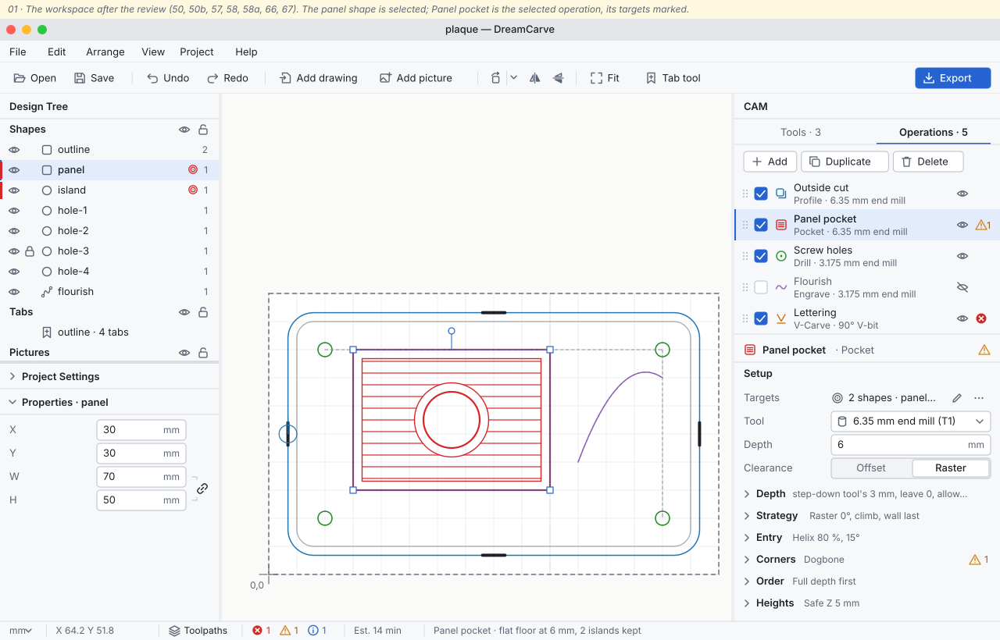

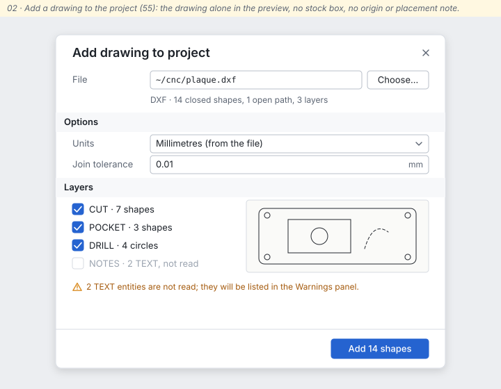

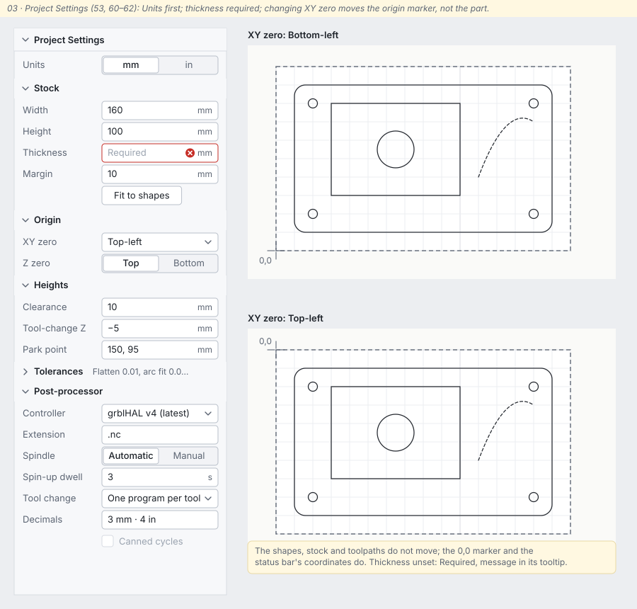

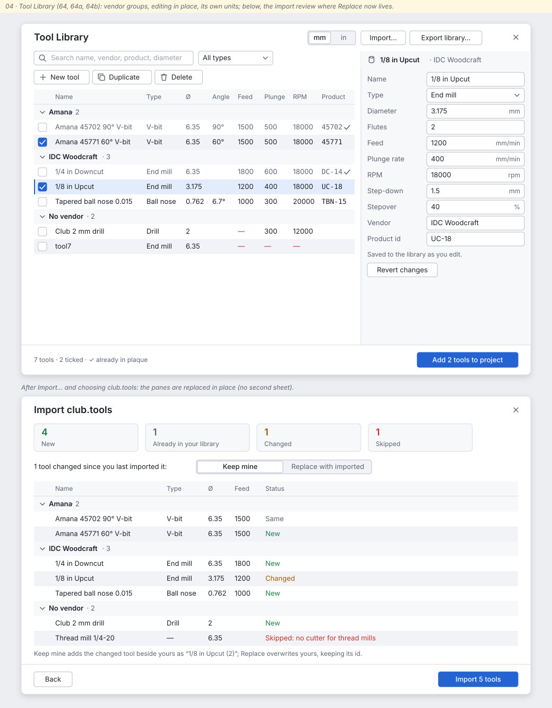

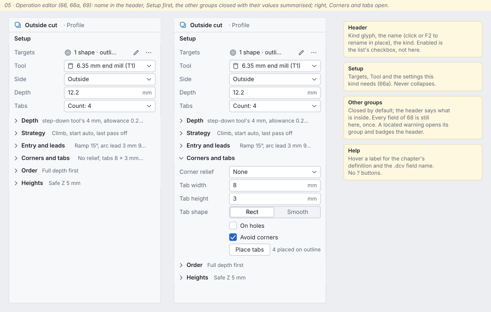

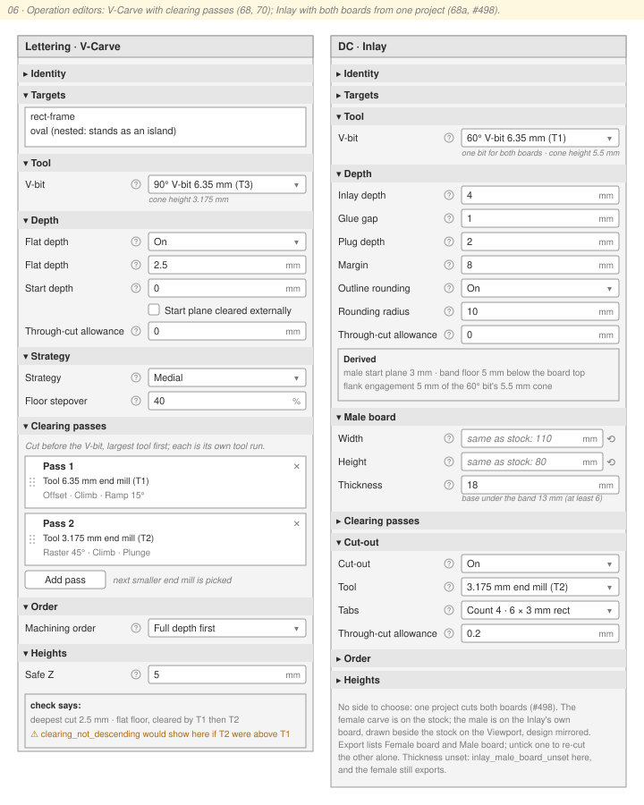

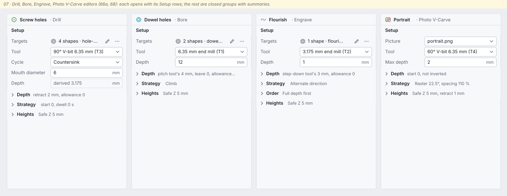

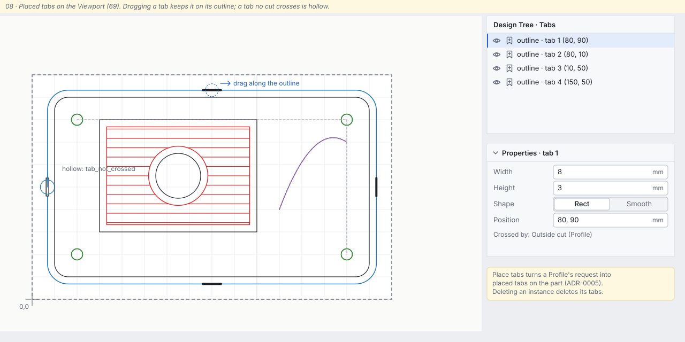

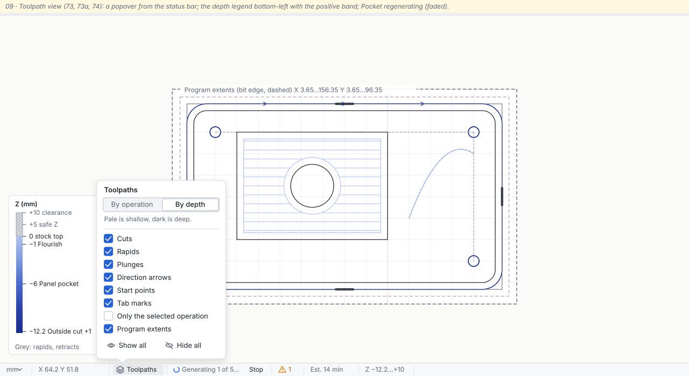

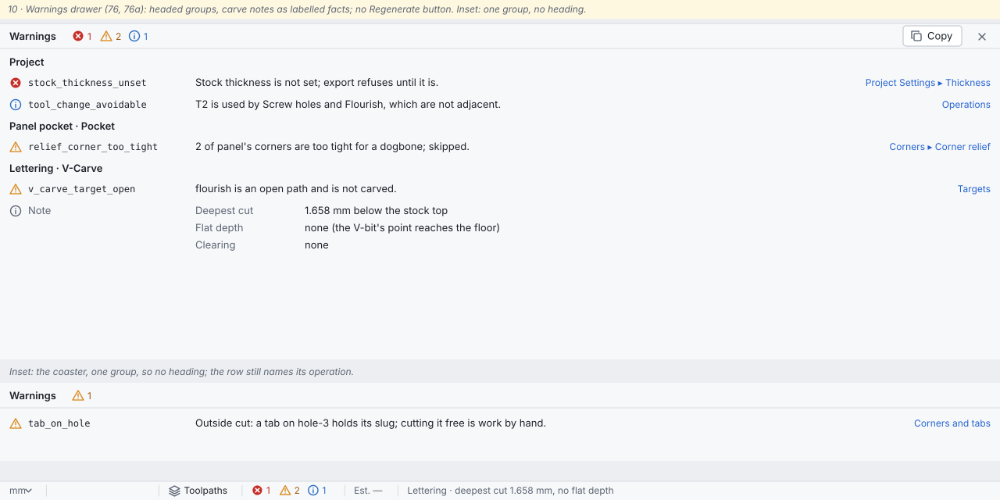

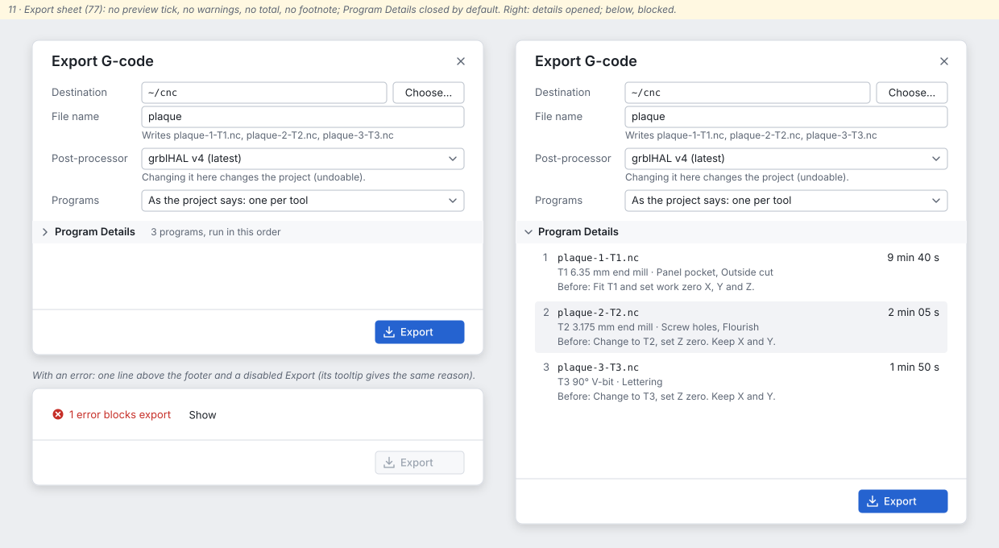

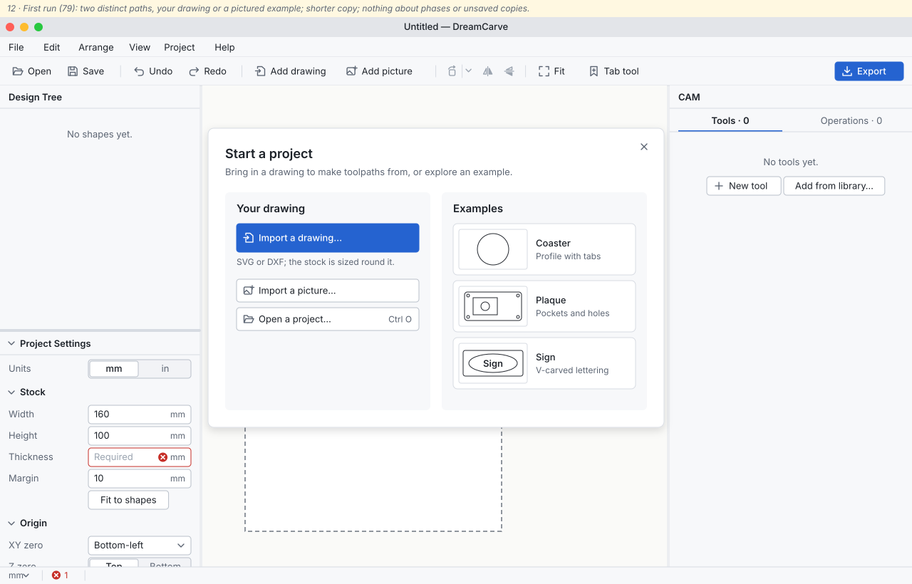

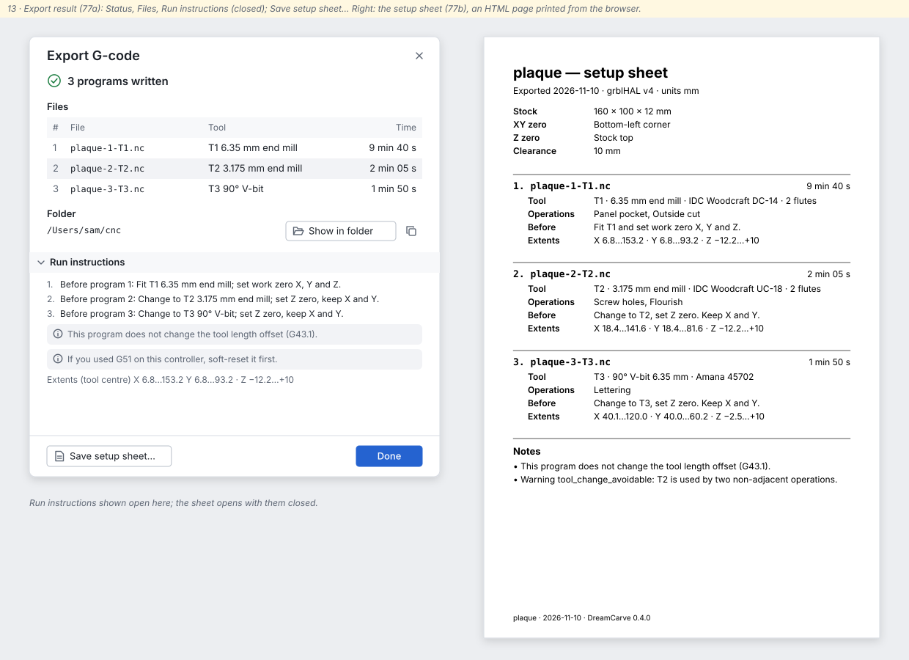

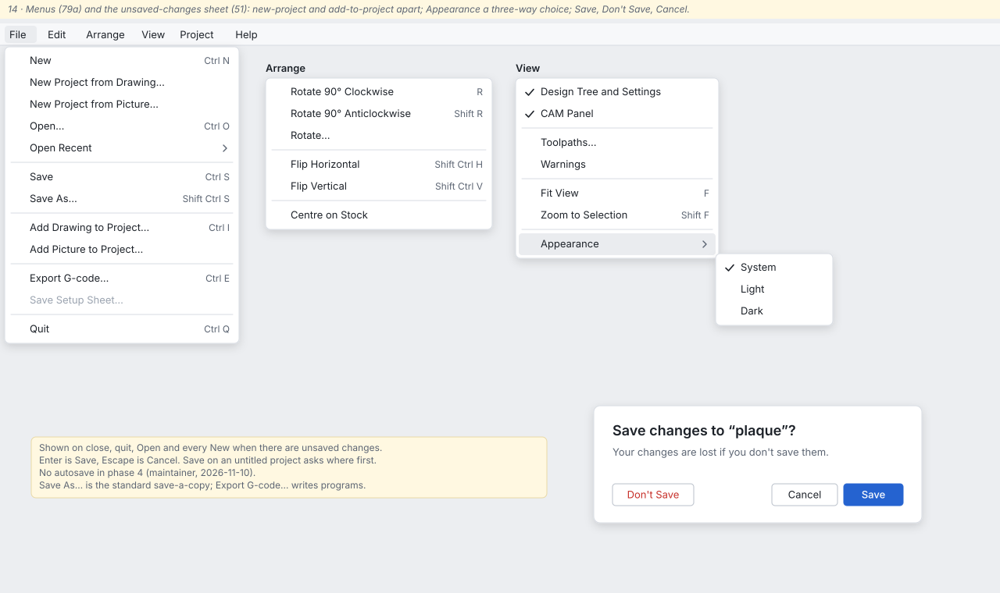

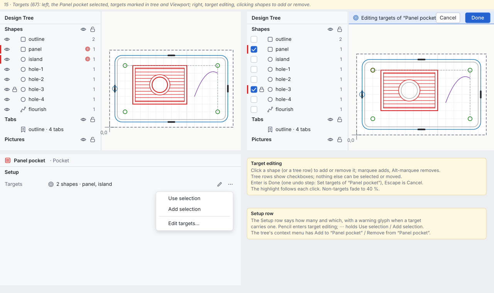

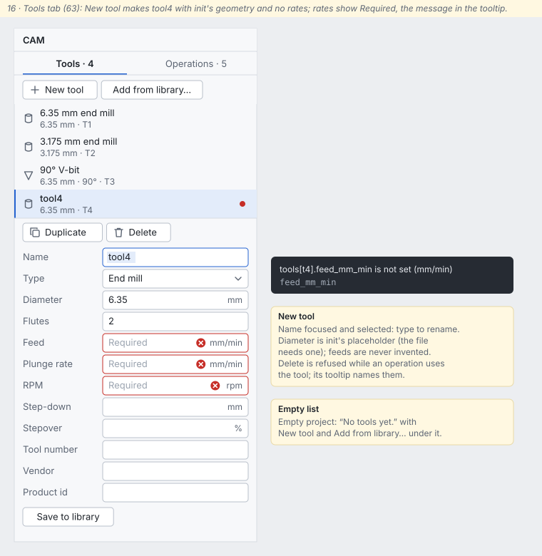
