# Phase 4: GUI, CAM only — Functional Spec

**Status:** draft
**Mock-ups:** `mockups/` (wireframes referenced from the capabilities below;
`mockups/README.md` lists them and how they are rendered)

## Goal

A hobbyist can do everything the phase 1–3 command line does in a desktop
window, on Windows, macOS and Linux: open or create a project, bring in SVG
and DXF drawings and PNG or JPEG pictures, place them on the stock, set the
stock, origin and heights, pick tools from the library, add and edit
operations of every kind (Profile, Pocket, Drill, Bore, Engrave, V-Carve,
Inlay, Photo V-Carve), see every toolpath over the stock as it is generated,
read the same warnings `check` prints, and export the same programs `export`
writes. No drawing: the shapes come from files, and the app moves, rotates,
scales, mirrors and deletes them but never edits their geometry. That is
phase 5.

The app and the CLI are two shells on one engine. Whatever the window shows
is what the saved `.dcv` says, and the program the window writes is the
program `dreamcarve export` writes for that file. Every safety rule from
phases 1–3 (S1–S19) holds unchanged, and one new rule (S20) says the
window may not bypass them.

Where VCarve Pro and PureCutCNC differ in how a workflow is presented, this
spec follows PureCutCNC's layout (its CAM panel, design tree, export dialog
and canvas are the reference: `src/components/cam/`, `feature-tree/`,
`export/`, `canvas/`) and VCarve's vocabulary, as phases 2 and 3 did for the
operations. The GUI toolkit and the architecture are the design spec's.

## Users and scenarios

- **Sam** opens the app for the first time. The empty window offers
  *Import a drawing*, *Open a project* and three examples. Sam imports
  `coaster.svg`: the circle lands on a stock sized round it. They set the
  stock 12 mm thick, pick the 6.35 mm end mill from their library (its
  feeds come with it), select the circle, add an **Outside Profile**, type
  the depth, ask for four tabs, and watch the blue toolpath and its tab
  marks appear over the circle. The Warnings panel is empty. Export writes
  `coaster.nc`; the dialog says it will take 4 minutes. Sam never sees a
  JSON file.
- **Sam, later,** opens `plaque.dcv`, the project they built from the CLI
  in phase 2. Every operation is in the list in cut order; the pocket's
  raster lines are visible on the canvas. They drag the Drill above the
  Pocket, switch the Pocket's clearance strategy to Offset, and see only
  that operation's toolpath change. They press Undo twice; both changes
  come back in order. Save writes the same file the CLI reads.
- **Alex** has a LinuxCNC router and a club Fusion library. In the Tool
  Library window they import `club.tools`, read that 23 tools came in and 2
  did not (and why), and drag a 90° V-bit and a 3.175 mm end mill into
  the project. They build the sign: a V-Carve of the rectangle with the
  oval standing as an island, a clearing pass by the end mill, a 2.5 mm
  flat depth, two countersinks, a tabbed outline. The Export dialog is set
  to LinuxCNC and lists three programs in the order to run them with what
  to do before each. Alex opens the preview SVG too, out of habit; it shows
  what the canvas showed.
- **Alex** makes the inlay pair. One project, the female; *Save As* to a
  second file, switch the Inlay's side to male, and the canvas shows the
  design mirrored with the band carved round it and the cut-out's tabs. The
  Warnings panel carries `inlay_male_mirrored` with the mirror line's X, as
  `check` did.
- **Jo** imports a DXF of six small parts drawn on three layers and takes
  only the `CUT` layer. The parts come in as drawn; Jo selects two, moves
  them off the clamps by dragging, rotates one 90° by typing the angle,
  and duplicates a third as a linked copy. One Outside Profile targets all
  six. The program extents overlay shows where the bit's edge reaches, so
  Jo knows the clamps are clear before leaving the desk.

## Capabilities

Numbering continues from phase 3's capability 49 and acceptance test 61.
Vocabulary is `CONTEXT.md`'s; three terms this phase adds (**Design Tree**,
**Viewport**, **Toolpath Visibility**) are defined in the Documentation
deliverables. "The user can" means in the app, with mouse and keyboard.
Everything the app can change is a field of the `.dcv`; the app has no
project state of its own. Window layout, recent files and the last export
folder are app preferences, kept outside the project.

### The workspace

50. **One window, four regions** (mock-up `01-workspace.svg`). A menu
    bar and toolbar across the top (File, Edit, View, Project, Help; the
    toolbar holds Open, Save, Undo, Redo, Import, Fit, and Export). On the
    left the **Design Tree** over the **Properties** panel. In the centre
    the **Viewport**. On the right the **CAM panel** with two tabs,
    **Operations** and **Tools**, each a list over an editor. A status bar
    along the bottom: project units, stock size, cursor position in
    project millimetres (or inches), generation state, and the warning and
    error counts, which open the **Warnings** panel as a drawer above the
    status bar. Side panels resize by dragging their dividers and collapse
    to a strip; the layout is remembered between sessions. The window
    follows the OS light or dark appearance. Minimum usable window:
    1280 × 768.
51. **Project lifecycle.** *New* makes an empty project with the phase 1
    defaults (100 × 100 mm stock, thickness unset, origin bottom-left and
    Z zero at the stock top, grblHAL at its latest version, no tools, no
    operations). *New from drawing…* and *New from picture…* do what
    `init` does (capabilities 1, 20, 46): a stock sized round the drawing
    with its margin, the picture or the shapes placed as `init` places
    them, and, for a picture, one Photo V-Carve on it with `init`'s
    defaults. Whether *New from drawing* also writes `init`'s placeholder
    tool and Profile is open question 1. *Open* reads any `.dcv` the CLI
    reads, migrates it, and lists migration notes and validation
    warnings in the Warnings panel. *Save* and *Save As…* write through the
    same serializer as the CLI, so a project opened and saved unchanged is
    byte-identical. *Recent* lists the last ten files. Closing, opening or
    quitting with unsaved changes asks to save, discard or cancel. The
    title bar shows the file name and a marker when unsaved. A `.dcv`
    dropped on the window, or passed on the command line, opens.
52. **Undo and redo** (Edit menu, Ctrl/⌘ Z and Shift+Ctrl/⌘ Z) walk the
    snapshot history. Every change to the project is a named command and
    one undo step: *Move "Oval"*, *Set depth of "Outside cut"*, *Reorder
    operations*, *Import plaque.dxf*, *Place 4 tabs*. The menu shows the
    name of the step it would undo. Typing in a field is one step when the
    field is left, not one per keystroke; dragging is one step when the
    mouse is released. Selection, zoom, pan, panel sizes and toolpath
    visibility are not project changes and are not undone. An instance's
    `visible` and `locked` flags are project data (they are saved) and are
    undone. Opening a file clears the history.
53. **Units.** The project's display units (`display_units`, mm or inch;
    capability 9) govern every length and feed field and the status bar.
    Fields show the unit after the value and accept the unit strings the
    file accepts (capability 32): `0.5 in` and `1 1/4 in` in a mm project
    convert on entry; a bare number is in the project's units. The stored
    value stays millimetres and the file is unchanged by the display.
    Switching units in the Project panel converts the display only, as
    today, and is undoable.
54. **Keyboard.** Standard shortcuts on every platform (⌘ for Ctrl on
    macOS): New, Open, Save, Save As, Import (Ctrl I), Export (Ctrl E),
    Undo, Redo, Select all (Ctrl A), Delete, Duplicate (Ctrl D), Fit view
    (F), Zoom to selection (Shift F), Hide and show selection (H, Shift H),
    Lock and unlock (L), nudge the selection with the arrow keys by 1 mm
    (Shift: 10 mm, Alt: 0.1 mm), Escape clears the selection or closes a
    menu. Every shortcut appears in its menu item and in the Keyboard
    chapter.

### Bringing geometry in

55. **Import a drawing** (`02-import-dialog.svg`; File ▸ Import…, Ctrl I,
    or drop an `.svg` or `.dxf` on the window) adds the file's shapes to
    the open project as new feature instances, placed as drawn, with the
    drawing's origin at the stock's bottom-left corner, then selects them so
    the user can move them (open question 2). The dialog shows the file,
    the shapes it holds (closed and open counts), and the importer's
    options: for DXF the units (read from the file, required when it has
    none, as `init --units` is), the join tolerance (default 0.01 mm) and
    a layer list to tick; nothing for SVG. Shapes are named as `init`
    names them (DXF layer names, SVG ids). Import warnings (entities not
    read, open paths skipped by nothing yet, duplicate shapes dropped)
    appear in the Warnings panel after the import, once, under the import's
    name. One import is one undo step.
56. **Import a picture** (File ▸ Import picture…, or drop a `.png`, `.jpg`
    or `.jpeg`) adds a bitmap (capability 46) at the origin, asking for its
    width *or* height in project units with the other following the
    pixels, and reporting a colour-to-grayscale conversion as `image add`
    does. The picture shows on the Viewport as it does on screen, under the
    shapes, at its footprint. A bitmap is a row in the Design Tree with a
    name, visibility and lock, moves like a shape, and does not rotate,
    scale or mirror in this phase (phase 3 decision). It is deleted like a
    shape; a Photo V-Carve that loses its picture says so.
57. **Design Tree** (`01-workspace.svg`, left). One row per feature
    instance, in file order, with: an eye (visible), a padlock (locked),
    the name (double-click to rename), a badge for *open* paths, a *linked*
    badge when the definition is shared with another row, and a count of
    the operations targeting it (hover lists them). Below the shapes, a
    **Tabs** section lists placed tabs by the outline they sit on, and a
    **Pictures** section lists bitmaps. Clicking a row selects it on the
    Viewport and vice versa; Shift and Ctrl extend the selection; the
    section header's eye and padlock act on every row in it. The context
    menu offers Hide/Show, Lock/Unlock, Duplicate, Delete, Zoom to, and
    *Add operation ▸* with the kinds the selection can take. Rows cannot be
    reordered or grouped in this phase (folders are phase 5).
58. **Placement** (`01-workspace.svg`, Properties). With one or more
    instances selected the Properties panel shows, in project units, the
    selection's **X** and **Y** (bottom-left of its bounding box), **W**
    and **H**, **Rotation** in degrees and two **Mirror** buttons
    (horizontal, vertical). Typing a value moves, scales or rotates the
    selection about its bounding-box centre; a selection of several moves
    as one. Scale keeps proportions unless the padlock between W and H is
    opened. On the Viewport the selection drags to move, its corner handles
    scale, its rotation handle rotates, and the arrow keys nudge (54).
    Every transform is a change to the instances' `transform`; the
    definitions are never touched, so a linked copy's sibling does not
    move. A locked instance shows its handles greyed and refuses every
    transform, and the status bar says why. *Centre on stock* and *Fit
    stock to shapes* (61) are in the Project menu. No snapping, no
    alignment and no distribution: phase 5.
59. **Duplicate and delete.** *Duplicate* makes a linked copy (CONTEXT:
    Linked Copy) offset by 10 mm, named `<name> (2)`, sharing the
    definition, so phase 5's shape editing will edit both. *Delete* removes
    the instance from every operation's targets as well as from the tree;
    when an operation is left with no targets the Warnings panel says so
    (`no_targets`, a new code), and the operation stays, disabled-looking
    but enabled, until the user fixes or deletes it. A definition no
    instance uses is dropped from the file on save. Placed tabs on a
    deleted instance go with it.

### Stock, origin and output setup

60. **Project panel** (`03-stock-origin.svg`; the Properties panel when
    nothing is selected, and Project ▸ Stock and origin…). **Stock**:
    width, height, thickness (red until set; export refuses without it, as
    today). **Origin**: XY at one of the four corners or the centre, or
    custom X/Y, and Z zero at the stock top or bottom; the Viewport draws
    the origin as a crosshair and the status bar's coordinates count from
    it. **Heights** (capability 33): clearance, tool-change machine Z (only
    offered when the post-processor documents `G53`, greyed with the reason
    otherwise), and park point, which can be typed or clicked on the
    Viewport. **Tolerances**, folded away: flatten tolerance and arc-fit
    tolerance (off switch for `null`). Each field validates as the file
    does and shows the validation message under itself.
61. **Fit stock to shapes** sizes the stock to the visible shapes plus a
    margin the user types (default `init`'s), keeping the origin preset;
    shapes do not move relative to each other. **Centre on stock** moves
    the selection so its bounding box is centred on the stock.
62. **Post-processor** (in the Project panel; `03-stock-origin.svg`).
    A list of the six bundled definitions with their latest version and a
    note when the project is on an older version. Picking another keeps
    the user's settings the new one can use, as `export --post` does
    (capability 27), and says which were reset. The settings below it are
    the project's post-processor settings (capability 2): file extension,
    spindle control (automatic or manual), spin-up dwell, tool-change mode
    (one program per tool, or one program with `M6`: offered only on a
    post-processor with `M6`), decimal places for mm and inch, and canned
    cycles (offered only where the definition has them). Nothing about the
    dialect itself is editable: the project names a bundled definition
    (ADR-0004).

### Tools

63. **Project tools** (`01-workspace.svg`, right panel, Tools tab). The
    tools the project embeds, one row each with type icon, name, diameter
    (and angle for a V-bit), number, and a red dot when the tool lacks a
    feed, plunge rate or RPM. Selecting a row edits it below: name, type
    (end mill, ball nose, V-bit with included angle, engraver, drill),
    diameter, flutes, feed, plunge rate, RPM, step-down, stepover, tool
    number, vendor and product id. Feed, plunge and RPM fields are empty,
    never prefilled: the app invents no feed (principle 5). *Add from
    library…* opens the picker (64). *Save to library* copies a project
    tool into the library. *Duplicate* and *Remove*; remove is refused
    while an operation uses the tool and names the operations. A tool used
    by no operation shows an `unused_tool` hint, as `check` prints.
64. **Tool Library** (`04-tool-library.svg`; Project ▸ Tool library…, and
    the picker from 63 and from an operation's tool field). A window over
    the library in the user's config directory (capability 21): a search
    box (name, vendor, diameter), a type filter, and a table with name,
    type, diameter, angle, flutes, feeds, vendor and product. Rows already
    in the project are marked. *Add to project* copies the ticked rows into
    the project under new ids, as `tools add` does; projects keep their
    copies and a library change never alters an open project (ADR-0002).
    *Import…* reads a Fusion `.tools` or `.json` or a DreamCarve library
    JSON and shows the per-tool report `tools import` prints (imported,
    skipped with the reason, already present), with a *Replace existing*
    switch for `--replace`. *Export…* writes the library as DreamCarve
    JSON. *Remove* deletes a library tool. Editing a library tool's fields
    in place is phase 5 (plan: "GUI tool-library editor"); in this phase
    the path is add to project, edit there, save to library.

### Operations

65. **Operations list** (`01-workspace.svg`, right panel, Operations tab).
    The project's operations in cut order, one row each: a drag grip, an
    enable checkbox, the kind's icon, the name, the tool's name, an eye for
    the operation's toolpath visibility (73), and a status cell: a spinner
    while generating, a warning count, a red mark for an error, nothing
    when clean. Drag to reorder (one undo step); the list order is the cut
    order (capability 10) and nothing regroups it. *Add* opens a menu of
    the eight kinds, the kinds the current selection can take listed
    first and the rest below a divider with the reason (an open path cannot
    take a Pocket; a Photo V-Carve needs a picture). The new operation
    targets the selection, takes the project's first tool whose type fits
    (a V-bit for V-Carve, Inlay and Photo V-Carve; a drill or end mill for
    Drill) or none, is named `<Kind> <n>`, and gets the CLI's defaults for
    the kind (the chapter's JSON block: `init`'s Profile, the plaque's
    Pocket, and so on). *Duplicate* copies an operation below itself with
    its targets; *Delete* removes it (placed tabs stay: they are the
    part's, ADR-0005).
66. **Operation editor** (`05-operation-profile.svg`,
    `06-operation-vcarve.svg`, `07-operation-fields.svg`). The selected
    operation's fields in named groups, in this order, each group a
    collapsible section whose open state is remembered: **Identity**
    (name, enabled), **Targets**, **Tool**, **Depth**, **Strategy**,
    **Entry and leads**, **Corners and tabs**, **Order**, and **Heights**.
    A group with no field for the kind is not shown. Every field shows its
    unit, validates on leave, shows the file's validation message under
    itself, and shows a short help line (the chapter's one-sentence
    definition) on hover of its label. A field whose file value is `null`
    and whose default comes from the tool (step-down, stepover, pitch)
    shows that default as grey placeholder text, `tool's: 3 mm`, and clears
    back to it with its ⟲ button. Warnings and errors that `check` locates
    at a field (capability 25) are shown under that field as well as in the
    Warnings panel. The editor never offers a setting the generator ignores
    for that kind, and never hides one it reads.
67. **Targets.** The Targets group lists the operation's target instances
    by name with a remove button each, highlights them on the Viewport
    while the group is hovered, and has *Add selected* (the Viewport
    selection), *Replace with selected*, and *Pick…*, which lets the user
    click shapes on the Viewport until Escape. A target the kind cannot cut
    (an open path for a Pocket, a non-circle for a Drill) is accepted and
    carries the warning `check` gives it (`side_needs_open_path`,
    `drill_target_not_circle`), as a hand-edited file does. A Photo
    V-Carve's single target is a picture, picked from the Pictures rows.
68. **Fields per kind.** The editor exposes every setting of the kind's
    record in the project file and nothing else. The table is the
    checklist for acceptance test 73; names are the file's, labels are the
    chapters'.

    | Kind | Fields, by group |
    | --- | --- |
    | Profile | Depth: `depth_mm`, `step_down_mm` (tool's), `through_cut_allowance_mm`. Strategy: `side` (Inside, Outside, On line, Left, Right), `direction`, `start` (Auto, First vertex, Near a point: typed or clicked), `last_pass` (off, or `stock_to_leave_mm`, `thickness_mm`, `reverse`). Entry and leads: `entry` (Plunge; Ramp with `angle_deg`; Helix with `diameter_fraction` and `angle_deg`), `lead` (off, or `radius_mm`, `sweep_deg`, `lead_out`, `overcut_mm`). Corners and tabs: `corner_relief` (None, Dogbone, T-bone), `tabs` request (69). Order: `machining_order`. Heights: `safe_z_mm`. |
    | Pocket | Depth: `depth_mm`, `step_down_mm` (tool's), `stock_to_leave_mm`, `through_cut_allowance_mm`. Strategy: `strategy` (Offset; Raster with `angle_deg`), `wall_pass` (Last, First, None), `step_over_fraction` (tool's, shown as a percentage), `direction`, `rest_of` (an earlier Pocket, or none). Entry: `entry`. Corners: `corner_relief`. Order: `machining_order`. Heights: `safe_z_mm`. |
    | Drill | Depth: `depth_mm`, `retract_mm`, `through_cut_allowance_mm`. Strategy: `cycle` (Simple; Peck with `peck_depth_mm` (tool's) and `retract` Full or Chip break with `gap_mm`; Countersink with `diameter_mm`, `start_depth_mm`, `start_plane_cleared_externally`), `dwell_s`, `allow_tool_wider_than_hole`. Heights: `safe_z_mm`. |
    | Bore | Depth: `depth_mm`, `pitch_mm` (tool's step-down), `stock_to_leave_mm`, `through_cut_allowance_mm`. Strategy: `direction`. Heights: `safe_z_mm`. |
    | Engrave | Depth: `depth_mm`, `step_down_mm` (tool's), `through_cut_allowance_mm`. Strategy: `alternate_direction`. Order: `machining_order`. Heights: `safe_z_mm`. |
    | V-Carve | Depth: `flat_depth_mm` (off for `null`), `start_depth_mm`, `start_plane_cleared_externally`, `through_cut_allowance_mm`. Strategy: `strategy` (Medial; Offset with `step_over_mm` and `direction`), `step_over_fraction`, `clearing` (70). Order: `machining_order`. Heights: `safe_z_mm`. |
    | Inlay | Strategy: `side` (Female, Male). Depth: `depth_mm`, `glue_gap_mm`, `plug_depth_mm`, `margin_mm` (male), `outline_rounding_mm` (male; off for `null`), `through_cut_allowance_mm`. Clearing: `clearing` (70), `step_over_fraction`. Cut-out (male): off, or `tool`, `tabs` request, `through_cut_allowance_mm`. Order: `machining_order`. Heights: `safe_z_mm`. |
    | Photo V-Carve | Targets: `image`. Depth: `max_depth_mm`, `start_depth_mm`, `invert`. Strategy: `line_angle_deg`, `line_spacing_fraction` (as a percentage), `strategy` (Raster, Hatch), `sample_mm`. Heights: `safe_z_mm`, `stepover_retract_mm`. |

    Photo V-Carve lands with phase 3.4 (format v25); its editor is a slice
    of this phase that waits for it (open question 10).
69. **Tabs** (`08-tabs-on-canvas.svg`). A Profile's **Tab request** is
    edited in its Corners and tabs group: none, a count, or distances along
    each outline; width, height, shape (rect or smooth), on holes, avoid
    corners. *Place tabs* runs `tabs place` for that operation: the request
    becomes **placed tabs** on the part's outlines (ADR-0005), drawn on the
    Viewport as marks the tab's width across the toolpath and listed under
    Tabs in the Design Tree. A placed tab drags along its outline (it stays
    on the outline; its point is in definition space, so it follows its
    instance), has width, height and shape in the Properties panel, and
    deletes with Delete. The **Tab tool** on the toolbar adds a tab where
    the user clicks an outline, with the last-used size. Every enabled
    Profile that cuts that outline rises over it; `tab_not_crossed`,
    `tab_on_hole` and the other tab codes appear as `check` gives them, and
    the Viewport draws a tab no cut crosses hollow. A disabled Profile's
    request is kept until the user places it, as the CLI keeps it. The
    saved file holds placed tabs only, as `tabs place` leaves it.
70. **Clearing passes** (`06-operation-vcarve.svg`). A V-Carve's or an
    Inlay's `clearing` is an ordered list of passes, each with its tool
    (an end mill from the project tools), clearance strategy (Offset or
    Raster with angle), direction and entry. *Add pass* appends one with
    the next smaller end mill; passes reorder by drag; the list enforces
    the file's rule that passes descend in diameter and shows
    `clearing_not_descending` otherwise. The passes' floor rings draw in
    the Viewport in the operation's colour, lighter than the V-bit's lines.
71. **Generation** happens by itself. Every change that affects an
    operation's toolpath regenerates it (and only it, where the engine's
    inputs allow; the design spec owns what counts) on a worker, a short
    moment after the change settles, never blocking the window. While an
    operation regenerates its row shows a spinner and its old toolpath
    stays on the Viewport, faded; when it finishes the new toolpath
    replaces it. A generation error (a tool with no feed, a missing
    thickness) marks the row red and lists in the Warnings panel; the
    operation draws nothing. The status bar shows *Generating 2 of 5…*
    while any operation is pending. *Stop* cancels generation on a huge
    project; *Regenerate all* forces it.

### Preview

72. **Viewport** (`01-workspace.svg`, centre; `09-preview-legend.svg`).
    The stock from above at the project's scale, Y up, in project units:
    the stock outline, a 10 mm grid that thins and coarsens with zoom, the
    origin crosshair, the park point, the shapes (closed solid, open
    dashed, selected highlighted, hidden absent, locked with a padlock at
    their corner), the pictures, the placed tabs, and the toolpaths.
    Toolpaths draw as `--preview` draws them (capability 31): cutting
    moves solid in the operation's colour, rapids thin grey dashed, start
    points as a bit-sized circle with a tick in the direction of the first
    cut, tab marks heavy, drill holes as bit-sized circles. Direction
    arrows along cuts are a toggle. Pan with the middle button or
    Space-drag, zoom with the wheel or pinch about the cursor, *Fit* (F) to
    the stock and shapes, *Zoom to selection* (Shift F), and a 1:1 button
    where the display's size is known. Clicking a toolpath selects its
    operation. The Viewport flips Y exactly once; every coordinate the
    user sees is project coordinates.
73. **Toolpath visibility and colour** (`09-preview-legend.svg`). A
    small panel in the Viewport's corner holds: the colour mode, **By
    operation** (default; each operation its own colour, repeating after
    eight, the same palette as `--preview`) or **By depth** (every cutting
    move coloured from pale at the stock top to dark at the deepest cut in
    the project, with a legend bar labelled in project units at the top,
    bottom and each operation's depth); toggles for *Cuts*, *Rapids*,
    *Plunges*, *Direction arrows*, *Start points*, *Tab marks*; and *Show
    only the selected operation*. Each operation's eye (65) hides or shows
    its toolpath; *Show all* and *Hide all* are in the panel. These are
    view settings: not in the file, not undoable, remembered between
    sessions (open question 6 on the default mode).
74. **Program extents.** A toggle draws the program's XY extents box in
    machine coordinates as `check` prints them (capability 4): the tool
    centre's box and, dashed outside it, the box widened by the largest
    tool's radius, where the cutter's edge reaches. The status bar shows
    the Z range. This is the box the user checks against their clamps.
75. **Selection on the Viewport.** Click selects an instance (the topmost
    where several overlap; a second click cycles), Shift-click adds,
    Ctrl-click toggles, a drag on empty stock draws a marquee, Escape
    clears. Hidden instances cannot be selected; locked ones can be
    selected but not transformed. Hovering an instance shows its name in
    the status bar. The selection is one selection, shared by the Design
    Tree, the Viewport and the Properties panel.

### Checking and exporting

76. **Warnings panel** (`10-warnings-panel.svg`). Always current: it is
    `check` on the project as it stands, run with every generation. Three
    tiers as `check` prints them: **errors** (export refuses), **warnings**
    and **hints**. Each row: the tier, the code (monospace, the chapter's
    anchor), the message with the operation and shape named, and, where the
    code concerns a field, that field. Clicking a row selects the operation
    and scrolls to the field, or selects the shape; the row's code links to
    its entry in the Warnings chapter. Rows group by operation, project-level
    rows (thickness unset, tool-change height on a post without `G53`,
    `tool_change_avoidable`) first. The status bar shows the counts; the
    panel opens from them or from View ▸ Warnings. *Copy* puts the panel's
    text on the clipboard in `check`'s format.
77. **Export** (`11-export-dialog.svg`; File ▸ Export G-code…, Ctrl E).
    The dialog shows: the destination folder and file stem (default the
    project's name beside the project file, remembered per project in the
    app's preferences); the post-processor with its version (changing it
    here is the Project panel's switch (62) and a project change); the
    program split, *as the project says* (the setting's value shown) or
    overridden for this export to one program per tool or one program with
    tool changes (`--programs-per-tool`, `--one-program`; the override is
    not saved, and *one program* is refused on a post without `M6` with
    the CLI's message); *Also write the toolpath preview (.svg)*
    (`--preview`); then the **programs** it will write, one row per tool
    run (capability 3): file name, tool, operations, estimated time
    (capability 30) and extents (capability 4), with the step before each
    (zero the tool, change to T2) as `export` prints them. Errors in the
    Warnings panel are listed and *Export* is disabled until they are
    fixed; warnings are listed and do not block. *Export* writes every file
    or none, as the CLI does (#71), and the result sheet shows the files,
    the run order and *Show in folder*. Export never changes the project
    file: switching the post-processor in the dialog is an undoable project
    change the user saves or not.
78. **Estimate and extents** appear outside the dialog too: each
    operation's row shows its estimated time on hover, and the status bar
    shows the program's total. The numbers are the CLI's (`[estimate]` in
    `config.toml` is read for the rapid rate, as today).

### First run and help

79. **Empty state** (`12-empty-state.svg`). A project with no shapes
    shows a card over the Viewport: *Import a drawing* (55), *Import a
    picture* (56), *Open a project*, and the three example projects from
    the quick starts (coaster, plaque, sign) which open as unsaved copies.
    The card closes when a shape arrives or on its ✕. An empty Operations
    list says *Select shapes on the drawing, then Add an operation*; an
    empty Tools list says *Add a tool from the library*. Help ▸ opens the
    book's quick start for the app, the Keyboard chapter, and About
    (version string as the CLI prints it).
80. **Strings.** Every user-visible string in the app comes from one
    string table keyed by id, so phase 8 can translate it; English is the
    only language shipped. Warning text is the CLI's text, from the same
    source.

## Out of scope

- Drawing or editing shape geometry: lines, rectangles, circles, text,
  node editing, fillets, booleans, offsets, joining open paths, snapping,
  alignment, distribution, arrays, folders, construction geometry (phase 5).
- Rotating, scaling or mirroring a picture (phase 3 decision; revisit in 5).
- 3D preview and material-removal simulation (phase 6).
- Editing library tools in place (phase 5); machine-definition editing
  (ADR-0004: definitions are bundled); a post-processor converter (phase 8).
- Operation templates, merging, array copies, tiling, nesting, the
  operation booklet, CAM Plan, clamps as obstacles (phase 8 or post-1.0).
- Printing the design or exporting the design as SVG (phase 8).
- The assistant panel (its own proposal; open question 3).
- Autosave and crash recovery files, more than one project open at once,
  multiple windows, tabs, touch and tablet layouts, a web build.
- Localisation beyond keyed strings; themes beyond following the OS.
- Any change to toolpath generation, warnings or G-code: the engine is as
  phase 3 left it. A GUI slice that needs an engine change opens an issue
  against the engine first.

## Acceptance tests

Numbered from 62, each traceable to a capability. The app is driven by its
test harness (the design spec names it) with the same fixtures the CLI
tests use; "the file" is the `.dcv` the app saves. "Equals the CLI" means
byte-identical output with the program's header date pinned (`--date`).

62. **Open, save, unchanged** (51). Each fixture under `tests/golden/`
    and the three quick-start projects opened and saved to a new path is
    byte-identical to the original after the CLI has migrated it to the
    current version. The history is empty after open.
63. **New from drawing** (51). *New from drawing* on `fixtures/coaster.svg`
    yields the project `dreamcarve init` writes for it, save for whatever
    open question 1 decides about the placeholder tool and Profile.
64. **Import DXF** (55). Importing `fixtures/plaque.dxf` into an empty
    project adds the shapes `init` would, named by layer, selected, as one
    undo step; a DXF with no `$INSUNITS` disables *Import* until units are
    chosen, with the CLI's message; ticking one layer imports that layer
    only; the unread-entity warning appears once in the Warnings panel.
65. **Import picture** (56). Importing `fixtures/photo/gradient.png` at
    width 100 adds the bitmap `image add --width 100` adds, at the origin,
    with the grayscale note for a colour file.
66. **Move, rotate, scale, mirror** (58). With the coaster selected,
    typing X 10 and Y 5 changes the instance's transform by that
    translation and nothing else; the toolpath regenerates translated by
    the same vector (compared to the CLI's toolpath for the saved file);
    rotation 90° and scale 50 % produce the transforms the CLI's
    `locate` tests expect; mirror flips about the bounding-box centre; a
    locked instance refuses each with a status-bar message. Each is one
    undo step and undo restores the transform exactly.
67. **Linked copy** (59). Duplicate yields a second instance with the same
    definition id; the file holds one definition and two instances; moving
    one leaves the other.
68. **Delete a target** (59). Deleting the plaque's panel instance removes
    it from the Pocket's targets, leaves the Pocket with `no_targets` in
    the Warnings panel, and removes the panel's placed tabs; undo restores
    all three.
69. **Stock, origin, heights** (60, 61). Setting the stock, origin presets
    and custom origin, Z zero, and the three heights writes the fields
    `check` reads and the Viewport's crosshair and park mark move; the
    tool-change height is disabled on the generic post with the CLI's
    message; *Fit stock to shapes* reproduces `init`'s stock for the
    coaster; the thickness field is marked and export is disabled until it
    is set.
70. **Post-processor switch** (62). Changing grblHAL to LinuxCNC on a
    project with a customised dwell keeps the dwell and resets what
    `switch_post` resets (acceptance 39); *one program* is offered on
    grblHAL and absent on GRBL; canned cycles is offered on LinuxCNC only.
71. **Tools** (63, 64). Adding the 6.35 mm end mill from the library writes
    the copy `tools add` writes; clearing its plunge rate marks the tool
    red, lists the CLI's refusal in the Warnings panel and disables
    *Export*; typing it back clears all three. *Remove* on a tool in use is
    refused naming the operation. The library window's import of
    `fixtures/fusion/sample.tools` shows the report `tools import` prints
    (acceptance 35), and the library file equals the CLI's.
72. **Add an operation** (65). With the coaster selected, *Add ▸ Profile*
    appends a Profile targeting it with `init`'s Profile defaults, the
    project's end mill, and the name `Profile 1`; with nothing selected the
    menu says to select shapes; with an open path selected, Pocket is below
    the divider with its reason.
73. **Every field round-trips** (66, 68). For each kind and each field in
    the table in 68, the harness sets the field to a non-default value,
    saves, and the CLI reads back that value; sets it to its default and
    the file holds the default (or `null` where the file uses it); and the
    editor shows no control the table does not list and lists no control
    the editor lacks. Tool-derived placeholders show the tool's value and
    write `null`.
74. **Reorder, enable, duplicate** (65). Dragging the plaque's Drill above
    its Pocket reorders the file's list and the export's program order;
    unticking an operation sets `enabled: false` and removes its toolpath
    from the Viewport and its program from the export; *Duplicate* appends
    a copy with the same targets and `(2)` in its name.
75. **Clearing passes** (70). Adding two passes with a 6.35 mm and a
    3.175 mm end mill writes the `clearing` list in that order; dragging
    the smaller above the larger shows `clearing_not_descending` under the
    list, as `check` reports it.
76. **Inlay side** (68). Switching the star fixture's Inlay from female to
    male redraws the toolpath mirrored, lists `inlay_male_mirrored` with
    the same X the CLI prints, offers the margin, rounding and cut-out
    fields, and hides them again on female.
77. **Photo V-Carve** (56, 68). The gradient fixture with a Photo V-Carve
    at `init`'s defaults draws the grooves `--preview` draws; `check`'s
    groove count appears in the operation's status. Runs once phase 3.4
    has landed.
78. **Tabs** (69). *Place tabs* on the coaster's Profile with a request of
    four writes the four placed tabs `tabs place --count 4` writes and
    clears the request; dragging one along the outline changes only its
    point and keeps it on the outline; deleting one leaves three; the Tab
    tool adds one at the clicked outline point; the exported program equals
    the CLI's for the saved file.
79. **Preview equals the toolpath** (72). For each golden case, the set
    of moves the Viewport draws for an operation is the generator's
    toolpath for the saved file (same count, same endpoints to 1 µm), and
    the Viewport's SVG dump equals `--preview`'s file for that project.
80. **Depth colouring** (73). On the plaque, *By depth* colours the
    Pocket's floor moves by their Z and the legend's labels are the stock
    top, each operation's depth, and the deepest cut, in project units.
81. **View state is not project state** (73). Toggling every visibility
    control, panning, zooming and resizing panels leaves the file
    unchanged on save and adds nothing to the undo history.
82. **Warnings panel equals `check`** (76). For each fixture under
    `crates/dreamcarve/tests/fixtures/` with expected `check` output, the
    panel lists the same codes, messages and operations in the same tier;
    clicking a located row selects the operation and focuses the field;
    *Copy* yields `check`'s text.
83. **Export equals the CLI** (77, S20). The coaster, plaque, sign and
    inlay-pair projects exported from the app, with the date pinned, give
    files byte-identical to `dreamcarve export` on the saved file, for each
    of the six post-processors, with and without the program-split
    override; the preview SVG equals `--preview`'s.
84. **Export is blocked by errors only** (77). A project with a tool
    lacking a feed shows the error and a disabled *Export*; a project with
    only warnings exports and lists them.
85. **Override not saved** (77). Exporting with *one program* overridden
    leaves `tool_change_mode` unchanged in the file.
86. **Undo and redo** (52). Twenty mixed edits (move, field, reorder, add,
    delete, import, place tabs) undo in reverse order to the opening
    state and redo to the final state, each with the labelled name; a new
    edit after undo clears redo; typing three characters in a field then
    leaving is one step.
87. **The window never blocks** (71). On a project of 500 shapes with a
    Pocket and a V-Carve on all of them, the window answers input within
    100 ms while generation runs, the rows show spinners, the stale
    toolpaths show faded, and *Stop* ends generation within a second.
88. **Unsaved changes** (51). Closing a changed project asks; *Cancel*
    keeps it open and unchanged; *Discard* loses the changes; *Save* writes
    the file before closing. Opening a second project does the same.
89. **Units** (53). An inch project shows every length in inches with
    `in`; typing `1/4 in` in a mm project's depth stores 6.35; typing `0.5`
    in an inch project stores 12.7; the file is unchanged by switching the
    display and back.
90. **Quick starts without the CLI** (exit). The coaster, the plaque, the
    sign and the inlay pair built in the app from their SVG or DXF by the
    steps of the new quick start export programs byte-identical to the
    quick starts' committed programs.
91. **Keyed strings** (80). A source scan finds no user-visible string
    literal outside the string table; every key in the table is used.
92. **Three platforms** (50). The app launches, opens the plaque, renders
    one frame and exports it in CI on Windows, macOS and Linux (the design
    spec names the headless harness).

## Safety requirements

S1–S19 apply unchanged: the engine, the safety pass and the post-processors
are phase 3's. New in this phase:

- **S20 The window is a shell, not a path.** The program the app writes is
  `dc-gcode`'s output for the project snapshot the app holds, built by the
  same generation call and checked by the same safety pass as
  `dreamcarve export`, and equals the CLI's program for the saved file
  (acceptance 83). No value reaches the engine that is not a field of the
  project; the app has no settings of its own that change motion. Export is
  refused on the same conditions as the CLI (a tool without feed, plunge or
  RPM; thickness unset; an error in `check`) and never offers to export a
  subset the file does not describe. The app never fills a feed, plunge
  rate, RPM or depth with a number of its own: such fields are empty until
  the user or a library tool supplies them (principle 5). What the Viewport
  draws is the generator's toolpath for the current snapshot; while an
  operation regenerates its old drawing is marked stale and the export
  dialog waits for generation to finish. Checked by acceptance tests 71,
  79, 83 and 84 and by a source rule in the design spec: the GUI crate
  depends on `dc-cam` and `dc-gcode` only through the same entry points the
  CLI uses.

## Test part

No new machine output, so no new part. **Bench check:** the coaster
(phase 1 test part) built in the app from `coaster.svg` by the quick start,
exported, and diffed against the phase 1 program; cut once from the app's
program on the bench grblHAL to close the loop. Record below.

| Item | Result |
| --- | --- |
| App program equals the CLI program (diff) | |
| Cut from the app's program, released cleanly | |
| Diameter, two measurements | |
| Date, version, controller, sender | |

## Documentation deliverables

- Quick start: **From SVG to G-code in the app**: the coaster end to end,
  with screenshots, then the plaque's second tool and the sign's V-Carve as
  short follow-ons that point at the phase 2 and 3 quick starts for the
  machining detail. The existing quick starts gain a note that each step
  has an equivalent in the app, with the panel named.
- User guide, new chapters: **The app** (the workspace tour, panels,
  selection, keyboard), **Importing drawings and pictures** (replaces the
  DXF chapter's CLI framing; the DXF detail stays), **Placing shapes**
  (move, rotate, scale, mirror, linked copies, lock), **Stock, origin and
  heights**, **Toolpath preview** (colours, visibility, extents, what the
  marks mean), **Checking and exporting** (the Warnings panel, the export
  dialog, the result sheet), **Keyboard shortcuts**.
- User guide, updated: Overview (no longer "a command line tool": the app
  first, the CLI as the same engine for scripts), every operation chapter
  with a screenshot of its editor and the field names beside the file
  names, Tabs (placing and dragging), Tool library (the window, the
  picker), Post-processors (the Project panel), Configuration (app
  preferences and where they live), Warnings (the panel; "located at the
  field" now means the editor).
- `CONTEXT.md`: **Design Tree** (the list of a project's feature
  instances, tabs and pictures; avoid: layer panel, object list; PureCutCNC:
  FeatureTree), **Viewport** (the 2D view of the stock from above; avoid:
  canvas, sketch view; PureCutCNC: SketchCanvas), **Toolpath Visibility**
  (the per-operation and per-move-kind display toggles; not project data;
  PureCutCNC: ToolpathVisibility).
- Contributing: Crate map (the GUI crate), How work flows (the GUI test
  harness and the screenshot rule for docs), Porting from PureCutCNC (what
  of its React UI is behaviour to port and what is not).

## Exit criteria

- [ ] Acceptance tests 62–92 green on Windows, macOS and Linux in CI.
- [ ] S20's equality test (83) covers all six post-processors.
- [ ] The coaster, plaque, sign and inlay pair reproduced in the app from
      their drawings, programs identical to the CLI's (90); the coaster cut
      from the app's program and recorded above.
- [ ] Quick start "From SVG to G-code in the app" and every chapter above
      published, with screenshots from the shipped build.
- [ ] `CONTEXT.md` updated with the three terms.
- [ ] Every user-visible string keyed (91).
- [ ] Binaries for all three platforms from cargo-dist; the app opens a
      `.dcv` by file association on each.
- [ ] `v0.4.0` tagged.

## Open questions

For the maintainer. Each has a recommendation; the decision is folded into
the capability it names and the record stays here.

| # | Question | Recommendation |
| --- | --- | --- |
| 1 | *New from drawing* (51): does it add `init`'s placeholder tool (feeds unset) and one Profile of every closed shape, as the CLI does, or only the shapes and the stock? | Shapes and stock only. `init` adds them because a file with no operation gives a CLI user nothing to edit; in the app the empty Operations list and *Add* do that, and a placeholder tool with unset feeds is a trap the library picker avoids. Acceptance 63 and the quick start follow the decision. |
| 2 | Importing into a project that already has shapes (55): place the new shapes as drawn (drawing origin at the stock's bottom-left) or centred on the stock, or ask? | As drawn, then selected, so the user moves them if they want. Deterministic, and matches `init`. |
| 3 | The assistant proposal from October (a chat panel docked right, the command layer, a local language model) is not in this repository's `docs/plan.md`. Does phase 4 reserve a place for it, or does it get its own spec and phase later? | Its own spec later. Phase 4's layout (50) must allow a third side panel without redesign, and 52's named commands are the seam it would plug into; nothing else here depends on it. |
| 4 | Export destination (77): ask every time, or remember the last folder per project in app preferences? | Remember per project in app preferences; the default is beside the project file. Never in the `.dcv`. |
| 5 | Per-export operation subset, as PureCutCNC's export dialog offers? | No. Enabled is the project's state and the file's truth (S20); the dialog shows what will be written. |
| 6 | Default toolpath colour mode (73): by operation or by depth? | By operation; it matches `--preview` and the quick-start pictures. Depth on a toggle. |
| 7 | Editing library tools in place in phase 4, rather than phase 5 as the plan says? | Keep phase 5. *Save to library* from a project tool covers the common case now. |
| 8 | Pan gesture (72): middle-drag, Space-drag, or both? | Both, plus two-finger scroll on a trackpad. |
| 9 | Appearance: must both light and dark ship in phase 4, or is following the OS with one palette enough? | Both, since following the OS implies both; the palette is the design spec's and the toolpath colours must read on both. |
| 10 | Phase 3.4 (Photo V-Carve, format v25) may land after phase 4 opens. Gate its editor as one slice on v25, or hold phase 4 for 3.5? | Gate the slice. Everything else in this phase is independent of it. |
| 11 | Where app preferences live (layout, recent files, visibility, export folders): beside `config.toml` in the user config directory? | Yes, as `gui.toml` beside it, documented in the Configuration chapter. Never in the `.dcv`. |
| 12 | Window and panel minimums (50): is 1280 × 768 the floor, or must the app work on a 1366 × 768 laptop with panels collapsed? | 1280 × 768 with both side panels open at their minimum; below that the panels collapse to strips rather than the window refusing. |

## Mock-ups

Wireframes, generated by `mockups/render.py`; `mockups/README.md` maps each
to its capabilities. They show layout, labels and field names, not visual
design. The plaque from the phase 2 quick start is the project in every
frame.

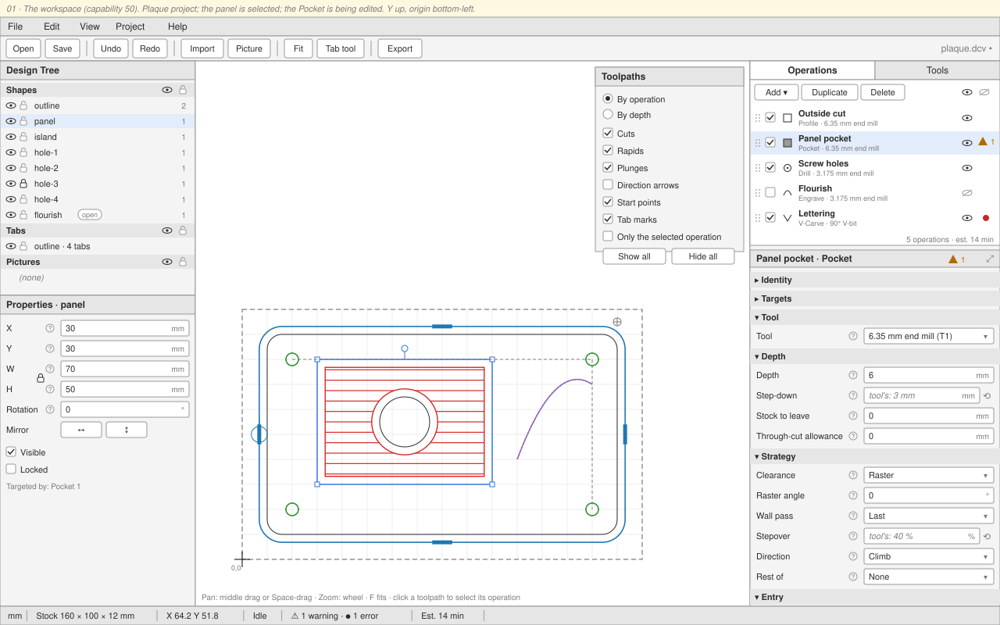

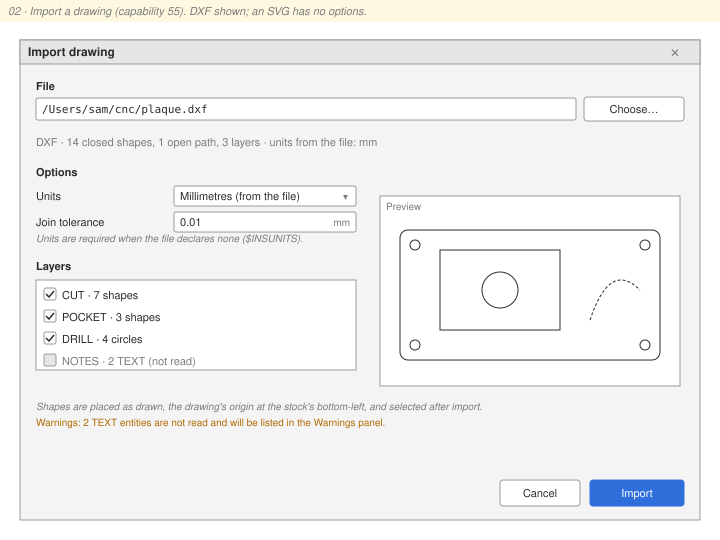

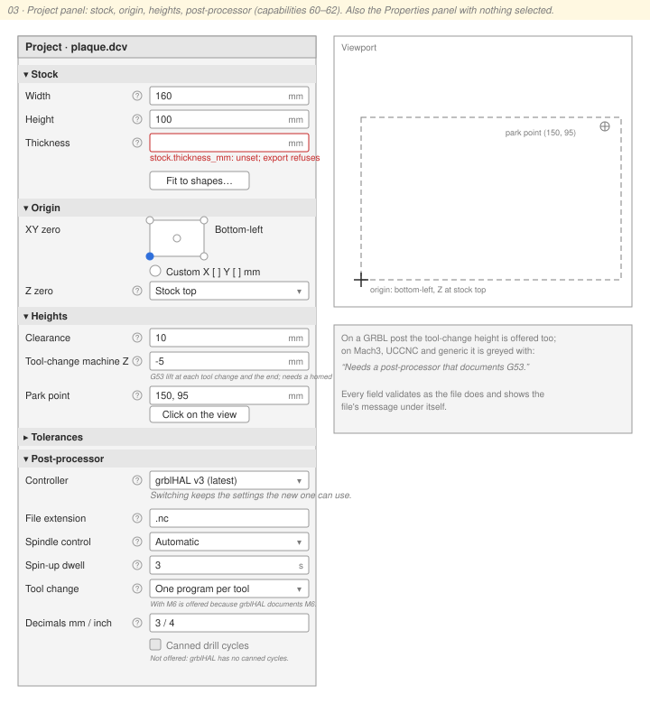

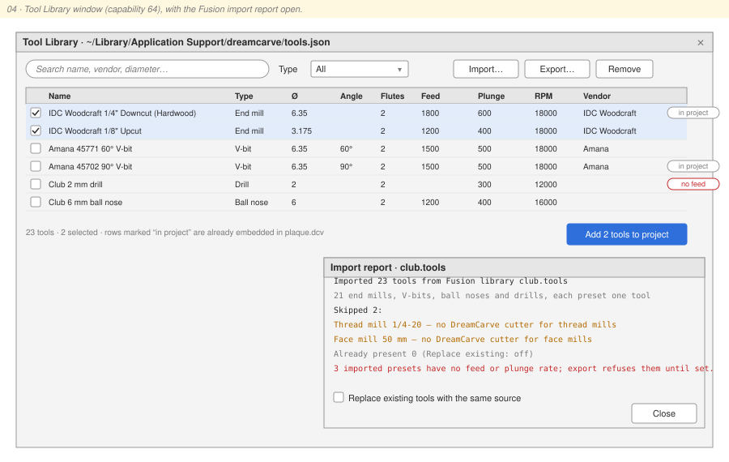

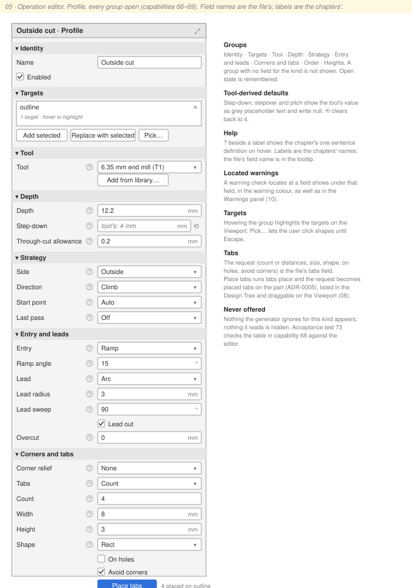

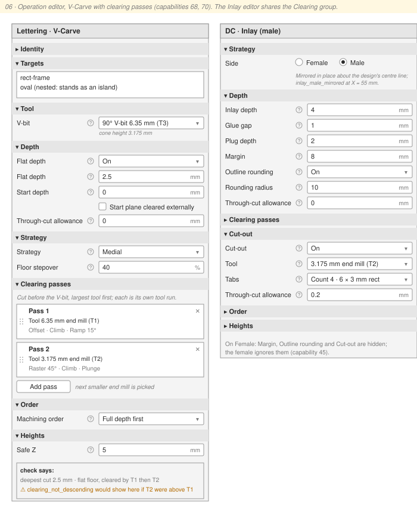

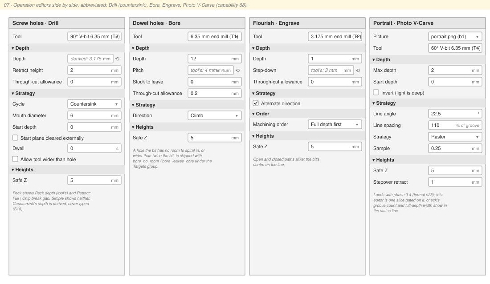

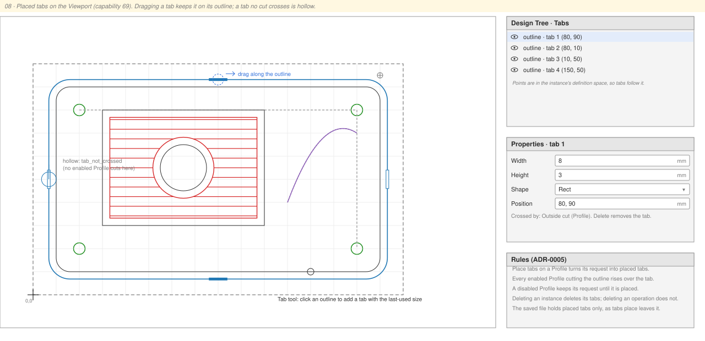

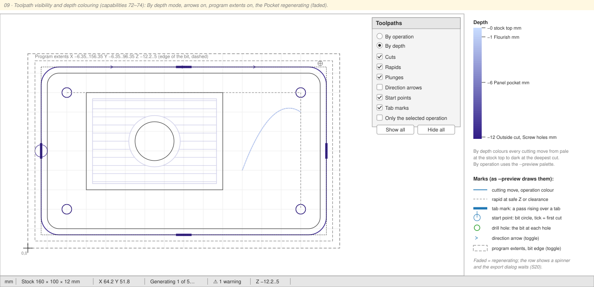

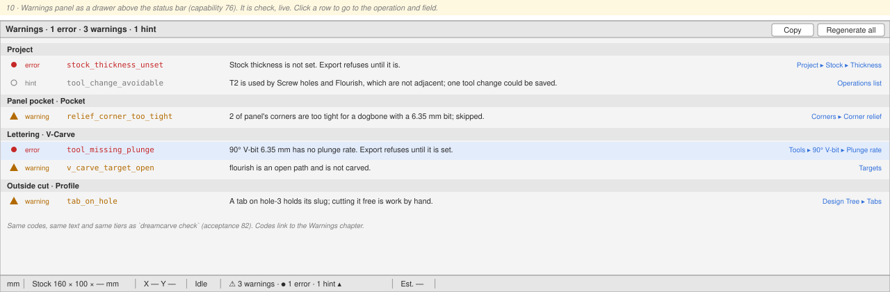

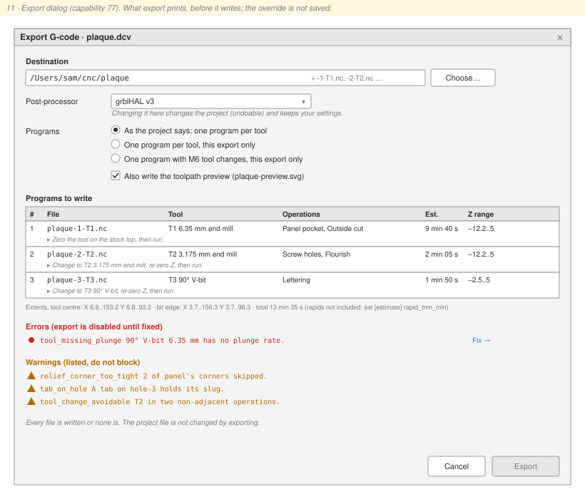

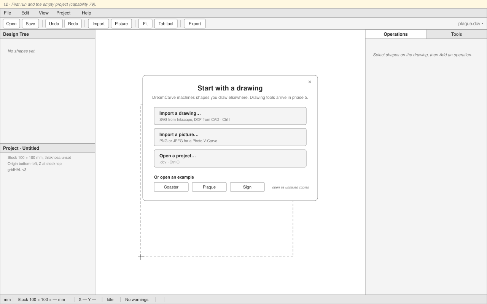
